# Reproduction of Carbonneau et al. (2026): a complete account of the analysis, step by step

| | |
|---|---|
| **Paper** | Carbonneau A., Tremblay J.-P., Normandeau E., Ferchaud A.-L., Bernatchez L., April J. (2026). *Evolutionary relationships between landlocked and anadromous Atlantic Salmon populations in the North Shore region of the Gulf of St. Lawrence.* Canadian Journal of Fisheries and Aquatic Sciences 83: 1-15. doi:10.1139/cjfas-2025-0204 |
| **Authors' data and code** | Dryad doi:10.5061/dryad.v6wwpzh7v (genotypes, 8 R scripts, 18 R functions, one saved result) |
| **What this document is** | One document that explains the paper, the data, every step that we ran on the cluster, what each step found and how it compares with the paper, the problems found in the paper or its code, and what we did not do. It is meant to be read by one person from start to end, or opened at one step. Nothing outside this file is needed to follow it: figures are embedded and the key to every notation is in section 3. |
| **Work done** | 6 to 10 October 2026, on the fir cluster of the Digital Research Alliance of Canada; the work is in the folder `step_by_step_workflow/` of the project (one subfolder per step). The status of every step is in `STATUS.tsv`, deviations from the plan in `DEVIATIONS.tsv`. |
| **Files of this document** | `comprehensive_report_v3.md` and `comprehensive_report_v3.html` have the same content (figures embedded in both). Version 3 follows comments on version 2; versions 1 and 2 are kept unchanged (`comprehensive_report.md`, `.html` and `comprehensive_report_v2.md`, `.html`). |


> **This document contains collapsible blocks.** A closed block shows only a title line with a small triangle in front of it. Click the title (or the triangle) to open the block, and click again to close it. Long tables, folder trees, explanations of methods and the original notes of the steps are in such blocks, so that the main text stays short. In the markdown file the blocks are written as HTML 'details' elements, which GitHub and most viewers display in the same way.


<details>
<summary>How to read this document (collapsible sections, notation, conventions)</summary>

* Blocks that start with a small triangle (like this one) are **collapsible**: click the title to open or close them (see the note above).
* `[AUTHORS']` marks something the authors published or provided; `[OURS]` marks something produced in this project.
* **Levels of reproducibility** (T1 to T4) say how closely a step reproduced the authors' results; **classes of script** (A to D) say how a script relates to the authors' code. Both are explained in section 3.
* "**As coded by the authors**" means the result of the authors' own code run exactly as they wrote it. "**Our correction**" means our computation after fixing a problem in their code or data handling. Where a problem was found, the step explains it in plain words.
* Site names follow the paper (PUY-R, COR-A, ...); the codes used inside the data files (PER_R, VIC_R, ...) are in the table of section 1.4.
* The authors' own files (their saved results and derived tables) were **never used as inputs** of our runs; they are used only to compare our results with theirs. Each step lists its real inputs separately from the files used only for comparison.

</details>


**Contents**

  * [1. The paper in brief](#1-the-paper-in-brief)
    * [1.1 What the paper is about](#11-what-the-paper-is-about)
    * [1.2 The two ideas being compared](#12-the-two-ideas-being-compared)
    * [1.3 What the paper wants to show (claims C1 to C9)](#13-what-the-paper-wants-to-show-claims-c1-to-c9)
    * [1.4 Sites and codes](#14-sites-and-codes)
  * [2. The data](#2-the-data)
    * [2.1 How the genotypes were obtained (not in the deposit)](#21-how-the-genotypes-were-obtained-not-in-the-deposit)
    * [2.2 The raw genotype table](#22-the-raw-genotype-table)
    * [2.3 Two hand-made inputs that are part of the primary information](#23-two-hand-made-inputs-that-are-part-of-the-primary-information)
    * [2.4 What the deposit contains, and what it does not](#24-what-the-deposit-contains-and-what-it-does-not)
  * [3. Key to terms and notations](#3-key-to-terms-and-notations)
  * [4. The workflow: what we did and how](#4-the-workflow-what-we-did-and-how)
    * [4.1 The map](#41-the-map)
    * [4.2 The steps](#42-the-steps)
    * [4.3 What is inside a step folder, and what counts as an input](#43-what-is-inside-a-step-folder-and-what-counts-as-an-input)
    * [4.4 How each job checks itself](#44-how-each-job-checks-itself)
    * [4.5 Software and compute](#45-software-and-compute)
  * [5. Step by step](#5-step-by-step)
    * [Step 00: Raw inputs](#step-00-raw-inputs)
    * [Step 01: Filter the main data set](#step-01-filter-the-main-data-set)
    * [Step 02: Filter the data set with the Rimouski outgroup](#step-02-filter-the-data-set-with-the-rimouski-outgroup)
    * [Step 03: Formats](#step-03-formats)
    * [Step 04: Audit of the nine Puyjalon fish removed as clustering with Romaine](#step-04-audit-of-the-nine-puyjalon-fish-removed-as-clustering-with-romaine)
    * [Step 05: Principal component analyses (Figs 2, S2, S3, S4)](#step-05-principal-component-analyses-figs-2-s2-s3-s4)
    * [Step 06: Audit of the four reassigned fish](#step-06-audit-of-the-four-reassigned-fish)
    * [Step 07: Linkage disequilibrium and identity by missingness](#step-07-linkage-disequilibrium-and-identity-by-missingness)
    * [Step 08: STRUCTURE (Figs 3, S5, S9)](#step-08-structure-figs-3-s5-s9)
    * [Step 09: FST as coded by the authors (Fig. S6)](#step-09-fst-as-coded-by-the-authors-fig-s6)
    * [Step 10: FST after our correction](#step-10-fst-after-our-correction)
    * [Step 11: Trees as coded by the authors (Fig. 4 and Fig. S7)](#step-11-trees-as-coded-by-the-authors-fig-4-and-fig-s7)
    * [Step 12: Tree variants](#step-12-tree-variants)
    * [Step 13: Directional gene flow (divMigrate, Fig. 5)](#step-13-directional-gene-flow-divmigrate-fig-5)
    * [Step 14: Genetic diversity (Table S2)](#step-14-genetic-diversity-table-s2)
    * [Step 15: Effective population size (Table S2 Ne, Table S3)](#step-15-effective-population-size-table-s2-ne-table-s3)
    * [Step 16: Alleles shared by resident sites and absent from anadromous sites (Fig. S8)](#step-16-alleles-shared-by-resident-sites-and-absent-from-anadromous-sites-fig-s8)
    * [Step 17: Approximate Bayesian computation (Table S1, Figs S1, S10, S11)](#step-17-approximate-bayesian-computation-table-s1-figs-s1-s10-s11)
    * [Step 18: Synthesis](#step-18-synthesis)
  * [6. What the whole analysis says](#6-what-the-whole-analysis-says)
    * [6.1 In short](#61-in-short)
    * [6.2 The nine claims of the paper, revisited](#62-the-nine-claims-of-the-paper-revisited)
  * [7. The problems found, in plain words](#7-the-problems-found-in-plain-words)
  * [8. How the corrected FST pattern and the ABC preference for a common origin fit together](#8-how-the-corrected-fst-pattern-and-the-abc-preference-for-a-common-origin-fit-together)
  * [9. What was not done, the deviations, and how to continue](#9-what-was-not-done-the-deviations-and-how-to-continue)
    * [9.1 What was not done, and why](#91-what-was-not-done-and-why)
    * [9.2 Options for further work (none started)](#92-options-for-further-work-none-started)
    * [9.3 Deviations from the plan](#93-deviations-from-the-plan)
    * [9.4 How to continue](#94-how-to-continue)
  * [Appendix A. The step notes](appendix_step_notes.md)


---

## 1. The paper in brief

### 1.1 What the paper is about

Atlantic Salmon (*Salmo salar*) are usually **anadromous**: they hatch in a river, migrate to the sea to feed and grow, and return to the river to spawn. Some populations are **resident** (also called **landlocked**): the fish spend their whole life in fresh water, in a lake or in a river section above a waterfall. The paper studies five rivers on the **North Shore of the Gulf of St. Lawrence** (Québec, Canada). In four of them there is an anadromous and a resident site, so the two tactics can be compared inside the same watershed; the fifth (Etamamiou) has only an anadromous site.

The authors read **microsatellite** markers (short repeated stretches of DNA whose length varies between individuals; each length is an *allele*) in 385 fish of known tactic (189 resident, 196 anadromous), plus 500 juveniles of one river whose tactic cannot yet be known and 50 fish from a distant river (Rimouski) that serve as an outgroup. From the allele lengths they ask how similar or different the sites are, and how the resident populations arose.

### 1.2 The two ideas being compared

1. **Independent residency origin** (the textbook view). After the last ice age, in each river a group of salmon became cut off from the sea and then slowly diverged from the anadromous fish **of its own river** by genetic drift. A resident population should therefore be genetically closest to the anadromous fish of its own river, and residents of different rivers should differ from each other at least as much as each differs from its own anadromous neighbour.
2. **Common residency origin** (the authors' alternative). The residents of the different rivers share an ancestor that separated once from the anadromous fish. Residents of different rivers should then look more like each other than like their own anadromous neighbours.

### 1.3 What the paper wants to show (claims C1 to C9)

We number the paper's claims C1 to C9 and use these numbers throughout.

| Claim | Statement |
|---|---|
| **C1** | Within each river, resident and anadromous fish are clearly different genetically. |
| **C2** | The size of that difference follows how easy it is to pass the barrier between the sites; the authors expect the order PUY-R, MUS-LAK-R, AGU-R, MUS-RIV-R, COR-R from least to most gene flow. |
| **C3** | Residents have less genetic diversity and a smaller effective population size (Ne) than anadromous fish. |
| **C4** | The anadromous sites are very similar to each other, because they exchange migrants. |
| **C5** | On the regional scale, residents of different rivers are about as similar to each other as to their local anadromous population (PUY-R is less different from the residents of AGU and MUS than from PUY-A). This is read as evidence against strictly independent origins. |
| **C6** | A formal model comparison (approximate Bayesian computation) prefers the common-origin scenario (posterior probability 0.9971) to the independent-origin scenario (0.0029). |
| **C7** | Some gene flow persists across the barriers, so complete isolation is not needed to keep the resident tactic. |
| **C8** | In the Corneille river, young fish above and below the falls show no genetic structure. |
| **C9** | For management: if stocking is needed, nearby resident populations may be a better source than the local anadromous population. |

The authors state that their ABC models contain no gene flow and call the demographic inference exploratory.

### 1.4 Sites and codes


| Paper code | Data code | Meaning |
|---|---|---|
| PUY-R | PER_R | Puyjalon watershed, resident site (fish caught in the Perugia River) |
| PUY-A | PUY_A | Puyjalon River, anadromous smolts caught downstream (a random 50 of 152 fish) |
| COR-R | COR_R | Corneille River, resident site above the Tanguay Lake falls |
| COR-A | COR_A | Corneille River, anadromous adults below the falls |
| COR-JUV-UP / COR-JUV-DOWN | COR_J_UP / COR_J_DO | Corneille parr and smolts above / below the falls (tactic unknown); 271 and 229 fish |
| AGU-R | VIC_R | Aguanish watershed, resident site (fish caught in Victor Lake) |
| AGU-A | AGU_A | Aguanish River, anadromous adults |
| MUS-LAK-R | MUS_LR | Musquaro, residents of the lake above an impassable fall |
| MUS-RIV-R | MUS_RR | Musquaro, residents of the river between that fall and the sea |
| MUS-A | MUS_A | Musquaro River, anadromous adults |
| MUS-R | MUS_R | the two Musquaro resident samples pooled (used in the migration analysis and the ABC) |
| ETA-A | ETA_A | Etamamiou River, anadromous adults (no resident site) |
| RIM-A | RIM_A | Rimouski River, anadromous; the outgroup of the trees |
| (not in the paper) | ROM_A | Romaine River smolts (113 fish in the raw table; removed in the first lines of the filtering scripts) |


In a site code, **A** means anadromous and **R** resident; PUY, COR, AGU, MUS, ETA and RIM are the watersheds (Puyjalon, Corneille, Aguanish, Musquaro, Etamamiou, Rimouski). The sample sizes our pipeline obtains (after the filters and the reassignment of four fish, section 5) equal those of the paper's Table 1:


<details>
<summary>Table of sites: fish per site, years and life stage</summary>

| Site | Fish in our table | Fish in the paper's Table 1 | First year | Last year | Life stage |
|---|---|---|---|---|---|
| AGU-A | 47 | 47 | 2004 | 2004 | Adult |
| COR-A | 41 | 41 | 2015 | 2018 | Adult |
| COR-J-DO | 229 | 229 | 2014 | 2020 | Parr/Smolt |
| COR-J-UP | 271 | 271 | 2012 | 2020 | Parr/Smolt |
| COR-R | 15 | 15 | 2015 | 2018 | Adult |
| ETA-A | 23 | 23 | 2004 | 2004 | Adult |
| MUS-A | 35 | 35 | 2004 | 2004 | Adult |
| MUS-LAK-R | 36 | 36 | 2004 | 2004 | Adult |
| MUS-RIV-R | 44 | 44 | 2004 | 2004 | Adult |
| PUY-R | 49 | 49 | 2018 | 2018 | not recorded |
| PUY-A | 50 | 50 | 2013 | 2015 | Smolt |
| AGU-R | 45 | 45 | 2004 | 2004 | not recorded |

The ten sites of known tactic hold 385 fish; the two juvenile groups of Corneille hold 500; together 885 fish. 'not recorded' means that the life stage is blank in the raw table.

</details>


---

## 2. The data

Everything the paper reports is derived from **one table of microsatellite genotypes**. This section says how that table was produced (before the deposit, so not reproducible from it) and what it contains.

### 2.1 How the genotypes were obtained (not in the deposit)

Fish were sampled between 2004 and 2020 in five watersheds. The migratory tactic was called from body size, colour and capture location (residents above barriers by location alone); a subsample was checked on scales. DNA was extracted with two different protocols for different sites, and 52 microsatellite loci of a published Atlantic Salmon panel were amplified in two multiplex reactions and sequenced on an Illumina MiSeq. Allele sizes were called with the program MEGASAT (minimum depth of 16 reads per allele). The Puyjalon smolts, caught below the confluence with the Romaine River, were assigned to their river with the R package assignPOP using an unpublished reference set.

**The result is a table with one row per fish and two allele sizes per locus.** The sequencing reads, the MEGASAT output, the scale data and the assignPOP reference set are **not in the deposit**; our reproduction therefore starts from the genotype table.

### 2.2 The raw genotype table

* One text file, `AllDataCombined_NotFiltered.txt`: **1,612 fish** (rows) and 122 columns = 20 descriptive columns (identifier, tactic, river, site, year, life stage, size, sex, ...) and **102 allele columns**, i.e. **51 loci** with two columns each (`Locus` and `Locus_b`). Allele sizes are in base pairs. 8.2 % of the allele cells are missing (a failed genotype is missing at both of its cells).
* The fish identifier has the form `TacticCode_Number_SiteCode_Year` (for example `AN_0047_AGU_2004`; `AN` anadromous, `LA` landlocked, `UN` unknown).
* The **20 descriptive columns** are listed below with their meaning and with what they contain in the raw table; the **43 loci** that are kept are listed after them, with the alleles found.
* The first part of the work removes the Romaine and (for the trees) adds the Rimouski fish, filters fish and loci with too much missing data and keeps **43 loci**.


<details>
<summary>The 20 descriptive columns of the genotype table: meaning and content (raw table of 1,612 fish)</summary>

The deposit's README lists the 20 columns but does not define them; the meanings below are ours, read from the values. The analyses mainly use the identifier, the tactic, the site (`River_Site`) and, in the sampling-year check, the year; most of the other columns are only carried along by the scripts.

| Column | Meaning | Missing cells (of 1,612 fish) | Values (number of fish) |
|---|---|---|---|
| ID | Identifier of the fish: tactic code, running number, site code, year (for example AN_0047_AGU_2004; AN anadromous, LA landlocked, UN unknown). | 0 | 1,612 different identifiers |
| Ecotype | Migratory tactic as called by the authors from body size, colour and place of capture: Anadromous, Landlock, or Unknown (the juveniles). | 0 | Anadromous (897), Landlock (198), Unknown (517) |
| Ecotype_Num | The same tactic as a number. | 0 | 1 (198), 2 (897), 3 (517) |
| River | River of capture. The resident sites of two watersheds carry the name of their own river: Perugia (PUY-R, in the Puyjalon watershed) and Victor (AGU-R, in the Aguanish watershed). | 0 | Aguanish (46), Corneille (577), Etamamiou (24), Musquaro (117), Perugia (50), Puyjalon (166), Rimouski (471), Romaine (113), Victor (48) |
| River_Num | The river as a number. | 0 | 1 (50), 2 (166), 3 (577), 5 (48), 6 (46), 7 (117), 10 (24), 99 (113), 100 (471) |
| Site | Place of capture inside the river system (for example upstream or downstream of a barrier). | 0 | Aguanish (46), Downstream (283), Etamamiou (24), Lake (36), Perugia (50), Puyjalon (166), Rimouski (471), River (81), Romaine (113), Upstream (294), Victor (48) |
| Year | Year of capture. | 0 | 2004 (235), 2012 (25), 2013 (147), 2014 (250), 2015 (168), 2018 (533), 2019 (122), 2020 (132) |
| Month | Month of capture (often blank). | 1,252 | 6 (105), 7 (1), 8 (254) |
| Day | Day of capture (often blank). | 1,252 | numbers from 3 to 30 |
| Num_Unique | A number that is different for almost every fish (running number); the deposit does not define it, and the scripts only carry it along. | 0 | numbers from 1 to 5470 |
| Life_Stage | Life stage at capture (for example adult, smolt, parr). | 98 | Adult (718), Parr (411), Smolt (385) |
| Life_Stage_Num | The life stage as a number. | 98 | 1 (411), 2 (385), 3 (718) |
| Length_F_mm | Length of the fish in millimetres (F: probably fork length; the deposit does not define it). | 1,506 | numbers from 138 to 248 |
| Length_T_mm | Length of the fish in millimetres (T: probably total length; the deposit does not define it). | 1,198 | numbers from 32 to 241 |
| Weigth_g | Weight in grams (the column name is spelled this way in the data). | 1,124 | numbers from 0.25 to 137.3 |
| Sex | Sex of the fish, when recorded. | 1,304 | F (177), M (131) |
| Age | Age of the fish in years, when recorded. | 1,295 | 0 (98), 1 (102), 2 (38), 3 (73), 4 (6) |
| Age_Ext | A mark attached to the age (+ or .); the deposit does not define it, and the scripts only carry it along. | 1,417 | + (181), . (14) |
| River_Site | **The site code used by every analysis** (PER_R, PUY_A, COR_R, ...; section 1.4). | 0 | AGU_A (46), COR_A (42), COR_J_DO (241), COR_J_UP (276), COR_R (18), ETA_A (24), MUS_A (35), MUS_LR (36), MUS_RR (46), PER_R (50), PUY_A (166), RIM_A (471), ROM_A (113), VIC_R (48) |
| River_Site_Num | The site code as a number. | 0 | 1 (50), 2 (166), 3 (18), 4 (42), 5 (48), 6 (46), 7 (36), 8 (46), 9 (35), 10 (24), 11 (241), 12 (276), 99 (113), 100 (471) |

</details>


<details>
<summary>The 43 loci kept after filtering: chromosome, number of alleles and the alleles found</summary>

Counted in the table of 885 fish after filtering and before imputation (our table of step 01, which equals the authors'). **Our count:** 347 alleles in all, 3 to 26 per locus, mean 8.07. **The paper** (Methods) states 3 to 27 alleles per locus, a mean of 8 and 348 alleles in all. The paper's maximum of 27 alleles appears only in the table that also holds all the Puyjalon fish (the 987-fish table: 350 alleles, 3 to 27 per locus, mean 8.14; it differs from the 885-fish table at `Ssa_14_5`, `Ssa_15_3`, `Ssa_18_7` only), so the paper probably counts that table; its numbers agree with ours to within one to three alleles.

| Locus | Chromosome | Number of alleles | Alleles (size in base pairs), smallest to largest |
|---|---|---|---|
| NGS_SSsp2210 | not given in the name | 8 | 21, 25, 33, 37, 41, 45, 49, 65 |
| NGS_SsaD486 | not given in the name | 9 | 28, 32, 36, 40, 44, 48, 52, 56, 64 |
| Ssa_1_7 | 1 | 5 | 46, 49, 52, 55, 58 |
| Ssa_10_1 | 10 | 4 | 28, 37, 40, 43 |
| Ssa_10_2 | 10 | 6 | 45, 48, 51, 54, 57, 60 |
| Ssa_11_2 | 11 | 10 | 43, 49, 52, 55, 58, 64, 70, 73, 76, 79 |
| Ssa_11_3 | 11 | 9 | 42, 51, 54, 57, 60, 63, 66, 69, 72 |
| Ssa_11_5 | 11 | 5 | 37, 46, 49, 52, 55 |
| Ssa_11_8 | 11 | 6 | 64, 67, 70, 73, 76, 79 |
| Ssa_12_5 | 12 | 7 | 57, 60, 63, 66, 69, 72, 78 |
| Ssa_13_8 | 13 | 5 | 36, 42, 45, 48, 51 |
| Ssa_14_2 | 14 | 8 | 30, 36, 42, 45, 48, 54, 57, 60 |
| Ssa_14_3 | 14 | 4 | 64, 67, 70, 73 |
| Ssa_14_5 | 14 | 8 | 21, 30, 33, 36, 39, 42, 45, 48 |
| Ssa_14_6 | 14 | 5 | 39, 42, 45, 51, 54 |
| Ssa_14_8 | 14 | 10 | 54, 57, 60, 63, 66, 69, 72, 75, 81, 87 |
| Ssa_15_1 | 15 | 3 | 43, 46, 49 |
| Ssa_15_3 | 15 | 26 | 37, 43, 46, 47, 49, 52, 53, 55, 56, 58, 59, 61, 62, 64, 65, 67, 68, 70, 73, 76, 77, 79, 83, 86, 89, 94 |
| Ssa_15_7 | 15 | 11 | 49, 52, 55, 61, 64, 67, 70, 73, 76, 79, 82 |
| Ssa_17_1 | 17 | 13 | 37, 40, 43, 46, 49, 52, 55, 58, 61, 64, 67, 70, 73 |
| Ssa_18_7 | 18 | 5 | 56, 62, 68, 71, 77 |
| Ssa_19_1 | 19 | 24 | 42, 45, 48, 51, 54, 56, 57, 59, 60, 62, 63, 65, 66, 68, 69, 71, 72, 74, 75, 77, 80, 81, 83, 86 |
| Ssa_19_2 | 19 | 5 | 29, 32, 38, 41, 44 |
| Ssa_19_3 | 19 | 5 | 49, 52, 55, 58, 61 |
| Ssa_2_1 | 2 | 7 | 28, 31, 34, 37, 40, 43, 46 |
| Ssa_2_2 | 2 | 6 | 35, 38, 41, 44, 47, 50 |
| Ssa_2_7 | 2 | 8 | 16, 31, 34, 37, 40, 43, 46, 49 |
| Ssa_21_2 | 21 | 10 | 60, 63, 66, 69, 72, 75, 78, 81, 84, 90 |
| Ssa_22_2 | 22 | 15 | 40, 48, 51, 54, 57, 60, 63, 66, 69, 72, 75, 78, 81, 84, 87 |
| Ssa_22_5 | 22 | 13 | 50, 53, 56, 59, 62, 65, 68, 71, 74, 77, 80, 83, 86 |
| Ssa_22_9 | 22 | 7 | 52, 55, 58, 61, 64, 67, 70 |
| Ssa_22_d31 | 22 | 15 | 26, 30, 32, 34, 36, 38, 40, 42, 44, 48, 50, 52, 54, 56, 58 |
| Ssa_25_11 | 25 | 6 | 39, 42, 48, 51, 54, 57 |
| Ssa_25_2 | 25 | 8 | 36, 39, 42, 45, 48, 51, 54, 57 |
| Ssa_26_1 | 26 | 11 | 33, 45, 48, 51, 54, 57, 60, 63, 66, 69, 72 |
| Ssa_4_d44 | 4 | 6 | 31, 33, 35, 37, 39, 41 |
| Ssa_5_2 | 5 | 3 | 43, 49, 52 |
| Ssa_5_6 | 5 | 5 | 74, 77, 86, 89, 92 |
| Ssa_6_2 | 6 | 4 | 40, 43, 46, 49 |
| Ssa_6_7 | 6 | 3 | 45, 51, 54 |
| Ssa_7_12 | 7 | 7 | 30, 36, 45, 48, 51, 54, 60 |
| Ssa_9_3 | 9 | 6 | 16, 31, 37, 40, 46, 52 |
| Ssa_9_8 | 9 | 6 | 28, 31, 34, 37, 40, 43 |

</details>


### 2.3 Two hand-made inputs that are part of the primary information

1. **Nine Puyjalon fish to exclude** (file `PUY_Ind_Cluster_With_ROM_To_Remove.txt`, nine identifiers). The deposit's description says they cluster with Romaine-type fish in a STRUCTURE analysis; the paper's Methods do not mention them. Step 04 looks at them from the data.
2. **Four fish moved to another site** after the PCA (their identifiers are written inside the authors' scripts): AN_1532_UN_2018 from COR-A to COR-R; LA_0146_VIC_2004 from AGU-R to AGU-A; LA_0021_MUR_2004 and LA_0029_MUR_2004 from MUS-RIV-R to MUS-A. The paper calls them first-generation migrants. Step 06 looks at them from the data.

Both lists are taken **as the authors give them** in every main step ("declared inputs").

### 2.4 What the deposit contains, and what it does not

* **Contains:** the raw table and the two lists; derived tables made by the authors' scripts (filtered, imputed, reassigned, different formats); eight R scripts (filtering, formats, PCA, trees, directional gene flow, FST) and 18 small functions; one saved analysis result (the directional gene-flow matrices behind Fig. 5, an `.RData` file); four genotype tables saved as R objects of the genind format (`.RDS` files). The R objects are described below.
* **Does not contain:** the sequencing reads and allele-calling output; STRUCTURE input, settings and output; the DIYABC project; NeEstimator input and output; scripts for the diversity table (Table S2), the tests, the private alleles, the juvenile FST, the map and the year-effect PCA; a record of the software versions. These steps were rebuilt by us from the paper's text and are marked as such.

**The deposit.** In this document 'the deposit' is the authors' data package on Dryad (<https://datadryad.org/dataset/doi:10.5061/dryad.v6wwpzh7v>, doi:10.5061/dryad.v6wwpzh7v), downloaded as one zip file and unzipped. It is kept in one folder outside the step folders; the steps link to its files and never change them. The tree below shows the folder as downloaded (the command is explained in section 4.3).


<details>
<summary>Tree of the deposit as downloaded and unzipped (folders Data, Scripts, Functions, AnalysisResults)</summary>

```
deposit/
├── AnalysisResults
│   └── DirMig_EcoSure_MusPooled_Reass_GST_10000_Boots_Forward.RData
├── Data
│   ├── AllDataCombined_NotFiltered.txt
│   ├── ALLELE_Filtered_Individuals885_Loci43_REASSIGNED_IND_FINAL.txt
│   ├── ALLELE_Filtered_Individuals885_Loci43_REASSIGNED_IND_IMPUTED_FINAL.txt
│   ├── ALLELE_Filtered_Individuals936_Loci40_REASSIGNED_IND_FINAL_Rimouski.txt
│   ├── ALLELE_Filtered_Individuals987_Loci43_ALL_PUY_REASSIGNED_IND_IMPUTED_FINAL.txt
│   ├── All_Rivers_All_PUY_Dataset_Filtered_Balanced_Reassigned.txt
│   ├── All_Rivers_All_PUY_Dataset_Filtered_Balanced.txt
│   ├── All_Rivers_All_PUY_Dataset_Filtered_Imputed_Balanced_Reassigned.txt
│   ├── All_Rivers_All_PUY_Dataset_Filtered_Imputed_Balanced.txt
│   ├── All_Rivers_Dataset_Filtered_Balanced_Reassigned_Rimouski.txt
│   ├── All_Rivers_Dataset_Filtered_Balanced_Reassigned.txt
│   ├── All_Rivers_Dataset_Filtered_Balanced_Rimouski.txt
│   ├── All_Rivers_Dataset_Filtered_Balanced.txt
│   ├── All_Rivers_Dataset_Filtered_Imputed_Balanced_Reassigned_Rimouski.txt
│   ├── All_Rivers_Dataset_Filtered_Imputed_Balanced_Reassigned.txt
│   ├── All_Rivers_Dataset_Filtered_Imputed_Balanced_Rimouski.txt
│   ├── All_Rivers_Dataset_Filtered_Imputed_Balanced.txt
│   ├── GENEPOP_Individuals385_Loci43_River_Site_IMPUTED_MUS_POOLED.txt
│   ├── GENEPOP_Individuals385_Loci43_River_Site_IMPUTED_REASS_MUS_POOLED.txt
│   ├── GENIND_Filtered_Individuals885_Loci43_IMPUTED_FINAL.RDS
│   ├── GENIND_Filtered_Individuals885_Loci43_REASSIGNED_IND_IMPUTED_FINAL.RDS
│   ├── GENIND_Filtered_Individuals936_Loci40_REASSIGNED_IND_IMPUTED_FINAL_Rimouski.RDS
│   ├── GENIND_Filtered_Individuals936_Loci41_IMPUTED_FINAL.RDS
│   ├── GENOTYPE_Filtered_Individuals885_Loci43_IMPUTED_FINAL.txt
│   ├── GENOTYPE_Filtered_Individuals885_Loci43_REASSIGNED_IND_IMPUTED_FINAL.txt
│   ├── GENOTYPE_Filtered_Individuals936_Loci40_REASSIGNED_IND_IMPUTED_FINAL_Rimouski.txt
│   ├── GENOTYPE_Filtered_Individuals936_Loci41_IMPUTED_FINAL.txt
│   └── PUY_Ind_Cluster_With_ROM_To_Remove.txt
├── Functions
│   ├── allele2genotype.R
│   ├── allele_freq.R
│   ├── allele_rich.R
│   ├── calculate_marker_missing_percentage.R
│   ├── create_genind.R
│   ├── delta_K.R
│   ├── export_allele_format.R
│   ├── fst_calculation.R
│   ├── fst_marker.R
│   ├── genepop_creator.R
│   ├── het.R
│   ├── impute.R
│   ├── kp_ind.R
│   ├── ld_test_locus.R
│   ├── mean_membership.R
│   ├── na_heatmap.R
│   ├── p100_missing.R
│   └── pca.R
├── README.md
└── Scripts
    ├── 01_FilteringData.R
    ├── 02_FilteringData_Rimouski.R
    ├── 03_Create_Format_Data.R
    ├── 04_PCA_MS.R
    ├── 05_PCA_MatSupp.R
    ├── 06_Tree_MS.R
    ├── 07_MigrationDirectionality_MS.R
    └── 08_FST_MS.R

5 directories, 56 files
```

</details>


<details>
<summary>The R objects of the deposit (.RDS and .RData files): what each one holds</summary>

An `.RDS` file stores **one** R object (here a genind, see section 3.1); an `.RData` file stores one or several named objects. R reads them with `readRDS()` and `load()`. The deposit's README describes the four genind objects as made by `create_genind.R` from the genotype tables. The authors' derived files are used only to check our own tables and results, never as inputs (section 4.3).

| File | Type of file | What it holds |
|---|---|---|
| `Data/GENIND_Filtered_Individuals885_Loci43_IMPUTED_FINAL.RDS` | .RDS (one R object) | genind: 885 fish x 43 loci, missing genotypes imputed, the four fish at their original sites (not reassigned); 9 populations |
| `Data/GENIND_Filtered_Individuals885_Loci43_REASSIGNED_IND_IMPUTED_FINAL.RDS` | .RDS | genind: the same 885 fish x 43 loci with the four fish moved to their new sites (reassigned); the object behind the PCA and the GENEPOP files |
| `Data/GENIND_Filtered_Individuals936_Loci40_REASSIGNED_IND_IMPUTED_FINAL_Rimouski.RDS` | .RDS | genind: 936 fish (the 885 plus the Rimouski outgroup) x 40 loci, imputed, reassigned; 10 populations; the object behind the trees |
| `Data/GENIND_Filtered_Individuals936_Loci41_IMPUTED_FINAL.RDS` | .RDS | genind: 936 fish x 41 loci, imputed, not reassigned; **no script of the deposit makes or reads it**, so no result depends on it |
| `AnalysisResults/DirMig_EcoSure_MusPooled_Reass_GST_10000_Boots_Forward.RData` | .RData (can hold several R objects) | one object, `mig_all_reass`: a list of 9 x 9 matrices of relative gene flow between the nine populations (`gRelMig`) and of the same matrix keeping only the values that the 10,000 bootstraps call different from zero (`gRelMigSig`); the saved result of the divMigrate run with the GST statistic behind Fig. 5 |

</details>


---

## 3. Key to terms and notations


<details>
<summary>3.1 Fish, sites and genetics (terms used in the text)</summary>

| Term | Meaning |
|---|---|
| anadromous / resident (landlocked) | The life-history tactic. Anadromous fish migrate to the sea to feed and return to the river to spawn; resident (landlocked) fish stay in fresh water all their life. |
| watershed, site, population | A watershed is a river basin. A **site** is one sample of fish from one place (for example PUY-A, the anadromous fish of the Puyjalon river); the analyses treat each site as one population. |
| microsatellite | A short stretch of DNA made of a repeated unit (for example CA CA CA ...). The number of repeats differs between fish, so the stretch has different lengths; the length is measured in base pairs (bp). |
| locus (plural loci) | One marker, i.e. one microsatellite at one place of the genome. The paper uses 43 loci. A name such as `Ssa_14_8` means: chromosome 14, marker number 8 (`NGS_SSsp2210` and `NGS_SsaD486` do not give a chromosome in the name). |
| allele | One length variant of a locus, written as its size in base pairs (for example 45 or 49). Different fish carry different alleles. |
| genotype, homozygous, heterozygous | The pair of alleles that one fish carries at one locus, one inherited from each parent (for example 45/49). The fish is **homozygous** at the locus when the two alleles are equal (45/45) and **heterozygous** when they differ (45/49). |
| allele frequency (AF) | In one population and at one locus: the number of copies of the allele found among the fish, divided by the number of allele copies examined, which is **two per fish genotyped**. Example: 20 fish are genotyped, so 40 allele copies are examined; allele 45 is found 10 times; its frequency is 10 / 40 = 0.25 (25 %). The frequencies of all alleles of a locus add up to 1 (100 %). A fish with a missing genotype at the locus is left out of the count. |
| heterozygosity, Ho and He | **Observed heterozygosity (Ho)**: the percentage of fish that are heterozygous at a locus (12 of 40 fish: Ho = 0.30). **Expected heterozygosity (He, also called gene diversity)**: the probability that two allele copies drawn at random from the population differ, He = 1 - (sum over the alleles of the squared allele frequency). Two alleles at 0.5 each: He = 1 - (0.25 + 0.25) = 0.5; one allele at 0.9 and one at 0.1: He = 1 - (0.81 + 0.01) = 0.18. Both are computed at each locus and averaged over the loci. |
| allelic richness (AR) | The number of different alleles at a locus in a site, averaged over the loci. **Raw** richness counts the alleles found in the sample (it grows with the number of fish sampled). **Extrapolated** (rarefied) richness is the number of alleles expected if every site had the same small number of fish, so that sites with different sample sizes can be compared. |
| effective population size (Ne) | The number of breeding fish of an ideal population (equal numbers of males and females, random mating, constant size) that would lose genetic variation by chance as fast as the real population does. Ne is usually much smaller than the number of fish present, because few fish breed successfully; for example 10,000 fish may have an Ne of 100. A small Ne means fast drift. |
| genetic drift | Random change of allele frequencies from one generation to the next, because only some of the alleles are passed on to the offspring. It is faster in small populations; the expected loss of heterozygosity per generation is about 1 / (2 Ne). |
| gene flow, migrant | Movement of alleles between populations by migrants that breed there. Gene flow makes populations more alike; drift makes them different. |
| private allele | Usual meaning: an allele found in one population only. **In this paper (Fig. S8)**: an allele found in **at least two resident sites and in no anadromous site**, i.e. an allele that belongs to the residents but not to any anadromous site. An allele found in one resident site only is *not* private in the paper's sense. Step 16 applies the paper's definition and two variants. |
| null allele | A technical artefact, not a biological type of allele: an allele that fails to be read in the laboratory (for example because a mutation sits where the primer of the reaction binds, so that the copy is not amplified). A fish with one null allele looks homozygous for its other allele, and a fish with two null alleles looks like a failed (missing) genotype. Null alleles are one of the possible reasons for missing genotypes (step 14). |
| missing genotype, imputation | A genotype that failed in the laboratory is *missing*. **Imputation** replaces a missing allele by an allele drawn at random, with a probability equal to its frequency at the locus (over all fish of the table), so that analyses that cannot handle gaps can be run. Step 01. |
| genind | The data format of the R package adegenet: a table with one row per fish and one column per allele that records how many copies (0, 1 or 2) of that allele the fish carries, together with the fish names, their population and other labels (strata). The deposit stores such objects in `.RDS` files (one R object per file). |
| GENEPOP file | A text format in which the genotype of each fish is written as one number per locus (the two alleles written one after the other) and the fish are grouped by population. It is the input of several programs (NeEstimator, and the divMigrate function through an R conversion). |
| smolt, parr, outgroup | Parr are young salmon that live in the river; smolts are young salmon ready to go to sea. An **outgroup** is a population known to be only distantly related to the others, used to root a tree (here Rimouski). |

</details>


<details>
<summary>3.2 Statistics and methods (what each one is; each is explained in more detail in the step where it is first used)</summary>

| Term | Meaning |
|---|---|
| principal component analysis (PCA), PC 1, PC 2; percentage of total variation | A method that summarises the genotype table in a few new axes (principal components, PC). Every fish gets a score on each axis; fish with similar genotypes get similar scores, so a scatter plot of PC 1 against PC 2 shows which fish resemble each other. PC 1 is the axis along which the fish differ most, PC 2 the next one, and so on. The **percentage of total variation** printed in an axis label, for example PC 1 (22.17 %), is the percentage of all the variation in the table that lies along that axis. The authors' scripts and the R package they use (ade4) call it *inertia*; this document says 'percentage of total variation'. Step 05. |
| FST and its relatives (Hs, Ht, Dst, Fst′) | A number between 0 and 1 that says how much of the genetic diversity lies **between** populations. For a locus, **Hs** is the gene diversity (1 - sum of squared allele frequencies) inside a population, averaged over the populations compared; **Ht** is the gene diversity of all the populations pooled together; **Dst = Ht - Hs** is the diversity between populations; **FST = Dst / Ht**. FST is 0 when the populations have the same allele frequencies and 1 when they have no allele in common. **Fst′** (the version that the function used by the authors returns) first multiplies Dst by np / (np - 1), where np is the number of populations (2 for a pair), and then divides by Hs + Dst′; it gives larger values than FST and reaches 1 more easily. A third version, the Weir-Cockerham θ, estimates the same idea with a different correction for sample size. A worked example is in step 09. Steps 09 and 10. |
| STRUCTURE, K, ΔK | A program that groups fish into K clusters using only their genotypes: every fish receives a **membership** in each cluster (numbers between 0 and 1 that add up to 1), and the program searches for clusters in which the alleles are close to random mating. The user must choose K (how many clusters). **ΔK** is the statistic of Evanno and colleagues for choosing K: it looks at how much the log probability of the data changes from K - 1 to K to K + 1, relative to its variation between replicate runs; the K with the largest ΔK is taken as the best K. Step 08. |
| Edwards distance, NJ, UPGMA, bootstrap value, sister tips | The **Edwards distance** between two populations is computed from their allele frequencies: it is the square root of 1 minus the mean over the loci of the sum, over the alleles, of the square root of the product of the two frequencies (0 when the frequencies are identical; Edwards' angular distance as coded in adegenet). **NJ** (neighbour joining) and **UPGMA** are two methods that build a tree from a table of distances: NJ joins the two groups that are closest after correcting for the average distance of each group to all others and gives an unrooted tree; UPGMA joins the closest groups and assumes that all tips evolve at the same rate, which gives a rooted tree. A **bootstrap value** on a branch is the percentage of resampled data sets (here: loci drawn with replacement) in which the same group of tips appears: high values mean that the branch is stable. **Sister tips** (a 'cherry') are two tips whose nearest common ancestor is shared by no other tip. Steps 11 and 12. |
| divMigrate, relative gene flow | An R function (package diveRsity) that estimates the **direction** and relative size of gene flow between every pair of populations from allele frequencies. For each ordered pair it gives a number between 0 and 1 (the largest value of the matrix is set to 1), and a bootstrap says which values are different from zero. Step 13. |
| linkage disequilibrium (LD) | A non-random association of alleles at two loci: allele a of locus 1 occurs together with allele b of locus 2 more (or less) often than expected from their two frequencies. For unphased genotypes the statistic used by the authors' function is, for each pair of alleles (a, b), **Δ = (frequency of the pair, counted with the copies 0, 1 and 2 carried by each fish) minus (what the frequencies alone predict)**, which is a covariance between allele counts. Step 07 explains it with a small example. |
| ABC, DIYABC, prior, posterior | **Approximate Bayesian computation**: many data sets are simulated under each demographic scenario, with parameter values (population sizes, times) drawn from **prior** ranges; the simulations whose summary statistics are closest to the observed data are kept, and the parameters of the kept simulations form the **posterior**. The scenario that produces the closest data most often is preferred. DIYABC is the program that does this for genetic data. Step 17. |
| P value, Wilcoxon test, permutation test | A **P value** is the probability, if there were no real difference, of getting a difference at least as large as the one observed. A **Wilcoxon (rank-sum) test** compares two groups of numbers using only their ranks. A **permutation test** reshuffles the labels (for example which site is resident) many times, recomputes the statistic each time, and reports the percentage of reshuffles that give a value at least as extreme as the observed one. Steps 09 and 10. |
| seed | The number that starts R's random-number generator, so that a random step can be repeated exactly. |

</details>


<details>
<summary>3.3 Notations of this project: levels of reproducibility, script classes, outcomes, words used for results</summary>

**Levels of reproducibility, T1 to T4** (how closely a step reproduced the authors' results; a step with two levels, for example T1/T3, has parts at different levels):

| Level | Meaning |
|---|---|
| **T1** | exact: the number or table equals the authors' |
| **T2** | approximate: same result within a stated tolerance, or with a documented difference |
| **T3** | our own re-implementation or audit: there is no authors' number to match, or their code cannot be used as it is |
| **T4** | blocked or not reproducible |

**Classes of script** (how a script relates to the authors' code):

| Class | Meaning |
|---|---|
| **A** | the authors' script, with only the line that gives the folder path changed |
| **B** | the authors' script plus additions that only make it run without a screen (writing results to files) |
| **C** | the authors' code with a correction (every correction has an explanation in the step) |
| **D** | ours: scripts that we wrote (checks, tests, figures, new analyses) |

**Outcomes in the check tables.** Every job ran its own check at the end. A check row is **PASS** or **FAIL** when it tests that the job did what it should (files exist, inputs unchanged, counts as expected; a FAIL makes the job fail); **AGREE** or **DIFFER** when it compares our number with the paper's; **NOTE** when the row only records a value: it is neither a test that the job worked nor a comparison with a number of the paper. A NOTE gives a number that has **no counterpart in the paper to compare with**, either because the paper does not state it or because it belongs to an extra analysis of ours, for example the range of P values of a leave-one-site-out analysis, or the two tree nodes whose bootstrap values differ from the figure's. It is there so that the reader sees the number and its context, not to judge it; where a NOTE explains a DIFFER row it follows that row. Three examples from the check tables:


| Step | What the NOTE row records | Value written in the row |
|---|---|---|
| 14 | Results text gives PUY-R raw richness as 2.4 +/- 1.0 and Table S2 as 2.3 (1.0); we obtain | 2.349 (1.021) |
| 11 | edwards_nj: clades whose label differs by more than 0.2 (clade: figure vs ours) | {ETA-A+MUS-A}: 44.47 vs 100; {AGU-A+ETA-A+MUS-A}: 100 vs 17.73 |
| 05 | fish selected by the script's conditions (they select the whole cluster that the migrants fall in: the ID prefix AN_ = anadromous, LA_ = landlocked) | agu_vic: 47 (AN 46 LA 1); cor: 12 (AN 1 LA 11); mus: 34 (AN 32 LA 2) |


**'As coded by the authors' and 'our correction'.** The first is the authors' code run as written; the second is our computation after correcting a problem. In section 5 these appear for FST (step 09 and step 10) and for several other items.

**A note on 'our correction' of FST.** In their function `fst_calculation()` the authors hand the FST routine (`pairwise.neifst()` of the R package hierfstat) a table with **two columns per locus**, one for each allele (the 86 allele columns). The documentation of hierfstat asks for **one column per locus** that holds both alleles of the fish as one number (for example 4549 for the alleles 45 and 49). Given two columns per locus, hierfstat reads every allele size as if it were a genotype of two one-digit alleles (45 becomes the alleles 4 and 5), so the numbers it works with are not the alleles of the fish. The function also returns Fst′ (a version of FST that is larger, see section 3.2) under the column name FST. We therefore recompute FST with the layout that the documentation asks for, and we call the result 'our correction'.

**How we made sure (a test with made-up data, step 10).** With real data the true FST is unknown, so real data cannot show which layout is right. We therefore built two small data sets of fish whose true value is known by construction and computed FST in four ways:

* **Made-up data A**: two populations, 5 loci, 20 fish each. Every fish of population 1 has the alleles 45 and 45; every fish of population 2 has the alleles 54 and 54. The populations have no allele in common, so the true FST is 1.
* **Made-up data B**: two populations, 30 loci, 200 fish each, drawn at random from allele frequencies that differ between the populations by a known amount (the Balding-Nichols model with F = 0.15), so that the true FST (0.0875) and the true Fst′ (0.161) follow from the frequencies.
* **The four ways of computing**: the equations of the hierfstat documentation (Nei 1987), written by us from the documentation and independent of hierfstat; hierfstat with one column per locus (the documented layout); hierfstat with two columns per locus (the authors' layout); and the authors' function itself.


| Made-up data | Quantity | True value | Equations written from the documentation | hierfstat, documented layout (one column per locus) | hierfstat, authors' layout (two columns per locus) | Authors' function fst_calculation() |
|---|---|---|---|---|---|---|
| A: no allele in common | FST | 1 | 1 | 1 | 0 | - |
| A: no allele in common | FST′ | 1 | 1 | 1 | 0 | 0 |
| B: known allele frequencies (30 loci, 200 fish per population) | FST | 0.0875 | 0.0878 | 0.0878 | 0.0430 | - |
| B: known allele frequencies (30 loci, 200 fish per population) | FST′ | 0.1609 | 0.1615 | 0.1615 | 0.0824 | 0.0824 |


**Reading the table.** With the documented layout hierfstat returns the true value in both data sets and equals our independent equations. With the authors' layout it returns **0 where the true value is 1** (data set A: the value 45 is read as the alleles 4 and 5 and the value 54 as the alleles 5 and 4, so the two populations look identical) and **about half of the true value** in data set B (0.043 instead of 0.0875, and 0.082 instead of 0.161). The authors' function returns the same number as hierfstat on the authors' layout, because it calls it. The example fish in both layouts are shown in step 10. **What the test does not show:** what the authors meant to compute; it shows that the layout decides the result and that the documented layout returns the known true value.

**'Reassigned' and 'not reassigned'.** The authors' script moves four fish to another site and tactic (section 2.3). 'Reassigned' data have the four fish at their new site (the paper's main analyses); 'not reassigned' data keep the original labels.

**Words used for the claims in section 6** (they describe our computation, not the authors' intent):

* **supported**: our numbers give the evidence for the claim;
* **supported with exceptions**: the claim holds in general, with named exceptions;
* **direction supported**: the direction of the effect agrees, its size or strength differs;
* **partly supported**: part of the evidence holds and part does not;
* **not supported by our FST computation**: the evidence the paper gives rests on FST values that we consider invalid (see the note on 'our correction' above); with our correction it no longer holds;
* **not testable here**: nothing in the data can test the claim.

</details>


---

## 4. The workflow: what we did and how

### 4.1 The map

The analyses of the paper rest on a chain of data preparation (filtering the genotypes, writing the formats that each analysis needs) followed by independent analyses. We reproduced each analysis in a numbered step (00 to 18) in the order below, and added audits of the two hand-made lists and tests of items that the paper reports without showing them. **The colour of a box is the level of reproducibility reached in that step** (T1: the authors' number or table was reproduced exactly; T2: approximately; T3: our own computation or audit, where there was no authors' number to match; T4: not reproduced; see section 3.3). The map therefore also shows how far the reproduction succeeded. Under each box, the claims C1 to C9 (section 1.3) that the step helps to test are listed.

**How to read the arrows.** The map is arranged in columns from left to right: the inputs taken as given (step 00), the preparation of the data (01 to 03), the audits and analyses (04 to 10 and 11 to 17) and the synthesis (18). The numbers give the order in which we ran the steps; they do **not** form a chain. After step 03, each analysis starts from the tables, genetic objects and GENEPOP files that steps 01 to 03 prepared. This is drawn once, as the grey lines that run beside the two columns of analyses (one line per step, not one per file), and not as an arrow between consecutive steps, because step 05 does not read step 04, step 08 does not read step 07, and so on. Only three pairs of steps depend on a result of one another, and they carry a **green arrow**: step 06 starts from the fish found in the principal component analysis of step 05; step 10 repeats the computation of step 09 with our correction and compares the two; step 12 examines one by one the trees that step 11 drew. Step 18 reads the results of all the other steps.


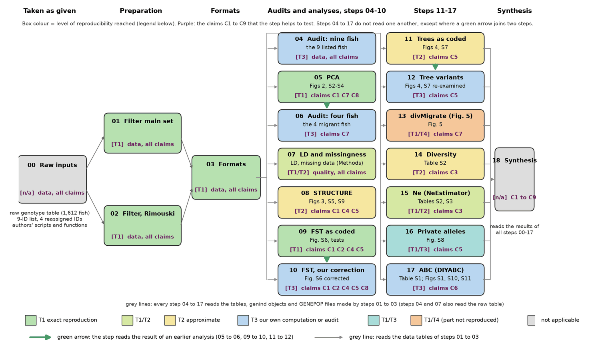

> **Our figure; no counterpart in the paper.** Map of the 19 steps (00 to 18) as run. Each box is one step: its number and title, then the figures or tables of the paper that it reproduces, then (in purple) the level of reproducibility reached and the claims C1 to C9 that it helps to test. The colour of a box is the level of reproducibility (legend below the map: T1 exact, T1/T2, T2 approximate, T3 our own computation or audit, T1/T3, T1/T4 part not reproduced, not applicable). Grey lines: every analysis step reads the tables made by steps 01 to 03. Green arrows: the step reads a result of an earlier analysis (05 to 06, 09 to 10, 11 to 12).


### 4.2 The steps


| Step | Title | What it does | Level of reproducibility |
|---|---|---|---|
| 00 | Raw inputs | fix everything taken as given, with checksums | not applicable (no result to compare) |
| 01 | Filter the main data set | filter the main data set, balance Puyjalon, impute gaps, move the four fish | T1 |
| 02 | Filter with the Rimouski outgroup | the same filtering with the Rimouski outgroup | T1 |
| 03 | Formats | write the tables, genetic objects and GENEPOP files that the analyses read | T1 |
| 04 | Audit of the nine Puyjalon fish | look at the nine excluded Puyjalon fish from the data | T3 |
| 05 | Principal component analyses | principal component analyses (Figs 2, S2-S4) | T1 |
| 06 | Audit of the four reassigned fish | look at the four reassigned fish with an assignment test | T3 |
| 07 | Linkage disequilibrium and missingness | linkage disequilibrium and missing-data checks of the Methods | T1/T2 |
| 08 | STRUCTURE | STRUCTURE clustering and Evanno's ΔK (Figs 3, S5, S9) | T2 |
| 09 | FST as coded by the authors | pairwise FST and its tests as the authors coded them (Fig. S6) | T1 |
| 10 | FST after our correction | pairwise FST after correcting the input encoding | T3 |
| 11 | Trees as coded by the authors | the three trees as the authors coded them (Figs 4, S7) | T2 |
| 12 | Tree variants | the trees with the problems found examined one by one | T3 |
| 13 | Directional gene flow (divMigrate, Fig. 5) | directional gene flow with divMigrate and the source of Fig. 5 | T1/T4 |
| 14 | Genetic diversity | genetic diversity (Table S2) | T2 |
| 15 | Effective population size | effective population size with NeEstimator (Tables S2, S3) | T1/T2 |
| 16 | Private alleles of residents | alleles shared by residents and absent from anadromous fish (Fig. S8) | T1/T3 |
| 17 | Approximate Bayesian computation | approximate Bayesian computation with DIYABC (Table S1, Figs S1, S10, S11) | T3 |
| 18 | Synthesis | synthesis: claims, issues, comparisons, this document | not applicable (no result to compare) |


### 4.3 What is inside a step folder, and what counts as an input

Every step has the same folder layout, so that a reader can find things without a guide:

* `README.md`: the step's note (purpose, inputs, scripts, parameters, results, checks). The notes of all steps are in Appendix A.
* `input/`: **symbolic links** to the files that the step reads (tables of earlier steps, the authors' scripts and functions) and small files written by us (for example a transcription of a table from the paper, used for a check). A symbolic link is a small entry that points to a file or folder kept somewhere else, so that several steps can use the same file without copying it and the origin of every input stays visible on the computer. In the trees of this document the place a link points to is not shown (see the example below).
* `scripts/`: the scripts that we wrote (class D) and the job script (`run_NN_*.sbatch`).
* `output/`: results, tables, figures, the check table (`check_NN.tsv`) and `logs/` (the job log, copies of the scripts as they ran, input checksums before and after, the R session information).

**What counts as an input.** The real inputs of every analysis are the raw genotype table, the two lists and the authors' scripts and functions, and the tables that our own earlier steps made from them. **The authors' derived files** (their filtered tables, genetic objects, GENEPOP files and the saved gene-flow result) are **not inputs of any analysis**. They are kept in step 00 (`deposit_for_comparison/`) so that we can check that our tables equal theirs and compare our results with theirs. Where a step uses one of them as a diagnostic, the step says so and says that it does not enter any decision.


<details>
<summary>Example: the folder of step 09 (FST as coded by the authors)</summary>

```
09_fst_as_coded/
├── input
│   ├── 08_FST_MS.R
│   ├── ALLELE_Filtered_Individuals885_Loci43_REASSIGNED_IND_FINAL.txt
│   ├── figS6B_README.txt
│   ├── figS6B_transcribed_values.tsv
│   └── Functions
│       ├── allele2genotype.R
│       ├── allele_freq.R
│       ├── allele_rich.R
│       ├── calculate_marker_missing_percentage.R
│       ├── create_genind.R
│       ├── delta_K.R
│       ├── export_allele_format.R
│       ├── fst_calculation.R
│       ├── fst_marker.R
│       ├── genepop_creator.R
│       ├── het.R
│       ├── impute.R
│       ├── kp_ind.R
│       ├── ld_test_locus.R
│       ├── mean_membership.R
│       ├── na_heatmap.R
│       ├── p100_missing.R
│       └── pca.R
├── output
│   ├── 09_post_results.R
│   ├── check_09.tsv
│   ├── exit_code.txt
│   ├── failed_attempts
│   │   ├── 63754826_salmon_wf09_fst_as_coded_2026-10-08_22-18-39
│   │   │   ├── 09_check.R
│   │   │   ├── 09_post_results.R
│   │   │   ├── check_09.tsv
│   │   │   ├── check.log
│   │   │   ├── run_stdout.log
│   │   │   ├── script_changes.diff
│   │   │   ├── slurm_script
│   │   │   └── stage_run.sh
│   │   └── salmon_wf09_fst_as_coded_63754826.out
│   ├── figures.pdf
│   ├── fst_as_coded_all_cells.tsv
│   ├── fst_as_coded_class_means.tsv
│   ├── fst_as_coded_pairs.tsv
│   ├── fst_as_coded_wilcoxon.tsv
│   ├── fst_per_locus_pegas.tsv
│   ├── inputs_check.txt
│   ├── inputs_md5_after.txt
│   ├── inputs_md5_before.txt
│   ├── logs
│   │   ├── 63757097_salmon_wf09_fst_as_coded_2026-10-08_22-37-17
│   │   │   ├── 09_check.R
│   │   │   ├── 09_post_results.R
│   │   │   ├── check_09.tsv
│   │   │   ├── check.log
│   │   │   ├── run_stdout.log
│   │   │   ├── script_changes.diff
│   │   │   ├── slurm_script
│   │   │   └── stage_run.sh
│   │   └── salmon_wf09_fst_as_coded_63757097.out
│   ├── run_stdout.log
│   ├── script_changes.diff
│   ├── seconds.txt
│   └── sessionInfo.txt
├── README.md
└── scripts
    ├── 09_check.R
    ├── 09_post_results.R
    └── run_09_fst_as_coded.sbatch

9 directories, 60 files
```

This tree and the trees of the other steps (in each step's section) list **every file and folder** of the step; they were made with the command `tree -l <folder>/ | sed 's/ -> .*//'`. The option `-l` lists the content of linked folders as if it were inside the folder, and `sed` removes the part of each line that says where a link points, so that no path of the computer appears. In `input/` the authors' script and functions come from step 00 and the allele table from step 03. The two small files written by us (`figS6B_*`) hold the 45 pairwise FST values that the authors report in Fig. S6B (the matrix printed in the supplement), which we typed in; they are used only to check our result of step 09. The deposit has **no table with these values** (its only saved result is the gene-flow object behind Fig. 5), so the printed matrix of Fig. S6B is the only place where the 45 values are published.

</details>


### 4.4 How each job checks itself

Each step runs as a batch job on the cluster (a job script, `sbatch`). At the end the job runs a check script that writes a table of rows PASS, FAIL, AGREE, DIFFER or NOTE (section 3.3). PASS/FAIL rows decide whether the job succeeds; AGREE/DIFFER rows compare with the paper and never make a job fail, because a difference with the paper is a result and not an error. Failed first runs (all caused by mistakes in our check scripts or job scripts, never in the data) are listed in the deviations (section 9). In the final runs of steps 00 to 17, 318 integrity rows pass and none fail; 61 comparisons agree with the paper and 28 differ.

### 4.5 Software and compute

* **R 4.2.1** in a locked environment (package versions from a snapshot of June 2023: hierfstat 0.5-11, adegenet 2.1.10, pegas 1.2, poppr 2.9.4, ape 5.7-1, assignPOP 1.2.4, starmie 0.1.2, diveRsity 1.9.90 and others); R 4.2.3 with GDAL for the one package that needs it (graph4lg, for the GENEPOP files). The authors' own list of packages is incomplete and has no versions, so the environment was rebuilt and tested before the analysis.
* **Programs:** STRUCTURE 2.3.4, PLINK 1.9, NeEstimator 2.1, the DIYABC 2.1 command-line engine (built from source).
* **Compute:** most steps run in seconds to minutes; the long ones are STRUCTURE (480 runs for step 08, 13.5 core-hours; 60 more runs for step 04, 2.2 core-hours) and the ABC (5,000,000 simulations in 50 tasks, about 146 core-hours). The large files (STRUCTURE runs, the 3.1 GB DIYABC reference table) stay on the cluster's scratch area.


## 5. Step by step

Each section follows the same order: what we set out to do, the method in brief (collapsible), the inputs of our run and the authors' files used only for comparison, what we found, how it compares with the paper, the problems found, and the folder and scripts (collapsible).


---

### Step 00: Raw inputs
**Level of reproducibility: n/a** (no result to compare). **Final run:** 58 integrity checks pass.


**What we set out to do.** Fix in one place everything that is taken as given, so that no later step can silently change it: the raw genotype table, the two hand-made lists (nine Puyjalon fish and four reassigned fish), the authors' scripts and functions, their derived files (kept only for comparison) and **every parameter** that the paper or the scripts state (seeds, thresholds, numbers of bootstraps, software settings), each with the file and line or the paper page where it is stated. Checksums of everything were recorded.


**Inputs of our run**


| Input | Where it comes from |
|---|---|
| `AllDataCombined_NotFiltered.txt` (1,612 fish, 51 loci) | the deposit (linked) |
| `PUY_Ind_Cluster_With_ROM_To_Remove.txt` (nine IDs) | the deposit (linked) |
| `Scripts/` (8 scripts) and `Functions/` (18 functions) | the deposit (linked) |
| the paper and its supplement (PDF, DOCX) | the publisher's files |

**The authors' files and transcriptions used only for comparison (never as inputs)**


| File | Used for |
|---|---|
| the 26 derived tables and genetic objects of the deposit's `Data/` folder, and the saved gene-flow result | later steps check that our tables equal them and compare our results with them; kept in `deposit_for_comparison/` |


**The deposit.** The inputs above come from the authors' data package on Dryad (<https://datadryad.org/dataset/doi:10.5061/dryad.v6wwpzh7v>), which we downloaded as one zip file and unzipped into a folder outside the step folders. Step 00 links to the files that it uses (it never copies or changes them) and records their checksums. The tree below shows the folder exactly as downloaded.


<details>
<summary>Tree of the deposit as downloaded and unzipped</summary>

```
deposit/
├── AnalysisResults
│   └── DirMig_EcoSure_MusPooled_Reass_GST_10000_Boots_Forward.RData
├── Data
│   ├── AllDataCombined_NotFiltered.txt
│   ├── ALLELE_Filtered_Individuals885_Loci43_REASSIGNED_IND_FINAL.txt
│   ├── ALLELE_Filtered_Individuals885_Loci43_REASSIGNED_IND_IMPUTED_FINAL.txt
│   ├── ALLELE_Filtered_Individuals936_Loci40_REASSIGNED_IND_FINAL_Rimouski.txt
│   ├── ALLELE_Filtered_Individuals987_Loci43_ALL_PUY_REASSIGNED_IND_IMPUTED_FINAL.txt
│   ├── All_Rivers_All_PUY_Dataset_Filtered_Balanced_Reassigned.txt
│   ├── All_Rivers_All_PUY_Dataset_Filtered_Balanced.txt
│   ├── All_Rivers_All_PUY_Dataset_Filtered_Imputed_Balanced_Reassigned.txt
│   ├── All_Rivers_All_PUY_Dataset_Filtered_Imputed_Balanced.txt
│   ├── All_Rivers_Dataset_Filtered_Balanced_Reassigned_Rimouski.txt
│   ├── All_Rivers_Dataset_Filtered_Balanced_Reassigned.txt
│   ├── All_Rivers_Dataset_Filtered_Balanced_Rimouski.txt
│   ├── All_Rivers_Dataset_Filtered_Balanced.txt
│   ├── All_Rivers_Dataset_Filtered_Imputed_Balanced_Reassigned_Rimouski.txt
│   ├── All_Rivers_Dataset_Filtered_Imputed_Balanced_Reassigned.txt
│   ├── All_Rivers_Dataset_Filtered_Imputed_Balanced_Rimouski.txt
│   ├── All_Rivers_Dataset_Filtered_Imputed_Balanced.txt
│   ├── GENEPOP_Individuals385_Loci43_River_Site_IMPUTED_MUS_POOLED.txt
│   ├── GENEPOP_Individuals385_Loci43_River_Site_IMPUTED_REASS_MUS_POOLED.txt
│   ├── GENIND_Filtered_Individuals885_Loci43_IMPUTED_FINAL.RDS
│   ├── GENIND_Filtered_Individuals885_Loci43_REASSIGNED_IND_IMPUTED_FINAL.RDS
│   ├── GENIND_Filtered_Individuals936_Loci40_REASSIGNED_IND_IMPUTED_FINAL_Rimouski.RDS
│   ├── GENIND_Filtered_Individuals936_Loci41_IMPUTED_FINAL.RDS
│   ├── GENOTYPE_Filtered_Individuals885_Loci43_IMPUTED_FINAL.txt
│   ├── GENOTYPE_Filtered_Individuals885_Loci43_REASSIGNED_IND_IMPUTED_FINAL.txt
│   ├── GENOTYPE_Filtered_Individuals936_Loci40_REASSIGNED_IND_IMPUTED_FINAL_Rimouski.txt
│   ├── GENOTYPE_Filtered_Individuals936_Loci41_IMPUTED_FINAL.txt
│   └── PUY_Ind_Cluster_With_ROM_To_Remove.txt
├── Functions
│   ├── allele2genotype.R
│   ├── allele_freq.R
│   ├── allele_rich.R
│   ├── calculate_marker_missing_percentage.R
│   ├── create_genind.R
│   ├── delta_K.R
│   ├── export_allele_format.R
│   ├── fst_calculation.R
│   ├── fst_marker.R
│   ├── genepop_creator.R
│   ├── het.R
│   ├── impute.R
│   ├── kp_ind.R
│   ├── ld_test_locus.R
│   ├── mean_membership.R
│   ├── na_heatmap.R
│   ├── p100_missing.R
│   └── pca.R
├── README.md
└── Scripts
    ├── 01_FilteringData.R
    ├── 02_FilteringData_Rimouski.R
    ├── 03_Create_Format_Data.R
    ├── 04_PCA_MS.R
    ├── 05_PCA_MatSupp.R
    ├── 06_Tree_MS.R
    ├── 07_MigrationDirectionality_MS.R
    └── 08_FST_MS.R

5 directories, 56 files
```

</details>


**What we found.** All checks passed (58 rows): the links resolve; the checksums equal those recorded in the earlier assessment; the raw table has 1,612 fish and 122 columns; the nine listed fish and the four reassigned fish are in the raw table, and the old tactic of each reassigned fish agrees with the direction of its move; every cited script line contains the cited setting and every cited sentence of the paper is found in the text of the PDF. The reassignments:


| ID | Direction | Old tactic | Old site (data code) | New tactic | New site (data code) |
|---|---|---|---|---|---|
| AN_1532_UN_2018 | anadromous to resident | Anadromous | COR_A | Landlock | COR_R |
| LA_0029_MUR_2004 | resident to anadromous | Landlock | MUS_RR | Anadromous | MUS_A |
| LA_0021_MUR_2004 | resident to anadromous | Landlock | MUS_RR | Anadromous | MUS_A |
| LA_0146_VIC_2004 | resident to anadromous | Landlock | VIC_R | Anadromous | AGU_A |


<details>
<summary>The parameters recorded: the whole table <code>authors_parameters.tsv</code> (setting, value, where stated, step that uses it)</summary>

| Setting | Value | Stated in | Lines or pages | Used in step |
|---|---|---|---|---|
| ind_missing_threshold_main | individuals with missing proportion >= 0.15 removed | authors_release/Scripts/01_FilteringData.R | 112-113 | 1 |
| marker_missing_threshold_main | loci with more than 0.15 missing overall or in any River_Site removed | authors_release/Scripts/01_FilteringData.R | 141-142 | 1 |
| puyjalon_subsample_script01 | 50 Puyjalon individuals, set.seed(5) | authors_release/Scripts/01_FilteringData.R | 264-265 | 1 |
| imputation_seed_script01 | set.seed(2) before impute() (not-reassigned and all-Puyjalon tables) | authors_release/Scripts/01_FilteringData.R | 313-317 | 1 |
| ld_block_switch_script01 | run_ld <- FALSE (the linkage disequilibrium block is switched off in the deposited script) | authors_release/Scripts/01_FilteringData.R | 186 | 7 |
| reassignment_function | reassign_ind(): four individuals moved (see lists/reassigned_ids.tsv) | authors_release/Scripts/01_FilteringData.R | 336-376 | 1 |
| rimouski_individual_threshold | Rimouski individuals with missing proportion >= 0.08 removed (RIM_A only) | authors_release/Scripts/02_FilteringData_Rimouski.R | 45 | 2 |
| ind_missing_threshold_rimouski_set | individuals with missing proportion >= 0.15 removed | authors_release/Scripts/02_FilteringData_Rimouski.R | 136-137 | 2 |
| marker_missing_threshold_rimouski_set | loci with more than 0.15 missing overall or in any River_Site removed | authors_release/Scripts/02_FilteringData_Rimouski.R | 166-167 | 2 |
| puyjalon_subsample_script02 | 50 Puyjalon individuals, set.seed(5) | authors_release/Scripts/02_FilteringData_Rimouski.R | 289-290 | 2 |
| rimouski_subsample | 50 Rimouski individuals, set.seed(5) | authors_release/Scripts/02_FilteringData_Rimouski.R | 307-308 | 2 |
| imputation_seed_script02 | set.seed(2) before impute() | authors_release/Scripts/02_FilteringData_Rimouski.R | 353-354 | 2 |
| pca | dudi.pca(scannf = FALSE, nf = 10) | authors_release/Functions/pca.R | 7 | 5 |
| fst_seed | set.seed(33) | authors_release/Scripts/08_FST_MS.R | 61 | 9 |
| fst_call | fst_calculation(method = "nei", n_boot = 10000, pop_col = "River_Site") | authors_release/Scripts/08_FST_MS.R | 62 | 9 |
| fst_class_tests | three wilcox.test calls: A-A vs R-R; A-A vs A-R/R-A; R-R vs A-R/R-A | authors_release/Scripts/08_FST_MS.R | 96-98 | 9 |
| tree_nj_edwards | aboot(..., dist = edwards.dist, sample = 10000, tree = "nj", root = TRUE), set.seed(5) | authors_release/Scripts/06_Tree_MS.R | 106-109 | 11 |
| tree_upgma_edwards | aboot(..., dist = edwards.dist, sample = 10000, tree = "upgma", root = TRUE), set.seed(5) | authors_release/Scripts/06_Tree_MS.R | 126-129 | 11 |
| tree_nj_fst | aboot(fst_sur_eco_out, sample = 10000, tree = "nj", root = TRUE), set.seed(5) | authors_release/Scripts/06_Tree_MS.R | 150-151 | 11 |
| tree_outgroup | outgroup RIM-A | authors_release/Scripts/06_Tree_MS.R | 112 | 11 |
| divmigrate_seed | set.seed(24) (commented out in the deposited script) | authors_release/Scripts/07_MigrationDirectionality_MS.R | 23 | 13 |
| divmigrate_call | divMigrate(genepop_file_reass, stat = "gst", boots = 10000) (commented out; the result is loaded from AnalysisResults) | authors_release/Scripts/07_MigrationDirectionality_MS.R | 24 | 13 |
| paper_ind_missing | individuals with more than 15% missing data removed (n = 32) | paper | 4-6 | 1 |
| paper_puyjalon_subsample | 50 Puyjalon individuals randomly sampled | paper | 4-6 | 1 |
| paper_marker_missing | loci with more than 15% missing data removed (n = 8) | paper | 4-6 | 1 |
| paper_ld | pairwise linkage disequilibrium with pegas v1.2 between -0.071 and 0.006; no locus removed | paper | 4-6 | 7 |
| paper_final_dataset | 196 anadromous and 189 resident individuals | paper | 4-6 | 1 |
| paper_pca | PCA on genotypes, ade4 v1.7-15 | paper | 4-6 | 5 |
| paper_structure_design | STRUCTURE admixture model, K = 1 to 12, 10 replicates | paper | 4-6 | 8 |
| paper_structure_chain | burn-in 50 000 steps, 100 000 MCMC replicates | paper | 4-6 | 8 |
| paper_structure_bestk | K chosen by the highest delta K (Evanno) with starmie | paper | 4-6 | 8 |
| paper_structure_groups | within the groups of the first analysis K = 1 to 8 | paper | 4-6 | 8 |
| paper_structure_watersheds | within each watershed K = 1 to 5 | paper | 4-6 | 8 |
| paper_fst | hierfstat 0.5-11, Nei (1987) equation, 95% intervals from 10 000 bootstraps | paper | 4-6 | 9 |
| paper_fst_balanced | 100 random subsamplings of 25 individuals per site (15 for COR-R, 23 for ETA-A) | paper | 4-6 | 10 |
| paper_fst_tests | Wilcoxon rank-sum tests among A-A, R-R and A-R | paper | 4-6 | 10 |
| paper_trees | poppr 2.9.4, Edwards distance, 10 000 bootstraps; outgroup RIM-A; a third NJ tree on FST | paper | 4-6 | 11 |
| paper_divmigrate | diveRsity 1.9.90, GST, 10 000 iterations | paper | 4-6 | 13 |
| paper_diversity | He, Ho and allele richness per locus with pegas 1.2; raw and extrapolated richness | paper | 4-6 | 14 |
| paper_ne | NeEstimator 2.1, linkage disequilibrium method, minor allele frequency above 0.05 | paper | 4-6 | 15 |
| paper_abc_datasets | 5 million simulated data sets | paper | 4-6 | 17 |
| paper_abc_time | 10 000 years, generation time 4 years (2500 generations) | paper | 4-6 | 17 |
| paper_abc_mutation | stepwise mutation model, rate 3e-4 to 9e-4 | paper | 4-6 | 17 |
| paper_abc_statistics | 144 summary statistics | paper | 4-6 | 17 |
| paper_abc_logistic | scenarios compared by logistic regression | paper | 4-6 | 17 |
| paper_abc_priors | priors of Table S1 (t1 10-1500, t2 10-2000 generations, log-uniform) | supplement docx, Table S1 | - | 17 |

Every row of the table is shown. 'Stated in' says whether the setting comes from the paper, from its supplement or from a script of the deposit; the lines or pages give the place.

</details>


<details>
<summary>Scripts, software and parameters of this step</summary>

| Script | Class | What it does |
|---|---|---|
| `00_make_inputs.sh`, `00_check.sh`, `run_00_raw_inputs.sbatch` | D | make the links and checksums, run the checks, submit the job |

**Software.** shell, no statistics

**Parameters.** none chosen by us

</details>


<details>
<summary>Folder of this step (tree)</summary>

```
00_raw_inputs/
├── authors_parameters.tsv
├── authors_release
│   ├── Functions
│   │   ├── allele2genotype.R
│   │   ├── allele_freq.R
│   │   ├── allele_rich.R
│   │   ├── calculate_marker_missing_percentage.R
│   │   ├── create_genind.R
│   │   ├── delta_K.R
│   │   ├── export_allele_format.R
│   │   ├── fst_calculation.R
│   │   ├── fst_marker.R
│   │   ├── genepop_creator.R
│   │   ├── het.R
│   │   ├── impute.R
│   │   ├── kp_ind.R
│   │   ├── ld_test_locus.R
│   │   ├── mean_membership.R
│   │   ├── na_heatmap.R
│   │   ├── p100_missing.R
│   │   └── pca.R
│   ├── README.md
│   ├── Scripts
│   │   ├── 01_FilteringData.R
│   │   ├── 02_FilteringData_Rimouski.R
│   │   ├── 03_Create_Format_Data.R
│   │   ├── 04_PCA_MS.R
│   │   ├── 05_PCA_MatSupp.R
│   │   ├── 06_Tree_MS.R
│   │   ├── 07_MigrationDirectionality_MS.R
│   │   └── 08_FST_MS.R
│   └── zip_link.txt
├── deposit_for_comparison
│   ├── ALLELE_Filtered_Individuals885_Loci43_REASSIGNED_IND_FINAL.txt
│   ├── ALLELE_Filtered_Individuals885_Loci43_REASSIGNED_IND_IMPUTED_FINAL.txt
│   ├── ALLELE_Filtered_Individuals936_Loci40_REASSIGNED_IND_FINAL_Rimouski.txt
│   ├── ALLELE_Filtered_Individuals987_Loci43_ALL_PUY_REASSIGNED_IND_IMPUTED_FINAL.txt
│   ├── All_Rivers_All_PUY_Dataset_Filtered_Balanced_Reassigned.txt
│   ├── All_Rivers_All_PUY_Dataset_Filtered_Balanced.txt
│   ├── All_Rivers_All_PUY_Dataset_Filtered_Imputed_Balanced_Reassigned.txt
│   ├── All_Rivers_All_PUY_Dataset_Filtered_Imputed_Balanced.txt
│   ├── All_Rivers_Dataset_Filtered_Balanced_Reassigned_Rimouski.txt
│   ├── All_Rivers_Dataset_Filtered_Balanced_Reassigned.txt
│   ├── All_Rivers_Dataset_Filtered_Balanced_Rimouski.txt
│   ├── All_Rivers_Dataset_Filtered_Balanced.txt
│   ├── All_Rivers_Dataset_Filtered_Imputed_Balanced_Reassigned_Rimouski.txt
│   ├── All_Rivers_Dataset_Filtered_Imputed_Balanced_Reassigned.txt
│   ├── All_Rivers_Dataset_Filtered_Imputed_Balanced_Rimouski.txt
│   ├── All_Rivers_Dataset_Filtered_Imputed_Balanced.txt
│   ├── AnalysisResults
│   │   └── DirMig_EcoSure_MusPooled_Reass_GST_10000_Boots_Forward.RData
│   ├── GENEPOP_Individuals385_Loci43_River_Site_IMPUTED_MUS_POOLED.txt
│   ├── GENEPOP_Individuals385_Loci43_River_Site_IMPUTED_REASS_MUS_POOLED.txt
│   ├── GENIND_Filtered_Individuals885_Loci43_IMPUTED_FINAL.RDS
│   ├── GENIND_Filtered_Individuals885_Loci43_REASSIGNED_IND_IMPUTED_FINAL.RDS
│   ├── GENIND_Filtered_Individuals936_Loci40_REASSIGNED_IND_IMPUTED_FINAL_Rimouski.RDS
│   ├── GENIND_Filtered_Individuals936_Loci41_IMPUTED_FINAL.RDS
│   ├── GENOTYPE_Filtered_Individuals885_Loci43_IMPUTED_FINAL.txt
│   ├── GENOTYPE_Filtered_Individuals885_Loci43_REASSIGNED_IND_IMPUTED_FINAL.txt
│   ├── GENOTYPE_Filtered_Individuals936_Loci40_REASSIGNED_IND_IMPUTED_FINAL_Rimouski.txt
│   └── GENOTYPE_Filtered_Individuals936_Loci41_IMPUTED_FINAL.txt
├── lists
│   ├── PUY_Ind_Cluster_With_ROM_To_Remove.txt
│   └── reassigned_ids.tsv
├── output
│   ├── check_00.tsv
│   └── logs
│       ├── 63751751_salmon_wf00_raw_inputs_2026-10-08_21-51-08
│       │   ├── 00_check.sh
│       │   ├── 00_make_inputs.sh
│       │   ├── authors_parameters.tsv
│       │   ├── check_00.tsv
│       │   ├── check.log
│       │   ├── make_inputs.log
│       │   └── slurm_script
│       └── salmon_wf00_raw_inputs_63751751.out
├── paper
│   ├── 763_Evolutionary_relationships_between_landlocked_and_anadromous_Atlantic_Salmon_populations_in_the_North_Shore_region_of_the_Gulf_of_St_Lawrence_2026.pdf
│   └── cjfas-2025-0204suppla.docx
├── raw
│   └── AllDataCombined_NotFiltered.txt
├── README.md
├── scripts
│   ├── 00_check.sh
│   ├── 00_make_inputs.sh
│   └── run_00_raw_inputs.sbatch
├── SHA256SUMS.txt
└── SOURCES.md

13 directories, 76 files
```

</details>


<details>
<summary>Deviations from the plan in this step</summary>

* **2026-10-08** (D): First run of the step 00 job (63751515) failed one check; table corrected and job rerun (63751751, all checks pass). The logs of the failed attempt were deleted by mistake when the output folder was cleaned. *Why:* An empty field in authors_parameters.tsv shifted the columns when the check read the table (bash read collapses empty tab-separated fields); the field now holds '-' *Effect on the result:* none (no authors' code involved)

</details>


---

### Step 01: Filter the main data set
**Level of reproducibility: T1** (the deposit's tables are reproduced exactly). **Final run:** 26 integrity checks pass.


**What we set out to do.** Run the authors' filtering script (their script 01) on the raw table to obtain the data set used by almost every analysis: remove the Romaine fish, fish and loci with too many missing genotypes, the nine listed Puyjalon fish, take a random sample of 50 Puyjalon fish, fill the remaining gaps (imputation) and move the four fish to their new sites. The result is eight tables (four before and four after the reassignment: not imputed and imputed, with and without all the Puyjalon fish).


<details>
<summary>Method in brief: why filter, sample and impute</summary>

* **Missing-data filters.** A fish or locus with many failed genotypes is more likely to be a poor sample or a poor marker (a primer that does not work in one lineage, a PCR failure in old DNA). The script removes fish with 15 % or more missing loci and loci with more than 15 % missing overall **or in any single site**; a marker that fails in one site is therefore lost for all sites. Result: 32 fish and 8 loci removed, leaving 43 loci.
* **Random sample of Puyjalon.** Puyjalon has far more fish (152 after filtering) than the other sites (about 39 on average); the script draws 50 at random (`set.seed(5)`) so that the sites are of similar size. The draw depends on the seed and on the order of the fish in the table.
* **Imputation.** Several analyses (PCA, allele-frequency trees, divMigrate) cannot use gaps, so an imputed copy is made: each missing allele is replaced by an allele drawn at random with probabilities equal to the allele frequencies of the locus (pooled over all sites; `set.seed(2)`). FST, diversity, Ne and the ABC use the copy **without** imputation.
* **Reassignment.** Moving four fish changes the site they count in for every later analysis. The reasons given (position in the PCA, biological and geographical plausibility) are in the paper's text only; the decision is a hand-made input.

</details>


**Inputs of our run**


| Input | Where it comes from |
|---|---|
| raw table and the nine-ID list | step 00 |
| `01_FilteringData.R` and the functions it calls | step 00 (the authors' script, class A: only the folder-path line differs) |

**The authors' files and transcriptions used only for comparison (never as inputs)**


| File | Used for |
|---|---|
| the deposit's eight filtered tables | to check that ours are identical to them |


**What we found.**


| Quantity | Value |
|---|---|
| individuals considered (raw table without Romaine and Rimouski) | 1028 |
| individuals removed for missing data (>= 0.15) | 32 |
| loci removed for missing data (columns / 2) | 8 |
| IDs in the Puyjalon list | 9 |
| Puyjalon individuals sampled (set.seed(5)) | 50 |
| individuals in the main table (balanced) | 885 |
| individuals in the all-Puyjalon table | 987 |
| loci in the main table | 43 |


* The script reproduces the **eight tables of the deposit exactly** (identical text after normalising the line endings, and identical when parsed). Level of reproducibility T1. Our main table has 885 fish and 43 loci; the table that keeps all Puyjalon fish has 987.
* The sample sizes per site equal those of the paper's Table 1 (section 1.4).
* The script only draws its diagnostic plots on screen and prints its counts to the console; our wrapper writes them to files (a 6-page PDF of the plots and a table of counts).


<details>
<summary><b>Problem found:</b> the imputation draws once per allele column, not once per missing entry</summary>

**What the authors did.** The function `impute()` calls `ifelse(is.na(column), sample(alleles, size = 1, replace = TRUE, prob = freq), column)`. The call to `sample()` happens once, and `ifelse()` repeats that single value in every missing cell of the column. The Methods say each missing entry was replaced by an allele drawn at random according to the allele frequencies.

**Evidence.** In the imputed main table, 44 of the 86 allele columns have missing cells (278 cells in all, 0.365 % of the 76,110 cells); **in all 44 columns every missing cell received the same value**, although 32 of these columns have more than one missing cell (the largest: `Ssa_5_6` and its partner column with 28 cells each). No cell outside the missing ones was changed, so the function does exactly what its code says.

**What is correct.** One draw per missing entry. With one draw per column, up to 28 fish receive the same allele at the same locus, which creates artificial allele sharing among the imputed fish.

**What we computed.** The authors' function and seed as written, so that the deposited tables are reproduced exactly; everything downstream of an imputed table in the deposit depends on these tables (the PCA, the allele-frequency trees and the file for divMigrate).

**What we did not compute.** The downstream analyses with a per-entry imputation (no sensitivity analyses were planned). Expected effect, as an expectation and not a result: small, because only 0.365 % of the cells are imputed, but not uniformly small, because the imputed cells are concentrated in a few columns; the PCA and the trees are the analyses most exposed.

</details>


<details>
<summary>Evidence table: first rows of the imputation evidence (columns with missing cells)</summary>

| Allele column | Locus | Missing cells | Distinct imputed values | Imputed allele |
|---|---|---|---|---|
| NGS_SSsp2210 | NGS_SSsp2210 | 14 | 1 | 25 |
| NGS_SSsp2210_b | NGS_SSsp2210 | 14 | 1 | 45 |
| NGS_SsaD486 | NGS_SsaD486 | 1 | 1 | 52 |
| NGS_SsaD486_b | NGS_SsaD486 | 1 | 1 | 36 |
| Ssa_1_7 | Ssa_1_7 | 0 | 0 |  |
| Ssa_1_7_b | Ssa_1_7 | 0 | 0 |  |
| Ssa_10_1 | Ssa_10_1 | 1 | 1 | 37 |
| Ssa_10_1_b | Ssa_10_1 | 1 | 1 | 37 |
| Ssa_10_2 | Ssa_10_2 | 0 | 0 |  |
| Ssa_10_2_b | Ssa_10_2 | 0 | 0 |  |
| Ssa_11_2 | Ssa_11_2 | 0 | 0 |  |
| Ssa_11_2_b | Ssa_11_2 | 0 | 0 |  |

</details>


<details>
<summary>Scripts, software and parameters of this step</summary>

| Script | Class | What it does |
|---|---|---|
| `input/01_FilteringData.R` | A | the authors' filtering script; only the folder-path line is changed by our harness |
| `01_post_counts.R` | D | writes the counts that the script only prints |
| `01_imputation_evidence.R` | D | shows that each imputed column holds one value |
| `01_check_against_deposit.R` | D | compares each of the eight tables with the deposit |
| `run_01_filter_main.sbatch` | D | the job (13 seconds) |

**Software.** R 4.2.1 (dplyr, tidyr, ggplot2, ggpubr, pegas, reshape2, stringr)

**Parameters.** all the authors': 15 % thresholds, `set.seed(5)` for the Puyjalon sample, `set.seed(2)` for the imputation; nothing chosen by us

</details>


<details>
<summary>Folder of this step (tree)</summary>

```
01_filter_main/
├── IMPUTATION_issue.md
├── input
│   ├── 01_FilteringData.R
│   ├── AllDataCombined_NotFiltered.txt
│   ├── Functions
│   │   ├── allele2genotype.R
│   │   ├── allele_freq.R
│   │   ├── allele_rich.R
│   │   ├── calculate_marker_missing_percentage.R
│   │   ├── create_genind.R
│   │   ├── delta_K.R
│   │   ├── export_allele_format.R
│   │   ├── fst_calculation.R
│   │   ├── fst_marker.R
│   │   ├── genepop_creator.R
│   │   ├── het.R
│   │   ├── impute.R
│   │   ├── kp_ind.R
│   │   ├── ld_test_locus.R
│   │   ├── mean_membership.R
│   │   ├── na_heatmap.R
│   │   ├── p100_missing.R
│   │   └── pca.R
│   └── PUY_Ind_Cluster_With_ROM_To_Remove.txt
├── output
│   ├── 01_post_counts.R
│   ├── All_Rivers_All_PUY_Dataset_Filtered_Balanced_Reassigned.txt
│   ├── All_Rivers_All_PUY_Dataset_Filtered_Balanced.txt
│   ├── All_Rivers_All_PUY_Dataset_Filtered_Imputed_Balanced_Reassigned.txt
│   ├── All_Rivers_All_PUY_Dataset_Filtered_Imputed_Balanced.txt
│   ├── All_Rivers_Dataset_Filtered_Balanced_Reassigned.txt
│   ├── All_Rivers_Dataset_Filtered_Balanced.txt
│   ├── All_Rivers_Dataset_Filtered_Imputed_Balanced_Reassigned.txt
│   ├── All_Rivers_Dataset_Filtered_Imputed_Balanced.txt
│   ├── check_01.tsv
│   ├── counts_step01.tsv
│   ├── exit_code.txt
│   ├── figures.pdf
│   ├── imputation_evidence.tsv
│   ├── imputation_summary.txt
│   ├── inputs_check.txt
│   ├── inputs_md5_after.txt
│   ├── inputs_md5_before.txt
│   ├── logs
│   │   ├── 63751953_salmon_wf01_filter_main_2026-10-08_21-54-08
│   │   │   ├── 01_check_against_deposit.R
│   │   │   ├── 01_imputation_evidence.R
│   │   │   ├── 01_post_counts.R
│   │   │   ├── check_01.tsv
│   │   │   ├── check.log
│   │   │   ├── imputation_evidence.log
│   │   │   ├── run_stdout.log
│   │   │   ├── script_changes.diff
│   │   │   ├── slurm_script
│   │   │   └── stage_run.sh
│   │   └── salmon_wf01_filter_main_63751953.out
│   ├── run_info_step01.txt
│   ├── run_stdout.log
│   ├── script_changes.diff
│   ├── seconds.txt
│   └── sessionInfo.txt
├── README.md
└── scripts
    ├── 01_check_against_deposit.R
    ├── 01_imputation_evidence.R
    ├── 01_post_counts.R
    └── run_01_filter_main.sbatch

7 directories, 61 files
```

</details>


---

### Step 02: Filter the data set with the Rimouski outgroup
**Level of reproducibility: T1** (the deposit's tables are reproduced exactly). **Final run:** 18 integrity checks pass.


**What we set out to do.** The same filtering with the 50 Rimouski fish added, as the outgroup of the trees (authors' script 02). The Rimouski fish are filtered more strictly (8 % missing); three loci that have no data in Rimouski are removed first. The result has 936 fish and 41 loci counted from the first locus (the allele-frequency step of the imputation starts at the second locus, so the first locus is not imputed; this matters for the number of loci in the trees, step 12).


**Inputs of our run**


| Input | Where it comes from |
|---|---|
| raw table and nine-ID list; the authors' script `02_FilteringData_Rimouski.R` and functions | step 00 (script class A) |

**The authors' files and transcriptions used only for comparison (never as inputs)**


| File | Used for |
|---|---|
| the deposit's four Rimouski tables | to check that ours are identical |


**What we found.** The four tables are **identical to the deposit** (level of reproducibility T1). Counts:


| Quantity | Value |
|---|---|
| individuals at the stage of the individual filter (raw table without Romaine, Rimouski individuals >= 0.08 missing removed) | 1118 |
| Rimouski loci without any data (removed) | 3 |
| individuals removed for missing data (>= 0.15) | 30 |
| loci removed for missing data (columns / 2) | 7 |
| IDs in the Puyjalon list | 9 |
| individuals in the Rimouski main table | 936 |
| Rimouski (RIM_A) individuals in the table | 50 |
| Puyjalon individuals in the table | 50 |
| loci in the table (counted from NGS_SSsp2210) | 41 |


<details>
<summary>Scripts, software and parameters of this step</summary>

| Script | Class | What it does |
|---|---|---|
| `input/02_FilteringData_Rimouski.R` | A | the authors' script |
| `02_post_counts.R`, `02_check_against_deposit.R`, `run_02_filter_rimouski.sbatch` | D | counts, comparison with the deposit, job |

**Software.** R 4.2.1

**Parameters.** all the authors' (8 % for Rimouski fish, 15 % for the others, `set.seed(5)`, `set.seed(2)`)

</details>


<details>
<summary>Folder of this step (tree)</summary>

```
02_filter_rimouski/
├── input
│   ├── 02_FilteringData_Rimouski.R
│   ├── AllDataCombined_NotFiltered.txt
│   ├── Functions
│   │   ├── allele2genotype.R
│   │   ├── allele_freq.R
│   │   ├── allele_rich.R
│   │   ├── calculate_marker_missing_percentage.R
│   │   ├── create_genind.R
│   │   ├── delta_K.R
│   │   ├── export_allele_format.R
│   │   ├── fst_calculation.R
│   │   ├── fst_marker.R
│   │   ├── genepop_creator.R
│   │   ├── het.R
│   │   ├── impute.R
│   │   ├── kp_ind.R
│   │   ├── ld_test_locus.R
│   │   ├── mean_membership.R
│   │   ├── na_heatmap.R
│   │   ├── p100_missing.R
│   │   └── pca.R
│   └── PUY_Ind_Cluster_With_ROM_To_Remove.txt
├── output
│   ├── 02_post_counts.R
│   ├── All_Rivers_Dataset_Filtered_Balanced_Reassigned_Rimouski.txt
│   ├── All_Rivers_Dataset_Filtered_Balanced_Rimouski.txt
│   ├── All_Rivers_Dataset_Filtered_Imputed_Balanced_Reassigned_Rimouski.txt
│   ├── All_Rivers_Dataset_Filtered_Imputed_Balanced_Rimouski.txt
│   ├── check_02.tsv
│   ├── counts_step02.tsv
│   ├── exit_code.txt
│   ├── figures.pdf
│   ├── inputs_check.txt
│   ├── inputs_md5_after.txt
│   ├── inputs_md5_before.txt
│   ├── logs
│   │   ├── 63753336_salmon_wf02_filter_rimouski_2026-10-08_22-04-09
│   │   │   ├── 02_check_against_deposit.R
│   │   │   ├── 02_post_counts.R
│   │   │   ├── check_02.tsv
│   │   │   ├── check.log
│   │   │   ├── run_stdout.log
│   │   │   ├── script_changes.diff
│   │   │   ├── slurm_script
│   │   │   └── stage_run.sh
│   │   └── salmon_wf02_filter_rimouski_63753336.out
│   ├── run_info_step02.txt
│   ├── run_stdout.log
│   ├── script_changes.diff
│   ├── seconds.txt
│   └── sessionInfo.txt
├── README.md
└── scripts
    ├── 02_check_against_deposit.R
    ├── 02_post_counts.R
    └── run_02_filter_rimouski.sbatch

7 directories, 51 files
```

</details>


---

### Step 03: Formats
**Level of reproducibility: T1** (all files identical to the deposit). **Final run:** 18 integrity checks pass.


**What we set out to do.** Write, from the tables of steps 01 and 02, the formats that each analysis reads (authors' script 03): allele tables (one row per fish, two columns per locus), genotype tables (the two alleles packed into one number per locus), **genind objects** (the R data structure of the package adegenet, one row per individual) and the **GENEPOP** text file used by divMigrate and NeEstimator (385 fish, nine populations, the two Musquaro resident samples pooled).


**Inputs of our run**


| Input | Where it comes from |
|---|---|
| the tables of steps 01 and 02 | steps 01, 02 |
| `03_Create_Format_Data.R` and its functions | step 00 (script class B: the folder-path line changes, and the GENEPOP code block is moved to a second script that we needed to run in a different R environment; see below) |

**The authors' files and transcriptions used only for comparison (never as inputs)**


| File | Used for |
|---|---|
| seven deposited tables, three genind objects and the deposited GENEPOP file | to check that ours are identical |


**What we found.** All seven tables, the three genind objects (allele table, strata, population, locus, individual and allele names) and the GENEPOP file (396 lines) are **identical to the deposit** (T1). Two differences from the authors' procedure are only technical: their script never loads the package that its GENEPOP function needs (we load it), and the GENEPOP code block runs in a second job, in a different R environment (see the next paragraph).

**Why the GENEPOP code block runs in a different R environment.** The part of the authors' script that writes the GENEPOP file (the GENEPOP code block) calls the function `genepop_creator()`, which needs the R package `graph4lg`. That package depends on spatial packages (`sf`) and the GDAL library, and we could not install it in the R 4.2.1 environment used for all other steps. We therefore built a second environment (R 4.2.3 with GDAL) and run only that code block in it, as a second job. The genetic object that the first job writes is read in the second without change, and the GENEPOP file that results is identical to the deposited one (396 of 396 lines).

**Two deposited files that no script makes.** `GENIND_..._936_Loci41_IMPUTED_FINAL.RDS` and the matching genotype table (Rimouski, 41 loci) are in the deposit but the script produces only the 40-locus Rimouski genind; no code of the deposit makes the 41-locus files. We did not open them and never used them as inputs.


<details>
<summary>Scripts, software and parameters of this step</summary>

| Script | Class | What it does |
|---|---|---|
| `input/03_Create_Format_Data.R` | B | the authors' conversion script (file formats) |
| `03_b_genepop.R` | B | our header plus the authors' GENEPOP lines copied verbatim (checked by the job) |
| `03_check_against_deposit.R`, `run_03a_formats.sbatch`, `run_03b_genepop.sbatch` | D | checks and jobs |

**Software.** R 4.2.1; for the GENEPOP code block, R 4.2.3 with GDAL and `graph4lg` 1.8.0

**Parameters.** none to choose

</details>


<details>
<summary>Folder of this step (tree)</summary>

```
03_formats/
├── input
│   ├── 03_Create_Format_Data.R
│   ├── All_Rivers_All_PUY_Dataset_Filtered_Balanced_Reassigned.txt
│   ├── All_Rivers_Dataset_Filtered_Balanced_Reassigned_Rimouski.txt
│   ├── All_Rivers_Dataset_Filtered_Balanced_Reassigned.txt
│   ├── All_Rivers_Dataset_Filtered_Imputed_Balanced_Reassigned_Rimouski.txt
│   ├── All_Rivers_Dataset_Filtered_Imputed_Balanced_Reassigned.txt
│   ├── All_Rivers_Dataset_Filtered_Imputed_Balanced.txt
│   └── Functions
│       ├── allele2genotype.R
│       ├── allele_freq.R
│       ├── allele_rich.R
│       ├── calculate_marker_missing_percentage.R
│       ├── create_genind.R
│       ├── delta_K.R
│       ├── export_allele_format.R
│       ├── fst_calculation.R
│       ├── fst_marker.R
│       ├── genepop_creator.R
│       ├── het.R
│       ├── impute.R
│       ├── kp_ind.R
│       ├── ld_test_locus.R
│       ├── mean_membership.R
│       ├── na_heatmap.R
│       ├── p100_missing.R
│       └── pca.R
├── output
│   ├── 03_b_genepop.R
│   ├── ALLELE_Filtered_Individuals885_Loci43_REASSIGNED_IND_FINAL.txt
│   ├── ALLELE_Filtered_Individuals885_Loci43_REASSIGNED_IND_IMPUTED_FINAL.txt
│   ├── ALLELE_Filtered_Individuals936_Loci40_REASSIGNED_IND_FINAL_Rimouski.txt
│   ├── ALLELE_Filtered_Individuals987_Loci43_ALL_PUY_REASSIGNED_IND_IMPUTED_FINAL.txt
│   ├── check_03a.tsv
│   ├── check_03b.tsv
│   ├── exit_code.txt
│   ├── failed_attempts
│   │   ├── 63753756_salmon_wf03b_genepop_2026-10-08_22-07-09
│   │   │   ├── 03_b_check.R
│   │   │   ├── 03_b_genepop_header.R
│   │   │   ├── block_check.txt
│   │   │   ├── block_vs_authors.diff
│   │   │   ├── check_03b.tsv
│   │   │   ├── check.log
│   │   │   ├── genepop.log
│   │   │   └── slurm_script
│   │   └── salmon_wf03b_genepop_63753756.out
│   ├── figures.pdf
│   ├── GENEPOP_Individuals385_Loci43_River_Site_IMPUTED_REASS_MUS_POOLED.txt
│   ├── GENIND_Filtered_Individuals885_Loci43_IMPUTED_FINAL.RDS
│   ├── GENIND_Filtered_Individuals885_Loci43_REASSIGNED_IND_IMPUTED_FINAL.RDS
│   ├── GENIND_Filtered_Individuals936_Loci40_REASSIGNED_IND_IMPUTED_FINAL_Rimouski.RDS
│   ├── GENOTYPE_Filtered_Individuals885_Loci43_IMPUTED_FINAL.txt
│   ├── GENOTYPE_Filtered_Individuals885_Loci43_REASSIGNED_IND_IMPUTED_FINAL.txt
│   ├── GENOTYPE_Filtered_Individuals936_Loci40_REASSIGNED_IND_IMPUTED_FINAL_Rimouski.txt
│   ├── inputs_check.txt
│   ├── inputs_md5_after.txt
│   ├── inputs_md5_before.txt
│   ├── logs
│   │   ├── 63753755_salmon_wf03a_formats_2026-10-08_22-06-39
│   │   │   ├── 03_check_against_deposit.R
│   │   │   ├── check_03a.tsv
│   │   │   ├── check.log
│   │   │   ├── run_stdout.log
│   │   │   ├── script_changes.diff
│   │   │   ├── slurm_script
│   │   │   └── stage_run.sh
│   │   ├── 63753793_salmon_wf03b_genepop_2026-10-08_22-07-39
│   │   │   ├── 03_b_check.R
│   │   │   ├── 03_b_genepop_header.R
│   │   │   ├── block_check.txt
│   │   │   ├── block_vs_authors.diff
│   │   │   ├── check_03b.tsv
│   │   │   ├── check.log
│   │   │   ├── genepop.log
│   │   │   └── slurm_script
│   │   ├── salmon_wf03a_formats_63753755.out
│   │   └── salmon_wf03b_genepop_63753793.out
│   ├── run_stdout.log
│   ├── script_changes.diff
│   ├── seconds.txt
│   ├── sessionInfo_03b.txt
│   └── sessionInfo.txt
├── README.md
└── scripts
    ├── 03_b_check.R
    ├── 03_b_genepop_header.R
    ├── 03_check_against_deposit.R
    ├── run_03a_formats.sbatch
    └── run_03b_genepop.sbatch

10 directories, 81 files
```

</details>


<details>
<summary>Deviations from the plan in this step</summary>

* **2026-10-08** (D): First run of the step 03b job (63753756) failed one of its own checks (the count of individuals in the GENEPOP file looked for ' , ' but the file writes 'ID, genotypes'); check corrected and the job rerun *Why:* my check pattern was wrong; the GENEPOP file itself was identical to the deposit *Effect on the result:* none

</details>


---

### Step 04: Audit of the nine Puyjalon fish removed as clustering with Romaine
**Level of reproducibility: T3** (descriptive audit; there is no published number to match). **Final run:** 9 integrity checks pass.


**What we set out to do.** The authors remove nine Puyjalon fish (a list in the deposit) because they cluster with Romaine-type fish, but the paper does not say how they were found, and the analysis (assignPOP, an unpublished reference set) is not deposited. We asked: from the data, how do these nine fish look next to the Romaine fish and the other Puyjalon fish? In every other step the list is used as the authors give it; here it is only used **to mark fish**, and the audit gives **no pass/fail verdict**.


<details>
<summary>Method in brief: clustering with STRUCTURE, assignment with assignPOP and a PCA</summary>

* **Why three methods.** The nine fish were removed because they 'cluster with Romaine'. A single method gives one view; STRUCTURE (clusters without labels), assignPOP (assignment to labelled reference groups) and a PCA (positions in a plane) answer the same question in different ways, so agreement is informative and disagreement shows that the evidence is graded.
* **STRUCTURE** (also used in step 08; explained there in detail) groups fish into K clusters without being told their origin. Each fish gets a **membership**: its proportion of ancestry in each cluster (between 0 and 1, summing to 1 over the clusters). With K = 2 here, a fish with 0.96 in the Romaine-like cluster is a typical Romaine fish, 0.06 a typical Puyjalon fish, and 0.5 is intermediate.
* **assignPOP** assigns each fish to a reference group (here Romaine or Puyjalon) from its genotype, with **ten-fold cross-validation**: the fish are split into ten parts, each part is assigned using the other nine, so that no fish helps to assign itself. The value reported is the **probability of belonging to Romaine** (0 to 1); high values mean the genotype is more probable under the Romaine reference.
* **A PCA** (explained in step 05) puts the fish in a plane; fish between the Puyjalon and the Romaine groups are intermediate in their allele content.
* **How to read the results.** A fish is 'Romaine-like' if it is high on all three scales. A fish that is intermediate on all three (the listed fish are mostly so) may be a hybrid or migrant, or a Puyjalon fish with unusual alleles; the data cannot tell which.

</details>


**Inputs of our run**


| Input | Where it comes from |
|---|---|
| raw table (all Puyjalon, Romaine and Rimouski fish) and the list of nine IDs | step 00 |
| the 43 loci and the filter thresholds of step 01 | step 01 (we recompute the missing-data filter over the 43 loci) |
| function `p100_missing.R` | the authors' function, step 00 |

STRUCTURE was run on two data sets (Puyjalon + Romaine, 278 fish; and with Rimouski, 495 fish), K = 2 to 4, ten replicates each (60 runs), with the settings of step 08.


**What we found.** Of the 166 Puyjalon fish of the raw table 165 pass the filters, all 113 Romaine fish and 217 of 471 Rimouski fish; all nine listed fish are among the 165.

* **STRUCTURE, K = 2** (Puyjalon + Romaine; the ten replicates agree): Romaine fish have a mean membership of 0.963 in the Romaine-like cluster and Puyjalon fish 0.060. The nine listed fish have **0.867, 0.701, 0.556, 0.521, 0.459, 0.442, 0.424, 0.418 and 0.198**: intermediate, not Romaine-like throughout. They rank 1 to 8 and 16 among the 165 Puyjalon fish; seven other Puyjalon fish (0.20 to 0.38) rank above the ninth.
* **assignPOP:** 98.2 % of the 278 fish are assigned to their site. The listed fish have held-out probabilities of Romaine of 0.886, 0.848, 0.479, 0.442, 0.286, 0.243, 0.164, 0.161 and 0.086; none of the other 156 Puyjalon fish exceeds 0.33.
* **PCA:** Puyjalon and Romaine separate on PC1; the nine lie between them.
* With Rimouski added (K = 3), 3 of the nine have a membership of 0.5 or more and none of the other 156; at K = 4 the runs are not stable and it is reported without interpretation.

The nine fish are therefore a group distinct from the other Puyjalon fish in all three analyses, but the individual evidence is graded and depends on the method and the cut-off; whether exactly these nine are the right set cannot be decided from these analyses.


| Listed fish | Romaine-like membership (STRUCTURE K=2) | assignPOP probability of Romaine | PC1 score | Rank among the 165 Puyjalon fish |
|---|---|---|---|---|
| AN_13063_PUY_2013 | 0.867 | 0.848 | 3.708 | 1.000 |
| AN_14041_PUY_2014 | 0.701 | 0.886 | 1.639 | 2.000 |
| AN_14042_PUY_2014 | 0.556 | 0.161 | 0.581 | 3.000 |
| AN_14168_PUY_2014 | 0.521 | 0.479 | 0.584 | 4.000 |
| AN_14138_PUY_2014 | 0.459 | 0.442 | 0.282 | 5.000 |
| AN_14064_PUY_2014 | 0.442 | 0.086 | -0.192 | 6.000 |
| AN_14021_PUY_2014 | 0.424 | 0.286 | -0.085 | 7.000 |
| AN_14087_PUY_2014 | 0.418 | 0.243 | 0.059 | 8.000 |
| AN_14079_PUY_2014 | 0.198 | 0.164 | -0.343 | 16.000 |


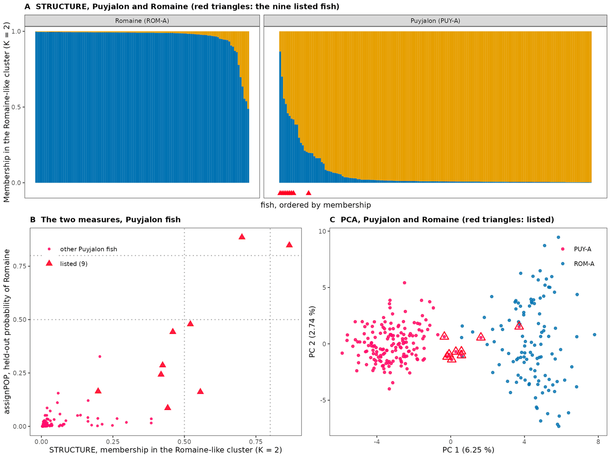

> **Our figure; no counterpart in the paper.** The nine Puyjalon fish that the authors list for removal, examined with the data. A: STRUCTURE with K = 2 on the Romaine fish (left) and the Puyjalon fish (right); each thin vertical bar is one fish, ordered by membership; the blue part of a bar is the membership in the Romaine-like cluster (0 to 1, y axis), the orange part the membership in the other cluster; red triangles under the right panel mark the nine listed fish. B: each Puyjalon fish as a point; x = STRUCTURE membership in the Romaine-like cluster, y = probability of being a Romaine fish given by assignPOP when the fish is held out of the reference; dotted lines at 0.5 and 0.8; red triangles = the nine listed fish, pink dots = the other Puyjalon fish. C: principal component analysis (PC 1 on x, PC 2 on y, percentages of total variation in the axis labels) of the Puyjalon (pink) and Romaine (blue) fish; the nine listed fish are circled in red.


**Limits.** The authors' assignPOP analysis is unpublished; ours uses Romaine as one reference group and all Puyjalon fish (including the listed ones) as the other, so the listed fish contaminate their own reference group (cross-validation holds out the fish being assigned). The membership of a fish is averaged over the STRUCTURE replicates whose likelihood is within 0.1 % of the best; this rule was adopted after seeing that one K = 3 replicate with Rimouski had failed to mix.


<details>
<summary>Scripts, software and parameters of this step</summary>

| Script | Class | What it does |
|---|---|---|
| `04_a_prepare_audit_data.R` | D | fish table with the filters and the listed flag; STRUCTURE inputs |
| `04_b_run_task.sbatch` | D | array of 6 STRUCTURE tasks (60 runs, 2.2 core-hours) |
| `04_c_pca_and_assignment.R` | D | PCA and assignPOP |
| `04_d_tables_and_figures.R`, `04_check.R`, `run_04_collect.sbatch` | D | tables, figure, check, collection job |

**Software.** R 4.2.1 (adegenet, ade4, assignPOP 1.2.4, starmie, ggplot2); STRUCTURE 2.3.4

**Parameters.** STRUCTURE as in step 08 (admixture model, correlated frequencies, burn-in 50,000, 100,000 steps, fixed seeds); PCA with `dudi.pca`; assignPOP with ten-fold cross-validation

</details>


<details>
<summary>Folder of this step (tree)</summary>

```
04_audit_puyjalon_ids/
├── input
│   ├── AllDataCombined_NotFiltered.txt
│   ├── Functions
│   │   ├── allele2genotype.R
│   │   ├── allele_freq.R
│   │   ├── allele_rich.R
│   │   ├── calculate_marker_missing_percentage.R
│   │   ├── create_genind.R
│   │   ├── delta_K.R
│   │   ├── export_allele_format.R
│   │   ├── fst_calculation.R
│   │   ├── fst_marker.R
│   │   ├── genepop_creator.R
│   │   ├── het.R
│   │   ├── impute.R
│   │   ├── kp_ind.R
│   │   ├── ld_test_locus.R
│   │   ├── mean_membership.R
│   │   ├── na_heatmap.R
│   │   ├── p100_missing.R
│   │   └── pca.R
│   ├── PUY_Ind_Cluster_With_ROM_To_Remove.txt
│   └── step01_main_table.txt
├── output
│   ├── check_04.tsv
│   ├── data
│   │   ├── audit_fish_table.tsv
│   │   ├── audit_genind.RDS
│   │   ├── audit_loci.tsv
│   │   ├── audit_puyrom.gen
│   │   ├── data_puyromrim.str
│   │   ├── data_puyrom.str
│   │   ├── datasets.tsv
│   │   ├── extraparams
│   │   ├── jobs.tsv
│   │   ├── labels_lookup.tsv
│   │   └── mainparams.template
│   ├── logs
│   │   ├── 63800232_task01_puyrom_K2_2026-10-09_04-41-06
│   │   │   ├── replicates.log
│   │   │   └── slurm_script
│   │   ├── 63800232_task02_puyrom_K3_2026-10-09_04-41-14
│   │   │   ├── replicates.log
│   │   │   └── slurm_script
│   │   ├── 63800232_task03_puyrom_K4_2026-10-09_04-41-08
│   │   │   ├── replicates.log
│   │   │   └── slurm_script
│   │   ├── 63800232_task04_puyromrim_K2_2026-10-09_04-41-08
│   │   │   ├── replicates.log
│   │   │   └── slurm_script
│   │   ├── 63800232_task05_puyromrim_K3_2026-10-09_04-41-10
│   │   │   ├── replicates.log
│   │   │   └── slurm_script
│   │   ├── 63800232_task06_puyromrim_K4_2026-10-09_04-41-12
│   │   │   ├── replicates.log
│   │   │   └── slurm_script
│   │   ├── 63800475_salmon_wf04_collect_2026-10-09_04-44-36
│   │   │   ├── 04_a_prepare_audit_data.R
│   │   │   ├── 04_check.R
│   │   │   ├── 04_c_pca_and_assignment.log
│   │   │   ├── 04_c_pca_and_assignment.R
│   │   │   ├── 04_d.log
│   │   │   ├── 04_d_tables_and_figures.R
│   │   │   ├── check_04.tsv
│   │   │   ├── check.log
│   │   │   └── slurm_script
│   │   ├── 63800579_salmon_wf04_collect_2026-10-09_04-46-37
│   │   │   ├── 04_a_prepare_audit_data.R
│   │   │   ├── 04_check.R
│   │   │   ├── 04_c_pca_and_assignment.log
│   │   │   ├── 04_c_pca_and_assignment.R
│   │   │   ├── 04_d.log
│   │   │   ├── 04_d_tables_and_figures.R
│   │   │   ├── check_04.tsv
│   │   │   ├── check.log
│   │   │   └── slurm_script
│   │   ├── 63800794_salmon_wf04_collect_2026-10-09_04-47-36
│   │   │   ├── 04_a_prepare_audit_data.R
│   │   │   ├── 04_check.R
│   │   │   ├── 04_c_pca_and_assignment.log
│   │   │   ├── 04_c_pca_and_assignment.R
│   │   │   ├── 04_d.log
│   │   │   ├── 04_d_tables_and_figures.R
│   │   │   ├── check_04.tsv
│   │   │   ├── check.log
│   │   │   └── slurm_script
│   │   ├── salmon_wf04b_str_63800232.out
│   │   ├── salmon_wf04b_str_63800234.out
│   │   ├── salmon_wf04b_str_63800235.out
│   │   ├── salmon_wf04b_str_63800236.out
│   │   ├── salmon_wf04b_str_63800237.out
│   │   ├── salmon_wf04b_str_63800238.out
│   │   ├── salmon_wf04_collect_63800475.out
│   │   ├── salmon_wf04_collect_63800579.out
│   │   └── salmon_wf04_collect_63800794.out
│   ├── pca_assign
│   │   ├── assignPOP_kfold
│   │   │   ├── AnalysisInfo.txt
│   │   │   ├── Loci_1_K10_10.txt
│   │   │   ├── Loci_1_K10_1.txt
│   │   │   ├── Loci_1_K10_2.txt
│   │   │   ├── Loci_1_K10_3.txt
│   │   │   ├── Loci_1_K10_4.txt
│   │   │   ├── Loci_1_K10_5.txt
│   │   │   ├── Loci_1_K10_6.txt
│   │   │   ├── Loci_1_K10_7.txt
│   │   │   ├── Loci_1_K10_8.txt
│   │   │   ├── Loci_1_K10_9.txt
│   │   │   ├── Out_1_K10_10.txt
│   │   │   ├── Out_1_K10_1.txt
│   │   │   ├── Out_1_K10_2.txt
│   │   │   ├── Out_1_K10_3.txt
│   │   │   ├── Out_1_K10_4.txt
│   │   │   ├── Out_1_K10_5.txt
│   │   │   ├── Out_1_K10_6.txt
│   │   │   ├── Out_1_K10_7.txt
│   │   │   ├── Out_1_K10_8.txt
│   │   │   └── Out_1_K10_9.txt
│   │   ├── assignPOP_kfold_results.tsv
│   │   ├── pca_inertia_puyromrim.tsv
│   │   ├── pca_inertia_puyrom.tsv
│   │   ├── pca_scores_puyromrim.tsv
│   │   ├── pca_scores_puyrom.tsv
│   │   └── sessionInfo.txt
│   └── results
│       ├── audit_per_fish_table.tsv
│       ├── audit_summary_by_cutoff.tsv
│       ├── figures
│       │   ├── fig_04_puyjalon_romaine_audit.pdf
│       │   └── fig_04_puyjalon_romaine_audit.png
│       ├── romaine_reference_summary.tsv
│       ├── structure_lnP_by_K.tsv
│       └── structure_romaine_cluster_summary.tsv
├── README.md
└── scripts
    ├── 04_a_prepare_audit_data.R
    ├── 04_b_run_task.sbatch
    ├── 04_check.R
    ├── 04_c_pca_and_assignment.R
    ├── 04_d_tables_and_figures.R
    └── run_04_collect.sbatch

20 directories, 122 files
```

</details>


<details>
<summary>Deviations from the plan in this step</summary>

* **2026-10-09** (D): Choices made while running: (i) the missing-data filter is computed over the 43 loci, not the authors 51-then-43 sequence; (ii) with Rimouski the primary K is 3, because K=2 isolates Rimouski; (iii) membership averaged over replicates within 0.1 percent of the best ln P(D), adopted after one K=3 replicate with Rimouski failed to mix (ln P -275,392); (iv) the first collection (job 63800475) averaged all ten replicates and used K=2 with Rimouski in the summary; replaced by job 63800794 *Why:* These were not fixed in the plan; none changes the K=2 results without Rimouski (all ten replicates agree) *Effect on the result:* none on K=2 without Rimouski

</details>


---

### Step 05: Principal component analyses (Figs 2, S2, S3, S4)
**Level of reproducibility: T1** (the percentage of total variation of all 16 PCAs equals the figures). **Final run:** 6 integrity checks pass; of the comparisons with the paper 17 agree and 0 differ.


**What we set out to do.** Reproduce the PCAs of the paper: Fig. 2 (385 fish of known tactic, reassigned; all sites together and each watershed), Fig. S2 (the same before the reassignment), Fig. S3 (with the Corneille juveniles) and Fig. S4 (the effect of sampling year), and identify the four fish that the paper moves.


<details>
<summary>Method in brief: principal component analysis (PCA)</summary>

* **Why a PCA.** Each fish has 86 allele columns (43 loci, two alleles); no one can look at 86 dimensions. A PCA finds the few directions along which the fish differ most and draws the fish on them, without using the site labels (labels only colour the points). If sites are genetically different, their fish form separate groups in the plot.
* **What it computes.** Each fish is a row of allele counts (0, 1 or 2 copies of each allele); each allele column is centred and scaled to unit variance, so that every allele counts equally (the authors call `dudi.pca` of the R package ade4 with 10 axes). **PC1** is the direction of largest variation, **PC2** the largest direction at right angles to PC1, and so on; each fish gets a score on each axis.
* **How to read the plot.** Fish close together have similar genotypes; separate clouds mean differentiated groups; overlapping clouds mean little differentiation; a fish that sits inside another group's cloud is a candidate migrant or a mislabelled fish. The distances in a PCA plane have no unit: compare them within one plot, not between plots.
* **How to read the axis percentages.** The number in an axis label, for example *PC 1 (22.17 %)*, is the **percentage of total variation** of the table that lies along that axis (the eigenvalue of the axis divided by the sum of all eigenvalues; the authors' scripts and ade4 call it *percentage of total variation*). It depends on the data set: with all 385 fish PC1 holds 6.44 %, while within a watershed (two groups) the difference between the tactics dominates and PC1 holds 10.60 % to 22.17 %. Low percentages (a few per cent) are normal for microsatellites, because the variation is spread over many alleles. The percentage says how much of the variation an axis summarises, not how strongly the groups are differentiated.
* **The ellipses** are 95 % normal ellipses drawn around the fish of each site: a visual aid that assumes the scores of a site are roughly bivariate normal.
* **What a PCA does not do.** It does not test anything; structure that is not about populations (relatives, sampling year, a few fish with many missing values) also makes axes, which is why the effect of sampling year is examined below (Fig. S4).

</details>


**Inputs of our run**


| Input | Where it comes from |
|---|---|
| the genind objects 885 fish x 43 loci, reassigned and not reassigned, imputed | step 03 (identical to the deposit) |
| `04_PCA_MS.R`, `05_PCA_MatSupp.R` and the functions `pca.R`, `kp_ind.R` | step 00 (the authors' scripts, class B) |

**The authors' files and transcriptions used only for comparison (never as inputs)**


| File | Used for |
|---|---|
| transcription of the percentages printed on the axes of Figs 2, S2, S3 and S4 | written by us from the figures; used only for the check |


**What we found.**

* The percentage of total variation of PC1 and PC2 of **the 16 analyses we could read in the figures equals the axis labels**: Fig. 2A-E (6.44/4.07; 22.17/3.91; 10.60/4.93; 13.96/3.67; 11.90/4.63), Fig. S2A-E (the same), Fig. S3A and B (5.72/2.61 and 3.80/2.45) and Fig. S4A-D to three decimals. A PCA is deterministic, so exact agreement is expected once the input genind is the deposited one. Level of reproducibility T1.
* The four fish that the paper reassigns are the four the script circles in red. The script finds them with conditions on the scores (`Axis1 > 5` in Corneille, `< 0` in Aguanish-Victor, `< -5` in Musquaro), which select **the whole cluster in which the migrants lie** (12, 47 and 34 fish), not four fish; in each cluster the fish whose identifier carries the other tactic prefix are the four.
* The PCAs of the reassigned and not-reassigned data have **identical scores** (maximum difference 0): reassignment changes only the label of four fish.


<details>
<summary>Comparison table: percentage of total variation printed in the figures against ours</summary>

| Comparison | Paper / expected | Ours | Result |
|---|---|---|---|
| all sites (385 fish of known tactic), reassigned: percentage of total variation of PC1 and PC2 (Fig. 2A; script 04; tolerance 0.005) | 6.44 / 4.07 | 6.44 / 4.07 | AGREE |
| PUY-A and PUY-R: percentage of total variation of PC1 and PC2 (Fig. 2B; script 04; tolerance 0.005) | 22.17 / 3.91 | 22.17 / 3.91 | AGREE |
| COR-A and COR-R: percentage of total variation of PC1 and PC2 (Fig. 2C; script 04; tolerance 0.005) | 10.60 / 4.93 | 10.60 / 4.93 | AGREE |
| AGU-A and AGU-R: percentage of total variation of PC1 and PC2 (Fig. 2D; script 04; tolerance 0.005) | 13.96 / 3.67 | 13.96 / 3.67 | AGREE |
| MUS-A, MUS-LAK-R, MUS-RIV-R: percentage of total variation of PC1 and PC2 (Fig. 2E; script 04; tolerance 0.005) | 11.90 / 4.63 | 11.90 / 4.63 | AGREE |
| all sites (385 fish of known tactic), not reassigned: percentage of total variation of PC1 and PC2 (Fig. S2A; script 05; tolerance 0.005) | 6.44 / 4.07 | 6.44 / 4.07 | AGREE |
| PUY-A and PUY-R, not reassigned: percentage of total variation of PC1 and PC2 (Fig. S2B; script 05; tolerance 0.005) | 22.17 / 3.91 | 22.17 / 3.91 | AGREE |
| COR-A and COR-R, not reassigned: percentage of total variation of PC1 and PC2 (Fig. S2C; script 05; tolerance 0.005) | 10.60 / 4.93 | 10.60 / 4.93 | AGREE |
| AGU-A and AGU-R, not reassigned: percentage of total variation of PC1 and PC2 (Fig. S2D; script 05; tolerance 0.005) | 13.96 / 3.67 | 13.96 / 3.67 | AGREE |
| MUS-A, MUS-LAK-R, MUS-RIV-R, not reassigned: percentage of total variation of PC1 and PC2 (Fig. S2E; script 05; tolerance 0.005) | 11.90 / 4.63 | 11.90 / 4.63 | AGREE |
| all 885 fish including juveniles: percentage of total variation of PC1 and PC2 (Fig. S3A; script 05; tolerance 0.005) | 5.72 / 2.61 | 5.72 / 2.61 | AGREE |
| COR-A, COR-R, COR-JUV-DOWN, COR-JUV-UP: percentage of total variation of PC1 and PC2 (Fig. S3B; script 05; tolerance 0.005) | 3.80 / 2.45 | 3.80 / 2.45 | AGREE |
| Fig. S4B, PUY-A and PUY-R: percentage of total variation of PC1 and PC2 (three decimals; tolerance 0.0006) | 22.167 / 3.906 | 22.167 / 3.906 | AGREE |
| Fig. S4C, COR-A and COR-R: percentage of total variation of PC1 and PC2 (three decimals; tolerance 0.0006) | 10.6 / 4.933 | 10.6 / 4.933 | AGREE |
| Fig. S4A, PUY-A, PUY-R, COR-A, COR-R: percentage of total variation of PC1 and PC2 (three decimals; tolerance 0.0006) | 14.874 / 5.969 | 14.874 / 5.969 | AGREE |
| Fig. S4D, COR-JUV-DOWN and COR-JUV-UP: percentage of total variation of PC1 and PC2 (three decimals; tolerance 0.0006) | 3.263 / 2.479 | 3.263 / 2.479 | AGREE |
| in each selected cluster the fish whose ID prefix differs from the cluster's majority prefix are the four IDs hard-coded in the script (to_circle) and reassigned | AN_1532_UN_2018 LA_0021_MUR_2004 LA_0029_MUR_2004 LA_0146_VIC_2004 | AN_1532_UN_2018 LA_0021_MUR_2004 LA_0029_MUR_2004 LA_0146_VIC_2004 | AGREE |

</details>


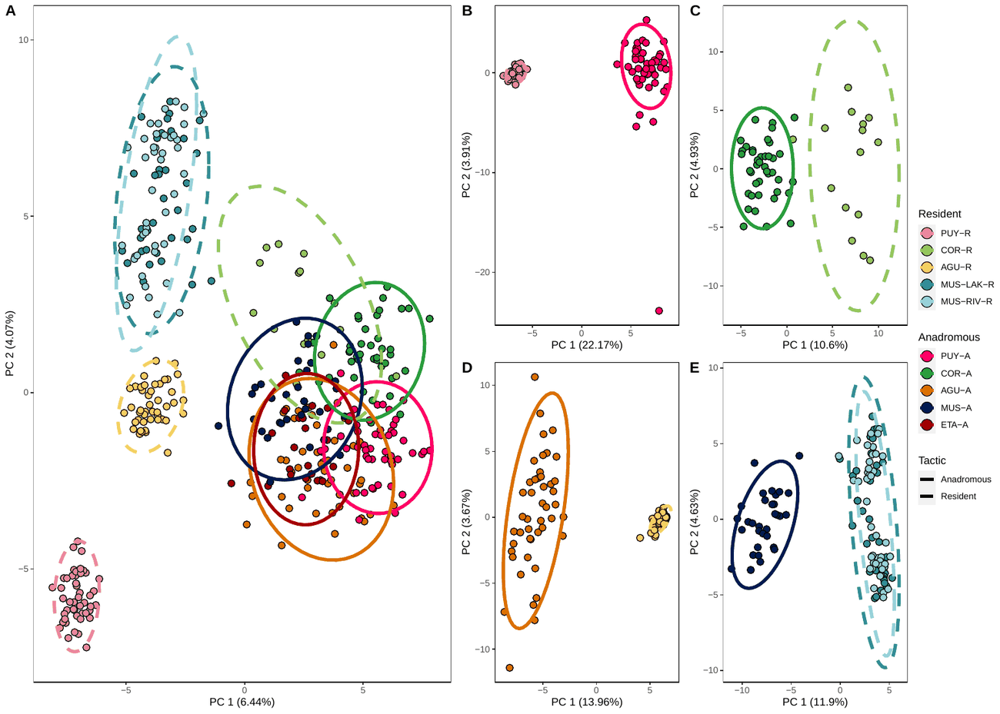

> **Reproduction of the paper's Fig. 2, drawn by the authors' own script from our tables.** Principal component analysis of the 385 fish of known tactic. A: all fish; B to E: the same analysis inside each of four watersheds (B Puyjalon, C Corneille, D Aguanish, E Musquaro). Each dot is one fish, PC 1 on the x axis and PC 2 on the y axis; the percentage in each axis label is the percentage of the total variation along that axis. Colour = site (legend at the right); ellipses are 95 % confidence ellipses of each site, solid for anadromous and dashed for resident fish. The percentages equal those of the paper's figure.


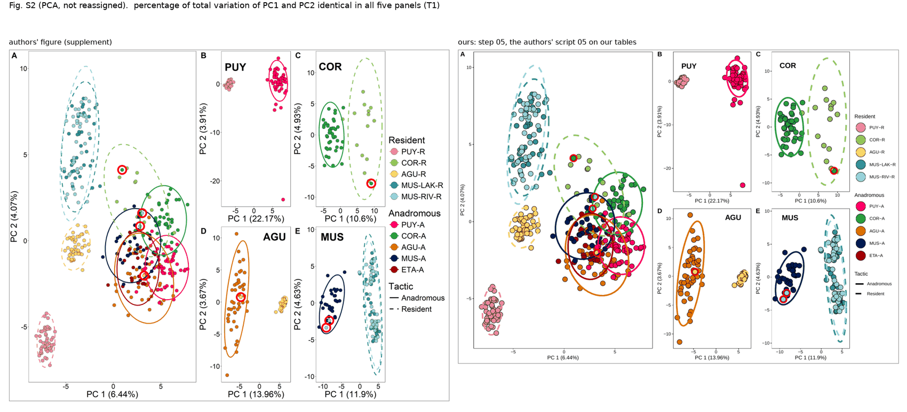

> **Paper's Fig. S2: the authors' figure (left) and the one drawn by the authors' script from our tables (right).** The principal component analysis of Fig. 2 before the four fish were moved to another site (A: all fish; B to E: the four watersheds). Axes, colours and ellipses as in the previous figure: PC 1 on x, PC 2 on y, percentages of total variation in the axis labels, colour = site, ellipse = one site. The percentages on the axes are identical in all five panels.


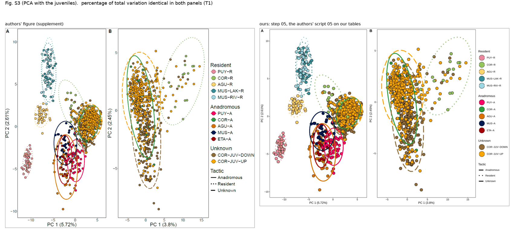

> **Paper's Fig. S3: the authors' figure (left) and the one drawn by the authors' script from our tables (right).** Principal component analysis in which the Corneille juveniles (parr and smolts of unknown tactic, caught above and below the falls) are added to the adult fish of Corneille. Each dot is one fish, PC 1 on x and PC 2 on y, percentages of total variation in the axis labels; colour = site or juvenile group. The percentages are identical in both panels.


**Fig. S4: the effect of sampling year (our script; the deposit has no code).** The paper states that sampling year had no effect on the genetic structure of sites sampled in several years, on the evidence of the figure alone. We redrew the four panels and added a test of the PCA scores of each site among years (Kruskal-Wallis, no correction for multiple tests):


**What the test asks.** For each site, in each panel of Fig. S4, do the fish sampled in different years have different scores on PC1 (and on PC2)? The **Kruskal-Wallis test** compares the scores among the years without assuming a distribution (it extends the Wilcoxon rank-sum test to more than two groups). Each P value is the probability of finding differences among years at least this large if the year had no effect: a **small P (below 0.05) means that the scores differ among years**, a large P that there is no evidence that they do. No correction was made for the number of tests. The columns of the table are: the panel of Fig. S4 in which the site appears (the same site can appear in two panels, because each panel is a separate PCA); the site; the years in which it was sampled; the number of fish; and the P values for the two axes.

| Panel of Fig. S4 | Site | Years of sampling compared | Fish | P value, PC1 scores among years | P value, PC2 scores among years |
|---|---|---|---|---|---|
| A | COR-A | 2015 2018 | 41 | 0.3 | 0.62 |
| C | COR-A | 2015 2018 | 41 | 0.46 | 0.19 |
| D | COR-J-DO | 2014 2015 2019 2020 | 229 | 6e-06 | 1.7e-09 |
| D | COR-J-UP | 2012 2014 2015 2019 2020 | 271 | 0.00082 | 1.3e-10 |
| A | COR-R | 2015 2018 | 15 | 0.49 | 1 |
| C | COR-R | 2015 2018 | 15 | 0.16 | 0.11 |
| A | PUY-A | 2013 2014 2015 | 50 | 0.081 | 0.13 |
| B | PUY-A | 2013 2014 2015 | 50 | 0.034 | 0.059 |


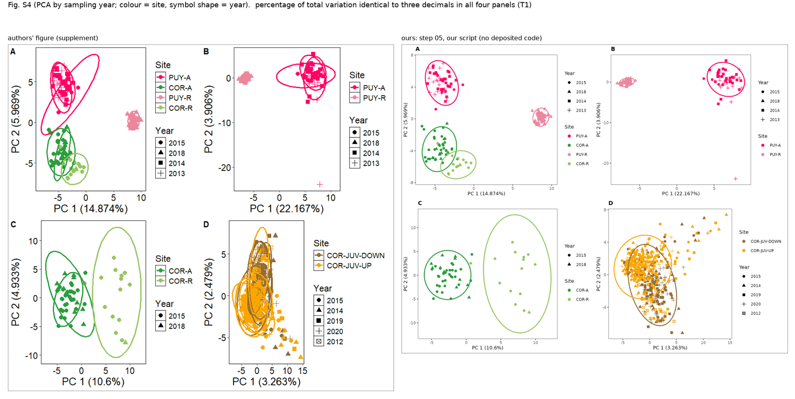

> **Paper's Fig. S4: the authors' figure (left) and our redrawing (right).** The authors' code for this figure is not in the deposit; the right-hand figure was drawn by our script. Principal component analysis by sampling year in four panels; each dot is one fish, PC 1 on x and PC 2 on y, with the percentage of total variation in the axis labels; colour = site, shape of the symbol = year of sampling. The percentages are identical to three decimals.


No year difference is seen in the adults (smallest P 0.11 to 0.19 in the Corneille sites; 0.034 in the Puyjalon smolts). In the juveniles the scores differ strongly among years (P down to 1e-10). That is not the same as an effect of the year on the genetic structure in the paper's sense: the juveniles were sampled in different years, possibly as cohorts and families that differ among years, which a PCA cannot separate from a year effect. The paper's sentence is supported for the adults and not for the juveniles by this test; we did not pursue it.

**A note on the inputs.** The PCA uses the imputed genind (one draw per allele column, step 01); the effect of the imputation on the PCA was not tested.


<details>
<summary>Scripts, software and parameters of this step</summary>

| Script | Class | What it does |
|---|---|---|
| `input/04_PCA_MS.R`, `input/05_PCA_MatSupp.R` | B | the authors' scripts; the PCAs that they keep in memory are written to files by two small post-run scripts |
| `05_post_04.R`, `05_post_05.R` | D | write scores and percentages of every PCA |
| `05_c_year_effect.R` | D | Fig. S4 and the year test |
| `05_check.R`, `run_05_pca.sbatch` | D | check and job (16 to 32 seconds) |

**Software.** R 4.2.1: adegenet 2.1.10 (`dudi.pca` of ade4), ggplot2, ggpubr, ggnewscale

**Parameters.** all the authors': `dudi.pca(as.data.frame(tab(genind)), scannf = FALSE, nf = 10)`, 95 % normal ellipses by site

</details>


<details>
<summary>Folder of this step (tree)</summary>

```
05_pca/
├── input
│   ├── 04_PCA_MS.R
│   ├── 05_PCA_MatSupp.R
│   ├── Functions
│   │   ├── allele2genotype.R
│   │   ├── allele_freq.R
│   │   ├── allele_rich.R
│   │   ├── calculate_marker_missing_percentage.R
│   │   ├── create_genind.R
│   │   ├── delta_K.R
│   │   ├── export_allele_format.R
│   │   ├── fst_calculation.R
│   │   ├── fst_marker.R
│   │   ├── genepop_creator.R
│   │   ├── het.R
│   │   ├── impute.R
│   │   ├── kp_ind.R
│   │   ├── ld_test_locus.R
│   │   ├── mean_membership.R
│   │   ├── na_heatmap.R
│   │   ├── p100_missing.R
│   │   └── pca.R
│   ├── GENIND_Filtered_Individuals885_Loci43_IMPUTED_FINAL.RDS
│   ├── GENIND_Filtered_Individuals885_Loci43_REASSIGNED_IND_IMPUTED_FINAL.RDS
│   ├── inertia_in_figures_transcribed.tsv
│   └── README_inertia_transcribed.txt
├── output
│   ├── check_05.tsv
│   ├── figures
│   │   ├── fig_05_authors_script04_fig2-1.png
│   │   ├── fig_05_authors_script05-1.png
│   │   ├── fig_05_authors_script05-2.png
│   │   ├── fig_05_authors_script05-3.png
│   │   └── fig_05_year_effect_ours.png
│   ├── logs
│   │   ├── 63797754_salmon_wf05_pca_2026-10-09_04-17-05
│   │   │   ├── 05_check.R
│   │   │   ├── 05_c_year_effect.log
│   │   │   ├── 05_c_year_effect.R
│   │   │   ├── 05_post_04.R
│   │   │   ├── 05_post_05.R
│   │   │   ├── check_05.tsv
│   │   │   ├── check.log
│   │   │   ├── run_stdout.log
│   │   │   ├── script_changes.diff
│   │   │   ├── slurm_script
│   │   │   └── stage_run.sh
│   │   ├── 63797801_salmon_wf05_pca_2026-10-09_04-18-34
│   │   │   ├── 05_check.R
│   │   │   ├── 05_c_year_effect.log
│   │   │   ├── 05_c_year_effect.R
│   │   │   ├── 05_post_04.R
│   │   │   ├── 05_post_05.R
│   │   │   ├── check_05.tsv
│   │   │   ├── check.log
│   │   │   ├── run_stdout.log
│   │   │   ├── script_changes.diff
│   │   │   ├── slurm_script
│   │   │   └── stage_run.sh
│   │   ├── 63798037_salmon_wf05_pca_2026-10-09_04-21-34
│   │   │   ├── 05_check.R
│   │   │   ├── 05_c_year_effect.log
│   │   │   ├── 05_c_year_effect.R
│   │   │   ├── 05_post_04.R
│   │   │   ├── 05_post_05.R
│   │   │   ├── check_05.tsv
│   │   │   ├── check.log
│   │   │   ├── run_stdout.log
│   │   │   ├── script_changes.diff
│   │   │   ├── slurm_script
│   │   │   └── stage_run.sh
│   │   ├── salmon_wf05_pca_63797754.out
│   │   ├── salmon_wf05_pca_63797801.out
│   │   └── salmon_wf05_pca_63798037.out
│   ├── script04
│   │   ├── 05_post_04.R
│   │   ├── exit_code.txt
│   │   ├── figures.pdf
│   │   ├── inputs_check.txt
│   │   ├── inputs_md5_after.txt
│   │   ├── inputs_md5_before.txt
│   │   ├── pca_inertia_script04.tsv
│   │   ├── pca_scores_script04_eco_sure_agu_vic.tsv
│   │   ├── pca_scores_script04_eco_sure_cor.tsv
│   │   ├── pca_scores_script04_eco_sure_mus.tsv
│   │   ├── pca_scores_script04_eco_sure_puy_per.tsv
│   │   ├── pca_scores_script04_eco_sure.tsv
│   │   ├── run_stdout.log
│   │   ├── script_changes.diff
│   │   ├── seconds.txt
│   │   └── sessionInfo.txt
│   ├── script05
│   │   ├── 05_post_05.R
│   │   ├── exit_code.txt
│   │   ├── figures.pdf
│   │   ├── inputs_check.txt
│   │   ├── inputs_md5_after.txt
│   │   ├── inputs_md5_before.txt
│   │   ├── migrants_found_by_the_script_conditions.tsv
│   │   ├── pca_inertia_script05.tsv
│   │   ├── pca_scores_script05_all.tsv
│   │   ├── pca_scores_script05_eco_sure_agu_vic.tsv
│   │   ├── pca_scores_script05_eco_sure_cor.tsv
│   │   ├── pca_scores_script05_eco_sure_eta.tsv
│   │   ├── pca_scores_script05_eco_sure_mus.tsv
│   │   ├── pca_scores_script05_eco_sure_puy_per.tsv
│   │   ├── pca_scores_script05_eco_sure.tsv
│   │   ├── pca_scores_script05_not_reass_agu_vic.tsv
│   │   ├── pca_scores_script05_not_reass_cor.tsv
│   │   ├── pca_scores_script05_not_reass_eco_sure.tsv
│   │   ├── pca_scores_script05_not_reass_mus.tsv
│   │   ├── pca_scores_script05_not_reass_puy_per.tsv
│   │   ├── pca_scores_script05_with_cor_juv.tsv
│   │   ├── run_stdout.log
│   │   ├── script_changes.diff
│   │   ├── seconds.txt
│   │   └── sessionInfo.txt
│   └── year_effect
│       ├── fig_S4_year_effect_ours.pdf
│       ├── fig_S4_year_effect_ours.png
│       ├── year_effect_inertia.tsv
│       ├── year_effect_scores.tsv
│       └── year_effect_tests_kruskal.tsv
├── README.md
└── scripts
    ├── 05_check.R
    ├── 05_c_year_effect.R
    ├── 05_post_04.R
    ├── 05_post_05.R
    └── run_05_pca.sbatch

13 directories, 118 files
```

</details>


<details>
<summary>Deviations from the plan in this step</summary>

* **2026-10-09** (D): First checks of step 05 (jobs 63797754, 63797801): one comparison failed in the first version because the script conditions (Axis1 > 5 etc.) select whole clusters, not four fish; my check expected four fish. The check now identifies the four as the minority tactic prefix in each selected cluster *Why:* Check written before looking at the selected sets *Effect on the result:* none; the script and its results are unchanged

</details>


---

### Step 06: Audit of the four reassigned fish
**Level of reproducibility: T3** (descriptive audit; no published statistic exists). **Final run:** 6 integrity checks pass; of the comparisons with the paper 2 agree and 1 differ.


**What we set out to do.** The paper identifies the four migrants by eye on the PCA; there is no code or statistic for it in the deposit. We asked how the four fish look in an **assignment test** compared with the 381 other fish of known tactic. Again no pass/fail verdict.


<details>
<summary>Method in brief: leave-one-out assignment</summary>

* **Why.** The paper moves four fish to another site because of their position in the PCA. An assignment test asks the same question with a number: how probable is each fish's genotype under the allele frequencies of each site?
* **What it computes.** For each fish and each site, the probability of the fish's genotype given the site's allele frequencies, **leaving the fish itself out of its own site's reference** (leave-one-out, so a fish cannot vouch for itself), assuming Hardy-Weinberg proportions and independent loci, with a pseudocount of 0.5 added to every allele count so that an allele absent from a site is not impossible. With equal prior probabilities the likelihoods give a **posterior probability** for each site; the fish is assigned to the site with the highest one.
* **How to read the values.** A posterior near 1 for the labelled site means the fish fits its own site; a very low posterior for its own label (for example 1e-23) together with a posterior near 1 for another site means the fish looks like a member of that other site. Posteriors of clearly assigned fish are extreme (close to 0 or 1) because the loci are treated as independent, so the values are for ranking and for cut-offs (0.5, 0.8), not for probability statements.
* **Scope.** The analysis is done for the 10 sites, for the 9 groups with the Musquaro residents pooled, and for the two tactics within each watershed.

</details>


**Inputs of our run**


| Input | Where it comes from |
|---|---|
| genind of the 385 fish of known tactic, before the reassignment | step 03 |
| PC1 and PC2 scores of the not-reassigned PCA | step 05 (for the figure only) |


**What we found.** First a summary of what the audit corroborates and what else it shows; the details follow.


| Statement or question | What our audit found | Status |
|---|---|---|
| The four fish moved by the authors do not belong with the other fish of their labelled site (the paper moves them by eye on the PCA) | All four are assigned, with a posterior of at least 0.9999999, to the site that the paper gives them (the other tactic of their watershed); their own-label posteriors are the four lowest of all 385 fish | Corroborated |
| The four fish are first-generation migrants (paper) | Their genotypes resemble the other tactic of their watershed; the audit cannot tell a migrant from a mislabelled or admixed fish | Not testable here |
| Nothing else in the data is as extreme as the four (implied by moving only four fish) | A fifth fish, LA_0012_UN_2015 (labelled COR-R), is assigned to COR-A with a posterior of about 1 (own-label posterior 2.2e-8, the fifth lowest) and was not moved; the paper gives no reason | New observation |
| (not discussed in the paper) | Two ETA-A fish, AN_0033_ETA_2004 and AN_0018_ETA_2004, are assigned to MUS-A (posterior 0.976 and 0.964); ETA-A has no resident counterpart | New observation |
| The site labels agree with the genotypes (implied by the use of the sites as populations) | All other fish have a posterior of at least 0.58 for their own label, and 376 of 385 fish have at least 0.8 | Corroborated, apart from the fish above |
| MUS-LAK-R and MUS-RIV-R are one population (the paper pools them) | They cannot be told apart: 40 of 82 fish are assigned to the other resident sample | Corroborated |


**Details.**

* **The four fish are the four most extreme of the 385.** Each is assigned, with posterior at least 0.9999999, to the site the paper gives it and to the other tactic of its watershed; their own-label posteriors are the four lowest of all 385 fish.
* **A fifth fish is as clearly assigned elsewhere and was not reassigned:** LA_0012_UN_2015 (COR-R) is assigned to COR-A (posterior about 1; own-label posterior 2.2e-8, the fifth lowest). In the PCA it lies at the edge of the COR-A cluster. The paper's rule (reassign when biologically and geographically consistent) does not say why this COR-R fish, the reverse of the reassigned COR-A fish AN_1532_UN_2018, was kept. We do not decide; the table lists it.
* **Two ETA-A fish** (AN_0033_ETA_2004, AN_0018_ETA_2004) are assigned to MUS-A (posterior 0.976 and 0.964). ETA-A has no resident counterpart; the paper does not discuss them.
* All other fish have a posterior of at least 0.58 for their own group; 376 of 385 have at least 0.8.
* **MUS-LAK-R and MUS-RIV-R cannot be distinguished** (40 of 82 fish are assigned to the other resident sample), which agrees with the authors' pooling of the two samples.


| Fish | Labelled site (data code) | Assigned site (data code) | Posterior of the assigned site | Posterior of its own label (9 groups) |
|---|---|---|---|---|
| LA_0146_VIC_2004 | VIC_R | AGU_A | 1 | 5.27e-46 |
| LA_0021_MUR_2004 | MUS_RR | MUS_A | 1 | 3.87e-33 |
| LA_0029_MUR_2004 | MUS_RR | MUS_A | 1 | 1.79e-29 |
| AN_1532_UN_2018 | COR_A | COR_R | 1 | 4.7e-23 |
| LA_0012_UN_2015 | COR_R | COR_A | 1 | 2.2e-08 |
| AN_0033_ETA_2004 | ETA_A | MUS_A | 0.976 | 0.0236 |
| AN_0018_ETA_2004 | ETA_A | MUS_A | 0.964 | 0.0357 |


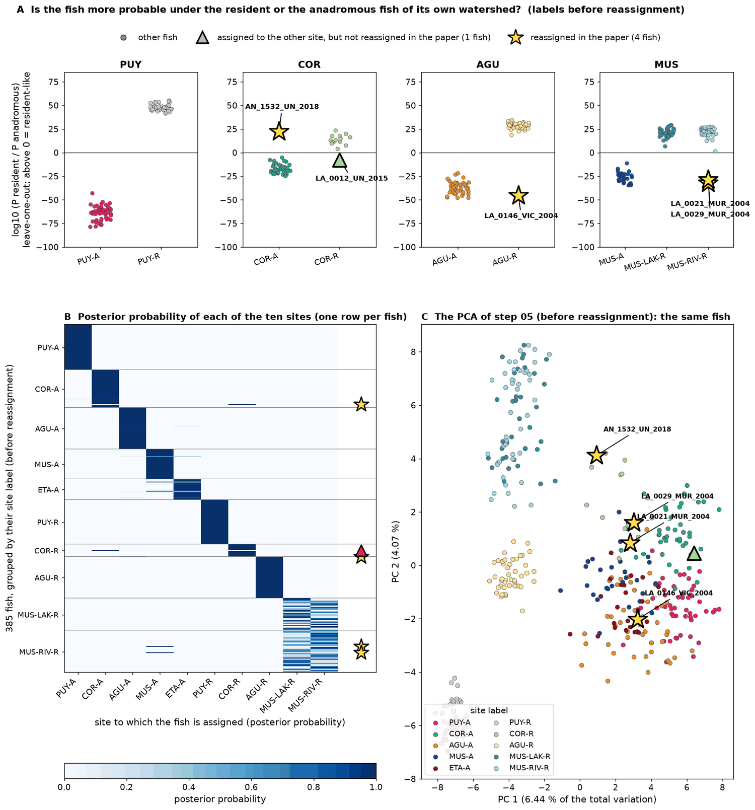

> **Our figure; no counterpart in the paper.** Leave-one-out assignment of the 385 fish of known tactic, with the site labels they had before the reassignment (every fish is classified by a model built without it). A: one panel per watershed (PUY, COR, AGU, MUS); each dot is one fish, x = its site label, y = log10 of (probability that it is resident divided by the probability that it is anadromous in its own watershed); above 0 the fish is resident-like, below 0 anadromous-like. Stars: the four fish that the paper reassigns; triangle: LA_0012_UN_2015, assigned to the other tactic but not reassigned in the paper; dots: all other fish. B: one row per fish, grouped by site label; each column is one of the ten sites and the colour is the posterior probability (white 0, dark blue 1) that the fish belongs to that site; the symbols at the right of the figure mark the same fish as in A. C: the principal component analysis of step 05 (PC 1 on x, PC 2 on y, percentage of total variation in the axis labels) with the same fish marked.


**Limits.** The assignment uses all 43 loci and the same reference samples as the labels; no other subset of loci, pseudocount or method was tried (no sensitivity analysis was planned).


<details>
<summary>Scripts, software and parameters of this step</summary>

| Script | Class | What it does |
|---|---|---|
| `06_a_loo_assignment.R` | D | leave-one-out likelihood assignment |
| `06_b_figures.R`, `06_check.R`, `run_06_audit_reassignment.sbatch` | D | figure, check, job (17 seconds) |

**Software.** R 4.2.1, adegenet 2.1.10

**Parameters.** fixed before the run: pseudocount 0.5, Hardy-Weinberg, equal prior, 86 allele columns, focal fish removed from its own reference

</details>


<details>
<summary>Folder of this step (tree)</summary>

```
06_audit_reassignment/
├── input
│   ├── GENIND_not_reassigned_imputed.RDS
│   └── pca_scores_not_reassigned_385.tsv
├── output
│   ├── check_06.tsv
│   ├── figures
│   │   ├── fig_06_loo_assignment_bold.png
│   │   ├── fig_06_loo_assignment.pdf
│   │   └── fig_06_loo_assignment.png
│   ├── logs
│   │   ├── 63798576_salmon_wf06_audit_2026-10-09_04-26-38
│   │   │   ├── 06_a_loo_assignment.log
│   │   │   ├── 06_a_loo_assignment.R
│   │   │   ├── 06_b_figures.log
│   │   │   ├── 06_b_figures.R
│   │   │   ├── 06_check.R
│   │   │   ├── check_06.tsv
│   │   │   ├── check.log
│   │   │   ├── inputs_md5_after.txt
│   │   │   ├── inputs_md5_before.txt
│   │   │   └── slurm_script
│   │   └── salmon_wf06_audit_63798576.out
│   ├── loo_assignment_per_fish.tsv
│   ├── loo_fish_assigned_elsewhere_or_reassigned.tsv
│   ├── loo_loglik_10sites.tsv
│   ├── loo_summary_by_site.tsv
│   └── sessionInfo.txt
├── README.md
└── scripts
    ├── 06_a_loo_assignment.R
    ├── 06_b_figures.R
    ├── 06_c_figure_bold.py
    ├── 06_check.R
    └── run_06_audit_reassignment.sbatch

7 directories, 28 files
```

</details>


<details>
<summary>Deviations from the plan in this step</summary>

* **2026-10-10** (D): Added 06_c_figure_bold.py: the figure of the step with larger symbols (stars for the four reassigned fish, a large triangle for LA_0012_UN_2015) and labelled panels, output/figures/fig_06_loo_assignment_bold.png; the original figure is kept *Why:* the symbols of the figure were too thin (comments on version 2) *Effect on the result:* none; presentation only

</details>


---

### Step 07: Linkage disequilibrium and identity by missingness
**Level of reproducibility: T1/T2** (the linkage statistic is reproduced exactly, the missingness check approximately). **Final run:** 19 integrity checks pass; of the comparisons with the paper 3 agree and 1 differ.


**What we set out to do.** The Methods report two checks without showing them: (a) pairwise **linkage disequilibrium** among loci (the paper: values between -0.071 and 0.006, so no locus was removed), and (b) **identity by missingness** with PLINK (no cluster created by missing data, data not shown). We reproduced both.


<details>
<summary>Method in brief: why test linkage disequilibrium and identity by missingness, and how to read them</summary>

**1. Linkage disequilibrium (LD): why it matters.** STRUCTURE, FST with bootstraps over loci, and the Ne method assume that the loci are statistically independent. Two loci that lie close together on the same chromosome are inherited together and their alleles are not independent: this is **linkage disequilibrium**, the non-random association of alleles at two loci. If many loci were linked, the effective number of independent loci would be smaller than 43 and the results would look more certain than they are. Loci on different chromosomes are not linked, so the authors test only pairs of loci on the same chromosome (the chromosome is read from the locus name: `Ssa_14_8` is on chromosome 14), 36 pairs in all.

**What the statistic is.** The authors' function calls `pegas::LD2` (for genotypes whose phase is unknown, after Schaid 2004). For a pair of loci it returns **Δ ('Delta'), the correlation between each allele of locus 1 and each allele of locus 2** (a covariance of the numbers of copies carried by the fish, divided by two), and a T2 test of the hypothesis of no linkage disequilibrium (the pegas documentation). Δ near 0 means that the two alleles are found together as often as chance predicts; a positive value means that they are found together more often than expected and a negative value less often. The authors average the Δ of each pair of loci and report the range of these means, -0.071 to 0.006, and conclude that no locus needed to be removed. A worked example with two loci, the definition of Δ and of the T2 test are in the block **'What linkage disequilibrium is and what the statistic Δ measures'** below.

**2. Identity by missingness (IBM): why look at missing genotypes at all.** A genotype is missing when the PCR or the sequencing failed. If failures were random, they would only reduce the amount of data. If they were systematic (for example concentrated in the fish of one site, one year, one extraction method, or one sequencing run), they would mimic genetic differences or bias the allele frequencies: a locus that fails more often in one lineage can be a sign of a **null allele** (a technical artefact, not a type of allele: an allele that fails to amplify, for example because a mutation sits where the primer binds; the fish then looks homozygous for its other allele, or its genotype is recorded as missing), and a site with poor DNA would show fewer alleles. The PLINK documentation puts it this way: systematic batch effects that induce missingness in parts of the sample induce correlation between the patterns of missing data of different individuals, and one way to detect such biases is to cluster individuals by their **identity-by-missingness**.

**What the computation is.** Every fish is described only by which of the loci are missing (called or not called); the genotype values are ignored. PLINK compares each pair of fish by how similar their patterns of missing loci are (the identity-by-missingness matrix, from `--cluster missing`), clusters the fish on this similarity, and the matrix can be drawn as a **multidimensional scaling (MDS)**, a plane (or a few axes) on which fish with similar missing-data patterns are close. **How to read it.** (a) PLINK's clustering, run without any constraint, merges the fish step by step until all are in **one cluster**; it does so for any data, so the single cluster found here agrees with the paper but is not by itself informative (a minimum identity-by-missingness for merging could be set, and the paper does not say it was). (b) The informative result is the MDS plot: if the points of one site (or one year) formed their own cloud, missingness would depend on site (or year); if the colours are mixed, it does not. (c) We add a number to the plot: the **adjusted R²** of site (or year) as a predictor of each MDS axis, the percentage of the variation of the axis that site explains (0 means none, 1 means all, a slightly negative value means no relation). (d) MDS axis 2 turns out to be just the **number of missing loci per fish**, not a grouping. **Limits.** Only 0.365 % of the genotypes are missing (793 of 885 fish have no missing genotype), so there is little pattern to find; the test can show that the missingness does not group by site or year, but it cannot detect a null allele at a single locus.

</details>


<details>
<summary>What linkage disequilibrium is and what the statistic Δ measures (a small example)</summary>

**The idea.** Take two loci. Locus L1 has the alleles a1 and b1; locus L2 has the alleles a2 and b2. A fish carries 0, 1 or 2 copies of each allele. If the two loci are inherited independently, knowing that a fish carries a1 tells nothing about whether it carries a2 or b2. If the loci are physically close on a chromosome, or the sample mixes populations with different allele frequencies, some allele pairs occur together more often than expected: this is **linkage disequilibrium (LD)**.

**The statistic Δ.** For every pair made of one allele of L1 and one allele of L2 (here four pairs: a1 with a2, a1 with b2, b1 with a2, b1 with b2) the function `LD2` of the R package pegas (version 1.2, the one the authors use) returns

Δ = (average over the fish of: copies of the L1 allele × copies of the L2 allele) / 2 − 2 × (frequency of the L1 allele) × (frequency of the L2 allele),

which is the covariance of the two counts divided by two. Δ is 0 when the two alleles are independent, positive when they occur together more than expected and negative when less.

**Why the Δ of a pair of loci must add up to zero.** A fish has two copies of L2 alleles in all, so the copies of a2 and of b2 add to 2: when a fish carries more of a2 it carries fewer of b2. For the allele a1, the Δ with a2 and the Δ with b2 therefore have the same size and opposite signs, and the same holds for b1 and for each column. **Every row, every column and the whole table of Δ sum to zero.** This is a property of the definition, not of the data, and it gives a check on any table returned by the function.

**The T2 test.** `LD2` also returns a statistic T2 for the null hypothesis that the two loci are independent (Schaid 2004, Genetics 166: 505-512, as cited in the documentation of pegas). For every pair of alleles the statistic r = Δ² / [(variance term of the L1 allele) × (variance term of the L2 allele)] is computed; it is the squared correlation between the numbers of copies of the two alleles carried by the fish. Then T2 = df × n × (sum of r) / (k × m), with n fish, k and m the numbers of alleles of the two loci and df = (k - 1) × (m - 1) degrees of freedom. Under independence T2 follows approximately a chi-square distribution with df degrees of freedom, which gives the P value: a small P (below 0.05) means that the two loci are associated.

**The example, run by us (step 07).** 40 made-up fish, locus L1 with the alleles 10 and 12, locus L2 with the alleles 20, 22 and 24, with a built-in association. The output of the job is below: our own computation of Δ, the table returned by `LD2` with the loci given in column order (L1, L2), and the table returned with the loci given in the reverse order (L2, L1).

```
Made-up data: 40 fish, locus L1 (alleles 10, 12), locus L2 (alleles 20, 22, 24); pegas 1.2 

First 8 fish (two columns per locus):
  L1 L1_b L2 L2_b
1 10   10 24   24
2 12   12 22   20
3 10   10 20   22
4 10   10 20   20
5 12   10 22   24
6 12   10 22   20
7 10   10 20   24
8 10   10 20   20

Allele frequencies L1: 10 = 0.65, 12 = 0.35 ; L2: 20 = 0.462, 22 = 0.2, 24 = 0.338 

Delta computed by us (rows = alleles of L1, columns = alleles of L2); the rows and columns sum to zero:
        20      22      24 row_sum
10  0.0613 -0.0475 -0.0138       0
12 -0.0613  0.0475  0.0138       0
column sums: 0 0 0 

LD2 called with the loci in column order (L1, L2):
        20      22     24
10  0.0612 -0.0138 0.0475
12 -0.0475 -0.0612 0.0138
sum of all cells: -8.33e-17  row sums: 0.095 -0.095  T2 = 4.642  df = 2  P = 0.0982 

LD2 called with the loci in reverse order (L2, L1):
        20      22      24
10 -0.1263 -0.4138  0.1100
12 -0.1350  0.2263 -0.2112
sum of all cells: -0.55  T2 = 101.981  df = 2  P = 7.16e-23 

Attribute 'locicol' of the loci object after taking the columns in the order (L2, L1): 2 1  (positions in the ORIGINAL object, not in the new one)
Names of the columns of that object: L2 L1 ; names that summary() returns for it: L1 L2
```

**Reading the example.** (1) In column order the sum of all cells is 0, as it must be, and T2 = 4.64 on 2 degrees of freedom (P = 0.098); the six values are the six values of our own computation. (2) In the reverse order the table returned has a sum of -0.55 and T2 = 102 (P = 7e-23): the same two loci, called in the other order, give a different answer, and the row labels of the table (10 and 12) are those of L1 although the numbers were computed with L2 in the rows. (3) Even in column order the cells of the table are not in the right places when the two loci have different numbers of alleles: the rows of the table do not sum to zero (±0.095), while those of our own table do.

</details>


**Inputs of our run**


| Input | Where it comes from |
|---|---|
| raw table and nine-ID list, `01_FilteringData.R` and functions | step 00 (script class B: the switch that turns on the LD block of the script) |
| the 885-fish table of step 01 (not imputed) for the missingness analysis | step 01 |
| PLINK 1.9 | installed program |


**What we found.**

* **Linkage statistic as coded by the authors: reproduced exactly (T1).** Range of the mean pairwise values of the 36 same-chromosome pairs: **-0.0710 to 0.0057** (paper: -0.071 and 0.006). The authors' LD block runs on the data frame of **996 fish** before the removal of the Puyjalon fish and the balancing, not on the 885-fish table; we reproduce that as written.
* **Missingness (T2).** 139 of 38,055 genotypes are missing (0.365 %); 793 fish have no missing genotype. PLINK's clustering with its default options puts all 885 fish in **one cluster**, in agreement with the paper (this is also what it does by default, whatever the data). The MDS is not structured by site (adjusted R² of site on MDS 1 to 4: -0.001, 0.014, -0.002, -0.006) or by year (0.019, 0.071, 0.012, -0.002); MDS 2 is just the number of missing loci per fish. Missingness is not constant among sites (the juveniles and COR-R have the most) but this forms no clusters.


<details>
<summary><b>Problem found:</b> the linkage statistic of the Methods is the range of values from the reversed half of the calls</summary>

**What the authors did.** The function `ld_test_locus()` calls `pegas::LD2` once for **every ordered pair** of loci (1,806 calls; 72 ordered pairs lie on the same chromosome, which is 36 pairs, each called twice: with the loci in column order and in reverse order), and averages the allele correlations Δ of each call. The range of these averages is the statistic quoted in the paper: between -0.071 and 0.006.

**What is wrong.** For a pair of loci the Δ must sum to zero (see the example above). For the 36 pairs called in column order the sum is 0 (to 2e-16); for the same pairs called in the reverse order the sum differs from zero in 35 of 36 pairs (down to -1.98). The reversed calls give **wrong numbers, not another correct view of the same pair**. We traced the cause in the example above: `LD2` takes the genotype columns in the order requested, but it reads the allele names and the allele frequencies from a summary of the loci that is always in the original column order, because the object it builds keeps the old column numbers; for a reversed pair the genotypes of one locus are therefore combined with the names and frequencies of the other. This is a defect of pegas 1.2 combined with a loop that asks for both orders; nothing suggests that the authors chose it. **The range quoted in the paper is the range of the reversed calls**: they span -0.0710 to 0.0057; the calls in column order span -0.0009 to 0.0001. Moreover, the mean of Δ over all allele pairs of a pair of loci is zero by construction when it is computed correctly, so a range of this mean around zero cannot show an absence of linkage whatever the data are.

**A second defect, which does not change the authors' numbers.** `LD2` fills its table row by row but stores it column by column, so when the two loci have different numbers of alleles the values are in the wrong cells of the table even in column order (and the table is transposed when the numbers of alleles are equal). The sum, the mean, T2 and P are not affected, so the quoted range is not changed by it, but the values of the authors' tables must not be read cell by cell (allele pair by allele pair).

**What is correct.** Call `LD2` once per pair in column order and judge linkage with a measure that does not cancel (the mean absolute Δ, a correlation per pair of loci, or the T2 test of `LD2`), within populations. The conclusion that no locus needed to be removed may well be right; the number that supports it in the paper does not.

**What we computed.** The authors' block exactly as written (range -0.0710 to 0.0057, T1), and the 36 pairs in both orders. In column order (the correct one) the authors' own test T2 gives P < 0.05 for 35 of 36 pairs in the pooled sample of 996 fish; this reflects differences of allele frequencies among sites as much as linkage.

**What we did not compute.** LD within sites or populations, thresholds on r², and any new choice of loci to remove (no sensitivity analysis was planned). Whether a corrected calculation would remove any locus is **not known**.

</details>


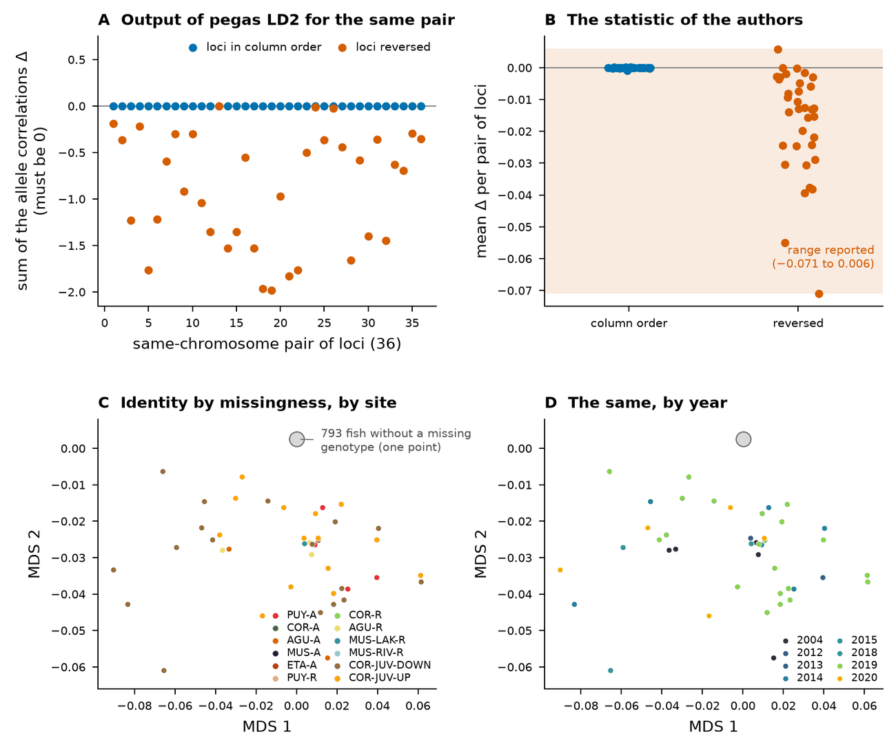

> **Our figure; no counterpart in the paper.** A: for each of the 36 pairs of loci on the same chromosome (x), the sum of the allele correlations Δ returned by the function `LD2` of pegas (y) when the two loci are given in column order (blue) and in reverse order (orange). The correlations are centred, so the sum must be 0; it is 0 for every blue point and different from 0 for the orange points. B: the authors' statistic, the mean Δ per pair of loci (y), for the same two sets of calls; the shaded band is the range reported in the paper (−0.071 to 0.006), which is the range of the orange (reversed) calls. C and D: identity by missingness (PLINK): each point is one fish and the two axes (MDS 1 and MDS 2) place fish with similar patterns of missing genotypes close together; colour = site in C and year of sampling in D. The 793 fish without any missing genotype have identical patterns and are drawn as one point (grey circle).


<details>
<summary>Scripts, software and parameters of this step</summary>

| Script | Class | What it does |
|---|---|---|
| `input/01_FilteringData.R` | B | the authors' filtering script with one switch, `run_ld <- TRUE` |
| `07_post_ld.R`, `07_a2_ld_valid_order.R` | D | write what the LD block keeps in memory; both orders of the 36 pairs |
| `07_c_ld_toy_example.R`, `07_c_check.R`, `run_07c_ld_toy.sbatch` | D | the made-up example with two loci, its check and its job (11 seconds) |
| `07_b_missingness_plink.R`, `07_b_run_plink.sh` | D | PLINK files, clustering and MDS |
| `07_check.R`, `run_07_ld_missingness.sbatch` | D | check and job (35 seconds) |

**Software.** R 4.2.1, pegas 1.2; PLINK v1.9.0-b.8 (the plan named 1.90b7.7; the installed build is 1.9.0-b.8)

**Parameters.** (a) the authors'; (b) ours: each called genotype becomes the dummy genotype '1 2' and each missing genotype '0 0'; `--cluster missing` with PLINK defaults and `--mds-plot 4`

</details>


<details>
<summary>Folder of this step (tree)</summary>

```
07_ld_missingness_checks/
├── input
│   ├── 01_FilteringData.R
│   ├── AllDataCombined_NotFiltered.txt
│   ├── All_Rivers_Dataset_Filtered_Balanced.txt
│   ├── Functions
│   │   ├── allele2genotype.R
│   │   ├── allele_freq.R
│   │   ├── allele_rich.R
│   │   ├── calculate_marker_missing_percentage.R
│   │   ├── create_genind.R
│   │   ├── delta_K.R
│   │   ├── export_allele_format.R
│   │   ├── fst_calculation.R
│   │   ├── fst_marker.R
│   │   ├── genepop_creator.R
│   │   ├── het.R
│   │   ├── impute.R
│   │   ├── kp_ind.R
│   │   ├── ld_test_locus.R
│   │   ├── mean_membership.R
│   │   ├── na_heatmap.R
│   │   ├── p100_missing.R
│   │   └── pca.R
│   └── PUY_Ind_Cluster_With_ROM_To_Remove.txt
├── LD_statistic_issue.md
├── output
│   ├── check_07.tsv
│   ├── figures
│   │   ├── fig_07_ld_and_missingness.pdf
│   │   └── fig_07_ld_and_missingness.png
│   ├── ld_pairs_column_order_vs_reversed.tsv
│   ├── logs
│   │   ├── 63799560_salmon_wf07_ld_missing_2026-10-09_04-36-06
│   │   │   ├── 07_a2_ld_valid_order.R
│   │   │   ├── 07_a2.log
│   │   │   ├── 07_b_analyse.log
│   │   │   ├── 07_b_make.log
│   │   │   ├── 07_b_missingness_plink.R
│   │   │   ├── 07_b_plink.log
│   │   │   ├── 07_b_run_plink.sh
│   │   │   ├── 07_check.R
│   │   │   ├── 07_post_ld.R
│   │   │   ├── check_07.tsv
│   │   │   ├── check.log
│   │   │   ├── ibm.log
│   │   │   ├── run_stdout.log
│   │   │   ├── script_changes.diff
│   │   │   ├── slurm_script
│   │   │   └── stage_run.sh
│   │   ├── 64156321_salmon_wf07c_ld_toy_2026-10-10_16-21-22
│   │   │   ├── 07_c_check.R
│   │   │   ├── 07_c_ld_toy_example.R
│   │   │   ├── 07_c.log
│   │   │   ├── check_07c.tsv
│   │   │   ├── check.log
│   │   │   └── slurm_script
│   │   ├── 64158937_salmon_wf07c_ld_toy_2026-10-10_16-43-47
│   │   │   ├── 07_c_check.R
│   │   │   ├── 07_c_ld_toy_example.R
│   │   │   ├── 07_c.log
│   │   │   ├── check_07c.tsv
│   │   │   ├── check.log
│   │   │   └── slurm_script
│   │   ├── salmon_wf07c_ld_toy_64156321.out
│   │   ├── salmon_wf07c_ld_toy_64158937.out
│   │   └── salmon_wf07_ld_missing_63799560.out
│   ├── plink
│   │   ├── fish_table.tsv
│   │   ├── ibm.cluster1
│   │   ├── ibm.cluster2
│   │   ├── ibm.imiss
│   │   ├── ibm.lmiss
│   │   ├── ibm.log
│   │   ├── ibm.map
│   │   ├── ibm.mds
│   │   ├── ibm.mds.eigvals
│   │   ├── ibm.nosex
│   │   ├── ibm.ped
│   │   ├── mds_axes_association.tsv
│   │   ├── mds_with_labels.tsv
│   │   ├── missingness_by_site.tsv
│   │   ├── missingness_by_year.tsv
│   │   ├── plink_clusters_by_site.tsv
│   │   └── plink_stdout.log
│   ├── script01_ld
│   │   ├── 07_post_ld.R
│   │   ├── All_Rivers_All_PUY_Dataset_Filtered_Balanced_Reassigned.txt
│   │   ├── All_Rivers_All_PUY_Dataset_Filtered_Balanced.txt
│   │   ├── All_Rivers_All_PUY_Dataset_Filtered_Imputed_Balanced_Reassigned.txt
│   │   ├── All_Rivers_All_PUY_Dataset_Filtered_Imputed_Balanced.txt
│   │   ├── All_Rivers_Dataset_Filtered_Balanced_Reassigned.txt
│   │   ├── All_Rivers_Dataset_Filtered_Balanced.txt
│   │   ├── All_Rivers_Dataset_Filtered_Imputed_Balanced_Reassigned.txt
│   │   ├── All_Rivers_Dataset_Filtered_Imputed_Balanced.txt
│   │   ├── bd_at_ld_block.tsv
│   │   ├── exit_code.txt
│   │   ├── figures.pdf
│   │   ├── inputs_check.txt
│   │   ├── inputs_md5_after.txt
│   │   ├── inputs_md5_before.txt
│   │   ├── ld_allele_pairs_same_chromosome.tsv
│   │   ├── ld_loci_with_same_chromosome_partner.tsv
│   │   ├── ld_mean_per_locus_pair.tsv
│   │   ├── ld_summary.tsv
│   │   ├── run_stdout.log
│   │   ├── script_changes.diff
│   │   ├── seconds.txt
│   │   └── sessionInfo.txt
│   └── toy_example
│       ├── check_07c.tsv
│       ├── toy_genotypes.tsv
│       ├── toy_ld_example.txt
│       └── toy_ld_results.tsv
├── README.md
└── scripts
    ├── 07_a2_ld_valid_order.R
    ├── 07_b_missingness_plink.R
    ├── 07_b_run_plink.sh
    ├── 07_c_check.R
    ├── 07_check.R
    ├── 07_c_ld_toy_example.R
    ├── 07_post_ld.R
    ├── run_07c_ld_toy.sbatch
    └── run_07_ld_missingness.sbatch

13 directories, 112 files
```

</details>


<details>
<summary>Deviations from the plan in this step</summary>

* **2026-10-09** (D): Plan assumed the LD test ran on the 885-fish table; the script runs it on the 996-fish data frame before the Puyjalon removal and balancing (reproduced as written). The plan named PLINK 1.90b7.7; the installed binary is v1.9.0-b.8 (22 Oct 2024). The authors script 01 is run with one switch turned on (run_ld) and one statement added on the same line (bd_at_ld <- bd), applied by the harness and recorded in script_changes.diff *Why:* The script is the reference; the plan was written before reading the block *Effect on the result:* none on the results of script 01 (the eight tables are identical to step 01)
* **2026-10-10** (D): Added a made-up two-locus example (07_c_ld_toy_example.R, 07_c_check.R, run_07c_ld_toy.sbatch; output/toy_example/; jobs 64156321 and 64158937, 7-11 s; 8 integrity rows pass, 16 notes) that shows what the allele correlations are, that their table sums to zero, and what pegas::LD2 returns in column order and in reverse order; read the source of LD2 and traced the cause (the genotypes are taken in the requested order, the allele names and frequencies from summary() in the original order) and a second defect (the table is filled by rows and stored by columns, so its cells are misplaced when the loci have different numbers of alleles; sum, mean, T2 and P are not affected); LD_statistic_issue.md section 5 and the README updated *Why:* the user asked for a didactic explanation of the statistic and whether the 'scrambled' labels were intentional (comments on version 2) *Effect on the result:* none on the authors' numbers or on ours; the cause that was inferred is now traced; no sign that the authors chose the reversed calls

</details>


---

### Step 08: STRUCTURE (Figs 3, S5, S9)
**Level of reproducibility: T2** (six of seven best-K values and every quoted membership agree; one data set differs). **Final run:** 20 integrity checks pass; of the comparisons with the paper 10 agree and 2 differ.


**What we set out to do.** Re-run the Bayesian clustering of the paper (no STRUCTURE input, settings or output are in the deposit): all 385 fish (K = 1 to 12), the cluster of anadromous sites and the cluster of resident sites found in that first analysis (K = 1 to 8), and each watershed with both tactics (K = 1 to 5); then Evanno's ΔK and the mean membership.

**What STRUCTURE does, in simple words.** STRUCTURE looks only at the genotypes, not at the site labels, and asks: if the fish came from K groups, each mating at random within itself, which fish belong to which group? For each fish it returns a **membership**: one number between 0 and 1 for each of the K groups, adding up to 1 (a fish with 0.97 in group 1 and 0.03 in group 2 is almost entirely group 1). If the sites that we sampled were the groups that STRUCTURE finds, all the fish of a site would have a membership near 1 in the same cluster. The user has to say how many groups to look for (K); the program is run for several values of K and a statistic then chooses the K that the data support. Why we do it: the paper uses STRUCTURE to ask whether fish group by watershed or by tactic (claims C1, C4 and C5).

**How K is chosen (Evanno's ΔK).** For each K the ten replicate runs give ten values of ln P(D), the logarithm of the probability of the data given K; let L(K) be their mean. L(K) increases with K whatever the truth, so its largest value is no guide. Evanno and colleagues look for the K at which the increase changes most abruptly: the **second-order change** is the **second difference** L″(K) = L(K + 1) - 2 L(K) + L(K - 1) (the discrete version of a second derivative: it is large in absolute value where the curve L(K) bends sharply). Then ΔK = |L″(K)| / sd(K), where sd(K) is the standard deviation of ln P(D) among the ten runs at K, and the best K is the one with the largest ΔK. Example: L(1) = -20,000, L(2) = -18,000, L(3) = -17,900 and sd(2) = 2 give L″(2) = -17,900 + 36,000 - 20,000 = -1,900 and ΔK(2) = 950. A very small sd(K), as when the runs agree closely, makes ΔK large.


<details>
<summary>Method in brief: STRUCTURE, replicates, ln P(D), ΔK and membership</summary>

* **Why.** The PCA shows groups only if they are strong; STRUCTURE asks, with a statistical model and without the site labels, how many genetically distinct groups (clusters, **K**) the fish fall into and to which one each fish belongs.
* **What it computes.** STRUCTURE models each fish's genotype as coming from K clusters whose allele frequencies are in Hardy-Weinberg equilibrium and linkage equilibrium; with the **admixture model** a fish can have ancestry from several clusters. A **Markov chain Monte Carlo** (MCMC) run explores the possible assignments: a **burn-in** (50,000 steps, discarded) and then 100,000 steps that are used. Because the chain is random, each K is run in **replicates** (10).
* **The membership (q)** of a fish is its proportion of ancestry in each cluster; they add up to 1 over the clusters. In a **bar plot** each vertical bar is one fish, each colour one cluster: a bar of one colour means a fish assigned to that cluster with about 100 %; a bar with two colours means mixed ancestry or an ambiguous genotype. The mean membership of the sites in the cluster they belong to is the 'average individual membership' of the paper. Replicates can give the same partition with the cluster labels exchanged, so memberships are aligned across replicates (CLUMPP) before averaging.
* **How the best K is chosen.** For each run STRUCTURE reports the log-likelihood **ln P(D)** of the data given K. It usually rises with K and then flattens. **Evanno's ΔK** is the (absolute) second-order change of the mean ln P(D) between K-1, K and K+1, divided by the standard deviation of ln P(D) among the replicates at K; the best K is the one with the largest ΔK. Because it is divided by the replicate spread, **the height of ΔK is sensitive to how closely the replicates agree**, while the position of the peak is the result of interest. ΔK tends to find the uppermost level of structure (often K = 2) and cannot evaluate K = 1; a hierarchical analysis (the whole data set, then each cluster, then each watershed) is therefore the usual way to find finer structure, and it is what the authors did.
* **Cautions.** Small groups (COR-R has 15 fish) are easily absorbed into a larger cluster; clusters found by STRUCTURE are statistical groups and not necessarily populations; run settings the paper does not state (priors, correlated frequencies) can change the partition.

</details>


**Inputs of our run**


| Input | Where it comes from |
|---|---|
| the 385-fish allele tables of step 03 (not imputed; STRUCTURE takes missing alleles as -9) | step 03 |
| the function `mean_membership.R` | the authors' function, step 00, used unchanged |

**The authors' files and transcriptions used only for comparison (never as inputs)**


| File | Used for |
|---|---|
| the authors' function `delta_K.R` | run only to show what it returns; it is not Evanno's ΔK |

Settings from the paper: admixture model, burn-in 50,000, 100,000 MCMC steps, 10 replicates per K. Not stated in the paper, so STRUCTURE's defaults (ours, logged): correlated allele frequencies, α inferred, no sampling-location prior, no population information. 480 runs with 480 distinct seeds.


**What we found while running it.** STRUCTURE draws random numbers, and the user gives a starting number (the **seed**) so that a run can be repeated exactly. By default the program has a setting called `RANDOMIZE` switched on (`RANDOMIZE = 1`): it then **ignores the seed that the user gives and takes its seed from the computer's clock** (in whole seconds), so replicates started in the same second received the same seed and gave identical results. Identical replicates are useless for ΔK, because their standard deviation is zero. We set `RANDOMIZE` to 0 in our build of the program and in the parameter file, so that the seed we give is used, gave each of the 480 runs its own seed, and re-ran everything; the check now reads the parameter block of all 480 run files to confirm the setting and the 480 distinct seeds. The discarded runs are kept on the scratch area.

**Result against the paper.**


| Quantity | Paper | Ours |
|---|---|---|
| best K, all fish (Fig. S5A) | 2 | 2 (ΔK 672.5; the paper's curve reads about 670) |
| best K, resident cluster (S5C) | 3 | 3 (ΔK 2,018) |
| best K, each watershed (S5D-G) | 2 | 2 in all four (PUY 6,704; COR 782; AGU 2,815; MUS 1,247) |
| best K, anadromous cluster (S5B) | 4 | **2** (ΔK 1,049; ΔK(4) = 1.7) |
| mean membership, all fish, K = 2 | 96.70 % | 96.92 % |
| first cluster (anadromous sites and COR-R) | 95.59 % | 95.65 % |
| second cluster (residents without COR-R) | 98.38 % | 98.47 % |
| COR-R in the Corneille watershed analysis (Fig. S9) | 89.80 % | 89.88 % |
| 'above 97 % in all other sites' (watershed analyses) |  | all above 97 % except COR-A 95.47 % |


**Fig. S5 (ΔK).** The authors' figure first, turned upright, then ours at the same size and in the same order of panels. In both, each panel is one STRUCTURE analysis (A all 385 fish; B the cluster of the anadromous sites; C the cluster of the resident sites; D to G the four watersheds), the x axis is K and the y axis is ΔK; the highest point is the best K. The position of the peak agrees in six of seven data sets; the heights agree only for all sites.


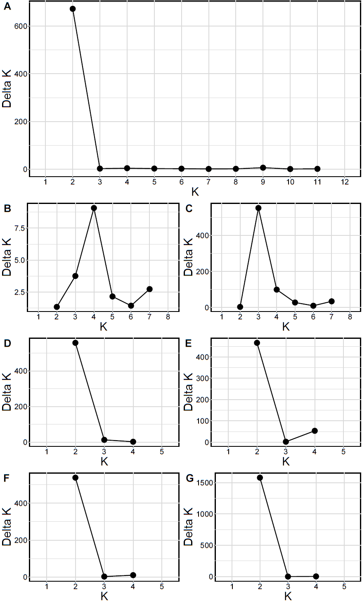

> **Paper's Fig. S5: the authors' figure, turned upright (it is printed turned by a quarter turn in the supplement).** Evanno's ΔK (y axis, 'Delta K') against the number of clusters K (x axis) in seven STRUCTURE analyses: A all 385 fish, B the cluster of the anadromous sites, C the cluster of the resident sites, D to G the watersheds Puyjalon, Corneille, Aguanish and Musquaro. The highest point of a panel is the best K for that data set.


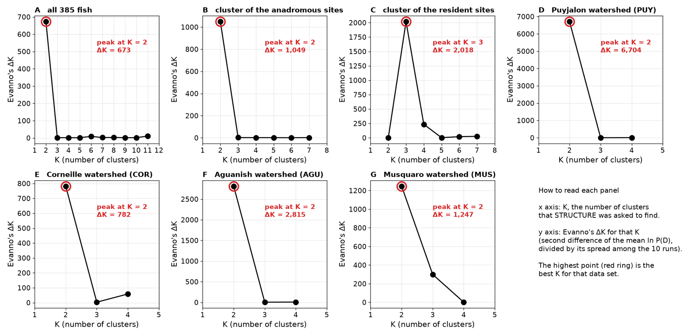

> **Our figure; no counterpart in the paper.** The counterpart of the paper's Fig. S5 from our STRUCTURE runs (10 replicates per K), in the same order of panels A to G and enlarged. x axis: K, the number of clusters that STRUCTURE was asked to find; y axis: Evanno's ΔK for that K; the red ring marks the highest point (best K) and its value is printed in each panel; the text panel at the lower right says how to read a panel. The best K is the same as the authors' in six of the seven panels; in panel B (the cluster of the anadromous sites) ours peaks at K = 2 whereas the authors' panel peaks at K = 4 (a ΔK of about 9). The ΔK values differ from the authors' in size except in panel A, because ΔK divides by the variation among replicate runs, which differs between runs.


| Panel of Fig. S5 | Authors: peak at K, height (read from the figure) | Ours: peak at K, height |
|---|---|---|
| A  all sites | 2, about 670 | 2, 673 |
| B  anadromous cluster | 4, about 9 | 2, 1,049 |
| C  resident cluster | 3, about 490 | 3, 2,018 |
| D  PUY | 2, about 480 | 2, 6,704 |
| E  COR | 2, about 470 | 2, 782 |
| F  AGU | 2, about 480 | 2, 2,815 |
| G  MUS | 2, about 1,570 | 2, 1,247 |


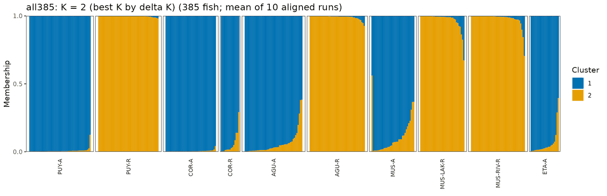

> **Our figure; no counterpart in the paper.** It corresponds to panel A of the paper's Fig. 3 (STRUCTURE with all individuals) but is not a redrawing of it. Membership of the 385 fish at K = 2 (mean of our 10 replicate runs aligned to each other): each thin vertical bar is one fish, grouped by site (labels under the bars); y = membership (0 to 1); blue = cluster 1, orange = cluster 2 (the colours are arbitrary). The anadromous sites and COR-R fall in one cluster, the other resident sites in the other.


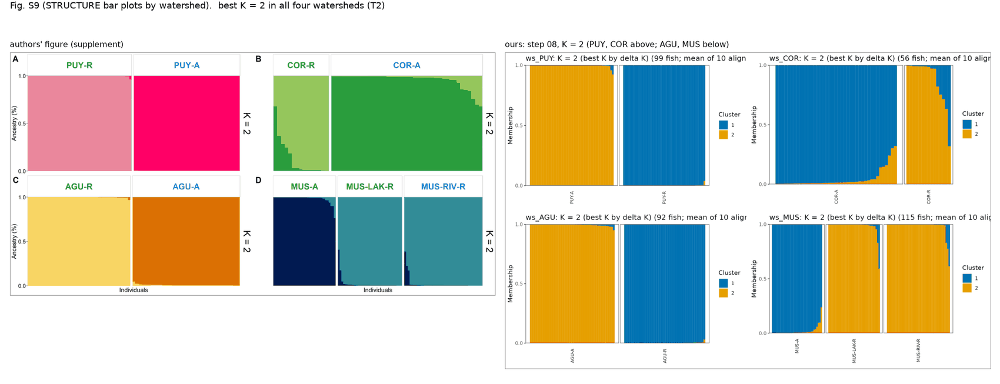

> **Paper's Fig. S9: the authors' figure (left) and ours (right).** STRUCTURE bar plots at K = 2 within each watershed (PUY, COR, AGU, MUS). Each thin vertical bar is one fish, grouped by site; the heights of the two colours in a bar are the fish's memberships in the two clusters (y axis, 0 to 1). The colours of the clusters are arbitrary and differ between the two figures. Ours are arranged with PUY and COR above and AGU and MUS below.


<details>
<summary>Problem found: the anadromous cluster gives K = 2 in our runs and K = 4 in the paper</summary>

Our ΔK curve for the anadromous cluster peaks at K = 2 because the ten K = 2 runs agree to within 0.73 ln P(D) units (their standard deviation), so ΔK(2) = |L″(2)| / sd(2) = 761 / 0.73, about 1,049 (the second difference L″ and the standard deviation sd are defined above). The paper's Fig. S5B shows ΔK(2) close to zero and a maximum of about 9 at K = 4, which needs a spread of ln P(D) at K = 2 of hundreds of units (more than about 280) between replicates; none of our runs shows it.

The partitions differ too. At K = 4 nine of our ten runs give AGU-A | COR-A + COR-R | ETA-A + MUS-A | PUY-A; the paper's Fig. 3B shows PUY-A | COR-A | COR-R | AGU-A + MUS-A + ETA-A. In our runs COR-R separates from COR-A only at K = 5. The all-fish K = 2 and the resident cluster at K = 3 have the same partitions as the paper. We did not test whether a different setting (for instance a sampling-location prior, which tends to separate small groups such as COR-R with 15 fish) reproduces the paper's K = 4; the plan had no sensitivity runs (about 2.5 core-hours for such a run).

The authors' own function `delta_K()` is not Evanno's statistic (it divides the mean of |ln P| by its standard deviation), is called by no deposited script, and on our runs has its maximum at K = 1 for five of the seven data sets, so it does not give K = 4 either.

</details>


<details>
<summary>Best K and mean membership by data set (our tables)</summary>

| Data set | Fish | K tried | Runs | Best K | ΔK at best K |
|---|---|---|---|---|---|
| all385 | 385 | 1-12 | 120 | 2 | 672.5 |
| grpA | 211 | 1-8 | 80 | 2 | 1048.7 |
| grpR | 174 | 1-8 | 80 | 3 | 2017.6 |
| ws_PUY | 99 | 1-5 | 50 | 2 | 6704.1 |
| ws_COR | 56 | 1-5 | 50 | 2 | 782.3 |
| ws_AGU | 92 | 1-5 | 50 | 2 | 2814.6 |
| ws_MUS | 115 | 1-5 | 50 | 2 | 1247.3 |

</details>


<details>
<summary>Scripts, software and parameters of this step</summary>

| Script | Class | What it does |
|---|---|---|
| `08_a_make_inputs.R` | D | STRUCTURE inputs for 7 data sets (48 tasks) |
| `08_b_run_task.sbatch` | D | job array: 10 replicates in parallel per task |
| `08_c_collect.R`, `08_d_modes.R` | D | read runs, Evanno's ΔK (starmie), membership, partitions of each run |
| `08_check.R` | D | check |

**Software.** STRUCTURE 2.3.4 (our build, RANDOMIZE off); R 4.2.1 with starmie 0.1.2 (`loadStructure`, `bestK(method = 'evanno')`, `clumpp`)

**Parameters.** from the paper: admixture, burn-in 50,000, 100,000 steps, 10 replicates; defaults of STRUCTURE for the rest; seeds 100000·round + 10000·data set + 100·K + replicate

</details>


<details>
<summary>Folder of this step (tree)</summary>

```
08_structure/
├── input
│   ├── ALLELE_Filtered_Individuals885_Loci43_REASSIGNED_IND_FINAL.txt
│   └── Functions
│       ├── allele2genotype.R
│       ├── allele_freq.R
│       ├── allele_rich.R
│       ├── calculate_marker_missing_percentage.R
│       ├── create_genind.R
│       ├── delta_K.R
│       ├── export_allele_format.R
│       ├── fst_calculation.R
│       ├── fst_marker.R
│       ├── genepop_creator.R
│       ├── het.R
│       ├── impute.R
│       ├── kp_ind.R
│       ├── ld_test_locus.R
│       ├── mean_membership.R
│       ├── na_heatmap.R
│       ├── p100_missing.R
│       └── pca.R
├── output
│   ├── archives
│   │   ├── structure_runs_round1.tar.gz
│   │   ├── structure_runs_round2.tar.gz
│   │   └── structure_runs_round3.tar.gz
│   ├── check_08.tsv
│   ├── collect_round1
│   │   ├── bars_all385_K2.pdf
│   │   ├── bars_all385_K2.png
│   │   ├── deltaK_all.pdf
│   │   ├── deltaK_all.png
│   │   ├── evanno_tables.tsv
│   │   ├── lnP_all_runs.tsv
│   │   ├── mean_membership_by_site.tsv
│   │   ├── mean_membership_overall.tsv
│   │   ├── membership_all385.rds
│   │   ├── sessionInfo_collect.txt
│   │   └── summary_best_K.tsv
│   ├── failed_attempts
│   │   ├── 63754136_task01_all385_K1_2026-10-08_22-10-43
│   │   │   ├── replicates.log
│   │   │   └── slurm_script
│   │   ├── 63754136_task02_all385_K2_2026-10-08_22-10-57
│   │   │   ├── replicates.log
│   │   │   └── slurm_script
│   │   ├── 63754136_task03_all385_K3_2026-10-08_22-10-53
│   │   │   ├── replicates.log
│   │   │   └── slurm_script
│   │   ├── 63754136_task04_all385_K4_2026-10-08_22-10-39
│   │   │   ├── replicates.log
│   │   │   └── slurm_script
│   │   ├── 63754136_task05_all385_K5_2026-10-08_22-10-55
│   │   │   ├── replicates.log
│   │   │   └── slurm_script
│   │   ├── 63754136_task06_all385_K6_2026-10-08_22-10-39
│   │   │   ├── replicates.log
│   │   │   └── slurm_script
│   │   ├── 63754136_task07_all385_K7_2026-10-08_22-10-43
│   │   │   ├── replicates.log
│   │   │   └── slurm_script
│   │   ├── 63754136_task08_all385_K8_2026-10-08_22-10-45
│   │   │   ├── replicates.log
│   │   │   └── slurm_script
│   │   ├── 63754136_task09_all385_K9_2026-10-08_22-10-51
│   │   │   ├── replicates.log
│   │   │   └── slurm_script
│   │   ├── 63754136_task10_all385_K10_2026-10-08_22-10-41
│   │   │   ├── replicates.log
│   │   │   └── slurm_script
│   │   ├── 63754136_task11_all385_K11_2026-10-08_22-10-49
│   │   │   ├── replicates.log
│   │   │   └── slurm_script
│   │   ├── 63754136_task12_all385_K12_2026-10-08_22-10-47
│   │   │   ├── replicates.log
│   │   │   └── slurm_script
│   │   ├── 63754558_salmon_wf08c_collect_collect_round1_2026-10-08_22-15-40
│   │   │   ├── 08_c_collect.R
│   │   │   ├── collect.log
│   │   │   └── slurm_script
│   │   ├── 63754561_salmon_wf08c_collect_collect_round1_2026-10-08_22-16-09
│   │   │   ├── 08_c_collect.R
│   │   │   ├── collect.log
│   │   │   └── slurm_script
│   │   ├── 63755271_salmon_wf08c_collect_collect_round1_2026-10-08_22-22-41
│   │   │   ├── 08_c_collect.R
│   │   │   ├── collect.log
│   │   │   └── slurm_script
│   │   ├── salmon_wf08b_str_63754136.out
│   │   ├── salmon_wf08c_collect_63754558.out
│   │   ├── salmon_wf08c_collect_63754561.out
│   │   └── salmon_wf08c_collect_63755271.out
│   ├── inputs
│   │   ├── data_all385.str
│   │   ├── data_grpA.str
│   │   ├── data_grpR.str
│   │   ├── datasets.tsv
│   │   ├── data_ws_AGU.str
│   │   ├── data_ws_COR.str
│   │   ├── data_ws_MUS.str
│   │   ├── data_ws_PUY.str
│   │   ├── extraparams
│   │   ├── jobs.tsv
│   │   ├── labels_lookup.tsv
│   │   └── mainparams.template
│   ├── inputs_check.tsv
│   ├── job_chain.txt
│   ├── logs
│   │   ├── 63754123_salmon_wf08a_inputs_2026-10-08_22-10-11
│   │   │   ├── 08_a_make_inputs.R
│   │   │   ├── inputs_check.tsv
│   │   │   ├── make_inputs.log
│   │   │   └── slurm_script
│   │   ├── 63754642_salmon_wf08a_inputs_2026-10-08_22-17-13
│   │   │   ├── 08_a_make_inputs.R
│   │   │   ├── inputs_check.tsv
│   │   │   ├── make_inputs.log
│   │   │   └── slurm_script
│   │   ├── 63754810_task01_all385_K1_2026-10-08_22-17-50
│   │   │   ├── replicates.log
│   │   │   └── slurm_script
│   │   ├── 63754810_task02_all385_K2_2026-10-08_22-17-40
│   │   │   ├── replicates.log
│   │   │   └── slurm_script
│   │   ├── 63754810_task03_all385_K3_2026-10-08_22-17-44
│   │   │   ├── replicates.log
│   │   │   └── slurm_script
│   │   ├── 63754810_task04_all385_K4_2026-10-08_22-17-42
│   │   │   ├── replicates.log
│   │   │   └── slurm_script
│   │   ├── 63754810_task05_all385_K5_2026-10-08_22-17-48
│   │   │   ├── replicates.log
│   │   │   └── slurm_script
│   │   ├── 63754810_task06_all385_K6_2026-10-08_22-17-43
│   │   │   ├── replicates.log
│   │   │   └── slurm_script
│   │   ├── 63754810_task07_all385_K7_2026-10-08_22-17-40
│   │   │   ├── replicates.log
│   │   │   └── slurm_script
│   │   ├── 63754810_task08_all385_K8_2026-10-08_22-17-40
│   │   │   ├── replicates.log
│   │   │   └── slurm_script
│   │   ├── 63754810_task09_all385_K9_2026-10-08_22-17-40
│   │   │   ├── replicates.log
│   │   │   └── slurm_script
│   │   ├── 63754810_task10_all385_K10_2026-10-08_22-17-52
│   │   │   ├── replicates.log
│   │   │   └── slurm_script
│   │   ├── 63754810_task11_all385_K11_2026-10-08_22-17-46
│   │   │   ├── replicates.log
│   │   │   └── slurm_script
│   │   ├── 63754810_task12_all385_K12_2026-10-08_22-17-44
│   │   │   ├── replicates.log
│   │   │   └── slurm_script
│   │   ├── 63756625_salmon_wf08c_collect_collect_round1_2026-10-08_22-33-12
│   │   │   ├── 08_c_collect.R
│   │   │   ├── collect.log
│   │   │   └── slurm_script
│   │   ├── 63756651_task13_grpA_K1_2026-10-08_22-35-03
│   │   │   ├── replicates.log
│   │   │   └── slurm_script
│   │   ├── 63756651_task14_grpA_K2_2026-10-08_22-34-57
│   │   │   ├── replicates.log
│   │   │   └── slurm_script
│   │   ├── 63756651_task15_grpA_K3_2026-10-08_22-35-01
│   │   │   ├── replicates.log
│   │   │   └── slurm_script
│   │   ├── 63756651_task16_grpA_K4_2026-10-08_22-35-03
│   │   │   ├── replicates.log
│   │   │   └── slurm_script
│   │   ├── 63756651_task17_grpA_K5_2026-10-08_22-34-55
│   │   │   ├── replicates.log
│   │   │   └── slurm_script
│   │   ├── 63756651_task18_grpA_K6_2026-10-08_22-34-47
│   │   │   ├── replicates.log
│   │   │   └── slurm_script
│   │   ├── 63756651_task19_grpA_K7_2026-10-08_22-34-53
│   │   │   ├── replicates.log
│   │   │   └── slurm_script
│   │   ├── 63756651_task20_grpA_K8_2026-10-08_22-34-49
│   │   │   ├── replicates.log
│   │   │   └── slurm_script
│   │   ├── 63756651_task21_grpR_K1_2026-10-08_22-35-03
│   │   │   ├── replicates.log
│   │   │   └── slurm_script
│   │   ├── 63756651_task22_grpR_K2_2026-10-08_22-34-45
│   │   │   ├── replicates.log
│   │   │   └── slurm_script
│   │   ├── 63756651_task23_grpR_K3_2026-10-08_22-35-03
│   │   │   ├── replicates.log
│   │   │   └── slurm_script
│   │   ├── 63756651_task24_grpR_K4_2026-10-08_22-35-03
│   │   │   ├── replicates.log
│   │   │   └── slurm_script
│   │   ├── 63756651_task25_grpR_K5_2026-10-08_22-35-03
│   │   │   ├── replicates.log
│   │   │   └── slurm_script
│   │   ├── 63756651_task26_grpR_K6_2026-10-08_22-34-51
│   │   │   ├── replicates.log
│   │   │   └── slurm_script
│   │   ├── 63756651_task27_grpR_K7_2026-10-08_22-34-47
│   │   │   ├── replicates.log
│   │   │   └── slurm_script
│   │   ├── 63756651_task28_grpR_K8_2026-10-08_22-34-51
│   │   │   ├── replicates.log
│   │   │   └── slurm_script
│   │   ├── 63756651_task29_ws_PUY_K1_2026-10-08_22-34-59
│   │   │   ├── replicates.log
│   │   │   └── slurm_script
│   │   ├── 63756651_task30_ws_PUY_K2_2026-10-08_22-34-43
│   │   │   ├── replicates.log
│   │   │   └── slurm_script
│   │   ├── 63756651_task31_ws_PUY_K3_2026-10-08_22-34-47
│   │   │   ├── replicates.log
│   │   │   └── slurm_script
│   │   ├── 63756651_task32_ws_PUY_K4_2026-10-08_22-35-01
│   │   │   ├── replicates.log
│   │   │   └── slurm_script
│   │   ├── 63756651_task33_ws_PUY_K5_2026-10-08_22-34-43
│   │   │   ├── replicates.log
│   │   │   └── slurm_script
│   │   ├── 63756651_task34_ws_COR_K1_2026-10-08_22-34-55
│   │   │   ├── replicates.log
│   │   │   └── slurm_script
│   │   ├── 63756651_task35_ws_COR_K2_2026-10-08_22-34-57
│   │   │   ├── replicates.log
│   │   │   └── slurm_script
│   │   ├── 63756651_task36_ws_COR_K3_2026-10-08_22-34-49
│   │   │   ├── replicates.log
│   │   │   └── slurm_script
│   │   ├── 63756651_task37_ws_COR_K4_2026-10-08_22-35-14
│   │   │   ├── replicates.log
│   │   │   └── slurm_script
│   │   ├── 63756651_task38_ws_COR_K5_2026-10-08_22-35-20
│   │   │   ├── replicates.log
│   │   │   └── slurm_script
│   │   ├── 63756651_task39_ws_AGU_K1_2026-10-08_22-35-18
│   │   │   ├── replicates.log
│   │   │   └── slurm_script
│   │   ├── 63756651_task40_ws_AGU_K2_2026-10-08_22-35-16
│   │   │   ├── replicates.log
│   │   │   └── slurm_script
│   │   ├── 63756651_task41_ws_AGU_K3_2026-10-08_22-35-12
│   │   │   ├── replicates.log
│   │   │   └── slurm_script
│   │   ├── 63756651_task42_ws_AGU_K4_2026-10-08_22-35-18
│   │   │   ├── replicates.log
│   │   │   └── slurm_script
│   │   ├── 63756651_task43_ws_AGU_K5_2026-10-08_22-35-12
│   │   │   ├── replicates.log
│   │   │   └── slurm_script
│   │   ├── 63756651_task44_ws_MUS_K1_2026-10-08_22-35-16
│   │   │   ├── replicates.log
│   │   │   └── slurm_script
│   │   ├── 63756651_task45_ws_MUS_K2_2026-10-08_22-35-24
│   │   │   ├── replicates.log
│   │   │   └── slurm_script
│   │   ├── 63756651_task46_ws_MUS_K3_2026-10-08_22-35-22
│   │   │   ├── replicates.log
│   │   │   └── slurm_script
│   │   ├── 63756651_task47_ws_MUS_K4_2026-10-08_22-35-20
│   │   │   ├── replicates.log
│   │   │   └── slurm_script
│   │   ├── 63756651_task48_ws_MUS_K5_2026-10-08_22-35-14
│   │   │   ├── replicates.log
│   │   │   └── slurm_script
│   │   ├── 63756652_salmon_wf08c_collect_results_2026-10-08_22-37-15
│   │   │   ├── 08_c_collect.R
│   │   │   ├── collect.log
│   │   │   └── slurm_script
│   │   ├── 63756653_salmon_wf08_check_2026-10-08_22-37-43
│   │   │   ├── 08_check.R
│   │   │   ├── archives.txt
│   │   │   ├── check_08.tsv
│   │   │   ├── check.log
│   │   │   └── slurm_script
│   │   ├── 63758373_salmon_wf08c_collect_results_2026-10-08_22-47-13
│   │   │   ├── 08_c_collect.R
│   │   │   ├── collect.log
│   │   │   └── slurm_script
│   │   ├── 63758433_salmon_wf08c_collect_results_2026-10-08_22-49-44
│   │   │   ├── 08_c_collect.R
│   │   │   ├── collect.log
│   │   │   └── slurm_script
│   │   ├── 63758434_salmon_wf08_check_2026-10-08_22-50-15
│   │   │   ├── 08_check.R
│   │   │   ├── archives.txt
│   │   │   ├── check_08.tsv
│   │   │   ├── check.log
│   │   │   └── slurm_script
│   │   ├── 63759687_salmon_wf08c_collect_results_2026-10-08_22-57-13
│   │   │   ├── 08_c_collect.R
│   │   │   ├── collect.log
│   │   │   └── slurm_script
│   │   ├── 63759688_salmon_wf08_check_2026-10-08_22-57-44
│   │   │   ├── 08_check.R
│   │   │   ├── archives.txt
│   │   │   ├── check_08.tsv
│   │   │   ├── check.log
│   │   │   └── slurm_script
│   │   ├── 63760012_salmon_wf08d_modes_2026-10-08_22-59-13
│   │   │   ├── 08_d_modes.R
│   │   │   ├── modes.log
│   │   │   └── slurm_script
│   │   ├── salmon_wf08a_inputs_63754123.out
│   │   ├── salmon_wf08a_inputs_63754642.out
│   │   ├── salmon_wf08b_str_63754148.out
│   │   ├── salmon_wf08b_str_63754149.out
│   │   ├── salmon_wf08b_str_63754150.out
│   │   ├── salmon_wf08b_str_63754151.out
│   │   ├── salmon_wf08b_str_63754152.out
│   │   ├── salmon_wf08b_str_63754153.out
│   │   ├── salmon_wf08b_str_63754154.out
│   │   ├── salmon_wf08b_str_63754155.out
│   │   ├── salmon_wf08b_str_63754156.out
│   │   ├── salmon_wf08b_str_63754157.out
│   │   ├── salmon_wf08b_str_63754158.out
│   │   ├── salmon_wf08b_str_63754810.out
│   │   ├── salmon_wf08b_str_63754812.out
│   │   ├── salmon_wf08b_str_63754813.out
│   │   ├── salmon_wf08b_str_63754814.out
│   │   ├── salmon_wf08b_str_63754815.out
│   │   ├── salmon_wf08b_str_63754816.out
│   │   ├── salmon_wf08b_str_63754817.out
│   │   ├── salmon_wf08b_str_63754818.out
│   │   ├── salmon_wf08b_str_63754819.out
│   │   ├── salmon_wf08b_str_63754820.out
│   │   ├── salmon_wf08b_str_63754821.out
│   │   ├── salmon_wf08b_str_63754822.out
│   │   ├── salmon_wf08b_str_63756651.out
│   │   ├── salmon_wf08b_str_63756666.out
│   │   ├── salmon_wf08b_str_63756667.out
│   │   ├── salmon_wf08b_str_63756668.out
│   │   ├── salmon_wf08b_str_63756669.out
│   │   ├── salmon_wf08b_str_63756670.out
│   │   ├── salmon_wf08b_str_63756671.out
│   │   ├── salmon_wf08b_str_63756672.out
│   │   ├── salmon_wf08b_str_63756673.out
│   │   ├── salmon_wf08b_str_63756674.out
│   │   ├── salmon_wf08b_str_63756675.out
│   │   ├── salmon_wf08b_str_63756676.out
│   │   ├── salmon_wf08b_str_63756677.out
│   │   ├── salmon_wf08b_str_63756678.out
│   │   ├── salmon_wf08b_str_63756679.out
│   │   ├── salmon_wf08b_str_63756680.out
│   │   ├── salmon_wf08b_str_63756681.out
│   │   ├── salmon_wf08b_str_63756682.out
│   │   ├── salmon_wf08b_str_63756683.out
│   │   ├── salmon_wf08b_str_63756684.out
│   │   ├── salmon_wf08b_str_63756685.out
│   │   ├── salmon_wf08b_str_63756686.out
│   │   ├── salmon_wf08b_str_63756687.out
│   │   ├── salmon_wf08b_str_63756688.out
│   │   ├── salmon_wf08b_str_63756689.out
│   │   ├── salmon_wf08b_str_63756705.out
│   │   ├── salmon_wf08b_str_63756706.out
│   │   ├── salmon_wf08b_str_63756707.out
│   │   ├── salmon_wf08b_str_63756708.out
│   │   ├── salmon_wf08b_str_63756709.out
│   │   ├── salmon_wf08b_str_63756710.out
│   │   ├── salmon_wf08b_str_63756711.out
│   │   ├── salmon_wf08b_str_63756712.out
│   │   ├── salmon_wf08b_str_63756713.out
│   │   ├── salmon_wf08b_str_63756714.out
│   │   ├── salmon_wf08b_str_63756715.out
│   │   ├── salmon_wf08c_collect_63756625.out
│   │   ├── salmon_wf08c_collect_63756652.out
│   │   ├── salmon_wf08c_collect_63758373.out
│   │   ├── salmon_wf08c_collect_63758433.out
│   │   ├── salmon_wf08c_collect_63759687.out
│   │   ├── salmon_wf08_check_63756653.out
│   │   ├── salmon_wf08_check_63758434.out
│   │   ├── salmon_wf08_check_63759688.out
│   │   └── salmon_wf08d_modes_63760012.out
│   └── results
│       ├── bars_all385_K2.pdf
│       ├── bars_all385_K2.png
│       ├── bars_grpA_K2.pdf
│       ├── bars_grpA_K2.png
│       ├── bars_grpA_K4.pdf
│       ├── bars_grpA_K4.png
│       ├── bars_grpR_K2.pdf
│       ├── bars_grpR_K2.png
│       ├── bars_grpR_K3.pdf
│       ├── bars_grpR_K3.png
│       ├── bars_ws_AGU_K2.pdf
│       ├── bars_ws_AGU_K2.png
│       ├── bars_ws_COR_K2.pdf
│       ├── bars_ws_COR_K2.png
│       ├── bars_ws_MUS_K2.pdf
│       ├── bars_ws_MUS_K2.png
│       ├── bars_ws_PUY_K2.pdf
│       ├── bars_ws_PUY_K2.png
│       ├── deltaK_all.pdf
│       ├── deltaK_all.png
│       ├── deltaK_diagnostics.tsv
│       ├── evanno_tables.tsv
│       ├── fig_08_deltaK_large.png
│       ├── fig_08_lnP_large.png
│       ├── lnP_all_runs.tsv
│       ├── mean_membership_by_site.tsv
│       ├── mean_membership_overall.tsv
│       ├── membership_all385.rds
│       ├── membership_grpA.rds
│       ├── membership_grpR.rds
│       ├── membership_ws_AGU.rds
│       ├── membership_ws_COR.rds
│       ├── membership_ws_MUS.rds
│       ├── membership_ws_PUY.rds
│       ├── modes_by_run.tsv
│       ├── modes_summary.tsv
│       ├── sessionInfo_collect.txt
│       └── summary_best_K.tsv
├── README.md
└── scripts
    ├── 08_a_make_inputs.R
    ├── 08_b_run_task.sbatch
    ├── 08_c_collect.R
    ├── 08_c_collect.sbatch
    ├── 08_check.R
    ├── 08_check.sbatch
    ├── 08_d_modes.R
    ├── 08_d_modes.sbatch
    ├── 08_f_figure_deltaK_large.py
    └── run_08a_make_inputs.sbatch

85 directories, 341 files
```

</details>


<details>
<summary>Deviations from the plan in this step</summary>

* **2026-10-08** (D): First round-1 run (job 63754136) gave ten identical replicates for every K: STRUCTURE seeds from the system clock when RANDOMIZE=1 (its default) and ignores -D, and the ten replicates of a task start in the same second. mainparams now has RANDOMIZE 0 so that the recorded seeds are used; round 1 rerun (job 63754810); the discarded runs are in scratch/discarded_same_clock_seed *Why:* identical replicates would have made Evanno's delta K undefined and the K selection meaningless *Effect on the result:* none for the final results (the discarded runs are not used)
* **2026-10-08** (D): STRUCTURE 'collect' script: an error of mine in the first runs (getPosterior returns a data frame; fixed) *Why:* code error *Effect on the result:* none
* **2026-10-09** (D): First check of rounds 2-3 (job 63756653): 5 FAIL rows. (i) seed and RANDOMIZE rows read only 20 lines of each run file, but the parameter block is at the end; (ii) the paper's 95.59 % and 98.38 % are the cluster means of the all-fish K = 2 analysis (first cluster: anadromous sites and COR-R; second cluster: residents without COR-R), and 89.80 % is COR-R in the Corneille watershed analysis (Fig. S9), not values of the group analyses as the check assumed; (iii) the paper's K = 4 for the anadromous group differs from our best K = 2 (a result, not an error). *Why:* Check script rewritten (integrity rows PASS/FAIL, paper rows AGREE/DIFFER); collection re-run to also align, plot and summarise the paper's K (anadromous group K = 4) *Effect on the result:* none on the STRUCTURE runs; the collection and check were repeated
* **2026-10-10** (D): Added 08_f_figure_deltaK_large.py: output/results/fig_08_deltaK_large.png and fig_08_lnP_large.png, the seven panels of Fig. S5 enlarged with a text panel that says how to read them; the original small figures are kept *Why:* the plots of ΔK were too small and their axes not explained (comments on version 2) *Effect on the result:* none; presentation only

</details>


---

### Step 09: FST as coded by the authors (Fig. S6)
**Level of reproducibility: T1** (all 45 pairwise values and the tests reproduced exactly). **Final run:** 9 integrity checks pass.


**What we set out to do.** Reproduce Fig. S6 and the Wilcoxon tests exactly as the authors computed them (their script 08), including the 95 % limits. **Read this first:** the numbers of this step are *not FST in the usual sense*. The authors' function passes the allele table (two columns per locus) to a function that expects one genotype column per locus, and that function returns Fst′. Step 10 explains the problem and gives the corrected computation; the values here are reproduced exactly because the deposit's figure was made this way.


<details>
<summary>How FST is measured: Hs, Ht, Dst and a worked example</summary>

**The quantities, for one locus.** Take a locus with two alleles and two populations. Let p be the frequency of the first allele in population 1 and q its frequency in population 2 (the frequency of the second allele is 1 - p and 1 - q).

* **Hs**, the diversity *inside* populations: for each population, the gene diversity 1 - (sum of the squared allele frequencies) (the probability that two allele copies drawn from the population differ), averaged over the populations.
* **Ht**, the diversity of the populations *pooled*: the same quantity computed from the mean allele frequencies of the populations.
* **Dst = Ht - Hs**, the diversity *between* populations: what is gained by pooling.
* **FST = Dst / Ht**: the fraction of the total diversity that lies between populations. It is 0 when the populations have the same frequencies and 1 when they have no allele in common.
* **Fst′** (the quantity returned by the function that the authors use) corrects for the number of populations compared, np: **Dst′ = np / (np - 1) × Dst**, **Ht′ = Hs + Dst′** and **Fst′ = Dst′ / Ht′**. For a pair of populations np = 2, so Dst′ is twice Dst.

Over many loci, the quantities Hs, Ht and Dst are first averaged over the loci and the ratio is taken afterwards. The programs also correct Hs and Ht for the finite number of fish sampled (Nei 1987), which the example ignores.

**Worked example.** Population 1 has the allele frequencies 0.9 and 0.1; population 2 has 0.1 and 0.9. Inside each population the gene diversity is 1 - (0.81 + 0.01) = 0.18, so Hs = 0.18. The pooled frequencies are 0.5 and 0.5, so Ht = 1 - (0.25 + 0.25) = 0.5. Then Dst = 0.5 - 0.18 = 0.32 and **FST = 0.32 / 0.5 = 0.64**. With np = 2, Dst′ = 0.64, Ht′ = 0.18 + 0.64 = 0.82 and **Fst′ = 0.64 / 0.82 = 0.78**. For the same two populations FST is 0.64 and Fst′ is 0.78: the two statistics are not interchangeable, and the authors report Fst′ under the name FST.

</details>


<details>
<summary>Method in brief: FST, its estimators, bootstrap limits and the comparison of classes of pairs</summary>

* **What FST measures.** FST is the fraction of the total genetic variation that lies *between* populations rather than within them. It is 0 when two populations have identical allele frequencies and approaches 1 when they share no alleles. For microsatellites, which have many alleles per locus and high diversity within populations, the maximum possible FST is well below 1, so values of a few tenths are already large.
* **Rule of thumb for reading values** (Wright 1978, often quoted): 0 to 0.05 little differentiation, 0.05 to 0.15 moderate, 0.15 to 0.25 great, above 0.25 very great. It is a guide, not a test; the **95 % limits** from the bootstrap are what say whether a value differs from 0 or from another value: limits that exclude 0 mean a real difference from identical populations; two pairs whose limits overlap widely cannot be told apart.
* **The three estimators.** In the documentation of the R package hierfstat (`basic.stats`): **Fst = Dst/Ht**, where Hs is the gene diversity within populations, Ht the overall gene diversity and Dst = Ht - Hs; **Fst′ = Dst′/Ht′**, the same with the diversities corrected for the number np of populations sampled (Dst′ = np/(np-1) × Dst and Ht′ = Hs + Dst′; for a pair of populations np = 2, so Dst′ is twice Dst); and **Weir and Cockerham's θ**, a variance-components estimator that corrects for sample sizes. With np = 2, Fst′ is therefore larger than Fst. They estimate the same quantity on a different scale, so the three cannot be mixed in one comparison.
* **Bootstrap limits.** The loci are resampled with replacement 10,000 times and FST is recomputed each time; the 2.5 % and 97.5 % quantiles of the results are the 95 % limits. Resampling loci shows how much the value depends on which loci happen to be in the data set.
* **Comparing classes of pairs.** The authors group the 45 site pairs into three classes (A-A, anadromous with anadromous; A-R; R-R) and compare the classes with **Wilcoxon rank-sum tests**. The test ranks all the pair values of the two classes together; the statistic **W** counts, over all combinations of one pair from each class, how often the pair of the first class has the larger value (so W runs from 0 to n1 × n2, for example 0 to 250 for 10 A-A against 25 A-R pairs); W = 0 or the maximum means the two classes do not overlap at all, and a value near half the maximum means no tendency. P is the probability of a W at least as extreme if the classes had the same distribution. The sign convention changes with the order in which the classes are named, which is why the paper's W = 94 and our W = 156 describe the same comparison (94 + 156 = 250).

</details>


**Inputs of our run**


| Input | Where it comes from |
|---|---|
| `ALLELE_…885_Loci43_REASSIGNED_IND_FINAL.txt` (not imputed) | step 03 |
| `08_FST_MS.R` and the functions | step 00 (the authors' script, class B) |

**The authors' files and transcriptions used only for comparison (never as inputs)**


| File | Used for |
|---|---|
| the 45 values of Fig. S6B, read from the figure | written by us; used only for the check |


**What we found (as coded by the authors).** All 45 pairwise values agree with Fig. S6B to within 0.0005 (largest difference; mean 0.0003). Class means: A-A 0.040, A-R 0.112, R-R 0.117. Wilcoxon tests: A-A against R-R W = 10, A-A against A-R W = 0, and **R-R against A-R W = 94, P = 0.27, as printed in the paper**, which is the paper's 'no difference'. Level of reproducibility T1.


| Class of pair | Mean FST as coded | Mean lower limit | Mean upper limit |
|---|---|---|---|
| A-A | 0.040 | 0.029 | 0.053 |
| R-R | 0.117 | 0.092 | 0.147 |
| A-R | 0.112 | 0.087 | 0.139 |


<details>
<summary>All 45 pairwise values: Fig. S6B against ours (as coded)</summary>

| Pair | Class | Fig. S6B | Ours (as coded) | Difference |
|---|---|---|---|---|
| AGU-A – COR-A | A-A | 0.0450 | 0.0453 | 0.0003 |
| AGU-A – PUY-A | A-A | 0.0450 | 0.0447 | -0.0003 |
| COR-A – PUY-A | A-A | 0.0470 | 0.0473 | 0.0003 |
| COR-R – AGU-A | R-A | 0.0790 | 0.0793 | 0.0003 |
| COR-R – COR-A | R-A | 0.0650 | 0.0647 | -0.0003 |
| COR-R – ETA-A | R-A | 0.0780 | 0.0782 | 0.0002 |
| COR-R – MUS-A | R-A | 0.0800 | 0.0799 | -0.0001 |
| COR-R – PUY-R | R-R | 0.1830 | 0.1830 | 0.0000 |
| COR-R – PUY-A | R-A | 0.0800 | 0.0796 | -0.0004 |
| ETA-A – AGU-A | A-A | 0.0190 | 0.0191 | 0.0001 |
| ETA-A – COR-A | A-A | 0.0460 | 0.0459 | -0.0001 |
| ETA-A – MUS-A | A-A | 0.0210 | 0.0213 | 0.0003 |
| ETA-A – PUY-A | A-A | 0.0500 | 0.0496 | -0.0004 |
| MUS-A – AGU-A | A-A | 0.0270 | 0.0268 | -0.0002 |
| MUS-A – COR-A | A-A | 0.0460 | 0.0455 | -0.0005 |
| MUS-A – PUY-A | A-A | 0.0590 | 0.0590 | 0.0000 |
| MUS-LAK-R – AGU-A | R-A | 0.0890 | 0.0888 | -0.0002 |
| MUS-LAK-R – COR-A | R-A | 0.0930 | 0.0927 | -0.0003 |
| MUS-LAK-R – COR-R | R-R | 0.0990 | 0.0991 | 0.0001 |
| MUS-LAK-R – ETA-A | R-A | 0.0850 | 0.0851 | 0.0001 |
| MUS-LAK-R – MUS-A | R-A | 0.0900 | 0.0896 | -0.0004 |
| MUS-LAK-R – PUY-R | R-R | 0.1300 | 0.1297 | -0.0003 |
| MUS-LAK-R – PUY-A | R-A | 0.1090 | 0.1090 | 0.0000 |
| MUS-LAK-R – AGU-R | R-R | 0.1110 | 0.1111 | 0.0001 |
| MUS-RIV-R – AGU-A | R-A | 0.0920 | 0.0925 | 0.0005 |
| MUS-RIV-R – COR-A | R-A | 0.0970 | 0.0972 | 0.0002 |
| MUS-RIV-R – COR-R | R-R | 0.1070 | 0.1068 | -0.0002 |
| MUS-RIV-R – ETA-A | R-A | 0.0890 | 0.0894 | 0.0004 |
| MUS-RIV-R – MUS-A | R-A | 0.0920 | 0.0922 | 0.0002 |
| MUS-RIV-R – MUS-LAK-R | R-R | 0.0010 | 0.0007 | -0.0003 |
| MUS-RIV-R – PUY-R | R-R | 0.1280 | 0.1275 | -0.0005 |
| MUS-RIV-R – PUY-A | R-A | 0.1150 | 0.1153 | 0.0003 |
| MUS-RIV-R – AGU-R | R-R | 0.1150 | 0.1151 | 0.0001 |
| PUY-R – AGU-A | R-A | 0.1510 | 0.1509 | -0.0001 |
| PUY-R – COR-A | R-A | 0.1910 | 0.1913 | 0.0003 |
| PUY-R – ETA-A | R-A | 0.1520 | 0.1522 | 0.0002 |
| PUY-R – MUS-A | R-A | 0.1640 | 0.1640 | 0.0000 |
| PUY-R – PUY-A | R-A | 0.1770 | 0.1772 | 0.0002 |
| AGU-R – AGU-A | R-A | 0.1160 | 0.1157 | -0.0003 |
| AGU-R – COR-A | R-A | 0.1360 | 0.1365 | 0.0005 |
| AGU-R – COR-R | R-R | 0.1460 | 0.1456 | -0.0004 |
| AGU-R – ETA-A | R-A | 0.1180 | 0.1184 | 0.0004 |
| AGU-R – MUS-A | R-A | 0.1240 | 0.1235 | -0.0005 |
| AGU-R – PUY-R | R-R | 0.1540 | 0.1545 | 0.0005 |
| AGU-R – PUY-A | R-A | 0.1350 | 0.1354 | 0.0004 |

</details>


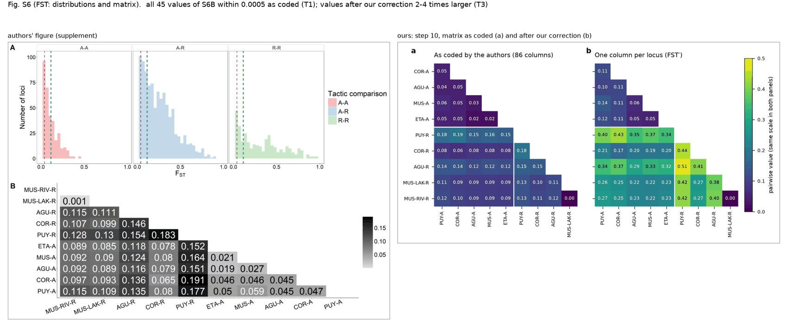

> **Paper's Fig. S6: the authors' figure (left) and ours (right).** Left: A, histograms of the locus-by-locus FST (x) in the three classes of pair of sites (A-A anadromous with anadromous, A-R anadromous with resident, R-R resident with resident; y = number of loci); B, the matrix of the 45 pairwise values printed in the supplement (darker = larger). Right: the same 10 x 10 matrix of pairwise values computed two ways, with one common colour scale (purple low, yellow high) and the values printed in the cells; white lines separate the five anadromous sites from the five resident sites. a: as coded by the authors (86 columns); it reproduces panel B of the authors to within 0.0005. b: after our correction (one column per locus, FST′); the values are 2 to 4 times larger.


<details>
<summary>Scripts, software and parameters of this step</summary>

| Script | Class | What it does |
|---|---|---|
| `input/08_FST_MS.R` | B | the authors' script; the results it only prints or keeps are written by `09_post_results.R` |
| `09_post_results.R`, `09_check.R`, `run_09_fst_as_coded.sbatch` | D | post-run writer, check, job (30 seconds) |

**Software.** R 4.2.1: hierfstat 0.5-11, pegas 1.2, ggplot2, ggpubr, ggtext, cowplot, tidyverse

**Parameters.** all the authors': `set.seed(33)`, 10,000 bootstraps, `method = 'nei'`

</details>


<details>
<summary>Folder of this step (tree)</summary>

```
09_fst_as_coded/
├── input
│   ├── 08_FST_MS.R
│   ├── ALLELE_Filtered_Individuals885_Loci43_REASSIGNED_IND_FINAL.txt
│   ├── figS6B_README.txt
│   ├── figS6B_transcribed_values.tsv
│   └── Functions
│       ├── allele2genotype.R
│       ├── allele_freq.R
│       ├── allele_rich.R
│       ├── calculate_marker_missing_percentage.R
│       ├── create_genind.R
│       ├── delta_K.R
│       ├── export_allele_format.R
│       ├── fst_calculation.R
│       ├── fst_marker.R
│       ├── genepop_creator.R
│       ├── het.R
│       ├── impute.R
│       ├── kp_ind.R
│       ├── ld_test_locus.R
│       ├── mean_membership.R
│       ├── na_heatmap.R
│       ├── p100_missing.R
│       └── pca.R
├── output
│   ├── 09_post_results.R
│   ├── check_09.tsv
│   ├── exit_code.txt
│   ├── failed_attempts
│   │   ├── 63754826_salmon_wf09_fst_as_coded_2026-10-08_22-18-39
│   │   │   ├── 09_check.R
│   │   │   ├── 09_post_results.R
│   │   │   ├── check_09.tsv
│   │   │   ├── check.log
│   │   │   ├── run_stdout.log
│   │   │   ├── script_changes.diff
│   │   │   ├── slurm_script
│   │   │   └── stage_run.sh
│   │   └── salmon_wf09_fst_as_coded_63754826.out
│   ├── figures.pdf
│   ├── fst_as_coded_all_cells.tsv
│   ├── fst_as_coded_class_means.tsv
│   ├── fst_as_coded_pairs.tsv
│   ├── fst_as_coded_wilcoxon.tsv
│   ├── fst_per_locus_pegas.tsv
│   ├── inputs_check.txt
│   ├── inputs_md5_after.txt
│   ├── inputs_md5_before.txt
│   ├── logs
│   │   ├── 63757097_salmon_wf09_fst_as_coded_2026-10-08_22-37-17
│   │   │   ├── 09_check.R
│   │   │   ├── 09_post_results.R
│   │   │   ├── check_09.tsv
│   │   │   ├── check.log
│   │   │   ├── run_stdout.log
│   │   │   ├── script_changes.diff
│   │   │   ├── slurm_script
│   │   │   └── stage_run.sh
│   │   └── salmon_wf09_fst_as_coded_63757097.out
│   ├── run_stdout.log
│   ├── script_changes.diff
│   ├── seconds.txt
│   └── sessionInfo.txt
├── README.md
└── scripts
    ├── 09_check.R
    ├── 09_post_results.R
    └── run_09_fst_as_coded.sbatch

9 directories, 60 files
```

</details>


---

### Step 10: FST after our correction
**Level of reproducibility: T3** (our own computation; no published value to match). **Final run:** 37 integrity checks pass.


**What we set out to do.** Compute the pairwise differentiation again from the same fish and with the authors' own estimator, but with the genotypes **encoded as the estimator expects**, and compare with step 09: the class means, the tests between classes, and each statement of the Results that quotes an FST value.


<details>
<summary>Method in brief: what the FST function expects, and the two other estimators</summary>

* **The function and its documentation.** The authors' function calls `pairwise.neifst()` of the R package hierfstat. Its documentation (hierfstat 0.5-11) reads, for the argument `dat`: *'A data frame containing population of origin as the first column and multi-locus genotypes in following columns'*; and for `basic.stats`, from which it takes its statistic: *'the following columns contain the genotype of the individuals - one locus per column'*. The value returned is a matrix of pairwise FSTs, computed 'using Nei (87) equations for FST′, as described in the note section of basic.stats'.
* **One locus per column, the two alleles in one number.** For a fish with alleles 45 and 49 at a locus, hierfstat expects one column holding **4549** (the two alleles written next to each other), as `genind2hierfstat()` produces from an adegenet object. The package decides how to split the number by looking at the largest value in the table: if all values are below 100 it splits each number into two one-digit alleles, if they are four-digit numbers it splits them into two two-digit alleles.
* **What the authors' table looks like.** Two columns per locus, one allele in each (the layout of the raw data). Given a column that holds 45, hierfstat splits it into the alleles 4 and 5; the table below shows real fish in both layouts.
* **Estimators.** Fst′ = Dst′/Ht′ (the one the function returns); plain Nei Fst = Dst/Ht; and Weir and Cockerham's θ, from `pairwise.WCfst()`, with limits from `boot.ppfst()`; see step 09 for how to read them.

</details>


**The same fish in the two layouts** (real fish and loci from our data; the population column is left out).

*The authors' layout: two columns per locus, one allele in each.*


| Fish | NGS_SSsp2210 | NGS_SSsp2210_b | NGS_SsaD486 | NGS_SsaD486_b |
|---|---|---|---|---|
| fish 1 | 45 | 49 | 40 | 52 |
| fish 3 | 25 | 45 | 44 | 56 |
| fish 5 | 25 | 45 | 36 | 52 |

*Our layout (the one the function documents): one column per locus, the two alleles written next to each other.*


| Fish | NGS_SSsp2210 | NGS_SsaD486 |
|---|---|---|
| fish 1 | 4549 | 4052 |
| fish 3 | 2545 | 4456 |
| fish 5 | 2545 | 3652 |


<details>
<summary>What the function reads from each layout (the six cases of <code>encoding_demo.txt</code>)</summary>

| Fish | Locus | Alleles of the fish | Authors' layout: value in each column -> what hierfstat reads | Our layout: value in the one column -> what hierfstat reads |
|---|---|---|---|---|
| fish 1 | NGS_SSsp2210 | 45 and 49 | 45 -> read as 4 and 5;  49 -> read as 4 and 9 | 4549 -> read as 45 and 49 |
| fish 1 | NGS_SsaD486 | 40 and 52 | 40 -> read as 4 and 0;  52 -> read as 5 and 2 | 4052 -> read as 40 and 52 |
| fish 3 | NGS_SSsp2210 | 25 and 45 | 25 -> read as 2 and 5;  45 -> read as 4 and 5 | 2545 -> read as 25 and 45 |
| fish 3 | NGS_SsaD486 | 44 and 56 | 44 -> read as 4 and 4;  56 -> read as 5 and 6 | 4456 -> read as 44 and 56 |
| fish 5 | NGS_SSsp2210 | 25 and 45 | 25 -> read as 2 and 5;  45 -> read as 4 and 5 | 2545 -> read as 25 and 45 |
| fish 5 | NGS_SsaD486 | 36 and 52 | 36 -> read as 3 and 6;  52 -> read as 5 and 2 | 3652 -> read as 36 and 52 |

In the authors' layout every allele size is cut into its two digits (45 becomes the 'alleles' 4 and 5), so the 'locus' that the function analyses is made of digits, not of microsatellite alleles. In our layout the function reads the two alleles of each fish correctly.

</details>


<details>
<summary>Excerpt of the documentation of the function (hierfstat 0.5-11, <code>pairwise.neifst</code>, <code>basic.stats</code>)</summary>

**`pairwise.neifst(dat, diploid = TRUE)`: Estimates pairwise FSTs according to Nei (1987).**

* `dat`: *A data frame containing population of origin as the first column and multi-locus genotypes in following columns.*
* Details: *FST are calculated using Nei (87) equations for FST', as described in the note section of basic.stats.* Value: *A matrix of pairwise FSTs.*

**`basic.stats(data, diploid = TRUE, digits = 4)`**

* `data`: *a data frame where the first column contains the population to which the different individuals belong, and the following columns contain the genotype of the individuals - one locus per column.*
* Note (equations 7.38 to 7.43 of Nei 1987): Hs is the within-population gene diversity and Ht the overall gene diversity; **Dst = Ht - Hs**; **Dst' = np/(np-1) Dst**; **Ht' = Hs + Dst'**; **Fst = Dst/Ht**; **Fst' = Dst'/Ht'**. (np is the number of populations; the equations rely on genotype numbers and are corrected for heterozygosity.)
* The table `overall` that `basic.stats` returns holds Ho, Hs, Ht, Dst, Ht', Dst', Fst, Fst', Fis and Dest in that order, so the 8th value, which the authors' function returns, is **Fst'**.

Source: the help pages of the installed package (`help("pairwise.neifst")`, `help("basic.stats")`); the wording is that of the package.

</details>


**A test with made-up data (step 10).** The two layouts give different numbers for the same fish; to be sure which layout returns the right FST we computed it for two small data sets whose true value is known by construction (the definition of the data sets, the table of results and the example fish are in the block below, and the result is summarised in section 3.3).


<details>
<summary>The made-up-data test: data sets, results and example fish</summary>

**Data set A.** Two populations, 5 loci, 20 fish each. Every fish of population 1 has the alleles 45 and 45 at every locus and every fish of population 2 has the alleles 54 and 54, so the populations have no allele in common and the true FST is 1.

**Data set B.** Two populations, 30 loci, 200 fish each. Allele frequencies at each locus are drawn for an ancestral population and then for each of the two populations by the Balding-Nichols model with F = 0.15, and the genotypes of the fish are drawn from the allele frequencies of their population. Each locus has 4 to 10 alleles with sizes between 20 and 80, and the genotypes are drawn at random from the allele frequencies of the population (random mating). From the known frequencies the true values follow: FST 0.0875 and Fst′ 0.161.

**What is computed.** (1) The equations of the hierfstat documentation (Nei 1987), written by us from the documentation and independent of hierfstat; (2) hierfstat with one column per locus (the documented layout); (3) hierfstat with two columns per locus (the authors' layout); (4) the authors' function `fst_calculation()`, which gives the quantity that it calls FST (it is Fst′).

| Made-up data | Quantity | True value | Equations written from the documentation | hierfstat, documented layout (one column per locus) | hierfstat, authors' layout (two columns per locus) | Authors' function fst_calculation() |
|---|---|---|---|---|---|---|
| A: no allele in common | FST | 1 | 1 | 1 | 0 | - |
| A: no allele in common | FST′ | 1 | 1 | 1 | 0 | 0 |
| B: known allele frequencies (30 loci, 200 fish per population) | FST | 0.0875 | 0.0878 | 0.0878 | 0.0430 | - |
| B: known allele frequencies (30 loci, 200 fish per population) | FST′ | 0.1609 | 0.1615 | 0.1615 | 0.0824 | 0.0824 |

**Reading the table.** The documented layout returns the true value in both data sets and equals our independent equations. The authors' layout returns 0 where the true value is 1 (data set A) and about half of the true value in data set B; the authors' function returns the same number as hierfstat on the authors' layout, because it calls it. Check of this job: 8 integrity checks pass (`check_10g.tsv`).

**The example fish** (as written by the job; the first three loci of data set A and the first two of data set B):

```
Test A, first and last fish, authors' layout (two columns per locus), first three loci:
  pop L1 L1_b L2 L2_b L3 L3_b
 pop1 45   45 45   45 45   45
 pop1 45   45 45   45 45   45
 pop2 54   54 54   54 54   54
 pop2 54   54 54   54 54   54

Test A, same fish, our layout (one column per locus):
  pop   L1   L2   L3
 pop1 4545 4545 4545
 pop1 4545 4545 4545
 pop2 5454 5454 5454
 pop2 5454 5454 5454

What hierfstat reads from the authors' layout, population pop1 (all fish 45 and 45):
  value 45 -> alleles 4 and 5 in each column; population pop2 (all fish 54 and 54): value 54 -> alleles 5 and 4: the two populations look identical.

Test B, first three fish of each population, first two loci, authors' layout:
  pop L1 L1_b L2 L2_b
 pop1 38   43 68   20
 pop1 55   28 63   20
 pop1 43   38 63   68
 pop2 38   55 68   20
 pop2 38   38 20   68
 pop2 38   55 20   20

Test B, same fish, our layout:
  pop   L1   L2
 pop1 3843 6820
 pop1 5528 6320
 pop1 4338 6368
 pop2 3855 6820
 pop2 3838 2068
 pop2 3855 2020
```

</details>


<details>
<summary>Method in brief: tests that respect shared sites: permutation of site labels and leave-one-site-out</summary>

The 45 site pairs are not independent: each of the 10 sites is in 9 pairs, so a Wilcoxon test that treats them as independent overstates the evidence. A **permutation of the tactic labels of the sites** (there are 252 ways to choose which 5 of 10 sites are 'resident') recomputes the difference of class means for each labelling; the P value is the percentage of labellings with a difference at least as large as observed. With 252 labellings the smallest possible P is 1/252 = 0.004. A **leave-one-site-out** analysis repeats the Wilcoxon test with each site removed in turn: if one site drives the result, P changes a lot when it is removed.

</details>


**Inputs of our run**


| Input | Where it comes from |
|---|---|
| `ALLELE_…885_Loci43_REASSIGNED_IND_FINAL.txt` (not imputed; the 385 fish of known tactic, the 885 for the juveniles) | step 03 |
| `All_Rivers_Dataset_Filtered_Balanced.txt` (same fish, original labels, for the not-reassigned comparison) | step 01 |
| the authors' `fst_calculation.R` pipeline and seed | step 00 (reused in our scripts) |

**The authors' files and transcriptions used only for comparison (never as inputs)**


| File | Used for |
|---|---|
| `fst_as_coded_pairs.tsv` | our own result of step 09, used only to put the as-coded value next to each corrected one |


**What we found.** Class means of the 45 pairwise values (385 fish, 43 loci):


| Class of pair | As coded (step 09) | Fst′ (our correction), with mean 95 % limits | Weir–Cockerham θ | Plain Nei FST |
|---|---|---|---|---|
| A-A (10 pairs) | 0.040 | **0.096** (0.069–0.124) | 0.096 | 0.051 |
| A-R (25 pairs) | 0.112 | **0.275** (0.218–0.331) | 0.278 | 0.161 |
| R-R (10 pairs) | 0.117 | **0.351** (0.274–0.421) | 0.363 | 0.220 |


Test of the difference between the R-R and the A-R classes (the paper reports 'no difference', P = 0.27):


| Estimator | Wilcoxon W (A-R vs R-R) | Wilcoxon P (pairs treated as independent) | Permutation of site labels, P |
|---|---|---|---|
| As coded | 156 | 0.27 | 0.80 |
| Fst′ (our correction) | 197 | 0.00743 | 0.22 |
| Weir–Cockerham θ | 198 | 0.00657 | 0.19 |
| Plain Nei FST | 197 | 0.00743 | 0.15 |


* **The values are 2.6 times larger** than the published ones for Fst′ and θ (1.5 times for plain FST); the ordering of the 45 pairs is largely kept (Spearman correlation between the as-coded and the Fst′ of our correction 0.97).
* **The gap between R-R and A-R is no longer absent:** 0.351 against 0.275 (as coded 0.117 against 0.112). The Wilcoxon P falls from 0.27 to 0.0074, but this test counts shared sites as independent; the permutation of site labels gives P = 0.22, and leaving out one site at a time gives P between 0.0034 and 0.108. **The data do not decide whether R-R pairs differ from A-R pairs**; what changes is that the paper's 'no difference' is not supported by its own number, not that a difference is shown.
* A-A pairs are clearly less differentiated than the others under every estimator and both tests (P = 0.004 in the permutation, the smallest attainable value).


<details>
<summary>Every FST value quoted in the Results, as printed, as coded and corrected</summary>

| Pair | Paper | As coded (step 09) | Fst′, our correction (95 % limits) | Why the paper quotes it |
|---|---|---|---|---|
| MUS-LAK-R – MUS-RIV-R | 0.0007 | 0.001 | 0.002 (-0.003 to 0.008) | lowest value |
| COR-A – PUY-R | 0.19 | 0.191 | 0.429 (0.363 to 0.492) | highest value |
| PUY-R – MUS-RIV-R | 0.128 | 0.128 | 0.416 (0.313 to 0.508) | resident sites of different watersheds, said to be less differentiated than PUY-R/PUY-A |
| PUY-R – MUS-LAK-R | 0.13 | 0.130 | 0.417 (0.314 to 0.506) | same |
| PUY-R – AGU-R | 0.15 | 0.154 | 0.512 (0.414 to 0.598) | same |
| PUY-R – PUY-A | 0.18 | 0.177 | 0.398 (0.333 to 0.459) | within-watershed pair PUY (0.175 in the text of the preceding paragraph) |
| AGU-R – AGU-A | 0.12 | 0.116 | 0.289 (0.231 to 0.347) | within-watershed pair AGU, said to be similar to AGU-R with the Musquaro residents |
| AGU-R – MUS-LAK-R | 0.11 | 0.111 | 0.381 (0.302 to 0.454) | same |
| AGU-R – MUS-RIV-R | 0.12 | 0.115 | 0.395 (0.313 to 0.470) | same |
| COR-R – COR-A | 0.065 | 0.065 | 0.169 (0.132 to 0.205) | smallest within-watershed difference between tactics |
| MUS-A – MUS-RIV-R |  | 0.092 | 0.222 (0.160 to 0.279) | order of increase within watersheds (paper, Fig. 4 text) |
| MUS-A – MUS-LAK-R |  | 0.090 | 0.217 (0.153 to 0.276) | same |

The order of the pairs quoted in the Results text is **reversed** for the corrected values: PUY-R with the other resident sites (0.416 to 0.512) is *more* differentiated than PUY-R with PUY-A (0.398), where the paper says the opposite; the confidence limits overlap. AGU-R with the Musquaro residents (0.38, 0.40) is higher than AGU-R with AGU-A (0.289), where the paper says they are similar. The direction 'the greater the possible dispersion between tactics, the lower the differentiation' **holds** with the corrected values (COR 0.169 < MUS-LAK 0.217 < MUS-RIV 0.222 < AGU 0.289 < PUY 0.398).

</details>


**Other statements checked.** Juveniles of Corneille (upstream and downstream, 271 and 229 fish): as coded 0.0029, our correction 0.0073 (the paper: 0.002); 'minimal differentiation' holds. Balancing the sites to 25 fish (100 random subsamples) changes the class means of Fst′ by at most 0.0004: the paper's statement that balancing does not matter holds. Leaving the four reassignments undone changes the class means by at most 0.0074: 'does not matter' holds.


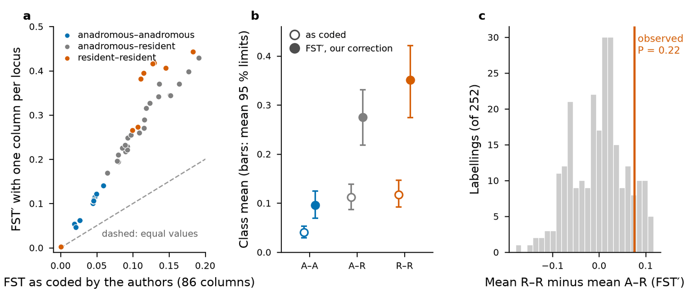

> **Our figure; no counterpart in the paper.** a: each point is one of the 45 pairs of sites; x = the pairwise value as coded by the authors (86 columns), y = FST′ after our correction (one column per locus); colour = class of pair (blue anadromous-anadromous, grey anadromous-resident, orange resident-resident); the dashed line marks equal values. b: mean of each class of pair with its mean 95 % limits; open circles = as coded, filled circles = after our correction. c: permutation test of the difference between the mean of the resident-resident pairs and the mean of the anadromous-resident pairs (FST′, x axis): the histogram shows the difference for each of the 252 ways of choosing which five of the ten sites are called resident (y = number of such labellings), the orange line is the observed difference (P = 0.22).


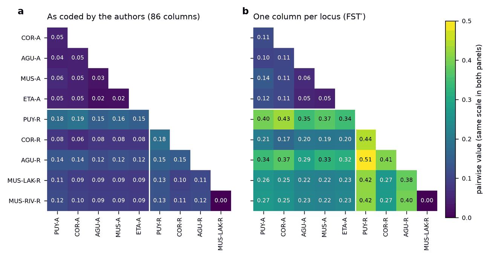

> **Paper's Fig. S6B, redrawn by us in two ways (the second matrix has no counterpart in the paper).** The 10 x 10 matrices of pairwise values of the ten sites, side by side: a, as coded by the authors (86 columns), which reproduces the matrix printed in the paper; b, after our correction (one column per locus, FST′). The two matrices share one colour scale (purple 0 to yellow 0.5) and the values are printed in the cells; white lines separate the five anadromous sites (first five rows and columns) from the five resident sites.


<details>
<summary><b>Problem found:</b> FST computed on a mis-encoded table (Fig. S6B, the Wilcoxon tests and the Results text)</summary>

Step 10 (`10_fst_corrected`); the as-coded computation is step 09. Evidence: `output/encoding_demo.txt`, `output/encoding_alleles_per_locus.tsv`, `output/fst_corrected_pairs.tsv`, `output/class_tests_*.tsv`, `output/paper_cited_pairs.tsv`, `output/figures/`.

**1. What the authors did**


`Functions/fst_calculation.R`, called by `Scripts/08_FST_MS.R`, passes the allele table to `hierfstat::pairwise.neifst()` with **two columns per locus** (86 columns: `NGS_SSsp2210`, `NGS_SSsp2210_b`, …, each holding an allele size such as 45 or 49) and the site in the first column. The 95 % limits come from `hierfstat::boot.ppfst()` (10,000 bootstraps, `set.seed(33)`) on the same table, and the three Wilcoxon rank-sum tests compare the 10 A–A, 25 A–R and 10 R–R pair values (Fig. S6B, and the text: "average of 0.097 among all sites", R–R vs A–R W = 94, P = 0.27).

**2. What is inconsistent, with the evidence**


* hierfstat expects **one column per locus** with the two alleles of a genotype packed in one number (alleles 45 and 49 → 4549). Given a column that holds 45, its code in `getal.b()` takes the largest value of the table (94, below 100), picks the modulus 10, and reads the one allele **45 as the genotype of two alleles, 4 and 5**; 49 becomes 4 and 9, 40 becomes 4 and 0 (`output/encoding_demo.txt`, six cases from real fish). Each of the 86 columns is therefore analysed as a pseudo-locus whose "alleles" are the tens and units digits of one allele size. All 43 loci have alleles of two digits (the smallest allele is 16, no cell is below 10), so no column escapes this.
* The statistic returned by `pairwise.neifst()` is `basic.stats()$overall[8]`, which is **Fst′** (in the hierfstat documentation Fst′ = Dst′/Ht′ with Dst′ = np/(np-1) × Dst and Ht′ = Hs + Dst′, that is, Nei's Fst with the gene diversities corrected for the number of populations; it is not Hedrick's standardised G′ST), not Nei's Fst or the Weir–Cockerham θ. The paper calls it FST.
* `boot.ppfst()` returns Weir–Cockerham θ limits; they are attached in the deposit to a Fst′ point estimate on the mis-encoded table.
* The values are not random garbage: the deposit's Fig. S6B is reproduced to within 0.0005 (step 09), and the paper's quoted values are reproduced by the as-coded computation to the printed precision (`output/paper_cited_pairs.tsv`: PUY-R–MUS-RIV-R 0.1275 vs 0.128, PUY-R–AGU-R 0.1545 vs 0.15, COR-A–PUY-R 0.1913 vs 0.19).
* The three Wilcoxon tests treat the 45 pair values as independent, yet each of the 10 sites appears in 9 pairs.

**3. What is correct, and why**


Genotypes enter hierfstat as one column per locus, the two alleles packed in one number (`genind2hierfstat()` of a genind built from the table, or a manual code a1 × 100 + a2; our two routes give identical genotypes and identical Fst′, `output/encoding_equivalence.txt`). The estimator to report is then named: Nei's Fst (the ratio of means Dst/Ht), Fst′ (Dstp/Htp), or Weir–Cockerham θ (`pairwise.WCfst()`, with limits from `boot.ppfst()`, which are then consistent with the point estimate). Comparison among classes of pairs needs a test that respects the sharing of sites among pairs (a permutation of the tactic labels of the sites, or a resampling of sites).

**4. What we compute**


Authors' pipeline and estimator (`pairwise.neifst()`), now with the documented layout (our correction), as the **main result (Fst′)**, with Weir–Cockerham θ and plain Nei Fst alongside (`output/fst_corrected_pairs.tsv`, 45 pairs, 385 fish, 43 loci):

| class (pairs) | as coded (paper) | Fst′ | θ (WC) | plain Nei Fst |
|---|---|---|---|---|
| A–A (10) | 0.040 | **0.096** (0.069–0.124) | 0.096 | 0.051 |
| A–R (25) | 0.112 | **0.275** (0.218–0.331) | 0.278 | 0.162 |
| R–R (10) | 0.117 | **0.351** (0.274–0.421) | 0.363 | 0.220 |
| mean of all 45 | 0.097 (paper 0.097) | 0.252 | 0.257 | 0.150 |

(limits: mean of the 95 % limits of the pairs; Fst′ and plain Fst limits from 10,000 bootstraps over the 43 loci, `set.seed(33)`; θ limits from `boot.ppfst()`.) The values are about 2.6 times larger than the published ones for Fst′ and θ, and 1.5 times for plain Fst. The ordering of the 45 pairs is largely kept (Spearman correlation between as coded and after our correction 0.97, `figures/fig_10_as_coded_vs_corrected.png`), but the **gap between R–R and A–R is no longer absent**: 0.351 vs 0.275 (difference 0.076) against 0.117 vs 0.112 as coded.

Tests between classes:

| comparison | as coded (paper) | Fst′ | θ | plain Fst |
|---|---|---|---|---|
| R–R vs A–R, Wilcoxon (pairs treated as independent) | W = 156, P = 0.27 (paper prints W = 94 for the other direction) | W = 197, **P = 0.0074** | P = 0.0066 | P = 0.0074 |
| R–R vs A–R, permutation of site labels (252 labellings) | P = 0.80 | **P = 0.22** | P = 0.19 | P = 0.15 |
| A–R vs A–A, permutation | P = 0.004 | P = 0.004 | P = 0.004 | P = 0.004 (smallest possible, 1/252) |
| R–R vs A–R, Fst′, leave one site out | | P from 0.0034 to 0.108 | | |

The leave-one-site-out range depends on three resident sites: dropping PUY-R, AGU-R or COR-R gives P = 0.083, 0.108 and 0.039; dropping a Musquaro site gives 0.0034. So the Wilcoxon P of 0.0074 is driven by pairs that share PUY-R and AGU-R and should not be read as evidence of a difference.

**Statements of the Results that change when FST is computed with the layout that the function documents** (`output/paper_cited_pairs.tsv`; Fst′ after our correction, with the 95 % limits of the pair). Each row gives the statement of the paper, what we compute, and the correction that we propose to the statement.

| Statement of the paper | Our computation | Proposed correction of the statement |
|---|---|---|
| "Differentiation was sometimes lower between resident sites from different watersheds than between resident and anadromous sites within the same watershed (PUY-R–MUS-RIV-R 0.128, PUY-R–MUS-LAK-R 0.13, PUY-R–AGU-R 0.15 < PUY-R–PUY-A 0.18)" | As coded, the quoted values are reproduced (0.1275, 0.13, 0.1545 and 0.18). After our correction: PUY-R–MUS-RIV-R 0.416, PUY-R–MUS-LAK-R 0.417, PUY-R–AGU-R 0.512 and PUY-R–PUY-A 0.398; the limits overlap (0.33–0.46 for PUY-R–PUY-A, 0.31–0.51 for PUY-R–MUS-RIV-R) | The order is reversed: PUY-R is as differentiated from the other residents as from PUY-A, or more (limits overlapping), not less. The sentence should not say 'lower' |
| "AGU-R–AGU-A (0.12) is similar to AGU-R–MUS-LAK-R (0.11) and AGU-R–MUS-RIV-R (0.12)" | After our correction: AGU-R–AGU-A 0.289 (limits 0.23–0.35), AGU-R–MUS-LAK-R 0.381 (0.30–0.45), AGU-R–MUS-RIV-R 0.395 (0.31–0.47) | The residents of Musquaro are more differentiated from AGU-R than AGU-A is (limits partly overlapping); the sentence should not say 'similar' |
| "The greater the possibility of dispersion between tactics within a watershed, the lower the differentiation" (list of watersheds in that order) | After our correction the within-watershed values increase in the order COR 0.169, MUS-LAK 0.217, MUS-RIV 0.222, AGU 0.289, PUY 0.398. The paper's list puts MUS-A–MUS-LAK-R after AGU-A–AGU-R, but its value is below those of MUS-A–MUS-RIV-R and AGU-A–AGU-R both as coded (0.090, 0.092, 0.116) and corrected (0.217, 0.222, 0.289) | The direction holds with the corrected values. The list should be put in the order of the values (MUS-LAK before MUS-RIV before AGU) |
| Juveniles of Corneille, upstream against downstream: FST 0.002 (limits 0.002–0.003) | As coded 0.0029 (no deposited script computes it); after our correction Fst′ 0.0073, θ 0.0074, plain Fst 0.0037 | The value should be quoted with its estimator; 'minimal differentiation' holds |

Statements that hold unchanged: **balancing** (100 draws of 25 fish per site, 15 for COR-R, 23 for ETA-A): the class means of Fst′ differ from those of the full sample by at most 0.0004 (θ by at most 0.008), so the statement that balancing does not matter holds (the subsamples are drawn from the same fish, so their spread, 0.006 on average, understates the sampling error); **reassignment of the four fish**: the class means of Fst′ change by at most 0.0074 (A–R 0.2751 → 0.2678 without reassignment, R–R 0.3511 → 0.3437), the largest pair difference is 0.024, so it does not matter, as the paper states.

**4b. A test with made-up data (step 10, `output/fake_data_test/`)**


To be sure that the layout, and not hierfstat, decides the result, we computed FST for two data sets whose true value is known by construction (data set A: two populations with no allele in common, true FST 1; data set B: 200 fish per population drawn from known allele frequencies, true FST 0.0875 and true Fst′ 0.161). With one column per locus hierfstat returns the true value (1 and 1; 0.0878 and 0.1615), equal to equations that we wrote from its documentation. With two columns per locus it returns 0 for data set A and 0.043 and 0.082 for data set B, and the authors' function returns the same numbers as hierfstat on that layout. See `fake_data_test_results.tsv`, `fake_data_examples.txt` and `check_10g.tsv`.

**5. What we do not compute, and why**


* No further estimators (Jost's D, G″ST) and no other resampling schemes: the plan keeps one main result with two alongside.
* We do not re-run the downstream analyses that use FST (the trees of step 12 and the migration analysis of step 13 take other inputs); step 12 uses these corrected values to show which tree changes.
* The Wilcoxon and permutation tests are descriptive: with 10 sites the permutation distribution has 252 labellings, so the smallest attainable P is 0.004 and the test has little power; we do not claim that the R–R and A–R classes are equal.

</details>


<details>
<summary>Scripts, software and parameters of this step</summary>

| Script | Class | What it does |
|---|---|---|
| `10_common.R`, `10_a_fst_corrected.R` | D | correct encoding, three estimators and limits for the 45 pairs |
| `10_b_class_tests.R` | D | Wilcoxon, permutation of site labels, leave-one-site-out |
| `10_c_juvenile_balanced_reassignment.R` | D | juveniles, 100 balanced subsamples, reassigned against not reassigned |
| `10_e_demonstrate_encoding.R` | D | what hierfstat reads from real fish |
| `10_g_fake_data_test.R`, `10_g_check.R`, `run_10g_fake_data_test.sbatch` | D | the made-up-data test (about 20 seconds) |
| `10_d_figures.py`, `10_f_paper_pairs.py` | D | figures and the table of quoted pairs |
| `10_check.R`, `run_10_fst_corrected.sbatch` | D | check and job (3 min 47 s on 4 cores) |

**Software.** R 4.2.1: hierfstat 0.5-11, adegenet 2.1.10

**Parameters.** 10,000 bootstraps over loci, `set.seed(33)` (as the authors); 100 balanced subsamples with `set.seed(2026)`; 252 permutations (exact)

</details>


<details>
<summary>Folder of this step (tree)</summary>

```
10_fst_corrected/
├── FST_encoding_issue.md
├── input
│   ├── ALLELE_Filtered_Individuals885_Loci43_REASSIGNED_IND_FINAL.txt
│   ├── All_Rivers_Dataset_Filtered_Balanced.txt
│   ├── fst_as_coded_pairs.tsv
│   └── Functions
│       ├── allele2genotype.R
│       ├── allele_freq.R
│       ├── allele_rich.R
│       ├── calculate_marker_missing_percentage.R
│       ├── create_genind.R
│       ├── delta_K.R
│       ├── export_allele_format.R
│       ├── fst_calculation.R
│       ├── fst_marker.R
│       ├── genepop_creator.R
│       ├── het.R
│       ├── impute.R
│       ├── kp_ind.R
│       ├── ld_test_locus.R
│       ├── mean_membership.R
│       ├── na_heatmap.R
│       ├── p100_missing.R
│       └── pca.R
├── output
│   ├── balanced_subsamples_class_means.tsv
│   ├── balanced_subsamples_pairs.tsv
│   ├── check_10.tsv
│   ├── class_tests_jackknife_sites.tsv
│   ├── class_tests_permutation.tsv
│   ├── class_tests_wilcoxon.tsv
│   ├── encoding_alleles_per_locus.tsv
│   ├── encoding_demo.txt
│   ├── encoding_equivalence.txt
│   ├── exit_code.txt
│   ├── fake_data_test
│   │   ├── check_10g.tsv
│   │   ├── fake_data_examples.txt
│   │   ├── fake_data_test_results.tsv
│   │   └── sessionInfo_10g.txt
│   ├── figures
│   │   ├── fig_10_as_coded_vs_corrected.pdf
│   │   ├── fig_10_as_coded_vs_corrected.png
│   │   ├── fig_10_matrices_as_coded_vs_corrected.pdf
│   │   ├── fig_10_matrices_as_coded_vs_corrected.png
│   │   └── fig_10_panel_c_values.tsv
│   ├── fst_corrected_class_means.tsv
│   ├── fst_corrected_pairs.tsv
│   ├── inputs_check.txt
│   ├── inputs_md5_after.txt
│   ├── inputs_md5_before.txt
│   ├── juvenile_fst.tsv
│   ├── logs
│   │   ├── 63757883_salmon_wf10_fst_corrected_2026-10-08_22-43-12
│   │   │   ├── 10_a_fst_corrected.log
│   │   │   ├── 10_a_fst_corrected.R
│   │   │   ├── 10_b_class_tests.log
│   │   │   ├── 10_b_class_tests.R
│   │   │   ├── 10_check.R
│   │   │   ├── 10_c_juvenile_balanced_reassignment.log
│   │   │   ├── 10_c_juvenile_balanced_reassignment.R
│   │   │   ├── 10_common.R
│   │   │   ├── 10_e_demonstrate_encoding.log
│   │   │   ├── 10_e_demonstrate_encoding.R
│   │   │   ├── check_10.tsv
│   │   │   ├── check.log
│   │   │   └── slurm_script
│   │   ├── 63758393_salmon_wf10_fst_corrected_2026-10-08_22-48-16
│   │   │   ├── 10_a_fst_corrected.log
│   │   │   ├── 10_a_fst_corrected.R
│   │   │   ├── 10_b_class_tests.log
│   │   │   ├── 10_b_class_tests.R
│   │   │   ├── 10_check.R
│   │   │   ├── 10_c_juvenile_balanced_reassignment.log
│   │   │   ├── 10_c_juvenile_balanced_reassignment.R
│   │   │   ├── 10_common.R
│   │   │   ├── 10_e_demonstrate_encoding.log
│   │   │   ├── 10_e_demonstrate_encoding.R
│   │   │   ├── check_10.tsv
│   │   │   ├── check.log
│   │   │   └── slurm_script
│   │   ├── 63763782_salmon_wf10_fst_corrected_2026-10-08_23-29-14
│   │   │   ├── 10_a_fst_corrected.log
│   │   │   ├── 10_a_fst_corrected.R
│   │   │   ├── 10_b_class_tests.log
│   │   │   ├── 10_b_class_tests.R
│   │   │   ├── 10_check.R
│   │   │   ├── 10_c_juvenile_balanced_reassignment.log
│   │   │   ├── 10_c_juvenile_balanced_reassignment.R
│   │   │   ├── 10_common.R
│   │   │   ├── 10_e_demonstrate_encoding.log
│   │   │   ├── 10_e_demonstrate_encoding.R
│   │   │   ├── check_10.tsv
│   │   │   ├── check.log
│   │   │   └── slurm_script
│   │   ├── 64155662_salmon_wf10g_fake_data_2026-10-10_16-13-07
│   │   │   ├── 10_g_check.R
│   │   │   ├── 10_g_fake_data_test.R
│   │   │   ├── 10_g.log
│   │   │   ├── check_10g.tsv
│   │   │   ├── check.log
│   │   │   ├── inputs_md5_after.txt
│   │   │   ├── inputs_md5_before.txt
│   │   │   └── slurm_script
│   │   ├── 64155763_salmon_wf10g_fake_data_2026-10-10_16-13-46
│   │   │   ├── 10_g_check.R
│   │   │   ├── 10_g_fake_data_test.R
│   │   │   ├── 10_g.log
│   │   │   ├── check_10g.tsv
│   │   │   ├── check.log
│   │   │   ├── inputs_md5_after.txt
│   │   │   ├── inputs_md5_before.txt
│   │   │   └── slurm_script
│   │   ├── salmon_wf10_fst_corrected_63757883.out
│   │   ├── salmon_wf10_fst_corrected_63758393.out
│   │   ├── salmon_wf10_fst_corrected_63763782.out
│   │   ├── salmon_wf10g_fake_data_64155662.out
│   │   └── salmon_wf10g_fake_data_64155763.out
│   ├── paper_cited_pairs.tsv
│   ├── perlocus_components_by_pair.rds
│   ├── reassignment_comparison_class_means.tsv
│   ├── reassignment_comparison_pairs.tsv
│   ├── seconds.txt
│   └── sessionInfo.txt
├── README.md
└── scripts
    ├── 10_a_fst_corrected.R
    ├── 10_b_class_tests.R
    ├── 10_check.R
    ├── 10_c_juvenile_balanced_reassignment.R
    ├── 10_common.R
    ├── 10_d_figures.py
    ├── 10_e_demonstrate_encoding.R
    ├── 10_f_paper_pairs.py
    ├── 10_g_check.R
    ├── 10_g_fake_data_test.R
    ├── run_10_fst_corrected.sbatch
    └── run_10g_fake_data_test.sbatch

13 directories, 126 files
```

</details>


<details>
<summary>Deviations from the plan in this step</summary>

* **2026-10-08** (D): First run of step 10 (job 63757883): two of 29 checks failed, both mistakes in my check (an identical() comparison that included row names; a tolerance that ignored the four-decimal rounding of basic.stats). The results were unchanged on the re-run (job 63758393) *Why:* Checks written before the first run *Effect on the result:* none
* **2026-10-08** (D): The input check of step 10 (job script) compared two empty files because md5sum has no -L option (it follows links by default); also present in the first version of the step 12 job script. Fixed; step 10 re-run (job 63763782; results unchanged, 29 of 29 checks) and the table paper_cited_pairs.tsv regenerated (it is written by a post-processing script and is removed with the other top-level files at each run) *Why:* Command option copied from another tool without testing *Effect on the result:* none
* **2026-10-09** (D): Corrected our own description of the statistic that the authors' FST function returns: FST_encoding_issue.md and the first version of the comprehensive report said that Fst' is 'Nei's Fst standardised by its maximum (Hedrick)' *Why:* The documentation of hierfstat (basic.stats, read when the data layouts and the documentation were added to the comprehensive report) gives Fst' = Dst'/Ht' with Dst' = np/(np-1) x Dst and Ht' = Hs + Dst', that is, Nei's Fst with the gene diversities corrected for the number of populations; it is not Hedrick's standardised G'ST *Effect on the result:* none on any number (the values come from the function itself); the description of what Fst' is changes
* **2026-10-10** (D): Added a test with made-up data (10_g_fake_data_test.R, 10_g_check.R, run_10g_fake_data_test.sbatch; output/fake_data_test/): two data sets whose true FST is known by construction (A: no allele in common, true FST 1; B: 30 loci, 200 fish per population, Balding-Nichols F = 0.15, true FST 0.0875 and Fst' 0.161), FST computed with equations written from the hierfstat documentation, with hierfstat on one column per locus, on two columns per locus, and with the authors' fst_calculation(). The job ran twice with the same result (64155662, 64155763; 4-5 s); the check has 8 integrity rows (pass) and 4 notes *Why:* the user asked to be completely sure that the layout, and not hierfstat, decides the values (comments on version 2 of the report) *Effect on the result:* none on any number of steps 09 and 10; documented layout returns the true value (1 and 1; 0.0878 and 0.1615), the authors' layout returns 0 and 0.043/0.082 and the authors' function equals hierfstat on the authors' layout
* **2026-10-10** (D): FST_encoding_issue.md: the statements of the Results that change are now a table (statement of the paper, our computation, proposed correction), with the statements that hold listed after it and a short section on the made-up-data test; the figure fig_10_as_coded_vs_corrected (and fig_10_panel_c_values.tsv) was drawn again with the legend 'FST′, our correction' instead of 'FST′, correct input' (10_d_figures.py edited; the matrices figure was left as it was) *Why:* comments on version 2 of the report (wording, structure of the statements) *Effect on the result:* none on any number

</details>


---

### Step 11: Trees as coded by the authors (Fig. 4 and Fig. S7)
**Level of reproducibility: T2** (UPGMA reproduced exactly; the two neighbour-joining trees have the same topology, with two nodes differing). **Final run:** 12 integrity checks pass; of the comparisons with the paper 1 agree and 2 differ.


**What we set out to do.** Run the authors' tree script (their script 06) as written: an Edwards-distance neighbour-joining tree (Fig. 4), an Edwards-distance UPGMA tree (Fig. S7A) and an 'FST' neighbour-joining tree (Fig. S7B), each with the 50 Rimouski fish as outgroup and 10,000 bootstrap replicates, and compare the bootstrap values at every node.

**How steps 11 and 12 differ from steps 09 and 10.** Steps 09 and 10 are about **numbers**: the pairwise FST values of the paper, first as the authors' code computes them and then with the layout that the function documents. Steps 11 and 12 are about the **trees** of the paper. Two of the three trees are drawn from allele frequencies (the Edwards distance) and do not use FST at all; the third, the 'FST tree', is drawn from the FST matrix of step 09. Step 11 runs the authors' tree script as written and compares the bootstrap numbers with the printed trees; step 12 changes one thing at a time to find out why the trees contain what they contain. The R object that the tree functions read, a **genind**, is a table with one row per fish and one column per allele that holds the number of copies (0, 1 or 2) of the allele carried by the fish (section 3.1).


<details>
<summary>Method in brief: distance trees and bootstrap supports</summary>

* **Why a tree.** A tree summarises the distances between sites as a branching diagram: sites that are genetically close are joined near the tips. The paper uses it to ask whether the resident sites group with each other (common origin) or with the anadromous sites of their own river (independent origins).
* **Distances.** **Edwards' distance** is a genetic distance between populations computed from allele frequencies: it is a chord distance, that is, a geometric distance between the vectors of square-rooted allele frequencies, and is commonly used for trees.
* **Methods.** **Neighbour-joining (NJ)** builds an unrooted tree by repeatedly joining the pair of populations that minimises the total branch length. **UPGMA** assumes a constant rate of change and builds a rooted tree in which all tips are equally far from the root. The trees are rooted on the outgroup (RIM-A, Rimouski), a distant population that is known to lie outside the group of interest. Two tips that join directly at one node are called **sister tips** (in tree vocabulary, a 'cherry').
* **Bootstrap support.** The loci are resampled with replacement 10,000 times, the tree is recomputed each time, and the value printed at a node is the percentage of resampled trees that contain the same group of populations below that node (function `aboot()` of poppr). **How to read it:** values of 70 % or more are often taken as fair support for a group (a rule of thumb from Hillis and Bull 1993); values below 50 % mean the group is found in fewer than half of the resamples, so the branching there is not reliable. With only 40 loci, supports are expected to be modest.

</details>


**Inputs of our run**


| Input | Where it comes from |
|---|---|
| the 936-fish genind (40 loci, imputed) and the allele table of step 03 | step 03 |
| `06_Tree_MS.R` and functions | step 00 (the authors' script, class B) |

**The authors' files and transcriptions used only for comparison (never as inputs)**


| File | Used for |
|---|---|
| the bootstrap values printed on Fig. 4 and Fig. S7 | written by us from the figures (`node_labels_transcribed.tsv`); used only for the check |


**What we found.**

* **UPGMA tree (Fig. S7A): all 10 bootstrap values equal those of the figure**, at the same nodes. T1.
* **Edwards NJ tree (Fig. 4) and 'FST' NJ tree (Fig. S7B): same topology as the figures; the bootstrap values are equal, or within 0.2, at 7 of 9 nodes.** At two neighbouring nodes the values differ: the group {ETA-A, MUS-A} has 100 in our trees (44.47 in Fig. 4; 14.81 in Fig. S7B) and the group {AGU-A, ETA-A, MUS-A} has 17.73 (100 in Fig. 4) and 20.02 (100 in Fig. S7B). In both figures the '100' sits one node higher than in ours. Same code and seed, and the UPGMA tree, which shares the random draws, is reproduced exactly, so the difference arises after the bootstrap values are computed, most probably in how the function that re-roots the tree moves node labels in other versions of the R packages. We have not found which version gives the figure's values; step 12 recomputes the supports on unrooted trees to show which label belongs to which split. T2 for the NJ trees.
* **What the 'FST' tree is.** Its topology is exactly that of `nj(nei.dist(rows of the matrix))` (Robinson-Foulds distance 0): the matrix of FST values was handed to `aboot()` as if it were a data table whose rows are compared, not as a matrix of distances (details in step 12).


**Two levels of agreement are tested** when our bootstrap value at a node is compared with the one printed in the figure. *Level 1, equal*: our value equals the printed value to its two decimals (difference below 0.005). *Level 2, approximately equal*: our value is within 0.2 percentage points of the printed one, a tolerance that we fixed in advance to allow for small differences in the random resampling (different versions of the R packages can draw slightly different resamples from the same seed). A node that is approximately equal but not equal points to such a numerical difference; a node that differs by much more than 0.2 is a different kind of difference (here, labels that sit at neighbouring nodes).

| Tree | Nodes compared | Equal to the figure's printed value | Within 0.2 of the printed value | Nodes that differ by more than 0.2 (figure vs ours) |
|---|---|---|---|---|
| Edwards NJ tree (Fig. 4) | 9 | 3 | 7 | {ETA-A+MUS-A}: 44.47 vs 100; {AGU-A+ETA-A+MUS-A}: 100 vs 17.73 |
| Edwards UPGMA tree (Fig. S7A) | 10 | 10 | 10 | none |
| 'FST' NJ tree (Fig. S7B) | 9 | 1 | 7 | {ETA-A+MUS-A}: 14.81 vs 100; {AGU-A+ETA-A+MUS-A}: 100 vs 20.02 |

For the UPGMA tree every node is equal. For the two NJ trees, 7 of 9 nodes agree within 0.2 (of which only 3 and 1 are equal to the printed decimals), and the two remaining nodes differ by much more: in both figures the '100' sits one node higher than in ours.

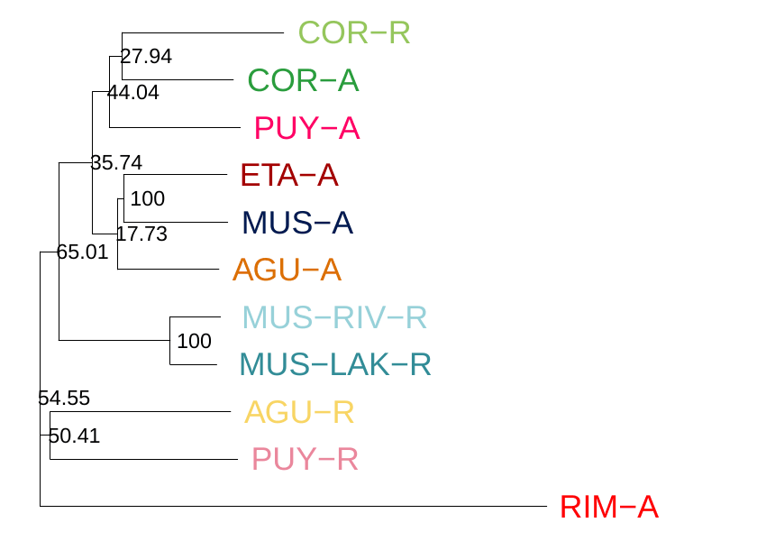

> **Reproduction of the paper's Fig. 4, drawn by the authors' script from our data.** Neighbour-joining tree of the ten sites and the outgroup RIM-A, built from the Edwards distance between sites; tips are coloured by site as in the paper; the numbers at the branches are bootstrap values (percentages), counted by the authors' function for the rooted tree. The vertical axis has no scale; horizontal distances are proportional to the branch lengths.


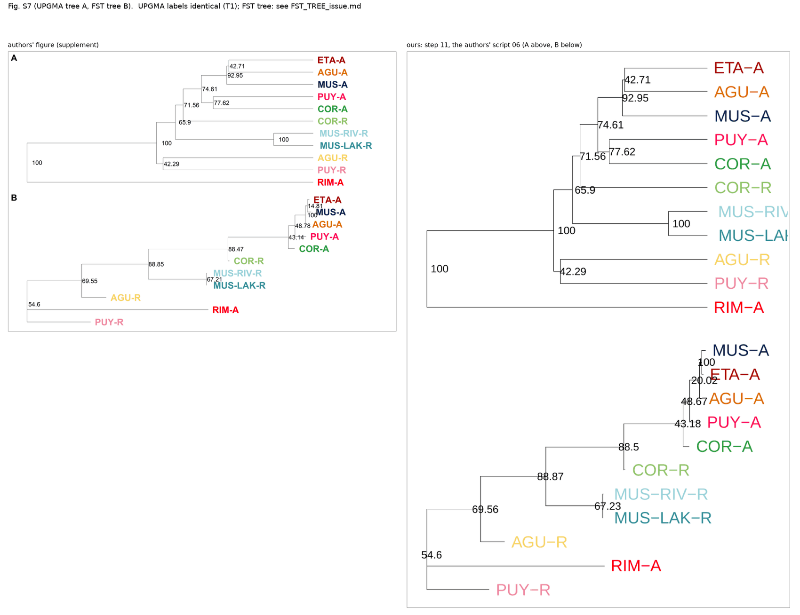

> **Paper's Fig. S7: the authors' two trees (left) and the same two drawn by the authors' script from our data (right).** A, UPGMA tree from the Edwards distance; B, the 'FST' tree. Each tree has the ten sites and the outgroup RIM-A as tips; the numbers at the branches are bootstrap values (percentages). The shape of the trees (topology) is the same as the authors'; see step 11 for the bootstrap values.


<details>
<summary>Scripts, software and parameters of this step</summary>

| Script | Class | What it does |
|---|---|---|
| `input/06_Tree_MS.R` | B | the authors' tree script; only the `base_path` line changes (see `script_changes.diff`) |
| `11_post_results.R` | D | writes the trees, the node tables and the matrix, and the demonstration of what the 'FST' tree is |
| `11_check.R`, `run_11_trees_as_coded.sbatch` | D | check and job (32 seconds) |

**Software.** R 4.2.1: poppr 2.9.4, ape 5.7-1, ggtree 3.6.2, tidytree 0.4.5, adegenet 2.1.10, hierfstat 0.5-11

**Parameters.** all the authors': `set.seed(5)`, 10,000 bootstraps, Edwards distance, outgroup RIM-A

</details>


<details>
<summary>Folder of this step (tree)</summary>

```
11_trees_as_coded/
├── input
│   ├── 06_Tree_MS.R
│   ├── ALLELE_Filtered_Individuals936_Loci40_REASSIGNED_IND_FINAL_Rimouski.txt
│   ├── Functions
│   │   ├── allele2genotype.R
│   │   ├── allele_freq.R
│   │   ├── allele_rich.R
│   │   ├── calculate_marker_missing_percentage.R
│   │   ├── create_genind.R
│   │   ├── delta_K.R
│   │   ├── export_allele_format.R
│   │   ├── fst_calculation.R
│   │   ├── fst_marker.R
│   │   ├── genepop_creator.R
│   │   ├── het.R
│   │   ├── impute.R
│   │   ├── kp_ind.R
│   │   ├── ld_test_locus.R
│   │   ├── mean_membership.R
│   │   ├── na_heatmap.R
│   │   ├── p100_missing.R
│   │   └── pca.R
│   ├── GENIND_Filtered_Individuals936_Loci40_REASSIGNED_IND_IMPUTED_FINAL_Rimouski.RDS
│   ├── node_labels_transcribed.tsv
│   └── README_transcription.txt
├── output
│   ├── 11_post_results.R
│   ├── check_11.tsv
│   ├── exit_code.txt
│   ├── F15_aboot_on_matrix_demonstration.tsv
│   ├── figures
│   │   ├── tree_page-1.png
│   │   ├── tree_page-2.png
│   │   └── tree_page-3.png
│   ├── figures.pdf
│   ├── fst_matrix_used_for_fst_tree.tsv
│   ├── inputs_check.txt
│   ├── inputs_md5_after.txt
│   ├── inputs_md5_before.txt
│   ├── logs
│   │   ├── 63760538_salmon_wf11_trees_as_coded_2026-10-08_23-02-44
│   │   │   ├── 11_check.R
│   │   │   ├── 11_post_results.R
│   │   │   ├── check_11.tsv
│   │   │   ├── check.log
│   │   │   ├── run_stdout.log
│   │   │   ├── script_changes.diff
│   │   │   ├── slurm_script
│   │   │   └── stage_run.sh
│   │   ├── 63761056_salmon_wf11_trees_as_coded_2026-10-08_23-06-43
│   │   │   ├── 11_check.R
│   │   │   ├── 11_post_results.R
│   │   │   ├── check_11.tsv
│   │   │   ├── check.log
│   │   │   ├── run_stdout.log
│   │   │   ├── script_changes.diff
│   │   │   ├── slurm_script
│   │   │   └── stage_run.sh
│   │   ├── salmon_wf11_trees_as_coded_63760538.out
│   │   └── salmon_wf11_trees_as_coded_63761056.out
│   ├── run_stdout.log
│   ├── script_changes.diff
│   ├── seconds.txt
│   ├── sessionInfo.txt
│   ├── tree_edwards_nj_rerooted.nwk
│   ├── tree_edwards_upgma_rerooted.nwk
│   ├── tree_fst_nj_rerooted.nwk
│   ├── tree_nj_on_as_dist_of_the_asCoded_matrix_NOT_THE_PAPER.nwk
│   ├── tree_node_labels.tsv
│   └── trees_rerooted.rds
├── README.md
└── scripts
    ├── 11_check.R
    ├── 11_post_results.R
    └── run_11_trees_as_coded.sbatch

9 directories, 67 files
```

</details>


---

### Step 12: Tree variants
**Level of reproducibility: T3** (our own variants of the trees). **Final run:** 13 integrity checks pass.


**What we set out to do.** Examine the points found in the trees one at a time by computing variants: the support of each split on the unrooted neighbour-joining tree (instead of the rooted clade counted by the authors' call), the effect of re-rooting on node labels, 40 against 41 loci, and the 'FST tree' built both as the authors did and from the matrix used as a matrix of distances (with the as-coded or the corrected values).


<details>
<summary>Method in brief: rooted clades against unrooted splits</summary>

A neighbour-joining tree is **unrooted**: the line between two groups of populations (a *split*) is well defined, but which group lies 'below' a node depends on where the root is drawn. The authors' call counts a bootstrap tree as supporting a node only if the same set of populations lies below that node *with the same orientation*, which for an NJ tree depends on how the algorithm happens to number its internal nodes. The support of the **unrooted split** counts a bootstrap tree if it has the same split, whichever side is the root. The **Robinson-Foulds distance** between two trees is the number of splits found in one tree and not in the other (0 means identical topology). A **pair of sister tips** is two populations that join directly at one node.

</details>


**Inputs of our run**


| Input | Where it comes from |
|---|---|
| the 40-locus genind, the imputed genotype table and the not-imputed allele table (936 fish) | step 03 |
| the three trees of step 11 (as a reproducibility check) | step 11 |


**What we found.** Twelve trees were computed (`variants_catalog.tsv`; the figure shows six). The main results:

* **Supports of rooted clades are not supports of splits.** For the Edwards NJ tree with 40 loci, 8 splits in common between the two ways of counting differ by 22.4 points on average and by up to 68.1 (for example {AGU-A, COR-A, COR-R, ETA-A, MUS-A, PUY-A} 35.7 as printed against 94.7 as an unrooted split).
* **With 41 loci the topology of the Edwards NJ tree changes** (Robinson-Foulds distance 4 from the 40-locus tree): the first locus is kept out of the genind by the authors' code (40 loci), while the paper says the outgroup data set has 41 loci.
* **The 'FST tree'** has the topology of the tree of the similarity of the FST profiles; the same matrix used as distances (`nj(as.dist(matrix))`) differs from the published tree by a Robinson-Foulds distance (the number of splits found in one tree and not in the other) of 4 with the as-coded values and 6 with the Fst′ after our correction (11 sites).


<details>
<summary>Catalogue of the twelve trees</summary>

| Identifier | Tree | Loci | Input | Distance | Support | Labels when re-rooting |
|---|---|---|---|---|---|---|
| E40_nj_published | Edwards NJ | 40 | genind, imputed | Edwards | rooted clades (root = TRUE), as the authors | root() default (labels stay on nodes) |
| E40_upgma_published | Edwards UPGMA | 40 | genind, imputed | Edwards | rooted clades (ultrametric tree) | root() default |
| FST_asCoded_published | FST NJ (aboot on the matrix rows) | 41 | allele table, 2 columns per locus | nei.dist of the matrix rows | rooted clades (root = TRUE), as the authors | root() default |
| E40_nj_unrooted_supports | Edwards NJ | 40 | genind, imputed | Edwards | unrooted splits (root = FALSE) | edgelabel = TRUE |
| E41_nj_rootedclades | Edwards NJ | 41 | genind, imputed + first locus | Edwards | rooted clades (root = TRUE), as the authors | root() default |
| E41_nj_unrooted_supports | Edwards NJ | 41 | genind, imputed + first locus | Edwards | unrooted splits (root = FALSE) | edgelabel = TRUE |
| E41_upgma | Edwards UPGMA | 41 | genind, imputed + first locus | Edwards | rooted clades (ultrametric tree) | root() default |
| FST_corrected_aboot_rootedclades | FST NJ (aboot on the matrix rows) | 41 | Fst' after our correction | nei.dist of the matrix rows | rooted clades (root = TRUE), as the authors | root() default |
| FST_corrected_aboot_unrooted | FST NJ (aboot on the matrix rows) | 41 | Fst' after our correction | nei.dist of the matrix rows | unrooted splits (root = FALSE) | edgelabel = TRUE |
| FST_asCoded_nj_asdist | FST NJ (matrix as distances) | 41 | allele table, 2 columns per locus | Fst' of the matrix | unrooted splits, bootstrap over the 82 columns | edgelabel = TRUE |
| FST_corrected_nj_asdist | FST NJ (matrix as distances) | 41 | Fst' after our correction | Fst' of the matrix | unrooted splits, bootstrap over 41 loci | edgelabel = TRUE |
| FST_corrected_nj_asdist_40loci | FST NJ (matrix as distances) | 40 | Fst' after our correction without the first locus | Fst' of the matrix | unrooted splits, bootstrap over 40 loci | edgelabel = TRUE |

</details>


**Which trees are the authors' and which are ours.** The figure below shows six trees, **all computed by us from our data**; none is an image of a tree printed in the paper (the printed trees, Fig. 4 and Fig. S7, are shown beside ours in step 11). Panels a and d follow the authors' procedure exactly, as run by us ('as published' in the panel titles means 'the procedure of the authors' script'); panels b, c, e and f change one thing at a time. In the panel titles of e and f, 'Fst′ after our correction' means the Fst′ of step 10.

| Panel | Tree | Whose procedure | What differs from the previous panel of the same kind |
|---|---|---|---|
| a | Edwards NJ tree, 40 loci, support of rooted clades | authors' procedure (our run; compared with Fig. 4 in step 11) | - |
| b | the same tree, support of unrooted splits | ours | how the support is counted |
| c | Edwards NJ tree with 41 loci, support of unrooted splits | ours | one more locus (the paper says 41) |
| d | 'FST' tree, bootstrap on the rows of the as-coded FST matrix | authors' procedure (our run; compared with Fig. S7B in step 11) | - |
| e | 'FST' tree from the Fst′ of our correction, bootstrap on the rows, unrooted splits | ours | the matrix (our correction instead of as coded) |
| f | Fst′ of our correction used as distances (neighbour-joining), bootstrap over loci | ours | the matrix used as distances, as a distance tree should be built |


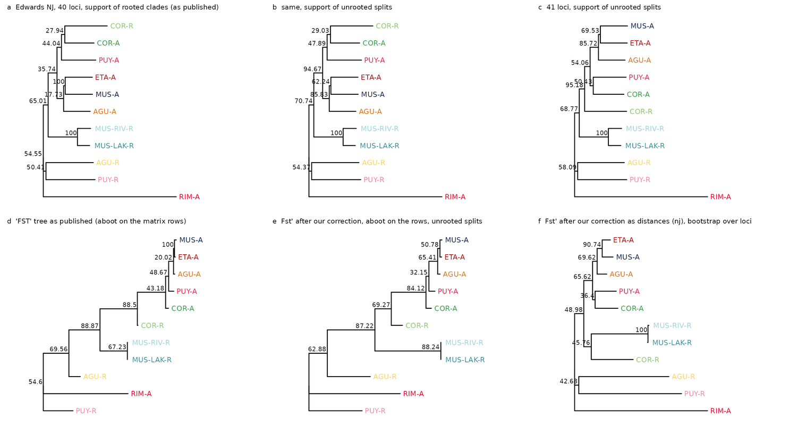

> **Our figure; no counterpart in the paper.** Six of the twelve trees of step 12, all computed from our data. Each is a neighbour-joining tree of the ten sites with the outgroup RIM-A; tips are coloured by site; the numbers at the branches are bootstrap values (percentages). a: Edwards distance, 40 loci, support of rooted clades as the authors count it. b: the same tree with the support counted for unrooted splits. c: 41 loci (the number of loci that the paper states). d: the 'FST' tree as published (the as-coded FST matrix handed row by row to the bootstrap function). e: the matrix after our correction, handled in the same way as d. f: the matrix after our correction used as a table of distances, with a bootstrap over loci.


<details>
<summary><b>Problem found:</b> the supports of the NJ trees and the 'FST tree'</summary>

Steps 11 (as coded) and 12 (variants). Evidence: `11_trees_as_coded/output/F15_aboot_on_matrix_demonstration.tsv`, `12_tree_variants/output/supports_by_split.tsv`, `robinson_foulds_unrooted.tsv`, `variants_catalog.tsv`, `fig_12_tree_variants.png`, `all_variant_trees.pdf`.

**0. In brief, and how steps 11 and 12 differ from steps 09 and 10**


Steps 09 and 10 are about **numbers**: the pairwise FST values of the paper, first as the authors' code computes them (09) and then with the layout that the function documents (10). Steps 11 and 12 are about **trees** that the paper draws (Fig. 4, Fig. S7). Step 11 runs the authors' tree script exactly as written and compares the bootstrap numbers with the printed trees. Step 12 then changes one thing at a time to find out why the trees are what they are. Four things are involved:

1. The **"FST tree"** is not built from FST distances between sites; it is built from the similarity of the **rows** of the FST matrix (each row is the list of FST values of one site with the others). Its input numbers are the as-coded values of step 09, but using the corrected values of step 10 gives the same tree.
2. The **bootstrap numbers on the neighbour-joining (NJ) trees** are counted for *rooted groups*, which depend on an arbitrary choice of root, so they are not the support of the groupings that the tree shows.
3. After the tree is **re-rooted on the outgroup, the numbers are attached to the wrong branches**; this is why two nodes of our reproduction differ from the printed trees.
4. The trees do not use the **same number of loci** (40 for the Edwards trees, 41 for the "FST tree"), and the number of loci changes the Edwards tree.

**1. What the authors did**


Three terms first. A **neighbour-joining (NJ) tree** is built from a table of distances between populations by joining, step by step, the two groups that are closest after correcting for how far each is from all the others; it has no root. **UPGMA** joins the closest groups and assumes the same rate of change on all branches, which gives a tree with a root. A **bootstrap value** on a branch is the percentage of 10,000 resamplings of the data (here: the loci are drawn with replacement) in which the same group of tips (a **clade**) is found; the **outgroup** RIM-A is a distant population used to place the root.

`Scripts/06_Tree_MS.R` builds three trees with RIM-A as outgroup. (i) The Edwards-distance NJ tree and (ii) the Edwards-distance UPGMA tree, from the genind (the R table of allele counts, see section 3.1 of the report) of the 936 fish with **40 loci** (the first locus, NGS_SSsp2210, stays in the strata columns and is not in the genind), with `aboot(..., sample = 10000, tree = "nj" or "upgma", root = TRUE)` followed by `root(tree, outgroup = "RIM-A")`; the comment above the NJ call says that `root = FALSE` is what the function suggests for NJ trees. (iii) The **"FST tree"**: `pairwise.neifst()` on the allele table with two columns per locus (**41 loci**, 82 columns; the layout of step 10), `NA` replaced by 0, and then `aboot(fst_matrix, sample = 10000, tree = "nj", root = TRUE)` and the same `root()`.

**2. What is inconsistent, with the evidence**


* **The "FST tree" is a tree of the similarity of FST profiles, not of FST distances.** The function `aboot()` (package poppr) is made for data tables: given a matrix, it takes the distance between the **rows** (`nei.dist`) and resamples the **columns**. In an FST matrix each row is the profile of one site (its FST with each other site) and the columns are the other sites, not the loci. So the tree puts together sites whose *profiles* are alike, which is not the same as sites that are close to each other (two sites with the same FST towards all the others can be far from each other). The topology of the authors' tree is exactly that of `nj(nei.dist(rows of the matrix))` (Robinson–Foulds distance 0, see section 4 for this distance) and differs from the NJ tree of the matrix used as distances, `nj(as.dist(matrix))` (distance 4). Its "bootstrap" asks how stable the tree is to the choice of sites in the profile, not to the choice of loci. The numbers in the matrix are the as-coded values of step 09, but the tree is the same with the corrected values (step 12: distance 0), so the encoding problem of step 09 does not change this tree; its construction is the problem.
* **The support values of the NJ trees are counts of rooted clades.** In `aboot()` the argument `root` is passed on to the bootstrap function as `rooted = `. An NJ tree has no root, and `nj()` gives it an arbitrary internal one. A rooted clade (the group of tips below a node, seen from the root) is counted only when a bootstrap tree has the same group below a node in the same orientation, so the value depends on how `nj()` happens to number its nodes. The support of a grouping of the tree is the percentage of resamples that contain the same **split** (the division of all the tips into two groups, whatever the root). Recomputed as supports of unrooted splits on the same trees (step 12; same seed, 10,000 replicates), the Edwards NJ tree with 40 loci gives, for 8 splits in common, a mean absolute difference of **22.4 points and a largest of 68.1**. Examples (as printed against the support of the split): {AGU-A, COR-A, COR-R, ETA-A, MUS-A, PUY-A} **35.7 against 94.7**; {AGU-A, ETA-A, MUS-A} **17.7 against 85.8**; {COR-A, COR-R, PUY-A} 44.0 against 47.9; {AGU-R, PUY-R} 50.4 against 54.4. The UPGMA tree has a root by construction, so for it the rooted count is the right one.
* **After `root(tree, outgroup = "RIM-A")` the labels are attached to the wrong branches.** `root()` keeps the node labels with the node numbers unless `edgelabel = TRUE` is given, so when the tree is turned around the outgroup the numbers stay behind. Evidence: the pair of sister tips {ETA-A, MUS-A} (a 'cherry') carries 100 on the printed tree, but a pair of sister tips is present in a resampled tree whatever the rooting, and it occurs in only 62.2 % of the 10,000 resamples (unrooted count; 69.5 % with 41 loci): a printed 100 cannot be its support. This is also why our reproduction differs from Fig. 4 and Fig. S7B at exactly two neighbouring nodes (step 11): which label lands on which node depends on the node numbering produced by the version of the R package ape that builds the tree.
* **The trees do not use the same loci.** The Edwards trees use 40 loci, the "FST tree" 41. One more locus changes the Edwards trees: with 41 loci the Robinson–Foulds distance to the published NJ tree is 4 (UPGMA: 2); COR-R, sister of COR-A with 40 loci, becomes the sister of the whole anadromous clade, and COR-A groups with PUY-A.
* All ten NJ trees (the two published NJ trees included) have a three-way root after `root()`: ape leaves the outgroup on a node with three branches unless `resolve.root = TRUE` is given. The two UPGMA trees have a two-way root.

**3. What is correct, and why**


A matrix of distances goes to the tree function as a distance (`ape::nj(as.dist(matrix))`) and the bootstrap resamples loci. Supports of an unrooted NJ tree are counts of unrooted splits (`rooted = FALSE`), and the tree is re-rooted with the labels carried by the branches (`root(..., edgelabel = TRUE)`). All trees use the same set of loci. UPGMA with rooted counts is consistent. The distances fed to the "FST tree" must come from the documented layout (step 10).

**4. What we compute (`12_a_variants.R`; 10,000 replicates, `set.seed(5)`, outgroup RIM-A)**


Twelve trees (three published ones read back and nine new). Edwards NJ and UPGMA with 40 and 41 loci (the first locus enters as in the allele table, with 15 fish that have a missing allele at it left missing, as population allele frequencies use the observed alleles); supports as the authors computed them and as unrooted splits with `edgelabel = TRUE`; the "FST tree" for the as-coded and the Fst′ after our correction matrix (11 sites, 41 loci), once with the authors' `aboot` on the rows and once as `nj(as.dist())` with a bootstrap over loci of our own (per-locus components of Fst′; 82 columns for the as-coded matrix, 41 and 40 loci for the corrected one).

| comparison (unrooted Robinson–Foulds distance: the number of splits found in one tree and not in the other; 0 means the same topology) | value |
|---|---|
| FST tree as published vs corrected matrix, same `aboot` construction | **0** (the encoding does not change this tree) |
| FST tree as published vs as-coded matrix as distances (nj) | 4 |
| FST tree as published vs corrected matrix as distances (nj) | 6 |
| corrected matrix as distances, 41 vs 40 loci | 0 |
| Edwards NJ, 40 vs 41 loci | 4 |
| Edwards UPGMA, 40 vs 41 loci | 2 |
| Edwards NJ (40 loci) vs corrected-matrix nj tree | 6 |
| Edwards UPGMA (40 loci) vs corrected-matrix nj tree | 4 |

On the Fst′ tree built as a distance tree with the corrected input, supports are 100 % only for the pair MUS-LAK-R and MUS-RIV-R (and 90.7 % for {ETA-A, MUS-A}); the placements of AGU-R and PUY-R (support of {AGU-R, PUY-R} 42.7 %) and of COR-R (45.8 %) are weak. In the Edwards NJ tree the support of unrooted splits is 94.7 % for the anadromous clade of six sites (COR-R included) and 54 % for {AGU-R, PUY-R}. The statement of the paper that resident populations are generally more similar to each other than to the anadromous population of their own watershed is therefore supported for AGU-R and PUY-R only weakly, and in all trees MUS-LAK-R and MUS-RIV-R are nested among the anadromous sites and COR-R rather than with the other residents.

**5. What we do not compute, and why**


* Other distances (Reynolds, Cavalli-Sforza) and other tree methods: the plan keeps the three trees of the paper and their variants.
* The 41-locus Edwards tree uses the first locus unimputed, not imputed as the others; with a 0.4 % rate of missing data and frequencies computed from observed alleles this is not expected to matter, but it was not tested.
* We did not search the package versions (ape, poppr) that reproduce the published labels at the two displaced nodes; the explanation above (node numbering of `nj()` and the default of `root()`) is supported by the displaced pair of sister tips and by the size of the difference between rooted and unrooted counts, not by a version-by-version test.

</details>


<details>
<summary>Scripts, software and parameters of this step</summary>

| Script | Class | What it does |
|---|---|---|
| `12_a_variants.R` | D | twelve trees, supports of splits, Robinson-Foulds distances (reuses the authors' data preparation of script 06 and their `create_genind()`, `kp_ind()`) |
| `12_check.R`, `run_12_tree_variants.sbatch` | D | check and job (95 seconds) |

**Software.** R 4.2.1: poppr 2.9.4, ape 5.7-1, ggtree 3.6.2, hierfstat 0.5-11, adegenet 2.1.10

**Parameters.** the authors' (`set.seed(5)`, 10,000 replicates, Edwards distance, outgroup RIM-A) for every tree

</details>


<details>
<summary>Folder of this step (tree)</summary>

```
12_tree_variants/
├── FST_TREE_issue.md
├── input
│   ├── ALLELE_936_not_imputed.txt
│   ├── Functions
│   │   ├── allele2genotype.R
│   │   ├── allele_freq.R
│   │   ├── allele_rich.R
│   │   ├── calculate_marker_missing_percentage.R
│   │   ├── create_genind.R
│   │   ├── delta_K.R
│   │   ├── export_allele_format.R
│   │   ├── fst_calculation.R
│   │   ├── fst_marker.R
│   │   ├── genepop_creator.R
│   │   ├── het.R
│   │   ├── impute.R
│   │   ├── kp_ind.R
│   │   ├── ld_test_locus.R
│   │   ├── mean_membership.R
│   │   ├── na_heatmap.R
│   │   ├── p100_missing.R
│   │   └── pca.R
│   ├── GENIND_936_40loci_imputed.RDS
│   ├── GENOTYPE_936_imputed.txt
│   ├── step11_tree_node_labels.tsv
│   └── step11_trees_rerooted.rds
├── output
│   ├── all_variant_trees.pdf
│   ├── check_12.tsv
│   ├── data_checks.txt
│   ├── exit_code.txt
│   ├── fig_12_tree_variants.pdf
│   ├── fig_12_tree_variants.png
│   ├── fst_matrix_as_coded_11sites.tsv
│   ├── fst_matrix_corrected_Fstprime_11sites.tsv
│   ├── inputs_check.txt
│   ├── inputs_md5_after.txt
│   ├── inputs_md5_before.txt
│   ├── logs
│   │   ├── 63761941_salmon_wf12_tree_variants_2026-10-08_23-16-13
│   │   │   ├── 12_a_variants.log
│   │   │   ├── 12_a_variants.R
│   │   │   ├── 12_check.R
│   │   │   ├── check.log
│   │   │   └── slurm_script
│   │   ├── 63762266_salmon_wf12_tree_variants_2026-10-08_23-18-13
│   │   │   ├── 12_a_variants.log
│   │   │   ├── 12_a_variants.R
│   │   │   ├── 12_check.R
│   │   │   ├── check_12.tsv
│   │   │   ├── check.log
│   │   │   └── slurm_script
│   │   ├── 63762664_salmon_wf12_tree_variants_2026-10-08_23-20-44
│   │   │   ├── 12_a_variants.log
│   │   │   ├── 12_a_variants.R
│   │   │   ├── 12_check.R
│   │   │   ├── check_12.tsv
│   │   │   ├── check.log
│   │   │   └── slurm_script
│   │   ├── 63762729_salmon_wf12_tree_variants_2026-10-08_23-23-13
│   │   │   ├── 12_a_variants.log
│   │   │   ├── 12_a_variants.R
│   │   │   ├── 12_check.R
│   │   │   ├── check_12.tsv
│   │   │   ├── check.log
│   │   │   └── slurm_script
│   │   ├── 63763266_salmon_wf12_tree_variants_2026-10-08_23-25-43
│   │   │   ├── 12_a_variants.log
│   │   │   ├── 12_a_variants.R
│   │   │   ├── 12_check.R
│   │   │   ├── check_12.tsv
│   │   │   ├── check.log
│   │   │   └── slurm_script
│   │   ├── 64157365_salmon_wf12_tree_variants_2026-10-10_16-31-17
│   │   │   ├── 12_a_variants.log
│   │   │   ├── 12_a_variants.R
│   │   │   ├── 12_check.R
│   │   │   ├── check_12.tsv
│   │   │   ├── check.log
│   │   │   └── slurm_script
│   │   ├── salmon_wf12_tree_variants_63761941.out
│   │   ├── salmon_wf12_tree_variants_63762266.out
│   │   ├── salmon_wf12_tree_variants_63762664.out
│   │   ├── salmon_wf12_tree_variants_63762729.out
│   │   ├── salmon_wf12_tree_variants_63763266.out
│   │   └── salmon_wf12_tree_variants_64157365.out
│   ├── reproducibility_checks.txt
│   ├── robinson_foulds_unrooted.tsv
│   ├── seconds.txt
│   ├── sessionInfo.txt
│   ├── supports_by_split.tsv
│   ├── tree_E40_nj_published.nwk
│   ├── tree_E40_nj_unrooted_supports.nwk
│   ├── tree_E40_upgma_published.nwk
│   ├── tree_E41_nj_rootedclades.nwk
│   ├── tree_E41_nj_unrooted_supports.nwk
│   ├── tree_E41_upgma.nwk
│   ├── tree_FST_asCoded_nj_asdist.nwk
│   ├── tree_FST_asCoded_published.nwk
│   ├── tree_FST_corrected_aboot_rootedclades.nwk
│   ├── tree_FST_corrected_aboot_unrooted.nwk
│   ├── tree_FST_corrected_nj_asdist_40loci.nwk
│   ├── tree_FST_corrected_nj_asdist.nwk
│   └── variants_catalog.tsv
├── README.md
└── scripts
    ├── 12_a_variants.R
    ├── 12_check.R
    └── run_12_tree_variants.sbatch

12 directories, 98 files
```

</details>


<details>
<summary>Deviations from the plan in this step</summary>

* **2026-10-08** (D): Three failed first runs of step 12 (jobs 63761941, 63762266, 63762664), all mistakes in my check or job script: ape not loaded in the check, md5sum -L, a test of the root that assumed a two-way root (ape leaves a three-way root), a logical stored as the number 1; figure axis limits widened after the first view *Why:* checks written before the run *Effect on the result:* none
* **2026-10-10** (D): Rerun of the job (64157365, 96 s) with names and labels changed: 'valid' became 'corrected' in the names of two tables (fst_matrix_corrected_Fstprime_11sites.tsv) and four trees (tree_FST_corrected_*.nwk), in the panel titles of the figure ('Fst′ after our correction') and in the scripts; FST_TREE_issue.md rewritten in plain words (what the 'FST tree' is, rooted clades, displaced labels, 40 against 41 loci, the difference between steps 11-12 and 09-10) *Why:* the user prefers 'our correction' to 'valid' and asked for a self-contained explanation of the problem found in the trees (comments on version 2) *Effect on the result:* none; the 12 newick trees are identical to those of the previous run (md5), the 25 rows of the check table have the same results

</details>


---

### Step 13: Directional gene flow (divMigrate, Fig. 5)
**Level of reproducibility: T1/T4** (the saved result is reproduced exactly; the published figure is not drawn from it). **Final run:** 10 integrity checks pass; of the comparisons with the paper 3 agree and 5 differ.


**What we set out to do.** (a) Recompute the relative gene flow and its significance with the authors' call and compare with their saved result; (b) search a grid, fixed in advance, of data versions and settings for the one that reproduces the 22 numbers printed on Fig. 5; (c) draw Fig. 5 with the authors' own plot code from each result that matters.


<details>
<summary>Method in brief: divMigrate: relative directional gene flow</summary>

* **Why.** FST says how different two populations are, not which way migrants go. In salmon the question is whether fish move downstream (resident to anadromous) more than upstream, so a directional measure is needed.
* **What it computes.** **divMigrate** (R package diveRsity; Sundqvist et al. 2016) estimates the **direction and relative size of gene flow** between pairs of populations. For each ordered pair (from A to B) it takes the allele frequencies of the two populations and of the pool of the pair, computes how much of the pooled gene pool each population contributes (a measure based on the differentiation statistic chosen: here Nei's G_ST), and scales the largest value in the whole data set to 1.
* **How to read the values.** All numbers are **relative to the strongest flow in the data set**: 0.142 does not mean 14 % of fish migrate, it means 14 % of the strongest estimated flow. Compare an arrow with its opposite (A to B against B to A): the larger one is the dominant direction. A value says nothing about the absolute number of migrants.
* **Significance.** The bootstrap over loci (10,000 replicates) gives confidence limits; the direction is called significant when the limits of A to B and B to A do not overlap. The authors then draw only the arrows above a threshold between the nine sites. Imputed genotypes are used (divMigrate cannot take gaps).

</details>


**Inputs of our run**


| Input | Where it comes from |
|---|---|
| the reassigned GENEPOP file (9 populations, 385 fish, imputed, Musquaro residents pooled) | step 03 |
| the reassigned and not-reassigned genind objects and the not-imputed table (for the 28 variants of the grid) | steps 01 and 03 |
| `07_MigrationDirectionality_MS.R` | step 00 (the authors' plot script, class B) |

**The authors' files and transcriptions used only for comparison (never as inputs)**


| File | Used for |
|---|---|
| the authors' saved result (`.RData`) and the 22 numbers read from the printed Fig. 5 | to compare with our run and as the target of the grid |
| the deposited **not-reassigned** GENEPOP file | one diagnostic run only, outside the grid's decision rule |


**What we found.**

* **The divMigrate computation is reproduced exactly (T1).** The relative gene-flow matrix that we compute with the authors' call equals the one they saved (largest difference 0, with 0 and with 10,000 bootstraps) and the significance matrix is identical in all 72 cells. The eight within-watershed values quoted in the text of the Results are numbers of this matrix.
* **The numbers printed on Fig. 5 are not those of the saved result.** Of the 22 arrows, 21 differ from the saved matrix by more than 0.0015 (mean difference 0.023, largest 0.055); for example PUY-R → PUY-A is 0.090 on the figure and 0.142 in the text and in the saved result.
* **The figure was drawn from another version of the data.** We ran the authors' own **not-reassigned** GENEPOP file of the deposit (the four fish at their original sites) through the authors' call and plot code: at 20 of the 22 arrows it gives the number printed on the figure; the two others are one pair of arrows, COR-R and AGU-R, whose two numbers (0.075 and 0.058) are exchanged on the figure. That file holds a different random sample of 50 PUY-A fish from the one that the authors' code writes (30 of the 50 fish differ), and no script of the deposit writes it. The text and the saved result describe the analysis of the Methods, with the four fish reassigned.
* **This is not an error in the computation of gene flow.** The figure and the text come from two versions of the data. The pattern that the Results describe, downstream flow larger than upstream flow, holds in every version we ran.


**The 22 arrows of Fig. 5, from each source.** The first column of numbers is what is printed on the figure; the next two columns are runs on data in which the four fish are **not** reassigned; the last two are the analysis of the Methods (four fish reassigned).

* *Printed on Fig. 5*: the 22 numbers written next to the arrows of the published figure. The authors give no table of them, so we read them from the figure itself: the PDF of the paper keeps the text of the figure as text, which gives each number together with its place on the page, and each number was attached to the arrow it stands beside.
* *Authors' deposited not-reassigned file, run by us*: the GENEPOP file of the deposit that has the original labels, run through the authors' call.
* *Our variant, not reassigned*: our run with the authors' pipeline on data in which the four fish keep their original labels (our random sample of PUY-A).
* *Authors' saved result (reassigned data)*: the matrix that the authors saved in the deposit; the values quoted in the text are taken from it.
* *Our run (reassigned data)*: the same call run by us; it gives exactly the saved numbers.

| Arrow | Printed on Fig. 5 | Authors' deposited not-reassigned file, run by us | Our variant, not reassigned | Authors' saved result (reassigned data) | Our run of the authors' call (reassigned data) |
|---|---|---|---|---|---|
| PUY-A → PUY-R | 0.042 | 0.042 | 0.044 | 0.044 | 0.044 |
| PUY-R → PUY-A | 0.090 | 0.090 | 0.141 | 0.142 | 0.142 |
| COR-A → COR-R | 0.294 | 0.294 | 0.294 | 0.279 | 0.279 |
| COR-R → COR-A | 0.361 | 0.361 | 0.361 | 0.323 | 0.323 |
| AGU-A → AGU-R | 0.099 | 0.099 | 0.099 | 0.062 | 0.062 |
| AGU-R → AGU-A | 0.259 | 0.259 | 0.259 | 0.231 | 0.231 |
| MUS-A → MUS-R | 0.186 | 0.186 | 0.186 | 0.131 | 0.131 |
| MUS-R → MUS-A | 0.357 | 0.357 | 0.357 | 0.393 | 0.393 |
| COR-A → PUY-A | 0.567 | 0.567 | 0.594 | 0.588 | 0.588 |
| PUY-A → COR-A | 0.399 | 0.399 | 0.423 | 0.415 | 0.415 |
| AGU-A → COR-A | 0.629 | 0.629 | 0.629 | 0.608 | 0.608 |
| COR-A → AGU-A | 0.741 | 0.741 | 0.741 | 0.728 | 0.728 |
| MUS-A → AGU-A | 0.887 | 0.887 | 0.887 | 0.856 | 0.856 |
| AGU-A → MUS-A | 0.793 | 0.793 | 0.793 | 0.796 | 0.796 |
| ETA-A → MUS-A | 0.978 | 0.978 | 0.978 | 0.996 | 0.996 |
| MUS-A → ETA-A | 0.736 | 0.736 | 0.736 | 0.715 | 0.715 |
| COR-R → PUY-R | 0.039 | 0.039 | 0.039 | 0.035 | 0.035 |
| PUY-R → COR-R | 0.055 | 0.055 | 0.055 | 0.054 | 0.054 |
| AGU-R → COR-R | 0.075 | 0.058 | 0.058 | 0.053 | 0.053 |
| COR-R → AGU-R | 0.058 | 0.075 | 0.075 | 0.047 | 0.047 |
| MUS-R → AGU-R | 0.093 | 0.093 | 0.093 | 0.053 | 0.053 |
| AGU-R → MUS-R | 0.083 | 0.083 | 0.083 | 0.054 | 0.054 |

**What the table shows.** The two last columns agree with each other and with the text of the Results. The printed figure agrees instead with the not-reassigned data: with the authors' own not-reassigned file at 20 of 22 arrows (the exceptions are the exchanged pair AGU-R and COR-R) and, with our own random sample of PUY-A, at 16 of 22. The four arrows that touch PUY-A are the ones where our variant misses, because its random sample of PUY-A is not the one in the authors' file.


<details>
<summary>The search for the data version of the figure (the grid fixed before the run), in detail</summary>

Before looking at the results we fixed a grid of data versions and settings (the four fish reassigned or not; Musquaro residents pooled or kept apart; the statistic `gst`, `d` or `Nm`; 385 fish or 885 fish with the two juvenile groups of Corneille; and 20 further imputation draws of the authors' function for the main variant) and a decision rule: a variant reproduces the figure only if **all 22** values are within 0.0015 of the printed ones. No variant of the grid met the rule: the best, not reassigned with Musquaro pooled and 385 fish, matches 16 of 22; the data of the saved result match 1 or 2 of 22. The deposited not-reassigned file, run once as a diagnostic outside the grid (it is a derived file of the authors, not an input of our pipeline), matches 20 of 22.

| Data version | Musquaro residents | Fish | Statistic | Runs | Arrows within 0.0015 of the figure (of 22) | Mean absolute difference |
|---|---|---|---|---|---|---|
| not reassigned | pooled | 385 | gst | 1 | 16 | 0.0065 |
| not reassigned | pooled | 385 | Nm | 1 | 7 | 0.0074 |
| four fish reassigned | pooled | 385 | gst | 21 | 1 to 2 | 0.0235 |
| four fish reassigned | pooled | 385 | Nm | 1 | 1 | 0.0240 |
| not reassigned | pooled | 885 | d | 1 | 1 | 0.2912 |
| four fish reassigned | kept apart | 385 | Nm | 1 | 0 | 0.2759 |
| four fish reassigned | kept apart | 385 | gst | 1 | 0 | 0.2751 |
| four fish reassigned | kept apart | 385 | d | 1 | 0 | 0.2972 |
| four fish reassigned | pooled | 385 | d | 1 | 0 | 0.2411 |
| four fish reassigned | kept apart | 885 | gst | 1 | 0 | 0.3188 |
| four fish reassigned | kept apart | 885 | d | 1 | 0 | 0.2972 |
| four fish reassigned | kept apart | 885 | Nm | 1 | 0 | 0.3192 |
| not reassigned | kept apart | 385 | Nm | 1 | 0 | 0.2704 |
| four fish reassigned | pooled | 885 | Nm | 1 | 0 | 0.3193 |
| four fish reassigned | pooled | 885 | d | 1 | 0 | 0.2886 |
| four fish reassigned | pooled | 885 | gst | 1 | 0 | 0.3189 |
| not reassigned | kept apart | 885 | Nm | 1 | 0 | 0.3177 |
| not reassigned | kept apart | 385 | gst | 1 | 0 | 0.2694 |
| not reassigned | kept apart | 385 | d | 1 | 0 | 0.2926 |
| not reassigned | kept apart | 885 | d | 1 | 0 | 0.2926 |
| not reassigned | pooled | 385 | d | 1 | 0 | 0.2060 |
| not reassigned | kept apart | 885 | gst | 1 | 0 | 0.3173 |
| not reassigned | pooled | 885 | Nm | 1 | 0 | 0.3177 |
| not reassigned | pooled | 885 | gst | 1 | 0 | 0.3173 |

</details>


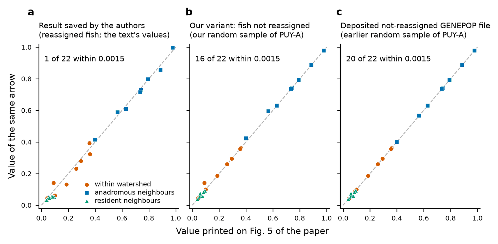

> **Our figure; no counterpart in the paper.** The 22 arrows of the paper's Fig. 5. In each panel, x = the value printed on the arrow in Fig. 5 and y = the value of the same arrow in another source; the dashed line marks equal values; orange circles = arrows within a watershed, blue squares = arrows between anadromous neighbours, green triangles = arrows between resident neighbours. a: the result saved by the authors (reassigned fish; also the values quoted in the text). b: our run on data in which the fish are not reassigned (our random sample of PUY-A). c: the authors' deposited not-reassigned GENEPOP file, run by us (the earlier random sample of PUY-A). The count in each panel is the number of arrows that agree to within 0.0015.


<details>
<summary><b>Problem found:</b> Fig. 5 is not drawn from the result that the text quotes</summary>

Step 13 (`13_divmigrate`). Evidence: `output/check_13.tsv`, `output/fig5_arrows_figure_vs_sources.tsv`, `output/fig5_label_comparison_by_position.tsv`, `output/grid_summary.tsv`, `output/grid_all_arrows.tsv`, `output/fig_13_fig5_vs_sources.png`, `input/fig5_values_transcribed.tsv`.

**1. What the authors did**


`Scripts/07_MigrationDirectionality_MS.R` loads a saved `divMigrate` result (GST, 10,000 bootstraps, the commented call has `set.seed(24)`; reassigned fish, Musquaro residents pooled, imputed genotypes, 385 fish), names its rows and columns from the GENEPOP file, and draws Fig. 5 (22 arrows between the 9 sites). The Results quote the within-watershed values: downstream flow of 0.142 (PUY), 0.323 (COR), 0.231 (AGU) and 0.393 (MUS), upstream 0.044, 0.279, 0.062 and 0.131.

**2. What is inconsistent, with the evidence**


* **The text agrees with the saved result and not with the figure.** Our run of the authors' call (point estimates, then 10,000 bootstraps, one core, `set.seed(24)`) gives a relative gene flow matrix **identical to the saved one** (largest difference 0) and a significance matrix identical in all 72 cells (`output/divmigrate_authors_run/`). The text's eight within-watershed values are these numbers. Seven of the eight within-watershed arrows printed on Fig. 5 differ from them by 0.015 to 0.055 (PUY-R → PUY-A: 0.090 on the figure, 0.142 in the text; MUS-A → MUS-R: 0.186 and 0.131; AGU-A → AGU-R: 0.099 and 0.062). Over the 22 arrows, 21 differ from the saved matrix by more than 0.0015 (mean absolute difference 0.023, largest 0.055). The 22 numbers of the figure were read from the vector text of the PDF and assigned to arrows by the position of the labels (`input/fig5_values_transcribed.tsv`); the authors' plot code, run on the saved result, puts the saved values at those positions, so the difference is not a matter of labelling.
* **The figure was drawn from not-reassigned fish and from another random sample of PUY-A.** In the grid below, the data version without the reassignment of the four fish comes much closer to the figure than the reassigned version (16 of 22 values within 0.0015 against 1 or 2 of 22). Run on the deposited not-reassigned GENEPOP file (a diagnostic; that file is a derived file and is not an input of our pipeline), the authors' plot code puts at 20 of the 22 positions the label printed on the paper's figure; the two others are the pair COR-R/AGU-R, where the paper prints the same two numbers (0.075 and 0.058) at the opposite arrows. The deposited not-reassigned file differs from the file that we write with the authors' code in the sample of PUY-A: 30 of the 50 PUY-A fish are different (the other 355 fish, 20 of them PUY-A, are shared and their genotypes are identical), and no deposited script produces it. This explains the four arrows that touch PUY-A and that our not-reassigned variant misses by 0.002 to 0.051.
* **The significance matrix does not support the narrative for COR.** The saved significance matrix marks COR-R → COR-A (0.323, quoted as "especially high") and every upstream arrow as not significant; of the within-watershed arrows only PUY-R → PUY-A, AGU-R → AGU-A and MUS-R → MUS-A are significant.

**3. What is correct, and why**


We cannot say which analysis the paper intends. The two sets of numbers come from different data (fish reassigned or not, and a different PUY-A sample); the text and the figure cannot both describe the analysis of the Methods, which reassigns the four fish. The values of the saved result are reproducible (they follow from the deposited GENEPOP file and `set.seed(24)`), the figure's are reproducible only from a file that no deposited script writes. One analysis should be reported for both, with the significance of each arrow.

**4. What we compute**


The authors' call as written (relative gene flow equal to the saved one: T1); the authors' script 07 on our result (same drawing as the saved one); a **grid fixed before the run** (data version × Musquaro pooled or apart × `gst`, `d`, `Nm` × 385 or 885 fish with the two Corneille juvenile groups, 24 runs) plus 20 further imputation draws of the authors' own function for the main variant (44 point-estimate runs, 46 s in all); a decision rule fixed in advance (all 22 values within 0.0015); a position-by-position comparison with the paper's figure of three drawings (`output/fig5_label_comparison_by_position.tsv`).

| variant (statistic `gst` unless stated) | values within 0.0015 of Fig. 5 | mean abs. difference |
|---|---|---|
| not reassigned, Musquaro pooled, 385 fish | **16 of 22** (7 for `Nm`) | 0.0065 |
| reassigned, pooled, 385 fish (the saved result's data) | 1 of 22 | 0.0233 |
| 20 imputation draws, reassigned, pooled, 385 | 1 or 2 of 22 | about 0.023 |
| all other variants (Musquaro apart, 885 fish, `d`) | 0 or 1 of 22 | 0.2 to 0.3 |
| diagnostic: deposited not-reassigned GENEPOP file | 20 of 22 (by position) | 0.0015 |

**By the rule fixed in advance no variant of the grid reproduces Fig. 5**: the source of the figure is not identified within the grid, which is the recorded result. The diagnostic on the deposited file explains the figure except for the order of two labels.

**5. What we do not compute, and why**


* Variants outside the grid, in particular the 16 intermediate states of reassignment of the four fish, other random samples of PUY-A (the seed that gave the deposited sample is unknown) and the exchange of two labels in the figure: the rule is that nothing is added after the results are seen.
* A significance matrix for the not-reassigned data: the figure uses only the point estimates.
* The cause of the swap of the COR-R/AGU-R labels in the figure: we see it, we do not explain it.

</details>


<details>
<summary>Scripts, software and parameters of this step</summary>

| Script | Class | What it does |
|---|---|---|
| `13_a_run_divmigrate.R` | D | the authors' call as written, with 0 and 10,000 bootstraps |
| `13_b0_imputation_seeds.R`, `13_b_make_variant_files.R` | D | 28 GENEPOP variants with the authors' functions (R 4.2.3 with graph4lg) |
| `13_c_search_grid.R` | D | 44 point-estimate runs and the decision rule |
| `13_d_post_results.R` with `input/07_MigrationDirectionality_MS.R` | B | the authors' plot script run on each result that matters |
| `13_e…13_h`, `13_check.R` | D | reading the 22 numbers from the PDF, label comparison, tables and figure, check |

**Software.** R 4.2.1: diveRsity 1.9.90, igraph, ggraph, reshape2, tibble; R 4.2.3 with graph4lg; Python for the figure reading

**Parameters.** the authors': Nei's G_ST, 10,000 bootstraps, `set.seed(24)`; one core (`para = FALSE`)

</details>


<details>
<summary>Folder of this step (tree)</summary>

```
13_divmigrate/
├── FIG5_inconsistency.md
├── input
│   ├── 07_MigrationDirectionality_MS.R
│   ├── authors_script01.R
│   ├── deposit_GENEPOP_not_reassigned_pooled.txt
│   ├── fig5_drawing_deposited_noreass_label_boxes.html
│   ├── fig5_drawing_noreass_label_boxes.html
│   ├── fig5_our_drawing_label_boxes.html
│   ├── fig5_paper_page9_label_boxes.html
│   ├── fig5_values_README.txt
│   ├── fig5_values_transcribed.tsv
│   ├── Functions
│   │   ├── allele2genotype.R
│   │   ├── allele_freq.R
│   │   ├── allele_rich.R
│   │   ├── calculate_marker_missing_percentage.R
│   │   ├── create_genind.R
│   │   ├── delta_K.R
│   │   ├── export_allele_format.R
│   │   ├── fst_calculation.R
│   │   ├── fst_marker.R
│   │   ├── genepop_creator.R
│   │   ├── het.R
│   │   ├── impute.R
│   │   ├── kp_ind.R
│   │   ├── ld_test_locus.R
│   │   ├── mean_membership.R
│   │   ├── na_heatmap.R
│   │   ├── p100_missing.R
│   │   └── pca.R
│   ├── GENEPOP_385_REASS_MUS_POOLED.txt
│   ├── GENIND_885_not_reassigned_imputed.RDS
│   ├── GENIND_885_reassigned_imputed.RDS
│   ├── saved_result_for_comparison
│   │   └── DirMig_EcoSure_MusPooled_Reass_GST_10000_Boots_Forward.RData
│   ├── step01_imputed_not_reassigned_seed2.txt
│   ├── step01_imputed_reassigned_seed2.txt
│   └── step01_not_imputed_not_reassigned.txt
├── output
│   ├── check_13.tsv
│   ├── divmigrate_authors_run
│   │   ├── arrows_ours_vs_saved.tsv
│   │   ├── comparison_with_saved_result.tsv
│   │   ├── DirMig_EcoSure_MusPooled_Reass_GST_10000_Boots_Forward.RData
│   │   ├── exit_code.txt
│   │   ├── gRelMig_ours.tsv
│   │   ├── gRelMig_saved.tsv
│   │   ├── gRelMigSig_ours.tsv
│   │   ├── gRelMigSig_saved.tsv
│   │   ├── inputs_check.txt
│   │   ├── inputs_md5_after.txt
│   │   ├── inputs_md5_before.txt
│   │   ├── seconds.txt
│   │   └── sessionInfo_13a.txt
│   ├── fig_13_fig5_vs_sources.pdf
│   ├── fig_13_fig5_vs_sources.png
│   ├── fig5_arrows_figure_vs_sources.tsv
│   ├── fig5_deposited_noreass_pooled
│   │   ├── 13_d_post_results.R
│   │   ├── arrows_drawn_in_script07.tsv
│   │   ├── exit_code.txt
│   │   ├── figures.pdf
│   │   ├── gRelMig_as_in_script07.tsv
│   │   ├── gRelMigSig_as_in_script07.tsv
│   │   ├── inputs_check.txt
│   │   ├── inputs_md5_after.txt
│   │   ├── inputs_md5_before.txt
│   │   ├── network_info.txt
│   │   ├── run_stdout.log
│   │   ├── script_changes.diff
│   │   ├── seconds.txt
│   │   └── sessionInfo.txt
│   ├── fig5_label_comparison_by_position.tsv
│   ├── fig5_noreass_pooled_385
│   │   ├── 13_d_post_results.R
│   │   ├── arrows_drawn_in_script07.tsv
│   │   ├── exit_code.txt
│   │   ├── figures.pdf
│   │   ├── gRelMig_as_in_script07.tsv
│   │   ├── gRelMigSig_as_in_script07.tsv
│   │   ├── inputs_check.txt
│   │   ├── inputs_md5_after.txt
│   │   ├── inputs_md5_before.txt
│   │   ├── network_info.txt
│   │   ├── run_stdout.log
│   │   ├── script_changes.diff
│   │   ├── seconds.txt
│   │   └── sessionInfo.txt
│   ├── fig5_ours
│   │   ├── 13_d_post_results.R
│   │   ├── arrows_drawn_in_script07.tsv
│   │   ├── exit_code.txt
│   │   ├── fig5_ours-1.png
│   │   ├── figures.pdf
│   │   ├── gRelMig_as_in_script07.tsv
│   │   ├── gRelMigSig_as_in_script07.tsv
│   │   ├── inputs_check.txt
│   │   ├── inputs_md5_after.txt
│   │   ├── inputs_md5_before.txt
│   │   ├── network_info.txt
│   │   ├── run_stdout.log
│   │   ├── script_changes.diff
│   │   ├── seconds.txt
│   │   └── sessionInfo.txt
│   ├── fig5_saved
│   │   ├── 13_d_post_results.R
│   │   ├── arrows_drawn_in_script07.tsv
│   │   ├── exit_code.txt
│   │   ├── figures.pdf
│   │   ├── gRelMig_as_in_script07.tsv
│   │   ├── gRelMigSig_as_in_script07.tsv
│   │   ├── inputs_check.txt
│   │   ├── inputs_md5_after.txt
│   │   ├── inputs_md5_before.txt
│   │   ├── network_info.txt
│   │   ├── run_stdout.log
│   │   ├── script_changes.diff
│   │   ├── seconds.txt
│   │   └── sessionInfo.txt
│   ├── grid_all_arrows.tsv
│   ├── grid_exit_codes.txt
│   ├── grid_inputs_check.txt
│   ├── grid_inputs_md5_after.txt
│   ├── grid_inputs_md5_before.txt
│   ├── grid_summary.tsv
│   ├── imputation_seeds_check.txt
│   ├── logs
│   │   ├── 63764709_salmon_wf13a_divmigrate_2026-10-08_23-36-15
│   │   │   ├── 13_a_run_divmigrate.log
│   │   │   ├── 13_a_run_divmigrate.R
│   │   │   └── slurm_script
│   │   ├── 63764743_salmon_wf13d_plot_saved_2026-10-08_23-37-16
│   │   │   ├── 13_d_post_results.R
│   │   │   ├── run_stdout.log
│   │   │   ├── script_changes.diff
│   │   │   ├── slurm_script
│   │   │   └── stage_run.sh
│   │   ├── 63764961_salmon_wf13d_plot_ours_2026-10-08_23-39-17
│   │   │   ├── 13_d_post_results.R
│   │   │   ├── run_stdout.log
│   │   │   ├── script_changes.diff
│   │   │   ├── slurm_script
│   │   │   └── stage_run.sh
│   │   ├── 63765010_salmon_wf13bc_grid_2026-10-08_23-41-16
│   │   │   ├── 13_b0_imputation_seeds.R
│   │   │   ├── 13_b0.log
│   │   │   ├── 13_b.log
│   │   │   ├── 13_b_make_variant_files.R
│   │   │   ├── 13_c.log
│   │   │   ├── 13_c_search_grid.R
│   │   │   └── slurm_script
│   │   ├── 63765333_salmon_wf13d_plot_noreass_pooled_385_2026-10-08_23-43-46
│   │   │   ├── 13_d_post_results.R
│   │   │   ├── run_stdout.log
│   │   │   ├── script_changes.diff
│   │   │   ├── slurm_script
│   │   │   └── stage_run.sh
│   │   ├── 63765334_salmon_wf13d_plot_deposited_noreass_pooled_2026-10-08_23-44-45
│   │   │   ├── 13_d_post_results.R
│   │   │   ├── run_stdout.log
│   │   │   ├── script_changes.diff
│   │   │   ├── slurm_script
│   │   │   └── stage_run.sh
│   │   ├── check_13_20261008_234645.log
│   │   ├── salmon_wf13a_divmigrate_63764709.out
│   │   ├── salmon_wf13bc_grid_63765010.out
│   │   ├── salmon_wf13d_plot_63764743.out
│   │   ├── salmon_wf13d_plot_63764961.out
│   │   ├── salmon_wf13d_plot_63765333.out
│   │   └── salmon_wf13d_plot_63765334.out
│   ├── sessionInfo_13b.txt
│   ├── sessionInfo_13c.txt
│   ├── variant_files_check.txt
│   ├── variant_results
│   │   ├── DirMig_DEPOSITED_not_reassigned_pooled_boots0.RData
│   │   └── DirMig_noreass_pooled_385_boots0.RData
│   └── variants.tsv
├── README.md
└── scripts
    ├── 13_a_run_divmigrate.R
    ├── 13_b0_imputation_seeds.R
    ├── 13_b_make_variant_files.R
    ├── 13_check.R
    ├── 13_c_search_grid.R
    ├── 13_d_post_results.R
    ├── 13_e_read_fig5.py
    ├── 13_f_variant_result.R
    ├── 13_g_fig5_label_comparison.py
    ├── 13_h_tables_figures.py
    ├── run_13a_divmigrate.sbatch
    ├── run_13bc_grid.sbatch
    └── run_13d_plot.sbatch

19 directories, 174 files
```

</details>


---

### Step 14: Genetic diversity (Table S2)
**Level of reproducibility: T2** (most cells of Table S2 agree; two heterozygosity cells and some richness cells differ). **Final run:** 7 integrity checks pass; of the comparisons with the paper 11 agree and 9 differ.


**What we set out to do.** Reproduce Table S2 (allele richness, expected and observed heterozygosity, mean and standard deviation over the 43 loci of each of the ten sites) and the tests of the Results (tactics compared, sites compared within watersheds), the effect of balancing the sample sizes and the effect of the four reassignments. The paper gives no code for any of this (the deposit has only two functions), so the choices not stated in the paper are ours and are listed below.

**Missing genotypes and null alleles.** After the filters, 0.365 % of the genotypes of the 885-fish table are missing: the laboratory reaction failed for that fish at that locus. Besides a failed reaction, one possible technical cause is a **null allele**: an allele that is not read, for example because a mutation sits where the primer of the reaction binds, so that the copy is not amplified. A null allele is an artefact of the measurement, not a type of allele; a fish with one null allele looks homozygous for its other allele and a fish with two looks like a failed genotype. The diversity functions must decide what to do with a missing genotype; the problem found in this step is that the authors' functions count it as if it were an allele.


<details>
<summary>Method in brief: allelic richness, heterozygosity and the tests used</summary>

* **Why.** Genetic diversity within a population reflects its history: small or isolated populations lose alleles and heterozygosity by drift. The paper expects residents (smaller, isolated) to be less diverse than anadromous fish.
* **Allelic richness** is the number of alleles per locus in a site. The **raw** value depends on how many fish were sampled (more fish, more alleles); the **extrapolated** value (the authors' function, pegas `allelicrichness`) estimates the number of alleles for a common sample size so that sites can be compared.
* **Expected heterozygosity (He)** is the probability that two alleles drawn at random from the site at a locus differ; **observed heterozygosity (Ho)** is the percentage of fish that carry two different alleles at the locus. Both are means over the 43 loci, and the standard deviation printed in Table S2 is the spread among loci, not among fish. **How to read them:** a high He means many alleles at similar frequencies; Ho close to He is the expectation in a randomly mating population; Ho clearly below He suggests inbreeding, population mixing or null alleles; Ho above He can occur in very small populations.
* **The unit of replication is the locus.** The tests compare 43 locus values per group. The **Welch t test** compares two means without assuming equal variances; **ANOVA** and **Tukey's honestly significant difference test** compare several groups and find which pairs differ. The paper does not state which unit it used; we chose the locus because the t values it reports (1.44, 0.54, 3.73, 8.10) are then reproduced within 5 %.

</details>


**Inputs of our run**


| Input | Where it comes from |
|---|---|
| `ALLELE_…885_Loci43_REASSIGNED_IND_FINAL.txt` (not imputed; 385 fish of known tactic) | step 03 |
| `All_Rivers_Dataset_Filtered_Balanced.txt` (same fish, original labels) | step 01 |
| the authors' functions `het.R` and `allele_rich.R` | step 00 (class A, unchanged) |

**The authors' files and transcriptions used only for comparison (never as inputs)**


| File | Used for |
|---|---|
| Table S2 and Table S3 as printed, and the tests quoted in the Results | transcribed by us; used only for the check |


**What we found.** Each cell reads: ours (SD) / printed in Table S2 (SD).


| Site | Fish | Raw richness (SD): ours / Table S2 | Extrapolated richness (SD) | He (SD) | Ho (SD) |
|---|---|---|---|---|---|
| PUY-R | 49 | 2.35 (1.02) / 2.3 (1.0) | 5.22 (2.56) / 5.2 (2.6) | 0.224 (0.206) / 0.2 (0.2) | 0.219 (0.200) / 0.2 (0.2) |
| PUY-A | 50 | 4.30 (1.77) / 4.2 (1.7) | 5.58 (3.04) / 5.6 (3.1) | 0.568 (0.161) / 0.6 (0.2) | 0.548 (0.161) / 0.5 (0.2) |
| COR-R | 15 | 3.56 (1.47) / 3.6 (1.5) | 4.72 (2.29) / 4.7 (2.3) | 0.439 (0.224) / 0.4 (0.2) | 0.384 (0.209) / 0.4 (0.2) |
| COR-A | 41 | 4.56 (2.07) / 4.5 (2.1) | 5.66 (3.21) / 5.6 (3.3) | 0.530 (0.203) / 0.5 (0.2) | 0.499 (0.198) / 0.5 (0.2) |
| AGU-R | 45 | 2.98 (2.01) / 3.0 (2.0) | 5.45 (3.17) / 5.5 (3.2) | 0.245 (0.219) / 0.2 (0.2) | 0.224 (0.196) / 0.2 (0.2) |
| AGU-A | 47 | 5.37 (2.40) / 5.4 (2.4) | 6.26 (3.29) / 6.3 (3.3) | 0.583 (0.179) / 0.6 (0.2) | 0.552 (0.181) / 0.6 (0.2) |
| MUS-LAK-R | 36 | 3.35 (1.77) / 3.4 (1.8) | 5.23 (2.64) / 5.2 (2.7) | 0.355 (0.212) / 0.6 (0.2) | 0.287 (0.188) / 0.3 (0.2) |
| MUS-RIV-R | 44 | 3.53 (1.93) / 3.6 (2.0) | 5.46 (2.81) / 5.5 (2.8) | 0.347 (0.214) / 0.4 (0.2) | 0.289 (0.185) / 0.3 (0.2) |
| MUS-A | 35 | 4.44 (1.87) / 4.4 (1.9) | 5.46 (2.74) / 5.5 (2.8) | 0.532 (0.223) / 0.5 (0.2) | 0.542 (0.232) / 0.5 (0.2) |
| ETA-A | 23 | 4.40 (1.79) / 4.4 (1.8) | 5.25 (2.48) / 5.2 (2.5) | 0.561 (0.216) / 0.6 (0.2) | 0.537 (0.218) / 0.5 (0.2) |


* **Table S2 is reproduced for most cells** (the one-decimal printed value equals our rounded value): raw richness at 6 of 10 sites (largest difference 0.10), extrapolated richness at 8 (0.06), He at 8 of 10, Ho at all 10 (largest difference 0.05).
* **Two heterozygosity cells cannot come from these data:** Table S2 prints He 0.6 for MUS-LAK-R and 0.4 for MUS-RIV-R, against our 0.355 and 0.347 (their Ho, 0.3, agrees). A mean He of 0.6 with a Ho of 0.3 and a SD of 0.2 over loci is not what these fish give.
* **Tactics compared (Welch t, 43 loci per group):** the decisions are those of the paper; the t values are within 5 % (table below).


| Quantity | Mean anadromous | Mean resident | t (ours) | t (paper) | Degrees of freedom | P (ours) |
|---|---|---|---|---|---|---|
| raw allele richness | 7.19 | 5.95 | 1.48 | 1.44 | 82.1 | 0.142 |
| extrapolated allele richness | 7.49 | 6.99 | 0.551 | 0.54 | 83.7 | 0.583 |
| expected heterozygosity | 0.605 | 0.443 | 3.8 | 3.73 | 83.5 | 0.000272 |
| observed heterozygosity | 0.536 | 0.263 | 8.4 | 8.1 | 80.5 | 1.26e-12 |


* **Within watersheds (Tukey):** residents have lower raw richness in PUY and AGU; only COR-R has higher He and Ho than the other resident sites; anadromous He and Ho are higher in PUY, AGU and both Musquaro pairs: reproduced in direction and significance. Where the paper states a threshold (P < 0.0003, P < 0.009 and so on) the P values sometimes differ from the stated threshold, never in direction.
* **Balanced subsamples (100 draws of 25 fish):** He and Ho change by at most 0.0011 ('virtually the same' holds); raw richness falls by 0.18 to 0.61 at sites with more than 25 fish, which is why the paper uses the extrapolated value.
* **Reassignments undone:** He and Ho change by at most 0.019 and 0.014, but **raw richness changes by 0.61 at AGU-R and 0.54 at MUS-RIV-R** (the fish moved carry many alleles of the anadromous site), so 'no meaningful difference' holds for heterozygosity and not for the raw richness of these two sites.


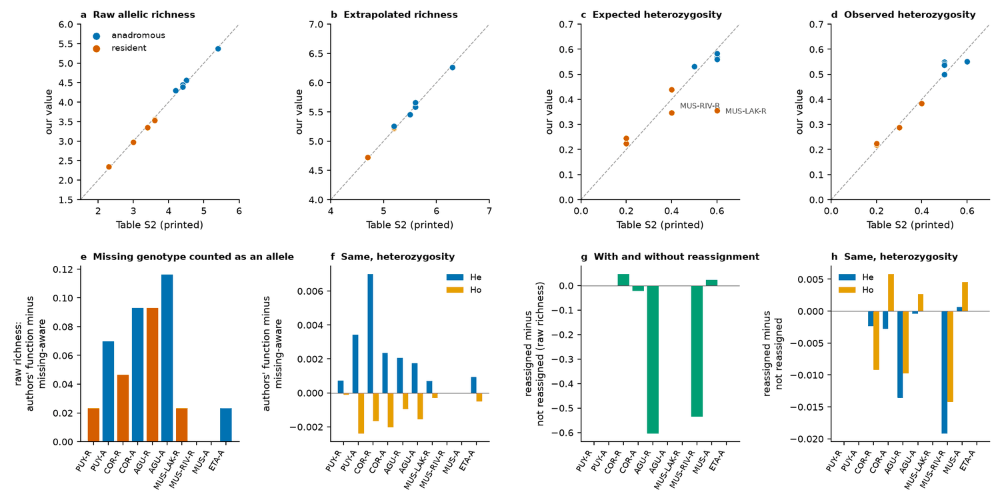

> **Our figure; no counterpart in the paper.** a to d: our value (y) against the value printed in the paper's Table S2 (x) for the ten sites, with a dashed line for equal values; blue = anadromous sites, orange = resident sites; a raw allelic richness, b extrapolated richness, c expected heterozygosity (He; MUS-LAK-R and MUS-RIV-R are labelled), d observed heterozygosity (Ho). e and f: effect of counting a missing genotype as an allele named NA in the authors' functions, by site: the authors' function minus the missing-aware computation, for raw richness (e) and for He (blue) and Ho (orange) (f). g and h: effect of the reassignment of the four fish: reassigned minus not reassigned, for raw richness (g) and for He and Ho (h).


<details>
<summary><b>Problem found:</b> a missing genotype is counted as an allele in the authors' diversity functions</summary>

**Status.** Shown exactly (all 430 locus × site cells); small effect on Table S2 (largest change in a site mean: raw richness +0.12, He +0.007, Ho −0.002); the printed Table S2 agrees with the affected values at least as well as with the corrected ones. Files: `output/diversity_per_locus_reassigned.tsv` (authors' functions), `output/diversity_per_locus_missing_aware.tsv` (ours), `output/check_14.tsv` (three integrity checks), `output/figures/fig_14_diversity_vs_tableS2.png` (panel e).

**1. The authors' version**


Table S2 gives raw and extrapolated allele richness, He and Ho for each site, "calculated per locus using the R package pegas v1.2 and averaged across sites or tactics" (Methods). The deposit has no script for Table S2; its functions `het()` (`Functions/het.R`, pegas `H()`) and `allele_rich()` (`Functions/allele_rich.R`, pegas `allelicrichness()`) build the pegas `loci` object with `alleles2loci()` from the allele table that still has missing genotypes (the paper: the diversity analyses use the not imputed data).

**2. The inconsistency and the evidence**


* In 409 of the 430 locus × site cells (43 loci × 10 sites) the authors' functions equal an independent calculation (Nei's unbiased gene diversity, the observed proportion of heterozygotes, the number of alleles): maximum difference 1e-15.
* In the other **21 cells**, where at least one fish of the site has a missing genotype, the authors' functions behave as if the missing genotype were a homozygous genotype of an allele called "NA": raw richness is the missing-aware richness **+ 1** in all 21 cells (difference 0), Ho = missing-aware Ho × (fish with a genotype / all fish) (difference 8e-16), and He equals Nei's unbiased formula applied with "NA" as an allele (difference 4e-16, 12 cells tested). The same "NA" allele appears in the output of `LD2`.
* The extrapolated richness takes the same input and is affected in the same way.

**3. What is correct**


Missing genotypes are left out of the allele frequencies and of the denominators (He, Ho, number of alleles per locus and site); the standard approach, or an estimate of richness by rarefaction on the complete genotypes.

**4. What we compute**


The statistics with the authors' functions (primary, because the printed Table S2 is closer to them: 6 against 5 of 10 sites for raw richness, 10 against 9 for Ho) and the missing-aware statistics (`output/diversity_summary_missing_aware.tsv`). Effect on the site means: raw richness up to +0.116 (AGU-A; +0.07 PUY-A, +0.09 COR-A and AGU-R, +0.05 COR-R, +0.02 at three other sites, 0 at MUS-RIV-R and MUS-A), He up to +0.007, Ho down by up to 0.0024. The conclusions drawn from the table do not change.

**5. What we do not compute**


A missing-aware extrapolated richness (the pegas extrapolation has no option for missing genotypes) and a re-run of the tests with the missing-aware values; the differences are of the size of the rounding of Table S2. That Table S2 was computed with these functions is an inference from the closer agreement, not something the paper states.

</details>


<details>
<summary>Scripts, software and parameters of this step</summary>

| Script | Class | What it does |
|---|---|---|
| `14_a_diversity.R` | D | calls the authors' functions (class A) for every site and writes per-locus tables |
| `14_b_tests.R` | D | Welch, ANOVA, Tukey |
| `14_c_balanced.R`, `14_d_without_reassignment.R` | D | balanced subsamples; reassigned against not reassigned |
| `14_e_figure.py` | D | the 8-panel figure |
| `14_check.R`, `run_14_diversity.sbatch` | D | check and job (18 seconds) |

**Software.** R 4.2.1, pegas 1.2

**Parameters.** the authors' (`H(observed = TRUE)`, `allelicrichness` raw and extrapolation); ours (not stated in the paper): not imputed data, the locus as unit of replication, tactics pooled as one population each, 100 subsamples with `set.seed(1)`

</details>


<details>
<summary>Folder of this step (tree)</summary>

```
14_diversity/
├── DIVERSITY_missing_issue.md
├── input
│   ├── Functions
│   │   ├── allele2genotype.R
│   │   ├── allele_freq.R
│   │   ├── allele_rich.R
│   │   ├── calculate_marker_missing_percentage.R
│   │   ├── create_genind.R
│   │   ├── delta_K.R
│   │   ├── export_allele_format.R
│   │   ├── fst_calculation.R
│   │   ├── fst_marker.R
│   │   ├── genepop_creator.R
│   │   ├── het.R
│   │   ├── impute.R
│   │   ├── kp_ind.R
│   │   ├── ld_test_locus.R
│   │   ├── mean_membership.R
│   │   ├── na_heatmap.R
│   │   ├── p100_missing.R
│   │   └── pca.R
│   ├── README_transcribed.txt
│   ├── table_not_reassigned_not_imputed.txt
│   ├── table_reassigned_imputed.txt
│   ├── table_reassigned_not_imputed.txt
│   ├── tableS2_transcribed.tsv
│   └── tableS3_transcribed.tsv
├── output
│   ├── balanced_subsamples_all.tsv
│   ├── balanced_subsamples_summary.tsv
│   ├── check_14.tsv
│   ├── diversity_per_locus_imputed_reassigned.tsv
│   ├── diversity_per_locus_missing_aware.tsv
│   ├── diversity_per_locus_not_reassigned.tsv
│   ├── diversity_per_locus_reassigned.tsv
│   ├── diversity_summary_imputed_reassigned.tsv
│   ├── diversity_summary_missing_aware.tsv
│   ├── diversity_summary_not_reassigned.tsv
│   ├── diversity_summary_reassigned.tsv
│   ├── fig_14_diversity_vs_tableS2.pdf
│   ├── fig_14_diversity_vs_tableS2.png
│   ├── figures
│   │   ├── fig_14_diversity_vs_tableS2.pdf
│   │   └── fig_14_diversity_vs_tableS2.png
│   ├── logs
│   │   ├── 63801344_salmon_wf14_diversity_2026-10-09_04-55-06
│   │   │   ├── 14_a_diversity.log
│   │   │   ├── 14_a_diversity.R
│   │   │   ├── 14_b_tests.log
│   │   │   ├── 14_b_tests.R
│   │   │   ├── 14_c_balanced.log
│   │   │   ├── 14_c_balanced.R
│   │   │   ├── 14_check.R
│   │   │   ├── 14_d_without_reassignment.log
│   │   │   ├── 14_d_without_reassignment.R
│   │   │   ├── check_14.tsv
│   │   │   ├── check.log
│   │   │   ├── inputs_md5_after.txt
│   │   │   ├── inputs_md5_before.txt
│   │   │   └── slurm_script
│   │   ├── 63801391_salmon_wf14_diversity_2026-10-09_04-57-06
│   │   │   ├── 14_a_diversity.log
│   │   │   ├── 14_a_diversity.R
│   │   │   ├── 14_b_tests.log
│   │   │   ├── 14_b_tests.R
│   │   │   ├── 14_c_balanced.log
│   │   │   ├── 14_c_balanced.R
│   │   │   ├── 14_check.R
│   │   │   ├── 14_d_without_reassignment.log
│   │   │   ├── 14_d_without_reassignment.R
│   │   │   ├── check_14.tsv
│   │   │   ├── check.log
│   │   │   ├── inputs_md5_after.txt
│   │   │   ├── inputs_md5_before.txt
│   │   │   └── slurm_script
│   │   ├── salmon_wf14_diversity_63801344.out
│   │   └── salmon_wf14_diversity_63801391.out
│   ├── sessionInfo.txt
│   ├── tableS2_transcribed.tsv
│   ├── tableS3_transcribed.tsv
│   ├── tests_anova_among_sites_of_a_tactic.tsv
│   ├── tests_tactic_welch_pooled.tsv
│   ├── tests_tactic_welch.tsv
│   ├── tests_tukey_among_resident_sites.tsv
│   ├── tests_tukey_within_watershed.tsv
│   └── with_vs_without_reassignment.tsv
├── README.md
└── scripts
    ├── 14_a_diversity.R
    ├── 14_b_tests.R
    ├── 14_c_balanced.R
    ├── 14_check.R
    ├── 14_d_without_reassignment.R
    ├── 14_e_figure.py
    └── run_14_diversity.sbatch

9 directories, 87 files
```

</details>


<details>
<summary>Deviations from the plan in this step</summary>

* **2026-10-09** (D): First run of the job (63801344) failed an integrity check of mine: it assumed no missing genotypes, and the authors functions count a missing genotype as an allele NA (21 cells); the check now characterises this exactly (job 63801391). Test design for tactics combined: the first unit tried (per-locus mean over the sites) did not fit the paper (t 4.4 vs 1.44); the design that follows the wording of the Results (fish of all anadromous or all resident sites combined as one population) was then adopted, both are reported *Why:* The paper does not state the unit of replication; the second design follows its words *Effect on the result:* none on the Table S2 values; the test design is documented in the README

</details>


---

### Step 15: Effective population size (Table S2 Ne, Table S3)
**Level of reproducibility: T1/T2** (Ne reproduced exactly at 8 of 10 sites; Table S3 does not match). **Final run:** 6 integrity checks pass; of the comparisons with the paper 10 agree and 6 differ.


**What we set out to do.** Estimate the effective population size Ne of each site with the program NeEstimator (the linkage-disequilibrium method, rare-allele criterion 0.05) as in the paper, and compare with Table S2 (Ne and limits) and Table S3 (individuals, loci and alleles used).


<details>
<summary>Method in brief: effective population size from linkage disequilibrium</summary>

* **Why.** The effective population size (Ne) tells how fast a population loses variation and how vulnerable it is; the paper uses it to compare residents and anadromous fish. Ne is the size of an ideal population that would lose genetic variation by drift at the same rate as the real population; it is usually much smaller than the number of fish.
* **What the method does.** In a small population, chance links alleles at different loci (**linkage disequilibrium**, LD, measured as the squared correlation r² between loci) more than expected from the sample size alone. NeEstimator's **LD method** compares the observed mean r² with the value expected from sampling (about 1/S for S fish) and converts the excess into Ne under random mating. Alleles at a frequency below the **critical value** (here 0.05) are left out because rare alleles bias r².
* **How to read the values.** A small Ne (tens) means strong drift and a high risk of inbreeding; the rule of thumb often quoted is that an Ne below 50 risks short-term inbreeding and below 500 limits long-term adaptive potential (Franklin 1980; revised upward by Frankham et al. 2014). The limits are **parametric** (from a chi-square approximation) or **jackknife** (resampling loci); Table S2 prints the parametric ones. **An upper limit of 'infinite'** means the data cannot separate that Ne from a very large population: the estimate is not informative. Ne from a single sample describes the recent generations, not a long-term average.

</details>


**Inputs of our run**


| Input | Where it comes from |
|---|---|
| the not-imputed allele table of step 03 (reassigned labels) and of step 01 (original labels), and the imputed genind of step 03 | steps 01 and 03 |
| the authors' `genepop_creator()` (their GENEPOP block, class C: without its two pooling statements, so that the ten sites stay separate) | step 00 |
| NeEstimator 2.1 (Linux binary) | installed program |

**The authors' files and transcriptions used only for comparison (never as inputs)**


| File | Used for |
|---|---|
| the deposited nine-population GENEPOP file (Musquaro residents pooled) | run for comparison only |
| Tables S2 and S3 as printed | transcribed; used only for the check |


**What we found.** Ne with the not-imputed data (critical value 0.05; ∞ = infinite upper limit):


| Site | Fish | Ne (ours) | 95 % parametric limits (ours) | Ne (Table S2) | Limits (Table S2) | Same? |
|---|---|---|---|---|---|---|
| AGU-A | 47 | 87.0 | 71.8–108.7 | 87.0 | 71.8–108.7 | yes |
| COR-A | 41 | 146.2 | 100.8–252.8 | 139.0 | 96.6–236.2 | **no** |
| COR-R | 15 | 13.2 | 10.3–17.5 | 13.2 | 10.3–17.5 | yes |
| ETA-A | 23 | 44.9 | 34.2–63.1 | 44.9 | 34.2–63.1 | yes |
| MUS-A | 35 | 41.6 | 35.2–50.0 | 41.6 | 35.2–50.0 | yes |
| MUS-LAK-R | 36 | 8.5 | 7.1–10.0 | 8.5 | 7.1–10.0 | yes |
| MUS-RIV-R | 44 | 19.8 | 16.7–23.5 | 19.8 | 16.7–23.5 | yes |
| PUY-R | 49 | 290.2 | 101.1–∞ | 290.2 | 101.1–∞ | yes |
| PUY-A | 50 | 54.8 | 46.9–65.0 | 56.8 | 48.5–67.8 | **no** |
| AGU-R | 45 | 161.3 | 79.3–1633.2 | 161.3 | 79.3–1633.2 | yes |


* **Ne and the parametric limits of Table S2 are reproduced exactly at eight of ten sites.** The two sites that differ, PUY-A (54.8 against 56.8) and COR-A (146.2 against 139), are the sites with random choices in the data: the 50 PUY-A fish are a random sample (the deposited balanced files differ from ours in some fish, step 13) and COR-A contains one of the reassigned fish.
* **The input was chosen after seeing the result.** The paper does not state whether the Ne analysis used the imputed or the not-imputed data. With the imputed GENEPOP file only 2 of 10 sites agree (the two sites without a missing genotype); with the not-imputed data 8 of 10 agree. We therefore took the not-imputed data as the primary run, a choice made after seeing the imputed run.
* **The claims of the Results hold:** resident Ne from 8.5 (7.1-10) to 19.8 at the three reliable sites; the parametric limits of the reliable resident and anadromous sites do not overlap (largest resident upper limit 23.5, smallest anadromous lower limit 34.2); PUY-R and AGU-R are the two sites without a reliable estimate (the asterisks of the table).
* **Table S3 does not match.** It reports, for each site, the number of fish used, the loci removed and the alleles removed by the rare-allele filter. The table below puts the printed values beside ours. NeEstimator uses exactly the fish of the site (15 to 50), while Table S3 prints more fish than exist at 9 of 10 sites (by 26 to 95 more at eight of them); we cannot say what the printed numbers count and did not search for a grouping that would give them. Our count of the loci for which fewer than two alleles reach a frequency of 0.05 equals the printed number of loci removed at 5 of 10 sites; our count of alleles below 0.05 (of the 326 alleles of the 385 fish; the paper has 348 alleles for the whole data set of 885 fish) equals no printed value. What 'removed' counts in Table S3 is therefore not established.

| Site | Fish: ours (used by NeEstimator) | Fish: Table S3 | Table S3 minus ours | Loci removed: ours | Loci removed: Table S3 | Alleles removed: ours | Alleles removed: Table S3 |
|---|---|---|---|---|---|---|---|
| PUY-R | 49 | 47 | -2 | 16 | 16 | 249 | 272 |
| PUY-A | 50 | 120 | 70 | 1 | 1 | 189 | 170 |
| COR-R | 15 | 91 | 76 | 7 | 5 | 212 | 207 |
| COR-A | 41 | 118 | 77 | 1 | 1 | 193 | 159 |
| AGU-R | 45 | 54 | 9 | 18 | 17 | 247 | 251 |
| AGU-A | 47 | 141 | 94 | 1 | 1 | 177 | 123 |
| MUS-LAK-R | 36 | 69 | 33 | 8 | 8 | 236 | 220 |
| MUS-RIV-R | 44 | 70 | 26 | 12 | 11 | 235 | 218 |
| MUS-A | 35 | 122 | 87 | 5 | 4 | 187 | 165 |
| ETA-A | 23 | 118 | 95 | 5 | 3 | 194 | 168 |

The figure below shows only the first comparison, **Ne of Table S2**, where agreement is exact at eight sites; Table S3 has no figure, and its mismatch is the one in the table above.


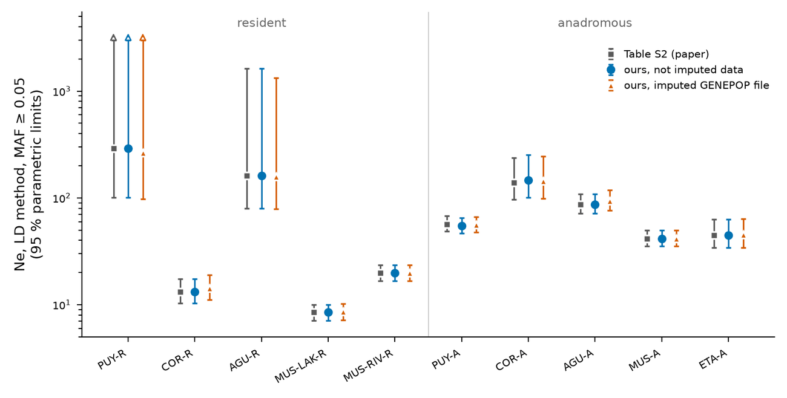

> **Our figure; no counterpart in the paper.** Effective population size (Ne, log scale, y) of each site (x; residents left, anadromous right) estimated by the linkage disequilibrium method with alleles of frequency 0.05 or more, with 95 % parametric limits. Grey squares: the paper's Table S2; blue circles: ours on the not-imputed data; orange triangles: ours on the imputed GENEPOP file. An open triangle at the top of the axis marks a limit that is infinite (the data do not bound the upper limit).


<details>
<summary>Scripts, software and parameters of this step</summary>

| Script | Class | What it does |
|---|---|---|
| `15_a_make_genepop.R` | C | the authors' GENEPOP block (lines 71-89 of their script 03) without its pooling statements; R 4.2.3 with graph4lg |
| `15_a2_make_genepop_not_imputed.R` | D | GENEPOP files from the not-imputed tables |
| `15_b_run_neestimator.sh`, `15_c_collect.R` | D | run NeEstimator; collect one row per site and critical value |
| `15_check.R`, `run_15_ne.sbatch` | D | check and job (8 seconds) |

**Software.** NeEstimator 2.1 (`Ne2-1L`); R 4.2.3 with graph4lg; R 4.2.1

**Parameters.** the authors': LD method, lowest allele frequency 0.05; ours: random mating, one population per site (reassigned labels), no option file

</details>


<details>
<summary>Folder of this step (tree)</summary>

```
15_ne_neestimator/
├── input
│   ├── deposit_like_GENEPOP_9pops.txt
│   ├── Functions
│   │   ├── allele2genotype.R
│   │   ├── allele_freq.R
│   │   ├── allele_rich.R
│   │   ├── calculate_marker_missing_percentage.R
│   │   ├── create_genind.R
│   │   ├── delta_K.R
│   │   ├── export_allele_format.R
│   │   ├── fst_calculation.R
│   │   ├── fst_marker.R
│   │   ├── genepop_creator.R
│   │   ├── het.R
│   │   ├── impute.R
│   │   ├── kp_ind.R
│   │   ├── ld_test_locus.R
│   │   ├── mean_membership.R
│   │   ├── na_heatmap.R
│   │   ├── p100_missing.R
│   │   └── pca.R
│   ├── GENIND_reassigned_imputed.RDS
│   ├── Ne2-1L_binary_source
│   ├── table_not_reassigned_not_imputed.txt
│   ├── table_reassigned_not_imputed.txt
│   ├── tableS2_transcribed.tsv
│   └── tableS3_transcribed.tsv
├── output
│   ├── check_15.tsv
│   ├── figures
│   │   ├── fig_15_ne_vs_tableS2.pdf
│   │   └── fig_15_ne_vs_tableS2.png
│   ├── genepop
│   │   ├── GENEPOP_Individuals385_Loci43_River_Site_IMPUTED_REASS_MUS_SEPARATE.txt
│   │   ├── GENEPOP_Individuals385_Loci43_River_Site_NOT_IMPUTED_NOT_REASSIGNED_MUS_SEPARATE.txt
│   │   ├── GENEPOP_Individuals385_Loci43_River_Site_NOT_IMPUTED_REASS_MUS_SEPARATE.txt
│   │   └── sessionInfo_15a.txt
│   ├── logs
│   │   ├── 63802041_salmon_wf15_ne_2026-10-09_05-04-30
│   │   │   ├── 15_a2.log
│   │   │   ├── 15_a2_make_genepop_not_imputed.R
│   │   │   ├── 15_a.log
│   │   │   ├── 15_a_make_genepop.R
│   │   │   ├── 15_b.log
│   │   │   ├── 15_b_run_neestimator.sh
│   │   │   ├── 15_c_collect.R
│   │   │   ├── 15_c_deposit_9pops_like.log
│   │   │   ├── 15_check.R
│   │   │   ├── 15_c_ten_sites.log
│   │   │   ├── 15_c_ten_sites_not_imputed.log
│   │   │   ├── 15_c_ten_sites_not_imputed_original_labels.log
│   │   │   ├── check_15.tsv
│   │   │   ├── check.log
│   │   │   ├── inputs_md5_after.txt
│   │   │   ├── inputs_md5_before.txt
│   │   │   ├── run_15_ne.sbatch
│   │   │   └── slurm_script
│   │   ├── 63802294_salmon_wf15_ne_2026-10-09_05-06-43
│   │   │   ├── 15_a2.log
│   │   │   ├── 15_a2_make_genepop_not_imputed.R
│   │   │   ├── 15_a.log
│   │   │   ├── 15_a_make_genepop.R
│   │   │   ├── 15_b.log
│   │   │   ├── 15_b_run_neestimator.sh
│   │   │   ├── 15_c_collect.R
│   │   │   ├── 15_c_deposit_9pops_like.log
│   │   │   ├── 15_check.R
│   │   │   ├── 15_c_ten_sites.log
│   │   │   ├── 15_c_ten_sites_not_imputed.log
│   │   │   ├── 15_c_ten_sites_not_imputed_original_labels.log
│   │   │   ├── check_15.tsv
│   │   │   ├── check.log
│   │   │   ├── inputs_md5_after.txt
│   │   │   ├── inputs_md5_before.txt
│   │   │   ├── run_15_ne.sbatch
│   │   │   └── slurm_script
│   │   ├── salmon_wf15_ne_63802041.out
│   │   └── salmon_wf15_ne_63802294.out
│   └── neestimator
│       ├── deposit_9pops_like_info.txt
│       ├── deposit_9pops_like_loci_alleles_removed.tsv
│       ├── deposit_9pops_like_neestimator_output.txt
│       ├── deposit_9pops_like_ne_long.tsv
│       ├── deposit_9pops_like_run_stdout.log
│       ├── ten_sites_info.txt
│       ├── ten_sites_loci_alleles_removed.tsv
│       ├── ten_sites_neestimator_output.txt
│       ├── ten_sites_ne_long.tsv
│       ├── ten_sites_not_imputed_info.txt
│       ├── ten_sites_not_imputed_loci_alleles_removed.tsv
│       ├── ten_sites_not_imputed_neestimator_output.txt
│       ├── ten_sites_not_imputed_ne_long.tsv
│       ├── ten_sites_not_imputed_original_labels_info.txt
│       ├── ten_sites_not_imputed_original_labels_loci_alleles_removed.tsv
│       ├── ten_sites_not_imputed_original_labels_neestimator_output.txt
│       ├── ten_sites_not_imputed_original_labels_ne_long.tsv
│       ├── ten_sites_not_imputed_original_labels_run_stdout.log
│       ├── ten_sites_not_imputed_run_stdout.log
│       └── ten_sites_run_stdout.log
├── README.md
└── scripts
    ├── 15_a2_make_genepop_not_imputed.R
    ├── 15_a_make_genepop.R
    ├── 15_b_run_neestimator.sh
    ├── 15_c_collect.R
    ├── 15_check.R
    └── run_15_ne.sbatch

11 directories, 97 files
```

</details>


<details>
<summary>Deviations from the plan in this step</summary>

* **2026-10-09** (D): The plan used the imputed genind for Ne; after the first run (job 63802041, imputed GENEPOP) the primary run was changed to the not imputed data because it reproduces Table S2 exactly at eight sites (the imputed file at two). A first version of my check compared the Musquaro block with its site prefix (a mistake of mine, fixed) and used an arbitrary limit of 250 for the upper limits (replaced by a ratio criterion) *Why:* The authors do not state the input of the Ne analysis *Effect on the result:* none on the NeEstimator numbers; both runs are reported
* **2026-10-09** (D): Corrected the number of sites at which Table S3 prints more fish than exist: 9 of 10 (by 26 to 95 fish at eight of them), not 8 of 10 (README of step 15, issues catalog S7) *Why:* counted again from the table of the printed and our numbers when it was added to the comprehensive report *Effect on the result:* none on any number; the wording of one sentence

</details>


---

### Step 16: Alleles shared by resident sites and absent from anadromous sites (Fig. S8)
**Level of reproducibility: T1/T3** (the two published alleles reproduced; the rest is our own analysis). **Final run:** 4 integrity checks pass; of the comparisons with the paper 4 agree and 2 differ.


**What we set out to do.** The paper reports two alleles (`Ssa_15_3`.64 and `Ssa_26_1`.51) found in resident sites and absent from anadromous sites, as a possible sign of ancient gene flow among residents. We reproduced them, listed every allele that meets the paper's definition, and asked how many such alleles random labelling of the fish would give.

**What 'private' means here.** In the usual sense a private allele is found in one population only. The paper uses the word differently (Fig. S8): an allele found in **at least two resident sites and in no anadromous site** (definition A below); an allele found in one resident site only is *not* private in the paper's sense. We also test a stricter definition (B) and the pattern of the three sites AGU-R, MUS-LAK-R and MUS-RIV-R and no other site (C), which we wrote after seeing the first run.


<details>
<summary>Method in brief: private alleles and a permutation baseline</summary>

A **private allele** is an allele found only in some of the populations. The paper's definition ('private alleles that were shared between two or more populations of this tactic') is applied literally in our definition A (present in at least two of the five resident sites and in none of the five anadromous sites), with variants B (the two Musquaro resident samples counted as one population) and C (present in AGU-R, MUS-LAK-R and MUS-RIV-R and nowhere else, a reading written after the first run). Rare alleles are found in few sites by chance (an allele with 5 copies in 385 fish can hardly be in many sites), so the count means little without a baseline. A **permutation baseline** supplies it: the fish are assigned to the ten sites at random (site sizes kept), 10,000 times, and the number of alleles that meet each definition is counted each time; the P value is the percentage of random assignments that give at least the observed number. A small P means the observed number is unusual for random labelling; a large P means chance alone gives as many.

</details>


**Inputs of our run**


| Input | Where it comes from |
|---|---|
| `ALLELE_…885_Loci43_REASSIGNED_IND_FINAL.txt` (not imputed; 385 fish; reassigned labels) | step 03 |


**What we found.** The two alleles of the paper are reproduced (`Ssa_15_3`.64 in AGU-R, MUS-LAK-R and MUS-RIV-R at frequencies 0.011 to 0.057; `Ssa_26_1`.51 at 0.014 to 0.023; both absent from the five anadromous sites and from PUY-R and COR-R). **They are not the only ones.** Alleles meeting definition A (copies in each resident site; none in an anadromous site):


| Allele | PUY-R | COR-R | AGU-R | MUS-LAK-R | MUS-RIV-R | Meets definition |
|---|---|---|---|---|---|---|
| Ssa_11_8.67 | 0 | 1 | 12 | 1 | 0 | A, B |
| Ssa_14_5.45 | 0 | 0 | 0 | 3 | 3 | A |
| Ssa_15_3.64 | 0 | 0 | 1 | 4 | 5 | A, B, C |
| Ssa_19_1.54 | 0 | 0 | 0 | 3 | 6 | A |
| Ssa_26_1.51 | 0 | 0 | 2 | 1 | 2 | A, B, C |


Permutation baseline (10,000 random assignments of the fish to sites):


| Definition | Observed | Mean in random assignments | P (at least as many) |
|---|---|---|---|
| A: >= 2 resident sites, no anadromous site | 5 | 4.99 | 0.560 |
| B: >= 2 resident populations (Musquaro pooled), no anadromous site | 3 | 4.60 | 0.844 |
| C: AGU-R, MUS-LAK-R and MUS-RIV-R, no other site | 2 | 0.17 | 0.016 |


Alleles shared by resident sites and absent from the anadromous ones are therefore what random labelling gives under the literal definitions (about 5 expected, 5 observed), because these alleles are rare (5 to 14 copies among 385 fish). Only the pattern of the three named sites (definition C, chosen after the first run, so P is not corrected for the choice) is more frequent than expected (P = 0.016). The data do not distinguish the paper's interpretation 'ancestral gene flow among resident sites' from chance for the literal definition, and we draw no conclusion from definition C.


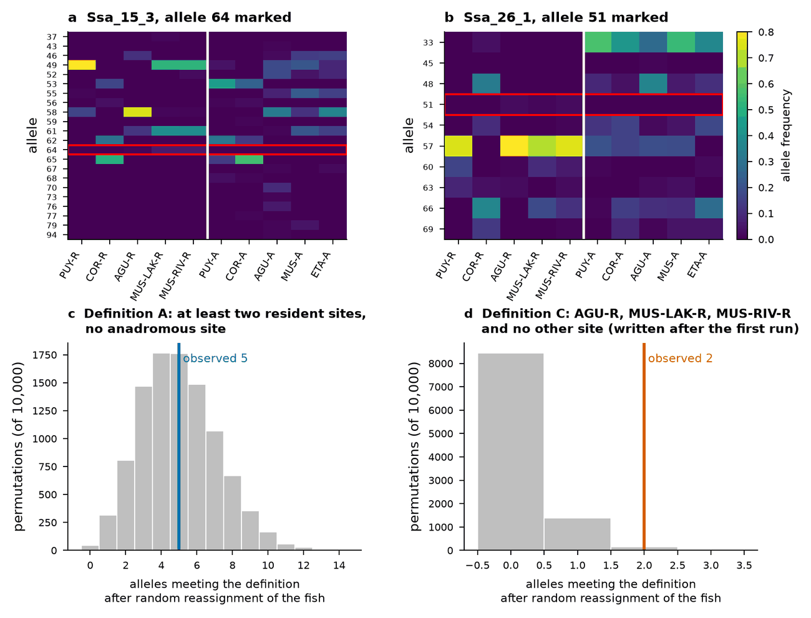

> **Our figure; no counterpart in the paper.** a and b: allele frequency (colour scale 0 to 0.8, right) of every allele (rows) at two loci in the ten sites (columns; the five resident sites left of the white line, the five anadromous sites right of it); the red box marks the allele named in the title (a Ssa_15_3 allele 64, b Ssa_26_1 allele 51). c and d: how many alleles meet a definition of private allele (x) when the fish are reassigned to the sites at random, in 10,000 permutations (y = number of permutations): c definition A (at least two resident sites and no anadromous site), d definition C (the three sites AGU-R, MUS-LAK-R and MUS-RIV-R and no other site; written after the first run). The vertical line is the number found in the real data (5 for A, 2 for C).


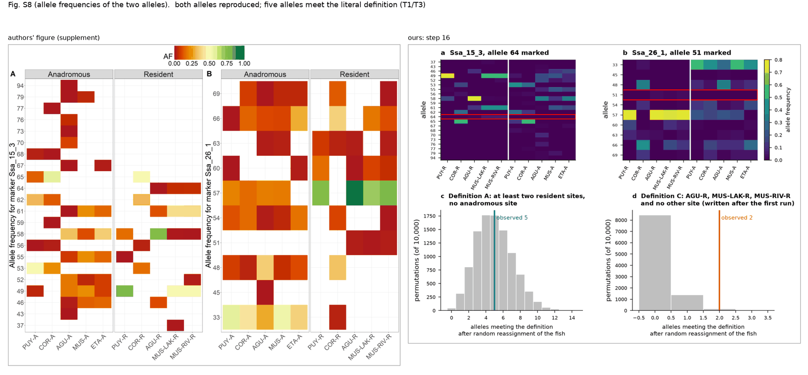

> **Paper's Fig. S8: the authors' heat maps (left) and ours (right).** Allele frequency of the two alleles that the paper names as examples of private alleles in the ten sites. Left: the authors' two heat maps. Right: a and b, our heat maps of the same two alleles (rows = alleles of the locus, columns = sites, colour = allele frequency); c and d, the permutation tests of step 16 (not in the paper).


<details>
<summary>Scripts, software and parameters of this step</summary>

| Script | Class | What it does |
|---|---|---|
| `16_a_private_alleles.R` | D | allele counts per site, the three definitions, the permutation |
| `16_check.R`, `run_16_private_alleles.sbatch` | D | check and job (8 seconds); the figure is drawn in Python from the output tables |

**Software.** R 4.2.1 (base R)

**Parameters.** ours: definitions A, B, C as above; 10,000 permutations, `set.seed(16)`

</details>


<details>
<summary>Folder of this step (tree)</summary>

```
16_private_alleles/
├── input
│   └── table_reassigned_not_imputed.txt
├── output
│   ├── allele_copies_and_frequencies_all.tsv
│   ├── alleles_absent_from_anadromous_in_one_resident_site.tsv
│   ├── check_16.tsv
│   ├── figures
│   │   ├── fig_16_private_alleles.pdf
│   │   └── fig_16_private_alleles.png
│   ├── logs
│   │   ├── 63802757_salmon_wf16_private_2026-10-09_05-10-12
│   │   │   ├── 16_a.log
│   │   │   ├── 16_a_private_alleles.R
│   │   │   ├── 16_check.R
│   │   │   ├── check_16.tsv
│   │   │   ├── check.log
│   │   │   ├── inputs_md5_after.txt
│   │   │   ├── inputs_md5_before.txt
│   │   │   └── slurm_script
│   │   └── salmon_wf16_private_63802757.out
│   ├── permutation_counts.tsv
│   ├── private_allele_candidates.tsv
│   ├── private_alleles_definitions_and_permutation.tsv
│   └── sessionInfo.txt
├── README.md
└── scripts
    ├── 16_a_private_alleles.R
    ├── 16_check.R
    └── run_16_private_alleles.sbatch

7 directories, 23 files
```

</details>


<details>
<summary>Deviations from the plan in this step</summary>

* **2026-10-09** (D): Definition C (alleles present in AGU-R, MUS-LAK-R and MUS-RIV-R and no other site) was added after the first run, as a reading of the sentence of the Results; the primary definition A (literal) and B (Musquaro pooled) were fixed in the plan *Why:* The paper does not state its definition *Effect on the result:* none on A and B; C is labelled as written after the first run

</details>


---

### Step 17: Approximate Bayesian computation (Table S1, Figs S1, S10, S11)
**Level of reproducibility: T3** (our own re-implementation: the scenario ranking agrees, the parameter values do not). **Final run:** 40 integrity checks pass.


**What we set out to do.** The paper uses DIYABC to choose between two scenarios of population history (Fig. S1) and to estimate the parameters of the preferred one (Table S1, Fig. S10), with a check of fit (Fig. S11). No DIYABC file is in the deposit, so we rebuilt the project from the paper and Table S1 (scenarios, priors, 144 summary statistics, 5,000,000 simulations) and ran the DIYABC engine.


<details>
<summary>Method in brief: approximate Bayesian computation, scenario choice and parameter estimation</summary>

* **Why.** The paper asks whether the resident populations arose independently in each river or from a common resident ancestor. This is a question about the past, which allele frequencies today can only answer through a model of population history. ABC is used because the likelihood of microsatellite data under such a history cannot be computed.
* **The idea.** The history is **simulated**: parameters (population sizes N, ancestral size NA1, divergence times t1 and t2 in generations, mutation rate) are drawn from **prior** distributions (ranges stated before looking at the data), a data set of the same size as the real one is simulated, and the same **144 summary statistics** (for example mean allele number, heterozygosity, FST and distances within and between the six populations) are computed. Simulations whose statistics are closest to those of the real data are kept; they approximate the posterior distribution.
* **Scenario choice.** Each scenario is simulated 2.5 million times (prior probability 0.5 each). The **direct approach** takes the percentage of each scenario among the n closest simulations. **Logistic regression** (used by the authors and by us) regresses the scenario indicator on the differences between the simulated and observed statistics among the closest simulations; the fitted probability at the observed data is the posterior probability of the scenario. In our run it gives probabilities much closer to 1 than the direct approach (see below). **How to read a posterior probability:** 0.5 means no preference; values near 1 mean the data favour that scenario over the other *among the two scenarios tried*; it says nothing about scenarios that were not simulated (for example with gene flow).
* **Parameter estimation.** The kept parameter values are corrected by **local linear regression** (on the logit scale, which keeps them inside the prior) so that they correspond to the observed statistics; the posterior mean, median and 95 % limits are reported. The **raw** rejection values (closest records, no regression) are the alternative we compare. **How to read them:** if the posterior is as wide as the prior, the data say little about that parameter; population sizes and times are in generations, not years.
* **Fit of the model.** A PCA of the simulated statistics with the observed data point drawn on it (Fig. S11) shows whether the observed data lie within the cloud of simulations; if the point lay outside, no simulated history would resemble the data.

</details>


**Inputs of our run**


| Input | Where it comes from |
|---|---|
| `All_Rivers_Dataset_Filtered_Balanced_Reassigned.txt` (the 885-fish allele table of step 01 with the reassignment, not imputed; 385 fish of known tactic in six populations: PUY-A, PUY-R, AGU-A, AGU-R, MUS-A and the two Musquaro residents pooled; 306 fish used) | steps 01 and 03 |
| DIYABC 2.1 command-line engine (built from the source code) | installed program |

**The authors' files and transcriptions used only for comparison (never as inputs)**


| File | Used for |
|---|---|
| Table S1 (published posterior values) and the Fig. S1 scenarios | transcribed; used for the comparison only |


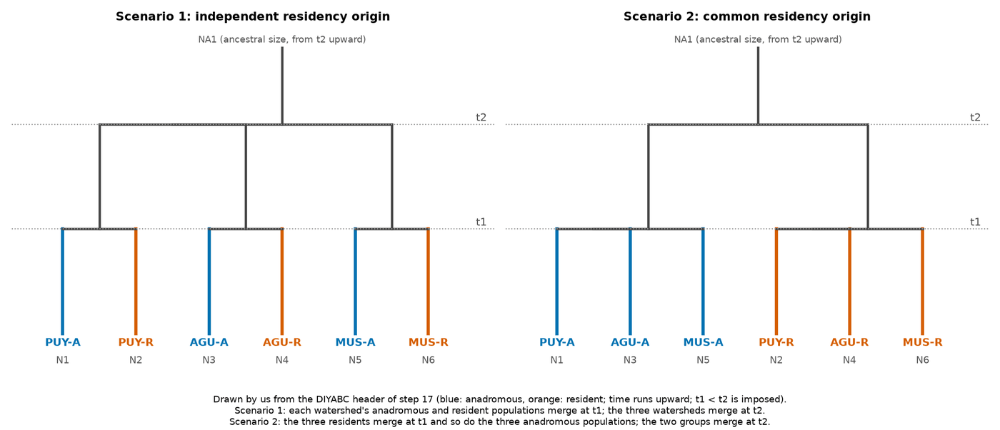

> **Our figure; no counterpart in the paper.** The two scenarios of the paper's Fig. S1, drawn by us from the DIYABC header file of step 17. Each coloured vertical line is a sampled population (blue anadromous, orange resident; N1 to N6 are their population sizes); time runs upward from the present at the bottom to the past, with two merging times, t1 (more recent) and t2; NA1 is the size of the ancestral population above t2. Scenario 1, independent residency origin: the anadromous and the resident populations of each watershed merge at t1 and the three watersheds merge at t2. Scenario 2, common residency origin: the three resident populations merge at t1 and so do the three anadromous populations, and the two groups merge at t2.


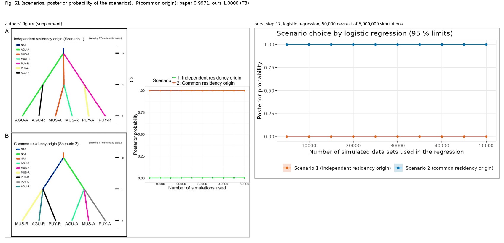

> **Paper's Fig. S1: the authors' figure (left: A scenario 1, B scenario 2, C scenario choice) and our scenario choice (right).** In C and in our panel, x = the number of simulated data sets used in the logistic regression (the nearest to the observed data, out of 5,000,000 in ours) and y = the posterior probability of each scenario. In the authors' C, red = scenario 2 (common residency origin), close to 1, and green = scenario 1, close to 0. In ours, blue = scenario 2 and orange = scenario 1, with 95 % limits; the result is the same. Our drawing of the two scenarios is the previous figure.


**What we found: scenario choice.** Posterior probability of scenario 2 (common origin of the residents), by the number n of closest simulations kept (the paper: logistic regression 0.9971, limits 0.9966–0.9977):


| n closest simulations | Logistic regression (95 % limits) | Direct approach |
|---|---|---|
| 5000 | 1.0000 (0.9999–1.0000) | 0.84 |
| 10000 | 1.0000 (1.0000–1.0000) | 0.81 |
| 15000 | 1.0000 (0.9998–1.0000) | 0.79 |
| 20000 | 1.0000 (0.9999–1.0000) | 0.78 |
| 25000 | 1.0000 (0.9998–1.0000) | 0.76 |
| 30000 | 0.9999 (0.9998–1.0000) | 0.75 |
| 35000 | 0.9999 (0.9997–1.0000) | 0.74 |
| 40000 | 1.0000 (0.9999–1.0000) | 0.73 |
| 45000 | 1.0000 (0.9999–1.0000) | 0.73 |
| 50000 | 1.0000 (0.9998–1.0000) | 0.72 |


Scenario 2 is preferred, as in the paper, with logistic probability 1.0000 at every size; the direct approach, which the paper does not report, gives 0.72 (0.68-0.76) at 50,000 and 0.89 at 500. **The two methods agree on the ranking and not on its strength.** The observed point lies within the cloud of simulated statistics (21.8 % of simulated records are farther from the centre).


**Parameters.** Posterior of the preferred scenario against Table S1 (the priors are the paper's):


| Parameter | Prior | Table S1: mean (95 % limits) | Ours: adjusted mean (95 % limits) | Ratio ours / published |
|---|---|---|---|---|
| N1 (PUY-A) | 10 to 4000 | 607 (130–2370) | 120 (32.3–417) | 0.20 |
| N2 (PUY-R) | 10 to 700 | 122 (34.7–375) | 56.9 (18–148) | 0.47 |
| N3 (AGU-A) | 10 to 8000 | 4980 (2440–7620) | 2520 (612–6970) | 0.51 |
| N4 (AGU-R) | 10 to 3000 | 452 (132–1470) | 179 (25.3–881) | 0.40 |
| N5 (MUS-A) | 10 to 7000 | 1870 (509–5440) | 605 (86.5–3340) | 0.32 |
| N6 (MUS-R) | 10 to 4000 | 2270 (1110–3660) | 779 (137–2870) | 0.34 |
| NA1 | 1000 to 10000 | 7250 (2560–9230) | 1650 (1040–2870) | 0.23 |
| t1 | 10 to 1500 | 103 (30.9–326) | 102 (12.2–279) | 0.99 |
| t2 | 10 to 2000 | 37.3 (13.4–138) | 68.7 (24.8–164) | 1.84 |
| mu (mutation rate) | 0.0003 to 0.0009 | 0.00042 (0.000312–0.00065) | 0.000456 (0.000301–0.000785) | 1.09 |


All 95 % limits lie inside the priors. Our adjusted means are **0.2 to 0.5 times** the published ones for the six population sizes and about a quarter of the published ancestral size; the divergence time t1 agrees (102 against 103), t2 does not (68.7 against 37.3) and the mutation rate is close (4.6 × 10⁻⁴ against 4.2 × 10⁻⁴). The raw rejection means are closer to the published values for some parameters and farther for others, so the difference is not a simple scale. A possible reason, **not tested**: the allele sizes of 37 of the loci change in steps of 3 base pairs while the engine assumes a motif of 2.


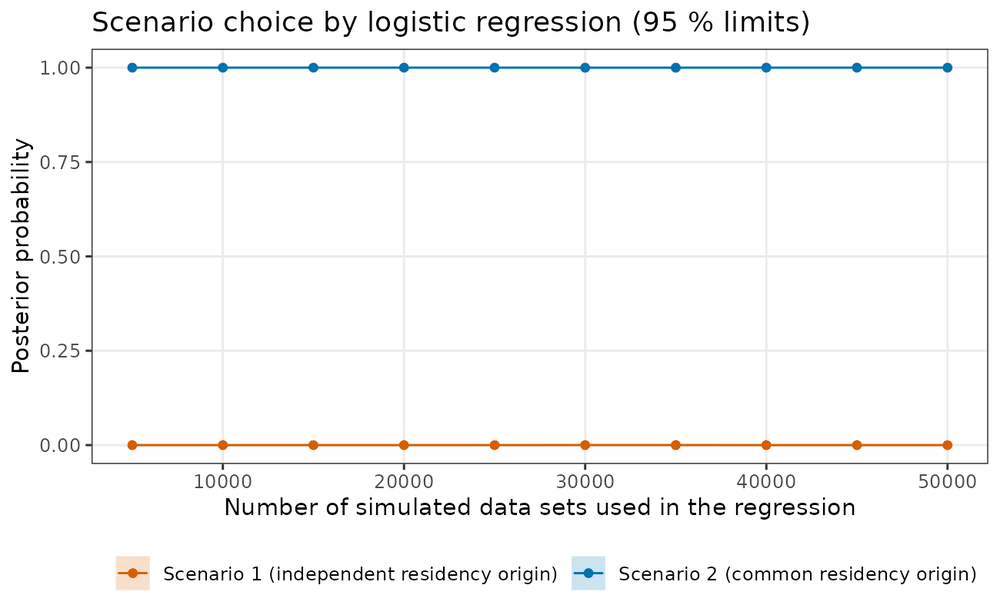

> **Our figure; no counterpart in the paper.** Posterior probability (y, 0 to 1) of each of the two scenarios estimated by logistic regression, with 95 % limits, as a function of the number of simulated data sets used in the regression (x, the simulations nearest to the observed data; 5,000 to 50,000). Blue = scenario 2 (common residency origin), orange = scenario 1 (independent residency origin); scenario 2 is at 1 and scenario 1 at 0 whatever the number used.


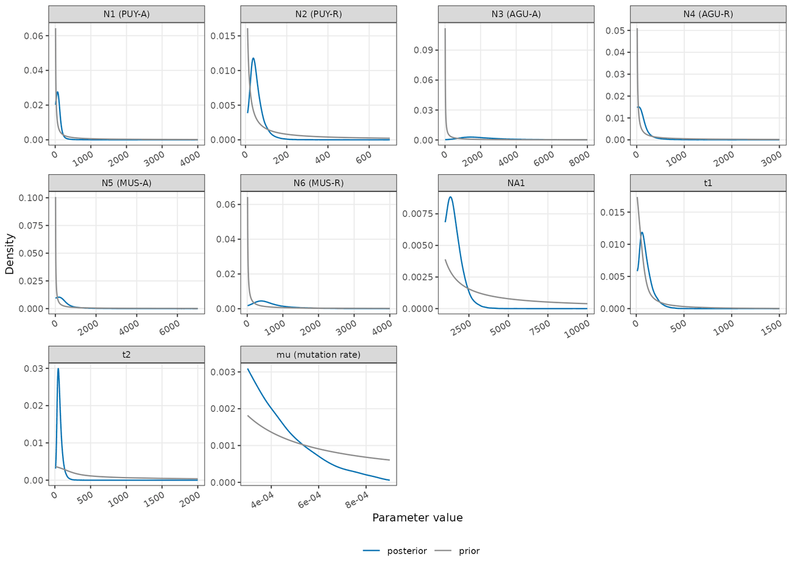

> **Our figure; no counterpart in the paper.** Prior (grey curve) and posterior (blue curve) density of each of the ten parameters of scenario 2, as written by the DIYABC engine from our 5,000,000 simulations (x = parameter value: population sizes N in fish, times t in generations, mutation rate mu; y = density). The panels are N1 PUY-A, N2 PUY-R, N3 AGU-A, N4 AGU-R, N5 MUS-A, N6 MUS-R, the ancestral size NA1, t1, t2 and mu.


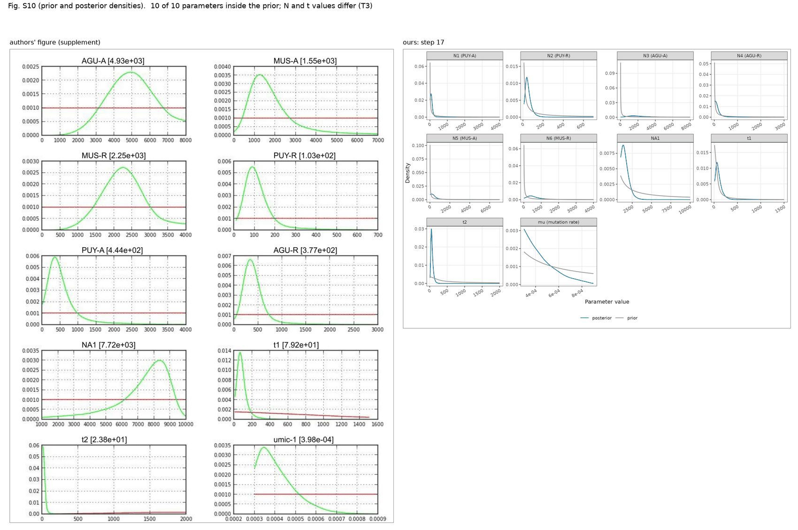

> **Paper's Fig. S10: the authors' figure (left) and ours (right).** Prior and posterior density of the ten parameters. Authors: the red line is the prior, the green curve the posterior, and the posterior mean is written in each title. Ours: grey = prior, blue = posterior; the panels are in a different order and the x axes cover the same ranges. The prior curves look different in the two figures (flat red lines on the left; the grey curves on the right are the log-uniform priors listed in Table S1, whose density decreases with the value); how the authors drew their prior lines is not documented. Our posteriors are narrower and the means of the population sizes are smaller.


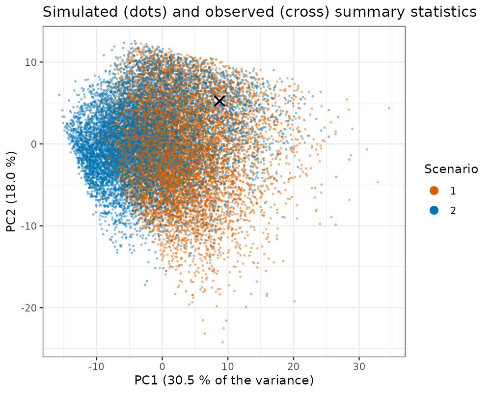

> **Our figure; no counterpart in the paper.** Principal component analysis of the 144 summary statistics of the simulated data sets (dots, one per simulation; orange = scenario 1, blue = scenario 2) and of the observed data (black cross). x = PC 1 (30.5 % of the variance), y = PC 2 (18.0 %). The observed data fall inside the cloud of both scenarios.


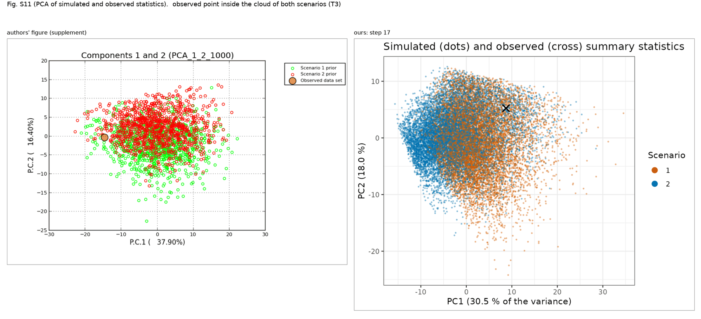

> **Paper's Fig. S11: the authors' figure (left) and ours (right).** Principal component analysis of the simulated summary statistics and of the observed ones, as a check of the fit of the model: the observed data should lie inside the cloud of simulated data. Ours is the figure shown just above (PC 1 and PC 2 of the summary statistics, simulated and observed).


<details>
<summary><b>Problem found:</b> the order of the two divergence times in Table S1 and Fig. S1</summary>

Step 17 (`17_abc_diyabc`). Evidence: `output/results/time_order_raw_vs_adjusted.tsv`, `output/results/parameters_published_adjusted_raw.tsv`, `output/results/fig_17_t1_t2_raw_vs_adjusted.png`, `output/engine_outputs/est_phistar_original.txt.gz`, `output/raw_rejection/`.

**1. What the authors did**


Fig. S1 draws two scenarios in which t1 is the more recent event and t2 the older one (scenario 1: each resident population splits from its own anadromous population at t1, then the anadromous populations join at t2; scenario 2: residents join each other and anadromous populations join each other at t1, then the two lineages join at t2). Table S1 gives priors t1 10–1500 and t2 10–2000 generations and posterior means **t1 = 103 (95 % limits 30.9–326) and t2 = 37.3 (13.4–138) generations** for the preferred scenario (scenario 2). The text reads these as the times of the events of Fig. S1.

**2. What is inconsistent, with the evidence**


A model in which t1 is the more recent event can only be simulated with t1 < t2 (DIYABC needs the condition when the priors overlap), so every simulated data set, and therefore every data set kept by a rejection step, has t1 < t2. A posterior mean of t1 (103) above the posterior mean of t2 (37.3) contradicts the model of Fig. S1, **if** the mean is a mean of kept simulations. It is not, however, evidence by itself that the authors' model had the opposite order:

* In our run (figure's order, t1 < t2 imposed, 2,498,090 records of scenario 2, 50,000 nearest, logit transformation) **all 50,000 closest records have t1 < t2** (raw means 39 and 114 generations, medians 24 and 70). The parameter vectors that the engine reports after its regression adjustment (the "posterior" of the graphical interface) have **t1 ≥ t2 in 39,775 of 50,000 vectors (80 %)**, with means t1 = 102 and t2 = 68.7 generations. The adjustment moves each parameter separately and does not preserve an order between two parameters.
* Our adjusted t1 (102) is close to the published 103, our adjusted t2 (68.7) is not 37.3; the inversion itself is reproduced.

So the published inversion has two possible explanations that Table S1 cannot separate: the model of the run had t2 more recent than t1 (the labels of Fig. S1 would be swapped relative to the run), or the posterior summaries are regression-adjusted values that violate the order of the prior, as in our run. In both cases the tabulated times are not directly interpretable as times before present of the events drawn in Fig. S1.

**3. What is correct, and why**


Summaries of parameters that are ordered by the model should respect the order: report the median and limits of the kept simulations (or of an adjustment that acts on a transformation that preserves the order, for instance t1 and t2 − t1), state the transformation and the number of records kept, and give the parameters of the event that is meant by each label in the figure. The adjusted means should not be read as times when they violate the model's order.

**4. What we compute**


The two scenarios as the figure draws them with the condition t1 < t2 (`DRAW UNTIL`); 5,000,000 simulations (2,501,910 and 2,498,090 per scenario), the 144 statistics of the paper, 50,000 nearest records for the local regression, logit transformation; engine summaries (`est_mmmq_original.txt`), the adjusted vectors (`est_phistar_original.txt.gz`) and our own rejection step without adjustment (`scripts/17_d_raw_rejection.py`: Euclidean distance on the statistics divided by their standard deviation within the scenario; this is our implementation, not the engine's). Table `parameters_published_adjusted_raw.tsv` puts the published, adjusted and raw summaries side by side.

**5. What we do not compute, and why**


* The model with the opposite order (condition t2 < t1) and any other variant of Fig. S1: the plan has no sensitivity runs, and the scenarios themselves, not their labels, were given by the figure. Which of the two explanations of section 2 holds therefore remains open; running the reverse order would show whether it reproduces t1 = 103 and t2 = 37.3 without the inversion (about 2 core-hours of simulation).
* Other transformations of the parameters and other numbers of kept records (not stated in the paper): about 22 s of engine time each, not run.
* The other parameters: our adjusted means are two to five times smaller than Table S1 for the six population sizes and the ancestral size (for example N1 120 against 607, NA1 1650 against 7250) while the mutation rate agrees (4.6 × 10⁻⁴ against 4.2 × 10⁻⁴). The settings the paper does not give (mutation-model parameters, motif size and range, transformation, number of kept records) are our proposals (`output/project/settings.tsv`); we do not know which of them accounts for the difference.

</details>


**In simple words: what is wrong with t1 and t2, and does it change the conclusions?**

* **What the model says.** In the preferred scenario two events happened in the past: a first one (time t1, the more recent) and a second one (time t2, the older), both counted in generations before the present. By construction every simulation has t1 smaller than t2.
* **What the paper's Table S1 says.** The averages of the estimates are t1 = 103 and t2 = 37.3 generations, that is the 'more recent' event is older than the 'older' one. That cannot be the average of times that always satisfy t1 < t2.
* **Where it comes from, in our run.** Among the 50,000 simulations closest to the observed data, t1 is below t2 in every one (averages 39 and 114 generations). The program then **adjusts each parameter separately** by a regression on the summary statistics to sharpen the estimate; the adjustment of t1 and the adjustment of t2 are made without reference to each other, so after it **t1 is larger than or equal to t2 in 80 % of the adjusted values**, and the averages become 102 and 68.7 generations, which reproduces the paper's inversion (the figure below).
* **What this means for the interpretation.** (1) The choice between the two scenarios (probability 0.9971 in the paper, 1.0000 in our run) does not use these time estimates, so it is not affected by this problem; it rests on the whole simulation. (2) The estimates of the times, as tabulated, cannot be read as the dates of the two events: the order is violated, and the paper's statement of the ages of the divergences cannot be taken from Table S1 as printed. Using the 50,000 closest simulations without the adjustment gives times that respect the order (about 39 and 114 generations), but they depend on how many simulations are kept and on the priors. (3) The authors state that their models contain no gene flow and call the demographic inference exploratory. The ranking of the scenarios is the same with both of our methods (the direct method gives a weaker 0.72), so it can be read as exploratory support for a common origin of the residents, within the limits of the model; the times cannot be used. The step does not decide whether the authors' model had the opposite order; running it would show whether the published values are reproduced without the inversion (about 2 core-hours).


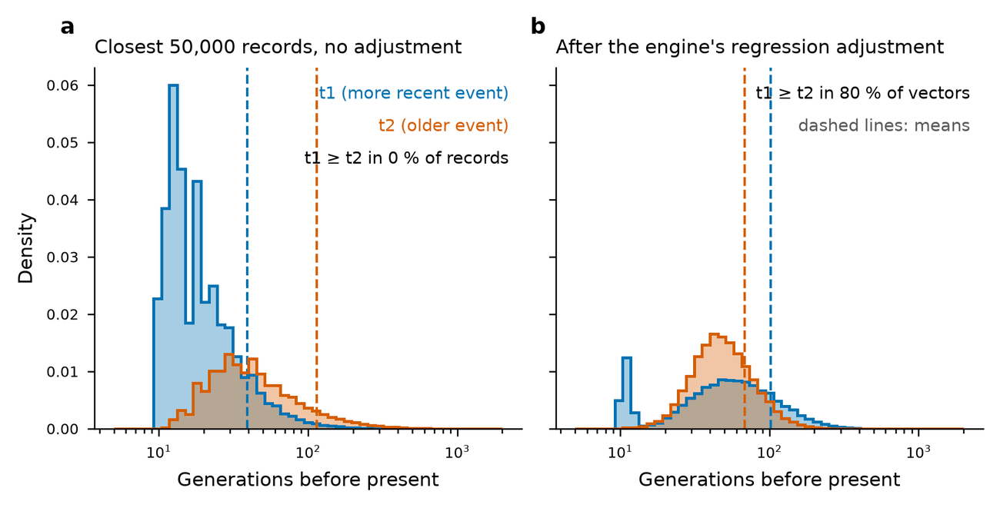

> **Our figure; no counterpart in the paper.** Distribution of the two divergence times of scenario 2 (x, generations before present, log scale; y = density; blue = t1, the more recent event, orange = t2, the older event; dashed lines = means). a: the 50,000 simulations closest to the observed data, without adjustment: t1 is smaller than t2 in every record. b: the same records after the regression adjustment of the DIYABC engine: t1 is larger than or equal to t2 in 80 % of the adjusted parameter vectors, which reverses the order of the two events.


<details>
<summary>Scripts, software and parameters of this step</summary>

| Script | Class | What it does |
|---|---|---|
| `17_a_make_project.R` | D | data file, header, settings of the DIYABC project |
| `17_b_simulate.sbatch` | D | first batch of 3 tasks, then an array of 47 (50 tasks of 100,000 simulations each) |
| `17_check_first_batch.sbatch`, `17_b_merge.sbatch` | D | check of the first batch; merge of the 50 tables into one reference table |
| `17_c_analyse.R`, `17_d_raw_rejection.py`, `17_e_tables_figures.py` | D | scenario choice, parameter estimation, PCA, raw rejection, tables and figures |

**Software.** DIYABC 2.1 command-line engine (our build of the source); R 4.2.1; Python for post-processing

**Parameters.** from the paper: scenarios, priors, stepwise mutation model, 144 statistics, 5,000,000 simulations; ours (not stated): default mutation-model parameters, motif size 2 and range 40, condition t1 < t2, 50,000 nearest records, logit transformation. The reference table (3.1 GB) is on scratch. Cost: 146 core-hours.

</details>


<details>
<summary>Folder of this step (tree)</summary>

```
17_abc_diyabc/
├── ABC_time_order_issue.md
├── input
│   ├── All_Rivers_Dataset_Filtered_Balanced_Reassigned.txt
│   ├── tableS1_posterior_published.tsv
│   └── tableS1_README.txt
├── output
│   ├── analysis_check.tsv
│   ├── engine_outputs
│   │   ├── choice_compdirect.txt
│   │   ├── choice_complogreg.txt
│   │   ├── est_mmmq_original.txt
│   │   ├── est_paramstatdens_original.txt
│   │   ├── est_phistar_original.txt.gz
│   │   ├── pca_first_components.txt.gz
│   │   └── reftable.log
│   ├── failed_attempts
│   │   └── 63752782_salmon_wf17a_project_2026-10-08_21-59-08
│   │       ├── 17_a_make_project.R
│   │       ├── init_rng.out
│   │       ├── make_project.log
│   │       ├── project_check.tsv
│   │       ├── slurm_script
│   │       ├── smoke_init.out
│   │       ├── smoke_run.out
│   │       └── smoke_statobs.txt
│   ├── first_batch_check.tsv
│   ├── first_batch_outputs
│   │   ├── check_c_compdirect.txt
│   │   ├── check_c_complogreg.txt
│   │   ├── check_c_progress.txt
│   │   ├── check_d_ACP.txt
│   │   ├── check_d_progress.txt
│   │   ├── check_e_mmmq_original.txt
│   │   ├── check_e_paramstatdens_original.txt
│   │   ├── check_e_phistar_original.txt
│   │   └── check_e_progress.txt
│   ├── first_batch_resources.txt
│   ├── job_chain.txt
│   ├── logs
│   │   ├── 63752868_salmon_wf17a_project_2026-10-08_22-00-40
│   │   │   ├── 17_a_make_project.R
│   │   │   ├── init_rng.out
│   │   │   ├── make_project.log
│   │   │   ├── project_check.tsv
│   │   │   ├── slurm_script
│   │   │   ├── smoke_init.out
│   │   │   ├── smoke_run.out
│   │   │   └── smoke_statobs.txt
│   │   ├── 63753301_task0000_salmon_wf17b_sim_2026-10-08_22-03-09
│   │   │   ├── engine.out
│   │   │   ├── engine_result.txt
│   │   │   └── slurm_script
│   │   ├── 63753301_task0001_salmon_wf17b_sim_2026-10-08_22-03-09
│   │   │   ├── engine.out
│   │   │   ├── engine_result.txt
│   │   │   └── slurm_script
│   │   ├── 63753301_task0002_salmon_wf17b_sim_2026-10-08_22-03-11
│   │   │   ├── engine.out
│   │   │   ├── engine_result.txt
│   │   │   └── slurm_script
│   │   ├── 63753302_salmon_wf17_check1_2026-10-08_22-29-42
│   │   │   ├── comp.out
│   │   │   ├── est.out
│   │   │   ├── est_result.txt
│   │   │   ├── files_made.txt
│   │   │   ├── first_batch_check.tsv
│   │   │   ├── merge.out
│   │   │   ├── pca.out
│   │   │   ├── pca_result.txt
│   │   │   └── slurm_script
│   │   ├── 63753304_task0003_salmon_wf17b_sim_2026-10-08_22-30-17
│   │   │   ├── engine.out
│   │   │   ├── engine_result.txt
│   │   │   └── slurm_script
│   │   ├── 63753304_task0004_salmon_wf17b_sim_2026-10-08_22-30-31
│   │   │   ├── engine.out
│   │   │   ├── engine_result.txt
│   │   │   └── slurm_script
│   │   ├── 63753304_task0005_salmon_wf17b_sim_2026-10-08_22-30-31
│   │   │   ├── engine.out
│   │   │   ├── engine_result.txt
│   │   │   └── slurm_script
│   │   ├── 63753304_task0006_salmon_wf17b_sim_2026-10-08_22-30-31
│   │   │   ├── engine.out
│   │   │   ├── engine_result.txt
│   │   │   └── slurm_script
│   │   ├── 63753304_task0007_salmon_wf17b_sim_2026-10-08_22-30-31
│   │   │   ├── engine.out
│   │   │   ├── engine_result.txt
│   │   │   └── slurm_script
│   │   ├── 63753304_task0008_salmon_wf17b_sim_2026-10-08_22-30-31
│   │   │   ├── engine.out
│   │   │   ├── engine_result.txt
│   │   │   └── slurm_script
│   │   ├── 63753304_task0009_salmon_wf17b_sim_2026-10-08_22-30-29
│   │   │   ├── engine.out
│   │   │   ├── engine_result.txt
│   │   │   └── slurm_script
│   │   ├── 63753304_task0010_salmon_wf17b_sim_2026-10-08_22-30-15
│   │   │   ├── engine.out
│   │   │   ├── engine_result.txt
│   │   │   └── slurm_script
│   │   ├── 63753304_task0011_salmon_wf17b_sim_2026-10-08_22-30-11
│   │   │   ├── engine.out
│   │   │   ├── engine_result.txt
│   │   │   └── slurm_script
│   │   ├── 63753304_task0012_salmon_wf17b_sim_2026-10-08_22-30-13
│   │   │   ├── engine.out
│   │   │   ├── engine_result.txt
│   │   │   └── slurm_script
│   │   ├── 63753304_task0013_salmon_wf17b_sim_2026-10-08_22-30-19
│   │   │   ├── engine.out
│   │   │   ├── engine_result.txt
│   │   │   └── slurm_script
│   │   ├── 63753304_task0014_salmon_wf17b_sim_2026-10-08_22-30-19
│   │   │   ├── engine.out
│   │   │   ├── engine_result.txt
│   │   │   └── slurm_script
│   │   ├── 63753304_task0015_salmon_wf17b_sim_2026-10-08_22-30-23
│   │   │   ├── engine.out
│   │   │   ├── engine_result.txt
│   │   │   └── slurm_script
│   │   ├── 63753304_task0016_salmon_wf17b_sim_2026-10-08_22-30-21
│   │   │   ├── engine.out
│   │   │   ├── engine_result.txt
│   │   │   └── slurm_script
│   │   ├── 63753304_task0017_salmon_wf17b_sim_2026-10-08_22-30-25
│   │   │   ├── engine.out
│   │   │   ├── engine_result.txt
│   │   │   └── slurm_script
│   │   ├── 63753304_task0018_salmon_wf17b_sim_2026-10-08_22-30-27
│   │   │   ├── engine.out
│   │   │   ├── engine_result.txt
│   │   │   └── slurm_script
│   │   ├── 63753304_task0019_salmon_wf17b_sim_2026-10-08_22-30-52
│   │   │   ├── engine.out
│   │   │   ├── engine_result.txt
│   │   │   └── slurm_script
│   │   ├── 63753304_task0020_salmon_wf17b_sim_2026-10-08_22-30-52
│   │   │   ├── engine.out
│   │   │   ├── engine_result.txt
│   │   │   └── slurm_script
│   │   ├── 63753304_task0021_salmon_wf17b_sim_2026-10-08_22-30-11
│   │   │   ├── engine.out
│   │   │   ├── engine_result.txt
│   │   │   └── slurm_script
│   │   ├── 63753304_task0022_salmon_wf17b_sim_2026-10-08_22-30-17
│   │   │   ├── engine.out
│   │   │   ├── engine_result.txt
│   │   │   └── slurm_script
│   │   ├── 63753304_task0023_salmon_wf17b_sim_2026-10-08_22-30-31
│   │   │   ├── engine.out
│   │   │   ├── engine_result.txt
│   │   │   └── slurm_script
│   │   ├── 63753304_task0024_salmon_wf17b_sim_2026-10-08_22-30-31
│   │   │   ├── engine.out
│   │   │   ├── engine_result.txt
│   │   │   └── slurm_script
│   │   ├── 63753304_task0025_salmon_wf17b_sim_2026-10-08_22-30-31
│   │   │   ├── engine.out
│   │   │   ├── engine_result.txt
│   │   │   └── slurm_script
│   │   ├── 63753304_task0026_salmon_wf17b_sim_2026-10-08_22-30-11
│   │   │   ├── engine.out
│   │   │   ├── engine_result.txt
│   │   │   └── slurm_script
│   │   ├── 63753304_task0027_salmon_wf17b_sim_2026-10-08_22-30-52
│   │   │   ├── engine.out
│   │   │   ├── engine_result.txt
│   │   │   └── slurm_script
│   │   ├── 63753304_task0028_salmon_wf17b_sim_2026-10-08_22-30-52
│   │   │   ├── engine.out
│   │   │   ├── engine_result.txt
│   │   │   └── slurm_script
│   │   ├── 63753304_task0029_salmon_wf17b_sim_2026-10-08_22-30-23
│   │   │   ├── engine.out
│   │   │   ├── engine_result.txt
│   │   │   └── slurm_script
│   │   ├── 63753304_task0030_salmon_wf17b_sim_2026-10-08_22-30-25
│   │   │   ├── engine.out
│   │   │   ├── engine_result.txt
│   │   │   └── slurm_script
│   │   ├── 63753304_task0031_salmon_wf17b_sim_2026-10-08_22-30-29
│   │   │   ├── engine.out
│   │   │   ├── engine_result.txt
│   │   │   └── slurm_script
│   │   ├── 63753304_task0032_salmon_wf17b_sim_2026-10-08_22-30-27
│   │   │   ├── engine.out
│   │   │   ├── engine_result.txt
│   │   │   └── slurm_script
│   │   ├── 63753304_task0033_salmon_wf17b_sim_2026-10-08_22-30-20
│   │   │   ├── engine.out
│   │   │   ├── engine_result.txt
│   │   │   └── slurm_script
│   │   ├── 63753304_task0034_salmon_wf17b_sim_2026-10-08_22-30-17
│   │   │   ├── engine.out
│   │   │   ├── engine_result.txt
│   │   │   └── slurm_script
│   │   ├── 63753304_task0035_salmon_wf17b_sim_2026-10-08_22-30-11
│   │   │   ├── engine.out
│   │   │   ├── engine_result.txt
│   │   │   └── slurm_script
│   │   ├── 63753304_task0036_salmon_wf17b_sim_2026-10-08_22-30-27
│   │   │   ├── engine.out
│   │   │   ├── engine_result.txt
│   │   │   └── slurm_script
│   │   ├── 63753304_task0037_salmon_wf17b_sim_2026-10-08_22-30-19
│   │   │   ├── engine.out
│   │   │   ├── engine_result.txt
│   │   │   └── slurm_script
│   │   ├── 63753304_task0038_salmon_wf17b_sim_2026-10-08_22-30-15
│   │   │   ├── engine.out
│   │   │   ├── engine_result.txt
│   │   │   └── slurm_script
│   │   ├── 63753304_task0039_salmon_wf17b_sim_2026-10-08_22-30-11
│   │   │   ├── engine.out
│   │   │   ├── engine_result.txt
│   │   │   └── slurm_script
│   │   ├── 63753304_task0040_salmon_wf17b_sim_2026-10-08_22-30-15
│   │   │   ├── engine.out
│   │   │   ├── engine_result.txt
│   │   │   └── slurm_script
│   │   ├── 63753304_task0041_salmon_wf17b_sim_2026-10-08_22-30-21
│   │   │   ├── engine.out
│   │   │   ├── engine_result.txt
│   │   │   └── slurm_script
│   │   ├── 63753304_task0042_salmon_wf17b_sim_2026-10-08_22-30-25
│   │   │   ├── engine.out
│   │   │   ├── engine_result.txt
│   │   │   └── slurm_script
│   │   ├── 63753304_task0043_salmon_wf17b_sim_2026-10-08_22-30-17
│   │   │   ├── engine.out
│   │   │   ├── engine_result.txt
│   │   │   └── slurm_script
│   │   ├── 63753304_task0044_salmon_wf17b_sim_2026-10-08_22-30-13
│   │   │   ├── engine.out
│   │   │   ├── engine_result.txt
│   │   │   └── slurm_script
│   │   ├── 63753304_task0045_salmon_wf17b_sim_2026-10-08_22-30-23
│   │   │   ├── engine.out
│   │   │   ├── engine_result.txt
│   │   │   └── slurm_script
│   │   ├── 63753304_task0046_salmon_wf17b_sim_2026-10-08_22-30-11
│   │   │   ├── engine.out
│   │   │   ├── engine_result.txt
│   │   │   └── slurm_script
│   │   ├── 63753304_task0047_salmon_wf17b_sim_2026-10-08_22-30-11
│   │   │   ├── engine.out
│   │   │   ├── engine_result.txt
│   │   │   └── slurm_script
│   │   ├── 63753304_task0048_salmon_wf17b_sim_2026-10-08_22-30-21
│   │   │   ├── engine.out
│   │   │   ├── engine_result.txt
│   │   │   └── slurm_script
│   │   ├── 63753304_task0049_salmon_wf17b_sim_2026-10-08_22-30-11
│   │   │   ├── engine.out
│   │   │   ├── engine_result.txt
│   │   │   └── slurm_script
│   │   ├── 63753305_salmon_wf17_merge_2026-10-08_22-58-13
│   │   │   ├── merge_check.tsv
│   │   │   ├── merged_files.txt
│   │   │   ├── merge.out
│   │   │   └── slurm_script
│   │   ├── 63757083_salmon_wf17c_analyse_2026-10-08_22-58-43
│   │   │   ├── 17_c_analyse.R
│   │   │   ├── analyse.log
│   │   │   ├── analysis_check.tsv
│   │   │   ├── choice.out
│   │   │   ├── est.out
│   │   │   ├── pca.out
│   │   │   └── slurm_script
│   │   ├── 63760711_salmon_wf17c_analyse_2026-10-08_23-04-43
│   │   │   ├── 17_c_analyse.R
│   │   │   ├── analyse.log
│   │   │   ├── analysis_check.tsv
│   │   │   ├── choice.out
│   │   │   ├── est.out
│   │   │   ├── pca.out
│   │   │   └── slurm_script
│   │   ├── salmon_wf17a_project_63752782.out
│   │   ├── salmon_wf17a_project_63752868.out
│   │   ├── salmon_wf17b_sim_63753301.out
│   │   ├── salmon_wf17b_sim_63753304.out
│   │   ├── salmon_wf17b_sim_63753318.out
│   │   ├── salmon_wf17b_sim_63753319.out
│   │   ├── salmon_wf17b_sim_63756142.out
│   │   ├── salmon_wf17b_sim_63756143.out
│   │   ├── salmon_wf17b_sim_63756144.out
│   │   ├── salmon_wf17b_sim_63756145.out
│   │   ├── salmon_wf17b_sim_63756146.out
│   │   ├── salmon_wf17b_sim_63756147.out
│   │   ├── salmon_wf17b_sim_63756148.out
│   │   ├── salmon_wf17b_sim_63756149.out
│   │   ├── salmon_wf17b_sim_63756150.out
│   │   ├── salmon_wf17b_sim_63756151.out
│   │   ├── salmon_wf17b_sim_63756152.out
│   │   ├── salmon_wf17b_sim_63756153.out
│   │   ├── salmon_wf17b_sim_63756154.out
│   │   ├── salmon_wf17b_sim_63756155.out
│   │   ├── salmon_wf17b_sim_63756156.out
│   │   ├── salmon_wf17b_sim_63756157.out
│   │   ├── salmon_wf17b_sim_63756158.out
│   │   ├── salmon_wf17b_sim_63756159.out
│   │   ├── salmon_wf17b_sim_63756160.out
│   │   ├── salmon_wf17b_sim_63756161.out
│   │   ├── salmon_wf17b_sim_63756162.out
│   │   ├── salmon_wf17b_sim_63756163.out
│   │   ├── salmon_wf17b_sim_63756164.out
│   │   ├── salmon_wf17b_sim_63756165.out
│   │   ├── salmon_wf17b_sim_63756166.out
│   │   ├── salmon_wf17b_sim_63756167.out
│   │   ├── salmon_wf17b_sim_63756168.out
│   │   ├── salmon_wf17b_sim_63756169.out
│   │   ├── salmon_wf17b_sim_63756170.out
│   │   ├── salmon_wf17b_sim_63756171.out
│   │   ├── salmon_wf17b_sim_63756172.out
│   │   ├── salmon_wf17b_sim_63756173.out
│   │   ├── salmon_wf17b_sim_63756174.out
│   │   ├── salmon_wf17b_sim_63756175.out
│   │   ├── salmon_wf17b_sim_63756176.out
│   │   ├── salmon_wf17b_sim_63756177.out
│   │   ├── salmon_wf17b_sim_63756178.out
│   │   ├── salmon_wf17b_sim_63756179.out
│   │   ├── salmon_wf17b_sim_63756180.out
│   │   ├── salmon_wf17b_sim_63756181.out
│   │   ├── salmon_wf17b_sim_63756182.out
│   │   ├── salmon_wf17b_sim_63756183.out
│   │   ├── salmon_wf17b_sim_63756184.out
│   │   ├── salmon_wf17b_sim_63756185.out
│   │   ├── salmon_wf17b_sim_63756186.out
│   │   ├── salmon_wf17b_sim_63756187.out
│   │   ├── salmon_wf17c_analyse_63757083.out
│   │   ├── salmon_wf17c_analyse_63760711.out
│   │   ├── salmon_wf17_check1_63753302.out
│   │   └── salmon_wf17_merge_63753305.out
│   ├── merge_check.tsv
│   ├── project
│   │   ├── data.txt
│   │   ├── header.txt
│   │   ├── loci_alleles_and_range.tsv
│   │   ├── RNG_state_0000.bin
│   │   ├── RNG_state_0001.bin
│   │   ├── RNG_state_0002.bin
│   │   ├── RNG_state_0003.bin
│   │   ├── RNG_state_0004.bin
│   │   ├── RNG_state_0005.bin
│   │   ├── RNG_state_0006.bin
│   │   ├── RNG_state_0007.bin
│   │   ├── RNG_state_0008.bin
│   │   ├── RNG_state_0009.bin
│   │   ├── RNG_state_0010.bin
│   │   ├── RNG_state_0011.bin
│   │   ├── RNG_state_0012.bin
│   │   ├── RNG_state_0013.bin
│   │   ├── RNG_state_0014.bin
│   │   ├── RNG_state_0015.bin
│   │   ├── RNG_state_0016.bin
│   │   ├── RNG_state_0017.bin
│   │   ├── RNG_state_0018.bin
│   │   ├── RNG_state_0019.bin
│   │   ├── RNG_state_0020.bin
│   │   ├── RNG_state_0021.bin
│   │   ├── RNG_state_0022.bin
│   │   ├── RNG_state_0023.bin
│   │   ├── RNG_state_0024.bin
│   │   ├── RNG_state_0025.bin
│   │   ├── RNG_state_0026.bin
│   │   ├── RNG_state_0027.bin
│   │   ├── RNG_state_0028.bin
│   │   ├── RNG_state_0029.bin
│   │   ├── RNG_state_0030.bin
│   │   ├── RNG_state_0031.bin
│   │   ├── RNG_state_0032.bin
│   │   ├── RNG_state_0033.bin
│   │   ├── RNG_state_0034.bin
│   │   ├── RNG_state_0035.bin
│   │   ├── RNG_state_0036.bin
│   │   ├── RNG_state_0037.bin
│   │   ├── RNG_state_0038.bin
│   │   ├── RNG_state_0039.bin
│   │   ├── RNG_state_0040.bin
│   │   ├── RNG_state_0041.bin
│   │   ├── RNG_state_0042.bin
│   │   ├── RNG_state_0043.bin
│   │   ├── RNG_state_0044.bin
│   │   ├── RNG_state_0045.bin
│   │   ├── RNG_state_0046.bin
│   │   ├── RNG_state_0047.bin
│   │   ├── RNG_state_0048.bin
│   │   ├── RNG_state_0049.bin
│   │   ├── settings.tsv
│   │   └── statobs.txt
│   ├── project_check.tsv
│   ├── raw_rejection
│   │   ├── raw_rejection_selected.tsv.gz
│   │   └── raw_rejection_summary.tsv
│   ├── reftable_merged.md5
│   ├── results
│   │   ├── fig_17_t1_t2_raw_vs_adjusted.pdf
│   │   ├── fig_17_t1_t2_raw_vs_adjusted.png
│   │   ├── parameters_published_adjusted_raw.tsv
│   │   ├── parameters_vs_tableS1.tsv
│   │   ├── pca_head.tsv
│   │   ├── pca_simulated_vs_observed.pdf
│   │   ├── pca_simulated_vs_observed.png
│   │   ├── prior_posterior_densities.pdf
│   │   ├── prior_posterior_densities.png
│   │   ├── scenario_choice_all_n.tsv
│   │   ├── scenario_choice_logistic.pdf
│   │   ├── scenario_choice_logistic.png
│   │   ├── sessionInfo_17c.txt
│   │   ├── summary_step17.tsv
│   │   └── time_order_raw_vs_adjusted.tsv
│   └── rng_init.txt
├── README.md
└── scripts
    ├── 17_a_make_project.R
    ├── 17_b_merge.sbatch
    ├── 17_b_simulate.sbatch
    ├── 17_c_analyse.R
    ├── 17_c_analyse.sbatch
    ├── 17_check_first_batch.sbatch
    ├── 17_d_raw_rejection.py
    ├── 17_e_tables_figures.py
    └── run_17a_make_project.sbatch

67 directories, 359 files
```

</details>


<details>
<summary>Deviations from the plan in this step</summary>

* **2026-10-08** (D): Mail on FAIL (and END for the check and merge jobs) for the simulation array tasks, not BEGIN,END,FAIL *Why:* fifty tasks would send up to 100 messages *Effect on the result:* none
* **2026-10-08** (D): Motif size 2 and range 40 for every locus; GUI defaults for the mutation-model settings other than the mean rate; ancestral lineages take the size of the surviving population *Why:* not stated in the paper; plan 07 section 5 item 10 (proposed values); the GUI defaults are the most likely choice of the authors; the allele sizes of the data step by 3 bp at 37 loci, 4 bp at 2, 2 bp at 2 and 1 bp at 2 (loci_alleles_and_range.tsv), so a data-derived motif size would be an alternative that we do not run *Effect on the result:* unknown; the statistics that use allele sizes (VAR, MGW, DM2, DAS) may depend on it
* **2026-10-08** (D): First run of the step 17a job (63752782) failed two of its own checks (expected 20 records instead of the 100 of the engine's bunch size, and 288 instead of 144 words in statobs.txt); expectations corrected and the job rerun (63752868, 10 checks pass); logs of the first run kept in output/failed_attempts/ *Why:* my expectations were wrong, the engine was fine *Effect on the result:* none
* **2026-10-08** (D): Analysis check of job 63757083 failed one row: it expected the whole table (5,000,000 records) in the parameter estimation, but the engine uses the records of the chosen scenario only (2,498,090) *Why:* The check was wrong, not the run *Effect on the result:* none; the analysis is re-run with the corrected expectation

</details>


---

### Step 18: Synthesis
**Level of reproducibility: n/a** (our own synthesis and audit). **Final run:** 0 integrity checks pass.


**What we set out to do.** Bring all steps together: one table of the claims of the paper and what each step found (section 6), one list of the problems found (section 7), the side-by-side comparisons of each figure and table of the supplement with ours (the montages shown in the step sections), the step overview, the deviations from the plan, and this document. Step 18 reads only tables and figures of the earlier steps; it computes no genetics. Its job checks that every step is present and checked, that all nine claims are in the table and that the numbers in the summary tables equal those of the step tables.


**Inputs of our run**


| Input | Where it comes from |
|---|---|
| the tables and figures of steps 00 to 17, `STATUS.tsv` and `DEVIATIONS.tsv` | the folders of the steps |
| `input/table1_n_transcribed.tsv` (sample sizes of Table 1) and `input/issues_catalog.tsv` (the list of issues) | written by us |


<details>
<summary>Scripts, software and parameters of this step</summary>

| Script | Class | What it does |
|---|---|---|
| `18_a_claims_table.py` | D | the table of the nine claims |
| `18_b_figures_side_by_side.py` | D | the side-by-side montages (S1C, S2-S11) |
| `18_c_report.py` | D | the short reproduction report, issue index, deviations summary, site table |
| `18_e_diagrams.py` | D | the workflow map as run and the drawn scenario trees |
| `18_d_comprehensive_report.py` with `report_lib.py` and `report_content/` | D | this document |
| `18_check.py`, `run_18_synthesis.sbatch` | D | check and job |

**Software.** Python 3.11 (pandas, numpy, matplotlib, pillow, markdown-it-py)

**Parameters.** none

</details>


<details>
<summary>Folder of this step (tree)</summary>

```
18_synthesis/
├── input
│   ├── issues_catalog.tsv
│   └── table1_n_transcribed.csv
├── output
│   ├── all_checks_long.tsv
│   ├── claims_table.md
│   ├── claims_table.tsv
│   ├── deviations_summary.md
│   ├── differences_index.tsv
│   ├── figures
│   │   ├── fig_18_abc_scenarios_drawn.png
│   │   ├── fig_18_authors_S5_upright.png
│   │   ├── fig_18_side_by_side_all.pdf
│   │   ├── fig_18_side_by_side_S10.png
│   │   ├── fig_18_side_by_side_S11.png
│   │   ├── fig_18_side_by_side_S1C.png
│   │   ├── fig_18_side_by_side_S2.png
│   │   ├── fig_18_side_by_side_S3.png
│   │   ├── fig_18_side_by_side_S4.png
│   │   ├── fig_18_side_by_side_S5.png
│   │   ├── fig_18_side_by_side_S6.png
│   │   ├── fig_18_side_by_side_S7.png
│   │   ├── fig_18_side_by_side_S8.png
│   │   ├── fig_18_side_by_side_S9.png
│   │   ├── fig_18_workflow_map_as_run.png
│   │   └── fig_18_workflow_map_claims.png
│   ├── issues_index.md
│   ├── logs
│   │   ├── 63804651_salmon_wf18_synthesis_2026-10-09_05-25-13
│   │   │   ├── 18_a_claims_table.py
│   │   │   ├── 18_a.log
│   │   │   ├── 18_b_figures_side_by_side.py
│   │   │   ├── 18_b.log
│   │   │   ├── 18_check.py
│   │   │   ├── 18_c.log
│   │   │   ├── 18_c_report.py
│   │   │   ├── check_18.tsv
│   │   │   ├── check.log
│   │   │   ├── inputs_md5_after.txt
│   │   │   ├── inputs_md5_before.txt
│   │   │   ├── slurm_script
│   │   │   └── versions.txt
│   │   ├── 63804979_salmon_wf18_synthesis_2026-10-09_05-27-14
│   │   │   ├── 18_a_claims_table.py
│   │   │   ├── 18_a.log
│   │   │   ├── 18_b_figures_side_by_side.py
│   │   │   ├── 18_b.log
│   │   │   ├── 18_check.py
│   │   │   ├── 18_c.log
│   │   │   ├── 18_c_report.py
│   │   │   ├── check_18.tsv
│   │   │   ├── check.log
│   │   │   ├── inputs_md5_after.txt
│   │   │   ├── inputs_md5_before.txt
│   │   │   ├── slurm_script
│   │   │   └── versions.txt
│   │   ├── 63896234_salmon_wf18_synthesis_2026-10-09_15-10-15
│   │   │   ├── 18_a_claims_table.py
│   │   │   ├── 18_a.log
│   │   │   ├── 18_b_figures_side_by_side.py
│   │   │   ├── 18_b.log
│   │   │   ├── 18_check.py
│   │   │   ├── 18_c.log
│   │   │   ├── 18_c_report.py
│   │   │   ├── 18_d_comprehensive_report.py
│   │   │   ├── 18_d.log
│   │   │   ├── 18_e_diagrams.py
│   │   │   ├── 18_e.log
│   │   │   ├── check_18.tsv
│   │   │   ├── check.log
│   │   │   ├── inputs_md5_after.txt
│   │   │   ├── inputs_md5_before.txt
│   │   │   ├── report_content
│   │   │   │   ├── part_a.py
│   │   │   │   ├── part_b1.py
│   │   │   │   ├── part_b2.py
│   │   │   │   ├── part_c1.py
│   │   │   │   ├── part_c2.py
│   │   │   │   ├── part_d.py
│   │   │   │   └── steplib.py
│   │   │   ├── report_lib.py
│   │   │   ├── slurm_script
│   │   │   └── versions.txt
│   │   ├── 63896816_salmon_wf18_synthesis_2026-10-09_15-13-18
│   │   │   ├── 18_a_claims_table.py
│   │   │   ├── 18_a.log
│   │   │   ├── 18_b_figures_side_by_side.py
│   │   │   ├── 18_b.log
│   │   │   ├── 18_check.py
│   │   │   ├── 18_c.log
│   │   │   ├── 18_c_report.py
│   │   │   ├── 18_d_comprehensive_report.py
│   │   │   ├── 18_d.log
│   │   │   ├── 18_e_diagrams.py
│   │   │   ├── 18_e.log
│   │   │   ├── check_18.tsv
│   │   │   ├── check.log
│   │   │   ├── inputs_md5_after.txt
│   │   │   ├── inputs_md5_before.txt
│   │   │   ├── report_content
│   │   │   │   ├── part_a.py
│   │   │   │   ├── part_b1.py
│   │   │   │   ├── part_b2.py
│   │   │   │   ├── part_c1.py
│   │   │   │   ├── part_c2.py
│   │   │   │   ├── part_d.py
│   │   │   │   └── steplib.py
│   │   │   ├── report_lib.py
│   │   │   ├── slurm_script
│   │   │   └── versions.txt
│   │   ├── 63897296_salmon_wf18_synthesis_2026-10-09_15-15-17
│   │   │   ├── 18_a_claims_table.py
│   │   │   ├── 18_a.log
│   │   │   ├── 18_b_figures_side_by_side.py
│   │   │   ├── 18_b.log
│   │   │   ├── 18_check.py
│   │   │   ├── 18_c.log
│   │   │   ├── 18_c_report.py
│   │   │   ├── 18_d_comprehensive_report.py
│   │   │   ├── 18_d.log
│   │   │   ├── 18_e_diagrams.py
│   │   │   ├── 18_e.log
│   │   │   ├── check_18.tsv
│   │   │   ├── check.log
│   │   │   ├── inputs_md5_after.txt
│   │   │   ├── inputs_md5_before.txt
│   │   │   ├── report_content
│   │   │   │   ├── part_a.py
│   │   │   │   ├── part_b1.py
│   │   │   │   ├── part_b2.py
│   │   │   │   ├── part_c1.py
│   │   │   │   ├── part_c2.py
│   │   │   │   ├── part_d.py
│   │   │   │   └── steplib.py
│   │   │   ├── report_lib.py
│   │   │   ├── slurm_script
│   │   │   └── versions.txt
│   │   ├── 63948267_salmon_wf18_synthesis_2026-10-09_20-33-34
│   │   │   ├── 18_a_claims_table.py
│   │   │   ├── 18_a.log
│   │   │   ├── 18_b_figures_side_by_side.py
│   │   │   ├── 18_b.log
│   │   │   ├── 18_check.py
│   │   │   ├── 18_c.log
│   │   │   ├── 18_c_report.py
│   │   │   ├── 18_d_comprehensive_report.py
│   │   │   ├── 18_d.log
│   │   │   ├── 18_e_diagrams.py
│   │   │   ├── 18_e.log
│   │   │   ├── check_18.tsv
│   │   │   ├── check.log
│   │   │   ├── inputs_md5_after.txt
│   │   │   ├── inputs_md5_before.txt
│   │   │   ├── report_content
│   │   │   │   ├── methods_text.py
│   │   │   │   ├── part_a.py
│   │   │   │   ├── part_b1.py
│   │   │   │   ├── part_b2.py
│   │   │   │   ├── part_c1.py
│   │   │   │   ├── part_c2.py
│   │   │   │   ├── part_d.py
│   │   │   │   ├── steplib.py
│   │   │   │   └── wording.py
│   │   │   ├── report_lib.py
│   │   │   ├── slurm_script
│   │   │   └── versions.txt
│   │   ├── 63949029_salmon_wf18_synthesis_2026-10-09_20-36-05
│   │   │   ├── 18_a_claims_table.py
│   │   │   ├── 18_a.log
│   │   │   ├── 18_b_figures_side_by_side.py
│   │   │   ├── 18_b.log
│   │   │   ├── 18_check.py
│   │   │   ├── 18_c.log
│   │   │   ├── 18_c_report.py
│   │   │   ├── 18_d_comprehensive_report.py
│   │   │   ├── 18_d.log
│   │   │   ├── 18_e_diagrams.py
│   │   │   ├── 18_e.log
│   │   │   ├── check_18.tsv
│   │   │   ├── check.log
│   │   │   ├── inputs_md5_after.txt
│   │   │   ├── inputs_md5_before.txt
│   │   │   ├── report_content
│   │   │   │   ├── methods_text.py
│   │   │   │   ├── part_a.py
│   │   │   │   ├── part_b1.py
│   │   │   │   ├── part_b2.py
│   │   │   │   ├── part_c1.py
│   │   │   │   ├── part_c2.py
│   │   │   │   ├── part_d.py
│   │   │   │   ├── steplib.py
│   │   │   │   └── wording.py
│   │   │   ├── report_lib.py
│   │   │   ├── slurm_script
│   │   │   └── versions.txt
│   │   ├── 64159281_salmon_wf18_synthesis_2026-10-10_16-47-17
│   │   │   ├── 18_a_claims_table.py
│   │   │   ├── 18_a.log
│   │   │   ├── 18_b_figures_side_by_side.py
│   │   │   ├── 18_b.log
│   │   │   ├── 18_check.py
│   │   │   ├── 18_c.log
│   │   │   ├── 18_c_report.py
│   │   │   ├── 18_d_comprehensive_report.py
│   │   │   ├── 18_d.log
│   │   │   ├── 18_e_diagrams.py
│   │   │   ├── 18_e.log
│   │   │   ├── check_18.tsv
│   │   │   ├── check.log
│   │   │   ├── inputs_md5_after.txt
│   │   │   ├── inputs_md5_before.txt
│   │   │   ├── report_content
│   │   │   │   ├── captions.py
│   │   │   │   ├── datasummary.py
│   │   │   │   ├── glossary.py
│   │   │   │   ├── methods_text.py
│   │   │   │   ├── part_a.py
│   │   │   │   ├── part_b1.py
│   │   │   │   ├── part_b2.py
│   │   │   │   ├── part_c1.py
│   │   │   │   ├── part_c2.py
│   │   │   │   ├── part_d.py
│   │   │   │   ├── steplib.py
│   │   │   │   └── wording.py
│   │   │   ├── report_lib.py
│   │   │   ├── slurm_script
│   │   │   └── versions.txt
│   │   ├── 64159620_salmon_wf18_synthesis_2026-10-10_16-50-16
│   │   │   ├── 18_a_claims_table.py
│   │   │   ├── 18_a.log
│   │   │   ├── 18_b_figures_side_by_side.py
│   │   │   ├── 18_b.log
│   │   │   ├── 18_check.py
│   │   │   ├── 18_c.log
│   │   │   ├── 18_c_report.py
│   │   │   ├── 18_d_comprehensive_report.py
│   │   │   ├── 18_d.log
│   │   │   ├── 18_e_diagrams.py
│   │   │   ├── 18_e.log
│   │   │   ├── check.log
│   │   │   ├── inputs_md5_after.txt
│   │   │   ├── inputs_md5_before.txt
│   │   │   ├── report_content
│   │   │   │   ├── captions.py
│   │   │   │   ├── datasummary.py
│   │   │   │   ├── glossary.py
│   │   │   │   ├── methods_text.py
│   │   │   │   ├── part_a.py
│   │   │   │   ├── part_b1.py
│   │   │   │   ├── part_b2.py
│   │   │   │   ├── part_c1.py
│   │   │   │   ├── part_c2.py
│   │   │   │   ├── part_d.py
│   │   │   │   ├── steplib.py
│   │   │   │   └── wording.py
│   │   │   ├── report_lib.py
│   │   │   ├── slurm_script
│   │   │   └── versions.txt
│   │   ├── 64159759_salmon_wf18_synthesis_2026-10-10_16-52-17
│   │   │   ├── 18_a_claims_table.py
│   │   │   ├── 18_a.log
│   │   │   ├── 18_b_figures_side_by_side.py
│   │   │   ├── 18_b.log
│   │   │   ├── 18_check.py
│   │   │   ├── 18_c.log
│   │   │   ├── 18_c_report.py
│   │   │   ├── 18_d_comprehensive_report.py
│   │   │   ├── 18_d.log
│   │   │   ├── 18_e_diagrams.py
│   │   │   ├── 18_e.log
│   │   │   ├── check_18.tsv
│   │   │   ├── check.log
│   │   │   ├── inputs_md5_after.txt
│   │   │   ├── inputs_md5_before.txt
│   │   │   ├── report_content
│   │   │   │   ├── captions.py
│   │   │   │   ├── datasummary.py
│   │   │   │   ├── glossary.py
│   │   │   │   ├── methods_text.py
│   │   │   │   ├── part_a.py
│   │   │   │   ├── part_b1.py
│   │   │   │   ├── part_b2.py
│   │   │   │   ├── part_c1.py
│   │   │   │   ├── part_c2.py
│   │   │   │   ├── part_d.py
│   │   │   │   ├── steplib.py
│   │   │   │   └── wording.py
│   │   │   ├── report_lib.py
│   │   │   ├── slurm_script
│   │   │   └── versions.txt
│   │   ├── 64160045_salmon_wf18_synthesis_2026-10-10_16-54-17
│   │   │   ├── 18_a_claims_table.py
│   │   │   ├── 18_a.log
│   │   │   ├── 18_b_figures_side_by_side.py
│   │   │   ├── 18_b.log
│   │   │   ├── 18_check.py
│   │   │   ├── 18_c.log
│   │   │   ├── 18_c_report.py
│   │   │   ├── 18_d_comprehensive_report.py
│   │   │   ├── 18_d.log
│   │   │   ├── 18_e_diagrams.py
│   │   │   ├── 18_e.log
│   │   │   ├── inputs_md5_before.txt
│   │   │   ├── report_content
│   │   │   │   ├── captions.py
│   │   │   │   ├── datasummary.py
│   │   │   │   ├── glossary.py
│   │   │   │   ├── methods_text.py
│   │   │   │   ├── part_a.py
│   │   │   │   ├── part_b1.py
│   │   │   │   ├── part_b2.py
│   │   │   │   ├── part_c1.py
│   │   │   │   ├── part_c2.py
│   │   │   │   ├── part_d.py
│   │   │   │   ├── steplib.py
│   │   │   │   └── wording.py
│   │   │   ├── report_lib.py
│   │   │   ├── slurm_script
│   │   │   └── versions.txt
│   │   ├── salmon_wf18_synthesis_63804651.out
│   │   ├── salmon_wf18_synthesis_63804979.out
│   │   ├── salmon_wf18_synthesis_63896234.out
│   │   ├── salmon_wf18_synthesis_63896816.out
│   │   ├── salmon_wf18_synthesis_63897296.out
│   │   ├── salmon_wf18_synthesis_63948267.out
│   │   ├── salmon_wf18_synthesis_63949029.out
│   │   ├── salmon_wf18_synthesis_64159281.out
│   │   ├── salmon_wf18_synthesis_64159620.out
│   │   ├── salmon_wf18_synthesis_64159759.out
│   │   └── salmon_wf18_synthesis_64160045.out
│   ├── reproduction_report.md
│   ├── site_table.tsv
│   └── step_overview.tsv
├── README.md
├── scripts
│   ├── 18_a_claims_table.py
│   ├── 18_b_figures_side_by_side.py
│   ├── 18_check.py
│   ├── 18_c_report.py
│   ├── 18_d_comprehensive_report.py
│   ├── 18_e_diagrams.py
│   ├── report_content
│   │   ├── captions.py
│   │   ├── datasummary.py
│   │   ├── glossary.py
│   │   ├── methods_text.py
│   │   ├── part_a.py
│   │   ├── part_b1.py
│   │   ├── part_b2.py
│   │   ├── part_c1.py
│   │   ├── part_c2.py
│   │   ├── part_d.py
│   │   ├── steplib.py
│   │   └── wording.py
│   ├── report_lib.py
│   └── run_18_synthesis.sbatch
├── v1_scripts
│   ├── 18_d_comprehensive_report.py
│   ├── report_content
│   │   ├── part_a.py
│   │   ├── part_b1.py
│   │   ├── part_b2.py
│   │   ├── part_c1.py
│   │   ├── part_c2.py
│   │   ├── part_d.py
│   │   └── steplib.py
│   └── report_lib.py
└── v2_scripts
    ├── 18_b_figures_side_by_side.py
    ├── 18_check.py
    ├── 18_d_comprehensive_report.py
    ├── 18_e_diagrams.py
    ├── report_content
    │   ├── methods_text.py
    │   ├── part_a.py
    │   ├── part_b1.py
    │   ├── part_b2.py
    │   ├── part_c1.py
    │   ├── part_c2.py
    │   ├── part_d.py
    │   ├── steplib.py
    │   └── wording.py
    └── report_lib.py

31 directories, 353 files
```

</details>


<details>
<summary>Deviations from the plan in this step</summary>

* **2026-10-09** (D): Step 18 scripts are Python (the plan named R scripts 18_a and 18_b); the report is generated by a script (18_c_report.py) instead of written by hand; the plan's 'five issue notes' became seven (imputation, FST encoding, trees, Fig. 5, ABC time order, LD, diversity); status words for the claims table were defined for this table *Why:* The step only reads tables and arranges images; every number in the generated tables is then read from a file; two more issue notes (steps 07 and 14) arose during the work *Effect on the result:* none on any result; the python environment used is the Claude Science one (not in 02_envs/lockfiles); versions are logged in the job's versions.txt
* **2026-10-09** (D): Added the comprehensive report (18_d_comprehensive_report.py with report_lib.py and report_content/*.py, and 18_e_diagrams.py for the workflow map and the drawn scenario trees); it is not in the plan and was requested on 9 October after the steps were finished. It reads only tables, figures and notes of steps 00-18 and embeds every figure, so that it can be shown without the step folders *Why:* The user asked for one self-contained document that explains the paper and every step, with collapsible sections and embedded graphics; the short reproduction report did not do this *Effect on the result:* none on any result; the report adds explanations and re-arranges tables of the steps (no number is recomputed except the elementary drift formula of section 8)
* **2026-10-09** (D): Comprehensive report version 2 (comprehensive_report_v2.md/.html) written after comments on version 1, which is kept unchanged (v1_scripts/ holds the scripts that built it); montage titles of 18_b changed ('coloured by year' to 'colour = site, symbol shape = year' for Fig. S4; 'percentage of total variation' to 'percentage of total variation'); map with the claims under each box (fig_18_workflow_map_claims.png) *Why:* the user asked for explanations of every method, a deposit tree, level of reproducibility wording, our correction instead of valid for FST, no private paths, and several clarified tables *Effect on the result:* none on any result; presentation only
* **2026-10-10** (D): Comprehensive report version 3 (comprehensive_report_v3.md/.html) written after comments on version 2, which is kept unchanged (v2_scripts/ holds the scripts that built it); redesigned workflow map (fig_18_workflow_map_claims.png: larger text, green arrows for the three pairs of steps that read an earlier result, grey lines for the data of steps 01-03); the authors' Fig. S5 turned upright and written as a single panel (fig_18_authors_S5_upright.png) and the S5 montage built with our large ΔK figure; 18_a_claims_table.py now also reads the check tables of 07c and 10g (the totals of the report change accordingly); new report modules datasummary.py, glossary.py and captions.py; whole folder trees by the program tree (tree -l, targets of links removed); 18_check.py checks v3 and that v1 and v2 are unchanged *Why:* the user's comments on version 2: definitions that say how each quantity is computed, tables of the columns and loci, the R objects of the deposit, a better map, trees, figure captions without numbers, a summary for step 06, a didactic account of LD, STRUCTURE and FST, the statements of step 10, a simpler Fig. 5 table and plain-language explanations of the trees and of the t1/t2 problem *Effect on the result:* none on any result; presentation only

</details>


---

## 6. What the whole analysis says

### 6.1 In short

The workflow runs the analyses of the paper from the deposited genotypes and scripts in 18 checked steps (00-17) on Alliance Canada's fir cluster (56 SLURM jobs or job arrays recorded in `STATUS.tsv` (one row per step)). Each job ran its own checks: 318 integrity checks passed and 0 failed in the final runs; of the comparisons with the paper's numbers and figures 61 agree and 28 differ. Failed first runs are recorded in `DEVIATIONS.tsv`; in each case the cause was in our check, job script or run settings.

Levels of reproducibility (as in the plan): **T1** exact reproduction of a number or table, **T2** approximate (same result within stated tolerance or with a documented difference), **T3** our own re-implementation or audit, **T4** blocked or not reproducible. Steps by level of reproducibility: T1: 5, T1/T2: 2, T1/T3: 1, T1/T4: 1, T2: 3, T3: 5, n/a: 1.

**Reproduced exactly (T1).** The eight filtered and imputed tables, the four tables of the Rimouski data set and the formats of steps 01-03 are identical to the deposit; the percentage of total variation of PC1 and PC2 of all 16 PCAs equals Figs 2 and S2-S4; the range of linkage disequilibrium of the Methods (-0.071 to 0.006); all 45 pairwise FST values of Fig. S6B and the class means 0.040 / 0.112 / 0.117 (as coded); the UPGMA tree of Fig. S7A; the saved divMigrate result (difference 0); Ne and its limits at 8 of 10 sites of Table S2.

**Reproduced approximately (T2).** STRUCTURE (best K 2 / 3 / 2 x 4 agree with Fig. S5; the anadromous cluster gives K = 2 against 4), the NJ trees (same topology, two neighbouring labels differ), the diversity statistics of Table S2 (within rounding except the He of the two Musquaro residents) and the tests between tactics.

**Not reproduced.** (1) **Fig. 5** (the arrows of directional gene flow). Our computation reproduces exactly the result that the authors saved and the numbers quoted in the text of the Results, but the numbers printed on the published figure are different: they match another version of the data (the four fish not reassigned, and another random sample of Puyjalon fish), and two of them (COR-R and AGU-R) are exchanged. So this is not a failure to compute gene flow; the figure does not correspond to the text and the saved result. (2) **Table S3** (individuals and alleles removed in the Ne analysis): the printed numbers do not correspond to the fish and alleles of the data, and we could not find what they count. (3) **The number of private alleles**: five alleles meet the definition stated in the paper, not two.

**Issues.** Seven issue notes and ten smaller discrepancies are indexed in section 7. The ones that change what a claim rests on: (1) FST was computed on a mis-encoded table and Fst' was reported as FST (step 10); with correct input the class means are 0.096 / 0.275 / 0.351 and the comparison of residents with anadromous fish no longer supports C5; (2) the order of the two divergence times of the ABC cannot be interpreted as published (step 17); (3) Fig. 5 was not drawn from the numbers quoted in the text (step 13); (4) the trees' support values and one tree's construction (step 12); (5) imputation draws once per column (step 01); (6) the LD statistic reported is the range of an invalid half (step 07); (7) missing genotypes count as an allele in the diversity functions (step 14).


### 6.2 The nine claims of the paper, revisited

The claims C1 to C9 are those of section 1.3. The status words: **supported** (our results agree with the claim, directly or after correction), **supported with exceptions**, **direction supported** (the direction is right, the size or strength differs), **partly supported**, **not supported** (the evidence the paper gives does not hold with our computation) and **not testable** (nothing in the data can test it).


| Claim | Statement | Status | Level of reproducibility | Steps |
|---|---|---|---|---|
| C1 | Within each river, resident and anadromous fish are clearly different genetically | supported | T1 (PCA), T2 (STRUCTURE), T3 (FST of our correction) | 05, 08, 09, 10 |
| C2 | Differentiation follows the barrier: PUY-R, MUS-LAK-R, AGU-R, MUS-RIV-R, COR-R from least to most gene flow | supported with exceptions | T3 | 09, 10 |
| C3 | Residents have lower genetic diversity and smaller effective population size (Ne) than anadromous fish | supported; numbers reproduced within rounding | T2 (diversity), T1/T2 (Ne) | 14, 15 |
| C4 | The anadromous sites are very similar to each other | supported; the K = 4 detail differs | T1 (as coded), T3 (our correction), T2 (STRUCTURE) | 08, 09, 10 |
| C5 | On the regional scale residents of different rivers are about as similar to each other as to their local anadromous population | not supported by our FST computation; other evidence partly supportive | T1 (as coded), T3 (FST of our correction, private alleles), T2 (STRUCTURE, trees) | 08-12, 16 |
| C6 | Approximate Bayesian computation prefers a common origin (posterior probability 0.9971) to independent origins (0.0029) | direction supported; magnitude depends on the method | T3 | 17 |
| C7 | Some gene flow persists across the barriers | partly supported; Fig. 5 is not drawn from the quoted result | T1 (text values), T4 (Fig. 5), T3 (audit of the four fish) | 05, 06, 13 |
| C8 | Corneille juveniles above and below the falls show no genetic structure | supported | T1 (PCA), T3 (FST of our correction) | 05, 10 |
| C9 | If stocking is needed, nearby resident populations may be a better source than the local anadromous population | not testable here |  | - |


<details>
<summary>C1: Within each river, resident and anadromous fish are clearly different genetically (<b>supported</b>)</summary>

**What the paper reports.** PC1 separates tactics, 10.60-21.85 % of variation (text; Fig. 2B-E); STRUCTURE within each watershed separates the tactics (Figs S5D-G, S9: two clusters; the text says three); FST between tactics within a watershed 0.065 (COR) to 0.175 (PUY) (text), no interval overlapping 0

**What we found.** PC1 percentage of total variation 22.17 / 10.60 / 13.96 / 11.90 % (PUY, COR, AGU, MUS), identical to Fig. 2B-E; best K = 2 in all four watershed analyses (delta K 6704, 782, 2815, 1247); within-watershed FST: as coded PUY 0.177, COR 0.065, AGU 0.116, MUS-LAK 0.090, MUS-RIV 0.092; Fst′ of our correction PUY 0.398, COR 0.169, AGU 0.289, MUS-LAK 0.217, MUS-RIV 0.222

**Reading.** Present in every analysis and with both the coded and our FST computation; the strongest claim. The size of the FST differences changes with the encoding (corrected values are 2.2-2.6 times the coded ones).

*Level of reproducibility: T1 (PCA), T2 (STRUCTURE), T3 (FST of our correction). Steps: 05, 08, 09, 10.*

</details>


<details>
<summary>C2: Differentiation follows the barrier: PUY-R, MUS-LAK-R, AGU-R, MUS-RIV-R, COR-R from least to most gene flow (<b>supported with exceptions</b>)</summary>

**What the paper reports.** order from the Methods (expert knowledge); the Results give an 'increasing differentiation' order COR, MUS-RIV, AGU, MUS-LAK, PUY with FST 0.065, 0.092, 0.116, 0.090, 0.177 (not monotone)

**What we found.** within-watershed FST, largest to smallest: as coded PUY > AGU > MUS-RIV > MUS-LAK > COR; Fst′ of our correction PUY > AGU > MUS-RIV > MUS-LAK > COR. Spearman rho against the expected order: as coded 0.70, corrected 0.70 (5 sites; MUS-LAK-R and MUS-RIV-R are one population, corrected values 0.217 and 0.222)

**Reading.** PUY-R has the largest and COR-R the smallest differentiation under both encodings. The authors' order puts MUS-LAK-R second and MUS-RIV-R fourth, with AGU-R between; our data put AGU-R above both Musquaro samples, which are one population (FST of our correction between them 0.0022; 40 of 82 fish cross-assigned in step 06), so the two cannot be told apart by the barrier order. The barrier order itself is not measured.

*Level of reproducibility: T3. Steps: 09, 10.*

</details>


<details>
<summary>C3: Residents have lower genetic diversity and smaller effective population size (Ne) than anadromous fish (<b>supported; numbers reproduced within rounding</b>)</summary>

**What the paper reports.** raw AR t = 1.44 (P = 0.15), extrapolated AR t = 0.54 (P = 0.59), He t = 3.73 (P = 0.0004), Ho t = 8.10 (P < 0.0001); Table S2 Ne residents 8.5-19.8 (COR-R, MUS-LAK-R, MUS-RIV-R), 161.3 and 290.2 (flagged), anadromous 41.6-139

**What we found.** Welch t (one pooled population per tactic, 43 loci): raw AR 1.48 (P 0.14), extrapolated 0.55 (P 0.58), He 3.80 (P 2.7e-04), Ho 8.40 (P 1e-12); Table S2 comparisons 11 agree, 9 differ; Ne (LD, MAF 0.05, not imputed data) equals Table S2 at 8 of 10 sites; resident Ne PUY-R 290.2, COR-R 13.2, AGU-R 161.3, MUS-LAK-R 8.5, MUS-RIV-R 19.8; anadromous PUY-A 54.8, COR-A 146.2, AGU-A 87.0, MUS-A 41.6, ETA-A 44.9

**Reading.** Heterozygosity is lower in residents, richness is not significantly different, as the paper states. Two residents (PUY-R, AGU-R) have Ne above all anadromous values but with very wide or unbounded limits (the paper flags them). He of MUS-LAK-R is 0.355 in the data and 0.6 in Table S2. Missing genotypes enter the authors' functions as an allele (effect <= 0.12 in raw AR). Table S3 (individuals and alleles removed) cannot be reproduced.

*Level of reproducibility: T2 (diversity), T1/T2 (Ne). Steps: 14, 15.*

</details>


<details>
<summary>C4: The anadromous sites are very similar to each other (<b>supported; the K = 4 detail differs</b>)</summary>

**What the paper reports.** FST class mean A-A 0.040 (Fig. S6A as coded); Wilcoxon A-A vs A-R and vs R-R: W = 0 and 10, P < 0.002; STRUCTURE anadromous cluster K = 4 (Fig. S5B)

**What we found.** class means A-A as coded 0.040, Fst′ of our correction 0.096 (Weir-Cockerham 0.096, plain Nei 0.051); A-A smaller than A-R and than R-R, same ranks under both encodings (Wilcoxon W 0 and 10; P 1.1e-08 and 0.0015); six anadromous sites form one cluster at K = 2 of all fish; anadromous cluster alone: best K 2 (delta K 1049), the paper's K = 4 is not the Evanno optimum

**Reading.** The anadromous sites are the least differentiated class under every estimator, but Fst′ of our correction of 0.096 is 2.4 times the coded 0.040. The best K of the anadromous cluster is 2 in our ten replicates (sd of ln P(D) 0.73; it would need to be 281 for K = 4 to win).

*Level of reproducibility: T1 (as coded), T3 (our correction), T2 (STRUCTURE). Steps: 08, 09, 10.*

</details>


<details>
<summary>C5: On the regional scale residents of different rivers are about as similar to each other as to their local anadromous population (<b>not supported by our FST computation; other evidence partly supportive</b>)</summary>

**What the paper reports.** class means R-R 0.117, A-R 0.112; Wilcoxon R-R vs A-R W = 94, P = 0.27; PUY-R vs MUS-RIV-R 0.128, vs MUS-LAK-R 0.13, vs AGU-R 0.15, all below PUY-R vs PUY-A 0.18

**What we found.** as coded reproduced exactly (0.117 / 0.112, P 0.27). Fst′ of our correction: R-R 0.351, A-R 0.275; Wilcoxon R-R vs A-R P 0.0074; site-label permutation (252) P 0.22 (as coded 0.80); leave-one-site-out Wilcoxon (10 sites) P 0.003-0.108 (as coded 0.18-0.98). PUY-R: our correction vs PUY-A 0.398, vs AGU-R 0.512, MUS-LAK-R 0.417, MUS-RIV-R 0.416 (coded 0.177, 0.154, 0.130, 0.128). STRUCTURE K = 2: residents of PUY, AGU, MUS in one cluster, COR-R with the anadromous sites. Trees (step 12, 41 loci or 40): MUS-LAK-R and MUS-RIV-R are nested among the anadromous sites and COR-R, support of {AGU-R, PUY-R} 54 % in the Edwards NJ tree and 42.7 % in the corrected-Fst′ tree. Private alleles: 4 comparisons agree, 5 alleles meet the literal definition (paper: 2); expected by chance 4.99 (P 0.56)

**Reading.** The published FST evidence rests on a mis-encoded input. With correct input R-R is higher than A-R (Wilcoxon P 0.007), but the 25 A-R and 10 R-R values are not independent; a permutation of the site labels gives P 0.22, so our corrected data neither show that residents are as similar to each other as to their local anadromous site nor that they are more different. Within PUY, the three other resident sites are as different from PUY-R as PUY-A is (0.416-0.512 against 0.398), not less. The private-allele argument does not separate the observed number from chance.

*Level of reproducibility: T1 (as coded), T3 (FST of our correction, private alleles), T2 (STRUCTURE, trees). Steps: 08-12, 16.*

</details>


<details>
<summary>C6: Approximate Bayesian computation prefers a common origin (posterior probability 0.9971) to independent origins (0.0029) (<b>direction supported; magnitude depends on the method</b>)</summary>

**What the paper reports.** P(common origin) = 0.9971 (CI 0.9966-0.9977), P(independent origins) = 0.0029 (0.0023-0.0033); Table S1 posterior means t1 = 103, t2 = 37.3 generations

**What we found.** logistic regression on 50,000 nearest records: P(scenario 2) = 1.0000 (limits 0.9998-1.0), P(scenario 1) = 0.0; direct approach 0.72 (0.68-0.76); adjusted posterior means t1 102.0, t2 68.7; all 10 parameters have 95 % limits inside the prior; 21.8 % of the simulated records lie farther from the centre than the observed data on PC1-PC2

**Reading.** Our DIYABC project is rebuilt from the paper's text (no deposited project): the common-origin scenario wins by logistic regression and is far from certain by the direct approach. Both scenarios lack gene flow. t1 > t2 in 80 % of the adjusted posterior vectors although the model imposes t1 < t2 (ABC_time_order_issue.md), so the times of Table S1 are not interpretable as published.

*Level of reproducibility: T3. Steps: 17.*

</details>


<details>
<summary>C7: Some gene flow persists across the barriers (<b>partly supported; Fig. 5 is not drawn from the quoted result</b>)</summary>

**What the paper reports.** relative downstream flow 0.142 (PUY), 0.323 (COR), 0.231 (AGU), 0.393 (MUS); upstream 0.044, 0.279, 0.062, 0.131 (text); four migrants identified on the PCA

**What we found.** divMigrate as written reproduces the saved matrix exactly (difference 0; 72 of 72 significance cells equal), so the text values are reproduced; the arrows printed on Fig. 5 agree with them at 1 of 22 positions and with our not-reassigned variant at 16 of 22; in the saved matrix only PUY-R to PUY-A, AGU-R to AGU-A and MUS-R to MUS-A are significant among the eight within-watershed arrows. The four reassigned fish are the four lowest own-label posteriors of 385 (posterior of the assigned site >= 0.9999999) and a fifth fish (LA_0012_UN_2015) with the same evidence was not reassigned

**Reading.** Relative gene flow values are not rates and most within-watershed arrows are not significant, including COR-R to COR-A (0.323), which the text calls especially high. See FIG5_inconsistency.md.

*Level of reproducibility: T1 (text values), T4 (Fig. 5), T3 (audit of the four fish). Steps: 05, 06, 13.*

</details>


<details>
<summary>C8: Corneille juveniles above and below the falls show no genetic structure (<b>supported</b>)</summary>

**What the paper reports.** FST = 0.002 (0.002-0.003); PCA of the juveniles (Fig. S3, S4)

**What we found.** FST as coded 0.0029; Fst′ of our correction 0.0073, Weir-Cockerham 0.0074, plain Nei 0.0037; percentage of total variation of all juvenile PCAs identical to Figs S3 and S4 (3.80 / 2.45 %, 3.263 / 2.479 %); year effect in the juveniles (Kruskal-Wallis on the scores): COR_J_DO P 1.7e-09; COR_J_UP P 1.26e-10

**Reading.** FST is close to zero under every estimator (0.0037-0.0074). Juveniles differ strongly by sampling year, which is a different axis from upstream versus downstream.

*Level of reproducibility: T1 (PCA), T3 (FST of our correction). Steps: 05, 10.*

</details>


<details>
<summary>C9: If stocking is needed, nearby resident populations may be a better source than the local anadromous population (<b>not testable here</b>)</summary>

**What the paper reports.** management inference from C5 and C6

**What we found.** no computation

**Reading.** It follows from C5 and C6. The FST part of C5 does not hold with correct input (see C5) and the ABC support (C6) depends on a model without gene flow and on the method of choice.

*Level of reproducibility: nan. Steps: -.*

</details>


---

## 7. The problems found, in plain words


Seven problems change what a result of the paper rests on (N1 to N7; each has its own note in the step folder and a collapsible account in the step section). Ten smaller discrepancies (S1 to S10) are listed after them. In every case 'what the authors did' is what the deposited code does as written; a problem in the code is not necessarily a problem in the authors' analysis, because we cannot see what was run for the published figure. The table gives the step where the problem is explained.


**Seven main problems**


| Id | Problem | Step |
|---|---|---|
| N1 | Imputation: one random draw per allele column instead of one per missing entry | 01 |
| N2 | FST computed on a mis-encoded table (two allele columns per locus read as two loci) and Fst' reported as FST; bootstrap limits are Weir-Cockerham limits | 10 (also 09) |
| N3 | Trees: supports of rooted clades on NJ trees, displaced labels after re-rooting, 40 against 41 loci, and an 'FST tree' that is a tree of FST profiles | 12 (also 11) |
| N4 | Fig. 5 is not drawn from the result that the text quotes | 13 |
| N5 | The order of the two divergence times in Table S1 and Fig. S1 | 17 |
| N6 | The linkage-disequilibrium statistic of the Methods is the range of an invalid half of a matrix | 07 |
| N7 | Missing genotypes enter the diversity statistics as an extra allele 'NA' | 14 |


<details>
<summary>N1: Imputation: one random draw per allele column instead of one per missing entry</summary>

**What we see.** impute() calls ifelse(is.na(col), sample(alleles, size = 1, ...), col); the single draw is recycled over every missing cell of a column. All 44 allele columns with missing cells hold one imputed value each (278 cells, 0.365 %); the Methods describe one draw per entry.

**What it affects.** Affects the analyses that read imputed tables: PCA, Edwards trees, divMigrate. Reproduced as written (8 of 8 tables identical to the deposit). Effect on results not measured (no per-entry rerun); expected small but not uniform.

**Where.** Step 01; evidence: 01_filter_main/IMPUTATION_issue.md; 01_filter_main/output/imputation_evidence.tsv.

</details>


<details>
<summary>N2: FST computed on a mis-encoded table (two allele columns per locus read as two loci) and Fst' reported as FST; bootstrap limits are Weir-Cockerham limits</summary>

**What we see.** fst_calculation() passes 86 allele columns to pairwise.neifst(), which returns Fst' on the invalid input. All 45 values of Fig. S6B are reproduced only this way (T1); with one column per locus the class means are 0.096 / 0.275 / 0.351 (A-A / A-R / R-R) instead of 0.040 / 0.112 / 0.117.

**What it affects.** Fig. S6, the Wilcoxon tests and the FST statements of the Results and Discussion; weakens C5 (R-R vs A-R P 0.27 becomes 0.0074 by Wilcoxon, 0.22 by permutation of sites; PUY-R is not closer to other residents than to PUY-A); sizes in C1, C2, C4, C8 change by a factor 2.2-2.6.

**Where.** Step 10 (also 09); evidence: 10_fst_corrected/FST_encoding_issue.md; 09_fst_as_coded/output/check_09.tsv; 10_fst_corrected/output/check_10.tsv.

</details>


<details>
<summary>N3: Trees: supports of rooted clades on NJ trees, displaced labels after re-rooting, 40 against 41 loci, and an 'FST tree' that is a tree of FST profiles</summary>

**What we see.** aboot() on a matrix applies Nei's distance to its rows and resamples its columns; NJ supports are rooted-clade counts and root() displaces node labels (pair of sister tips ETA-A+MUS-A printed 100, unrooted support 62.2 %); Edwards trees use 40 loci, the FST tree 41 (Robinson-Foulds 4 for NJ).

**What it affects.** Fig. 4 and Fig. S7 supports; the tree evidence for C5 is weak (MUS-LAK-R and MUS-RIV-R sit among the anadromous sites and COR-R; {AGU-R, PUY-R} 54 % in the Edwards NJ tree). UPGMA labels reproduced exactly; NJ topology reproduced with two neighbouring labels differing.

**Where.** Step 12 (also 11); evidence: 12_tree_variants/FST_TREE_issue.md; 12_tree_variants/output/check_12.tsv; 11_trees_as_coded/output/check_11.tsv.

</details>


<details>
<summary>N4: Fig. 5 is not drawn from the result that the text quotes</summary>

**What we see.** divMigrate as written reproduces the saved matrix exactly (72 of 72 significance cells equal), and the text quotes it; the arrows printed on Fig. 5 agree at 1 of 22 positions. The figure matches a not-reassigned data version (16 of 22 with our PUY-A sample, 20 of 22 by position with the deposited not-reassigned file, two labels exchanged).

**What it affects.** C7: the quoted values and the figure describe different analyses; only 3 of the 8 within-watershed arrows are significant.

**Where.** Step 13; evidence: 13_divmigrate/FIG5_inconsistency.md; 13_divmigrate/output/check_13.tsv; 13_divmigrate/output/grid_summary.tsv.

</details>


<details>
<summary>N5: The order of the two divergence times in Table S1 and Fig. S1</summary>

**What we see.** Table S1 gives t1 = 103 and t2 = 37.3 generations, but the model imposes t1 < t2. In our run all 50,000 nearest records have t1 < t2, while 80 % of the engine's regression-adjusted vectors have t1 >= t2 (means 102 and 68.7): the inversion is reproduced and arises from the adjustment.

**What it affects.** C6: the times of Table S1 are not interpretable as times before present; the scenario choice of our run uses the order drawn in Fig. S1; the reading with the opposite order was not run.

**Where.** Step 17; evidence: 17_abc_diyabc/ABC_time_order_issue.md; 17_abc_diyabc/output/results/time_order_raw_vs_adjusted.tsv.

</details>


<details>
<summary>N6: The linkage-disequilibrium statistic of the Methods is the range of an invalid half of a matrix</summary>

**What we see.** pegas 1.2 LD2 returns invalid values when loci are called in reverse column order (sum of delta not zero in 35 of 36 pairs, down to -1.98). The reported range (-0.071 to 0.006) is reproduced exactly (T1) and is the range of those invalid values; with correct order the mean delta lies between -0.0009 and 0.0001 and 35 of 36 pairs have P < 0.05 in the pooled sample.

**What it affects.** The Methods sentence on LD; no locus was removed on this basis, so downstream analyses are unaffected. A within-site LD test was not done.

**Where.** Step 07; evidence: 07_ld_missingness_checks/LD_statistic_issue.md; 07_ld_missingness_checks/output/check_07.tsv.

</details>


<details>
<summary>N7: Missing genotypes enter the diversity statistics as an extra allele 'NA'</summary>

**What we see.** het() and allele_rich() count a missing genotype as an allele: 21 site-by-locus cells; raw richness +1 in those cells, Ho scaled by complete/all, He with the NA allele. Largest site means effects: raw AR +0.116 (AGU-A), He +0.007, Ho -0.0024.

**What it affects.** Table S2 and the tests of C3: effects are below the printed rounding for He and Ho and up to 0.12 for raw richness; no conclusion changes.

**Where.** Step 14; evidence: 14_diversity/DIVERSITY_missing_issue.md; 14_diversity/output/diversity_summary_missing_aware.tsv.

</details>


**Ten smaller discrepancies**


| Id | Smaller discrepancy | Step |
|---|---|---|
| S1 | Nine Puyjalon fish removed by ID list without a stated criterion | 04 |
| S2 | Four hard-coded reassignments; a fifth fish with the same evidence is not reassigned | 05, 06 |
| S3 | delta K code and the anadromous cluster | 08 |
| S4 | STRUCTURE per watershed: K = 3 in the text, K = 2 in Figs S5 and S9 | 08 |
| S5 | PC1 percentage of total variation of the PUY panel: 21.85 % in the text, 22.17 % in Fig. 2B | 05 |
| S6 | Table S2: He printed 0.6 for MUS-LAK-R (data 0.355) and 0.4 for MUS-RIV-R (0.347); raw richness differs by up to 0.1; Tukey thresholds differ | 14 |
| S7 | Ne: PUY-A 54.8 (paper 56.8), COR-A 146.2 (139); Table S3 cannot be reproduced | 15 |
| S8 | Private alleles: five alleles meet the stated definition, not two | 16 |
| S9 | LD test runs on 996 fish before the Puyjalon removal and balancing | 07 |
| S10 | Sampling year is confounded with tactic and cohort | 05 |


<details>
<summary>Details of the ten smaller discrepancies</summary>

**S1. Nine Puyjalon fish removed by ID list without a stated criterion** (step 04). The listed fish are intermediate between Puyjalon and Romaine at STRUCTURE K = 2: Romaine-like membership 0.20-0.87, 4 of 9 at 0.5 or more, 0 of the other 156; seven other Puyjalon fish (0.20-0.38) rank above the ninth. Descriptive only. *Effect:* The list is partly supported by the data (it holds the highest Romaine-like fish) but is not a clean threshold; effect on results not measured.

**S2. Four hard-coded reassignments; a fifth fish with the same evidence is not reassigned** (step 05, 06). The four moved fish are the four lowest own-label posteriors of 385 (assigned-site posterior >= 0.9999999), and LA_0012_UN_2015 (COR-R assigned to COR-A, posterior about 1) was not moved; two ETA-A fish are assigned to MUS-A (0.976, 0.964). Script 05's selection conditions pick whole clusters (12, 47, 34 fish), not four fish. *Effect:* C7 and the reassigned datasets: with and without reassignment He and Ho change by at most 0.019, raw richness by up to 0.61 (AGU-R) (step 14); Fig. 5 depends on it (N4).

**S3. delta K code and the anadromous cluster** (step 08). The deposited delta_K.R is not Evanno's delta K; with Evanno's method the best K of the anadromous cluster is 2 (delta K 1049) against 4 in Fig. S5B; in the Corneille analysis the mean membership of COR-A is 95.5 % where the text says above 97 % for all sites except COR-R. *Effect:* C4 (the K = 4 detail only). Ten replicates agree; a location-prior run was not done.

**S4. STRUCTURE per watershed: K = 3 in the text, K = 2 in Figs S5 and S9** (step 08). Our best K is 2 in all four watershed analyses, as in the figures. *Effect:* None on the claims.

**S5. PC1 percentage of total variation of the PUY panel: 21.85 % in the text, 22.17 % in Fig. 2B** (step 05). We reproduce 22.17 % (Fig. 2B); the value 21.85 % occurs in none of our 16 percentage of total variation tables. *Effect:* None on the claims.

**S6. Table S2: He printed 0.6 for MUS-LAK-R (data 0.355) and 0.4 for MUS-RIV-R (0.347); raw richness differs by up to 0.1; Tukey thresholds differ** (step 14). Table S2 reproduced within rounding at the other values (He 8 of 10, Ho 10 of 10, raw AR 6 of 10 sites). *Effect:* C3: the He contrast of residents is overstated for MUS-LAK-R in the table; the t test of the paper is reproduced (3.80 against 3.73).

**S7. Ne: PUY-A 54.8 (paper 56.8), COR-A 146.2 (139); Table S3 cannot be reproduced** (step 15). Ne and parametric limits equal Table S2 at 8 of 10 sites (not imputed data); the individuals used printed in Table S3 exceed the sample size at 9 of 10 sites (by 26 to 95 at eight of them); alleles removed 0 of 10 equal. *Effect:* C3: the Ne contrast is reproduced; the input of Table S3 is unknown.

**S8. Private alleles: five alleles meet the stated definition, not two** (step 16). Ssa_15_3.64 and Ssa_26_1.51 are reproduced; Ssa_11_8.67, Ssa_14_5.45 and Ssa_19_1.54 also meet the literal definition. Only a three-site definition (AGU-R, MUS-LAK-R, MUS-RIV-R and no other site; added after the first run) gives exactly two (P 0.016 by permutation); the literal definition gives 5 observed against 4.99 expected by chance (P 0.56). *Effect:* C5: the private-allele argument.

**S9. LD test runs on 996 fish before the Puyjalon removal and balancing** (step 07). The script runs the LD block on a data frame that is not the analysed 885-fish table; reproduced as written. *Effect:* None.

**S10. Sampling year is confounded with tactic and cohort** (step 05). Kruskal-Wallis of the PCA scores by year (smallest P of PC1 and PC2): COR-A 0.185, COR-R 0.105, PUY-A (smolts) 0.034; strong in the Corneille juveniles (COR-J-DO 1.7e-9, COR-J-UP 1.3e-10). *Effect:* C8: a year axis exists in the juveniles, separate from the upstream/downstream comparison.

</details>


---

## 8. How the corrected FST pattern and the ABC preference for a common origin fit together


*This section is interpretation; the only computation added is the elementary drift formula in the table.*

With correct input the mean FST between residents of different rivers is 0.351, against 0.275 between residents and anadromous sites and 0.096 among anadromous sites. The residents are therefore not closer to each other than to anadromous fish, and PUY-R is at least as different from the three other residents as from PUY-A (see C5). The ABC asks a different question, namely whether the populations of three watersheds are better described by one resident origin (scenario 2) or three (scenario 1). In our run scenario 2 wins by logistic regression (1.0000; paper 0.9971) and is far less certain by the direct approach (0.72). The two results are compatible when the residents share ancestry but have drifted apart since the split: the linkage-disequilibrium Ne of three resident sites is 8.5-19.8 (PUY-R and AGU-R have large but imprecise estimates, 290.2 with an unbounded upper limit and 161.3 with limits 79.3-1633.2, which the authors flag). In populations of the first size the drift accumulated since a split reaches high values within tens of generations, while it is slower for the two imprecise estimates:


| Ne | t = 10 generations | t = 50 | t = 100 | t = 200 |
|---|---|---|---|---|
| 8.50 | 0.45 | 0.95 | 1.00 | 1.00 |
| 13.20 | 0.32 | 0.85 | 0.98 | 1.00 |
| 19.80 | 0.23 | 0.72 | 0.92 | 0.99 |
| 161.30 | 0.03 | 0.14 | 0.27 | 0.46 |
| 290.20 | 0.02 | 0.08 | 0.16 | 0.29 |


(Table: F_t = 1 - (1 - 1/(2Ne))^t, the divergence of one population from its ancestor by drift alone, for the Ne of resident sites in Table S2; microsatellite FST cannot reach 1, so the values show the speed of drift, not expected FST.) Under such drift, high FST between residents is expected whether their origin is common or independent, so neither the high R-R FST nor the small A-R versus R-R contrast discriminates between the scenarios. The FST argument of C5 therefore cannot carry the inference about origin; the ABC is the only analysis of the workflow built for that question, and its support is bounded by what it leaves out: no gene flow (variants with gene flow were not run, by decision), a project rebuilt from the paper's text, a scenario choice that depends on the method (1.0000 against 0.72), and times that are not interpretable as published (N5). Gene flow between residents and anadromous fish, which C7 asserts, is not in the models; its effect on the scenario choice is unknown.


**In plain words.** Two things were asked of the data: how different the resident populations are from each other and from the anadromous ones (FST), and whether the residents of the three watersheds descend from one common resident ancestor or from three independent ones (ABC). The FST results, once computed on correct input, say that residents are not closer to each other than to anadromous fish; the ABC says that one common resident origin describes the data better than three independent origins. These two statements are compatible, because populations of small effective size drift apart quickly after a split (table above), so strong differentiation among residents does not by itself say whether they share an origin. The weight of the evidence about origin therefore rests on the ABC, which has the limits listed above.


---

## 9. What was not done, the deviations, and how to continue


### 9.1 What was not done, and why

* Sensitivity analyses other than the two of plan section 1.9 (with and without the four reassigned fish, steps 10 and 14; the grid of Fig. 5, step 13).
* Variants of the ABC with gene flow: the paper's models have none; no extra scenario was added.
* The second reading of the ABC time order (t1 > t2 imposed): only the order drawn in Fig. S1 was simulated.
* Settings of Fig. 5 outside the grid fixed in advance (including the 16 intermediate states of reassignment of the four fish, other random samples of PUY-A).
* Per-entry imputation, a STRUCTURE run with a location prior, within-site LD tests and missing-aware extrapolated richness: noted as options in the step READMEs.
* Fig. 1 (map; the basemap is not public here), the sequencing reads and MEGASAT genotyping: the deposit holds genotypes only.
* The authors' derived files (saved results, deposited tables) were used only for comparison, never as inputs, with the saved divMigrate matrix as the one object we compare to.


### 9.2 Options for further work (none started)

* A STRUCTURE run with a sampling-location prior, to test whether it separates COR-R from COR-A at K = 4 as in the paper (about 2.5 core-hours).
* An ABC run with the opposite order of the two divergence times, to test whether it reproduces t1 = 103 and t2 = 37.3 without the inversion (about 2 core-hours of simulation).
* A per-entry imputation (one draw per missing allele) and its effect on the PCA, the Edwards trees and divMigrate.
* Intermediate states of the reassignment of the four fish and other random samples of PUY-A for Fig. 5.
* Linkage disequilibrium within sites, with a statistic that does not cancel.
* Opening the deposited 936 x 41-locus genotype object that no script of the deposit makes.


### 9.3 Deviations from the plan

The table has 30 rows. The deviations are, in the main, first runs that failed one of our own checks (the cause was always in the check or in the job script, never in the data or in the authors' code) and choices that the paper does not settle and that we made while running. No separate sensitivity step was run: the two comparisons planned (with and without the four reassigned fish, steps 10 and 14; the grid for Fig. 5, step 13) were done, and balanced subsamples (step 14) and an imputed GENEPOP file (step 15) were run inside the steps that reproduce a specific table.


<details>
<summary>All deviations (step, what, why, effect on the result)</summary>

| Step | What | Why | Effect on the result |
|---|---|---|---|
| 00 | First run of the step 00 job (63751515) failed one check; table corrected and job rerun (63751751, all checks pass). The logs of the failed attempt were deleted by mistake when the output folder was cleaned. | An empty field in authors_parameters.tsv shifted the columns when the check read the table (bash read collapses empty tab-separated fields); the field now holds '-' | none (no authors' code involved) |
| 17 | Mail on FAIL (and END for the check and merge jobs) for the simulation array tasks, not BEGIN,END,FAIL | fifty tasks would send up to 100 messages | none |
| 17 | Motif size 2 and range 40 for every locus; GUI defaults for the mutation-model settings other than the mean rate; ancestral lineages take the size of the surviving population | not stated in the paper; plan 07 section 5 item 10 (proposed values); the GUI defaults are the most likely choice of the authors; the allele sizes of the data step by 3 bp at 37 loci, 4 bp at 2, 2 bp at 2 and 1 bp at 2 (loci_alleles_and_range.tsv), so a data-derived motif size would be an alternative that we do not run | unknown; the statistics that use allele sizes (VAR, MGW, DM2, DAS) may depend on it |
| 17 | First run of the step 17a job (63752782) failed two of its own checks (expected 20 records instead of the 100 of the engine's bunch size, and 288 instead of 144 words in statobs.txt); expectations corrected and the job rerun (63752868, 10 checks pass); logs of the first run kept in output/failed_attempts/ | my expectations were wrong, the engine was fine | none |
| 03 | First run of the step 03b job (63753756) failed one of its own checks (the count of individuals in the GENEPOP file looked for ' , ' but the file writes 'ID, genotypes'); check corrected and the job rerun | my check pattern was wrong; the GENEPOP file itself was identical to the deposit | none |
| 08 | First round-1 run (job 63754136) gave ten identical replicates for every K: STRUCTURE seeds from the system clock when RANDOMIZE=1 (its default) and ignores -D, and the ten replicates of a task start in the same second. mainparams now has RANDOMIZE 0 so that the recorded seeds are used; round 1 rerun (job 63754810); the discarded runs are in scratch/discarded_same_clock_seed | identical replicates would have made Evanno's delta K undefined and the K selection meaningless | none for the final results (the discarded runs are not used) |
| 08 | STRUCTURE 'collect' script: an error of mine in the first runs (getPosterior returns a data frame; fixed) | code error | none |
| 08 | First check of rounds 2-3 (job 63756653): 5 FAIL rows. (i) seed and RANDOMIZE rows read only 20 lines of each run file, but the parameter block is at the end; (ii) the paper's 95.59 % and 98.38 % are the cluster means of the all-fish K = 2 analysis (first cluster: anadromous sites and COR-R; second cluster: residents without COR-R), and 89.80 % is COR-R in the Corneille watershed analysis (Fig. S9), not values of the group analyses as the check assumed; (iii) the paper's K = 4 for the anadromous group differs from our best K = 2 (a result, not an error). | Check script rewritten (integrity rows PASS/FAIL, paper rows AGREE/DIFFER); collection re-run to also align, plot and summarise the paper's K (anadromous group K = 4) | none on the STRUCTURE runs; the collection and check were repeated |
| 10 | First run of step 10 (job 63757883): two of 29 checks failed, both mistakes in my check (an identical() comparison that included row names; a tolerance that ignored the four-decimal rounding of basic.stats). The results were unchanged on the re-run (job 63758393) | Checks written before the first run | none |
| 17 | Analysis check of job 63757083 failed one row: it expected the whole table (5,000,000 records) in the parameter estimation, but the engine uses the records of the chosen scenario only (2,498,090) | The check was wrong, not the run | none; the analysis is re-run with the corrected expectation |
| 10 | The input check of step 10 (job script) compared two empty files because md5sum has no -L option (it follows links by default); also present in the first version of the step 12 job script. Fixed; step 10 re-run (job 63763782; results unchanged, 29 of 29 checks) and the table paper_cited_pairs.tsv regenerated (it is written by a post-processing script and is removed with the other top-level files at each run) | Command option copied from another tool without testing | none |
| 12 | Three failed first runs of step 12 (jobs 63761941, 63762266, 63762664), all mistakes in my check or job script: ape not loaded in the check, md5sum -L, a test of the root that assumed a two-way root (ape leaves a three-way root), a logical stored as the number 1; figure axis limits widened after the first view | checks written before the run | none |
| 05 | First checks of step 05 (jobs 63797754, 63797801): one comparison failed in the first version because the script conditions (Axis1 > 5 etc.) select whole clusters, not four fish; my check expected four fish. The check now identifies the four as the minority tactic prefix in each selected cluster | Check written before looking at the selected sets | none; the script and its results are unchanged |
| 07 | Plan assumed the LD test ran on the 885-fish table; the script runs it on the 996-fish data frame before the Puyjalon removal and balancing (reproduced as written). The plan named PLINK 1.90b7.7; the installed binary is v1.9.0-b.8 (22 Oct 2024). The authors script 01 is run with one switch turned on (run_ld) and one statement added on the same line (bd_at_ld <- bd), applied by the harness and recorded in script_changes.diff | The script is the reference; the plan was written before reading the block | none on the results of script 01 (the eight tables are identical to step 01) |
| 04 | Choices made while running: (i) the missing-data filter is computed over the 43 loci, not the authors 51-then-43 sequence; (ii) with Rimouski the primary K is 3, because K=2 isolates Rimouski; (iii) membership averaged over replicates within 0.1 percent of the best ln P(D), adopted after one K=3 replicate with Rimouski failed to mix (ln P -275,392); (iv) the first collection (job 63800475) averaged all ten replicates and used K=2 with Rimouski in the summary; replaced by job 63800794 | These were not fixed in the plan; none changes the K=2 results without Rimouski (all ten replicates agree) | none on K=2 without Rimouski |
| 14 | First run of the job (63801344) failed an integrity check of mine: it assumed no missing genotypes, and the authors functions count a missing genotype as an allele NA (21 cells); the check now characterises this exactly (job 63801391). Test design for tactics combined: the first unit tried (per-locus mean over the sites) did not fit the paper (t 4.4 vs 1.44); the design that follows the wording of the Results (fish of all anadromous or all resident sites combined as one population) was then adopted, both are reported | The paper does not state the unit of replication; the second design follows its words | none on the Table S2 values; the test design is documented in the README |
| 15 | The plan used the imputed genind for Ne; after the first run (job 63802041, imputed GENEPOP) the primary run was changed to the not imputed data because it reproduces Table S2 exactly at eight sites (the imputed file at two). A first version of my check compared the Musquaro block with its site prefix (a mistake of mine, fixed) and used an arbitrary limit of 250 for the upper limits (replaced by a ratio criterion) | The authors do not state the input of the Ne analysis | none on the NeEstimator numbers; both runs are reported |
| 16 | Definition C (alleles present in AGU-R, MUS-LAK-R and MUS-RIV-R and no other site) was added after the first run, as a reading of the sentence of the Results; the primary definition A (literal) and B (Musquaro pooled) were fixed in the plan | The paper does not state its definition | none on A and B; C is labelled as written after the first run |
| 18 | Step 18 scripts are Python (the plan named R scripts 18_a and 18_b); the report is generated by a script (18_c_report.py) instead of written by hand; the plan's 'five issue notes' became seven (imputation, FST encoding, trees, Fig. 5, ABC time order, LD, diversity); status words for the claims table were defined for this table | The step only reads tables and arranges images; every number in the generated tables is then read from a file; two more issue notes (steps 07 and 14) arose during the work | none on any result; the python environment used is the Claude Science one (not in 02_envs/lockfiles); versions are logged in the job's versions.txt |
| 18 | Added the comprehensive report (18_d_comprehensive_report.py with report_lib.py and report_content/*.py, and 18_e_diagrams.py for the workflow map and the drawn scenario trees); it is not in the plan and was requested on 9 October after the steps were finished. It reads only tables, figures and notes of steps 00-18 and embeds every figure, so that it can be shown without the step folders | The user asked for one self-contained document that explains the paper and every step, with collapsible sections and embedded graphics; the short reproduction report did not do this | none on any result; the report adds explanations and re-arranges tables of the steps (no number is recomputed except the elementary drift formula of section 8) |
| 10 | Corrected our own description of the statistic that the authors' FST function returns: FST_encoding_issue.md and the first version of the comprehensive report said that Fst' is 'Nei's Fst standardised by its maximum (Hedrick)' | The documentation of hierfstat (basic.stats, read when the data layouts and the documentation were added to the comprehensive report) gives Fst' = Dst'/Ht' with Dst' = np/(np-1) x Dst and Ht' = Hs + Dst', that is, Nei's Fst with the gene diversities corrected for the number of populations; it is not Hedrick's standardised G'ST | none on any number (the values come from the function itself); the description of what Fst' is changes |
| 15 | Corrected the number of sites at which Table S3 prints more fish than exist: 9 of 10 (by 26 to 95 fish at eight of them), not 8 of 10 (README of step 15, issues catalog S7) | counted again from the table of the printed and our numbers when it was added to the comprehensive report | none on any number; the wording of one sentence |
| 18 | Comprehensive report version 2 (comprehensive_report_v2.md/.html) written after comments on version 1, which is kept unchanged (v1_scripts/ holds the scripts that built it); montage titles of 18_b changed ('coloured by year' to 'colour = site, symbol shape = year' for Fig. S4; 'percentage of total variation' to 'percentage of total variation'); map with the claims under each box (fig_18_workflow_map_claims.png) | the user asked for explanations of every method, a deposit tree, level of reproducibility wording, our correction instead of valid for FST, no private paths, and several clarified tables | none on any result; presentation only |
| 10 | Added a test with made-up data (10_g_fake_data_test.R, 10_g_check.R, run_10g_fake_data_test.sbatch; output/fake_data_test/): two data sets whose true FST is known by construction (A: no allele in common, true FST 1; B: 30 loci, 200 fish per population, Balding-Nichols F = 0.15, true FST 0.0875 and Fst' 0.161), FST computed with equations written from the hierfstat documentation, with hierfstat on one column per locus, on two columns per locus, and with the authors' fst_calculation(). The job ran twice with the same result (64155662, 64155763; 4-5 s); the check has 8 integrity rows (pass) and 4 notes | the user asked to be completely sure that the layout, and not hierfstat, decides the values (comments on version 2 of the report) | none on any number of steps 09 and 10; documented layout returns the true value (1 and 1; 0.0878 and 0.1615), the authors' layout returns 0 and 0.043/0.082 and the authors' function equals hierfstat on the authors' layout |
| 10 | FST_encoding_issue.md: the statements of the Results that change are now a table (statement of the paper, our computation, proposed correction), with the statements that hold listed after it and a short section on the made-up-data test; the figure fig_10_as_coded_vs_corrected (and fig_10_panel_c_values.tsv) was drawn again with the legend 'FST′, our correction' instead of 'FST′, correct input' (10_d_figures.py edited; the matrices figure was left as it was) | comments on version 2 of the report (wording, structure of the statements) | none on any number |
| 07 | Added a made-up two-locus example (07_c_ld_toy_example.R, 07_c_check.R, run_07c_ld_toy.sbatch; output/toy_example/; jobs 64156321 and 64158937, 7-11 s; 8 integrity rows pass, 16 notes) that shows what the allele correlations are, that their table sums to zero, and what pegas::LD2 returns in column order and in reverse order; read the source of LD2 and traced the cause (the genotypes are taken in the requested order, the allele names and frequencies from summary() in the original order) and a second defect (the table is filled by rows and stored by columns, so its cells are misplaced when the loci have different numbers of alleles; sum, mean, T2 and P are not affected); LD_statistic_issue.md section 5 and the README updated | the user asked for a didactic explanation of the statistic and whether the 'scrambled' labels were intentional (comments on version 2) | none on the authors' numbers or on ours; the cause that was inferred is now traced; no sign that the authors chose the reversed calls |
| 06 | Added 06_c_figure_bold.py: the figure of the step with larger symbols (stars for the four reassigned fish, a large triangle for LA_0012_UN_2015) and labelled panels, output/figures/fig_06_loo_assignment_bold.png; the original figure is kept | the symbols of the figure were too thin (comments on version 2) | none; presentation only |
| 08 | Added 08_f_figure_deltaK_large.py: output/results/fig_08_deltaK_large.png and fig_08_lnP_large.png, the seven panels of Fig. S5 enlarged with a text panel that says how to read them; the original small figures are kept | the plots of ΔK were too small and their axes not explained (comments on version 2) | none; presentation only |
| 12 | Rerun of the job (64157365, 96 s) with names and labels changed: 'valid' became 'corrected' in the names of two tables (fst_matrix_corrected_Fstprime_11sites.tsv) and four trees (tree_FST_corrected_*.nwk), in the panel titles of the figure ('Fst′ after our correction') and in the scripts; FST_TREE_issue.md rewritten in plain words (what the 'FST tree' is, rooted clades, displaced labels, 40 against 41 loci, the difference between steps 11-12 and 09-10) | the user prefers 'our correction' to 'valid' and asked for a self-contained explanation of the problem found in the trees (comments on version 2) | none; the 12 newick trees are identical to those of the previous run (md5), the 25 rows of the check table have the same results |
| 18 | Comprehensive report version 3 (comprehensive_report_v3.md/.html) written after comments on version 2, which is kept unchanged (v2_scripts/ holds the scripts that built it); redesigned workflow map (fig_18_workflow_map_claims.png: larger text, green arrows for the three pairs of steps that read an earlier result, grey lines for the data of steps 01-03); the authors' Fig. S5 turned upright and written as a single panel (fig_18_authors_S5_upright.png) and the S5 montage built with our large ΔK figure; 18_a_claims_table.py now also reads the check tables of 07c and 10g (the totals of the report change accordingly); new report modules datasummary.py, glossary.py and captions.py; whole folder trees by the program tree (tree -l, targets of links removed); 18_check.py checks v3 and that v1 and v2 are unchanged | the user's comments on version 2: definitions that say how each quantity is computed, tables of the columns and loci, the R objects of the deposit, a better map, trees, figure captions without numbers, a summary for step 06, a didactic account of LD, STRUCTURE and FST, the statements of step 10, a simpler Fig. 5 table and plain-language explanations of the trees and of the t1/t2 problem | none on any result; presentation only |

</details>


### 9.4 How to continue

Read `HANDOVER.md`, `STATUS.tsv` and the step notes in [Appendix A](appendix_step_notes.md). Large files (the STRUCTURE runs and the DIYABC reference table of 3.1 GB) are on `<scratch>/763_salmon_work/`; the software environments are on `<scratch>/763_salmon_envs/` with lock files in `02_envs/lockfiles/`. Every step's job script writes its logs to `output/logs/<jobid>_*/`, with the scripts as they ran, the input checksums before and after, and the session information. Each step folder can be re-run by submitting its `scripts/run_NN_*.sbatch` from `output/logs/`; the check at the end of the job says whether the outputs are the expected ones.

